<p align="center">
  
</p>

# GitHub Actions Monitor

<p align="center">
  <b>🇺🇸 English</b> |
  <a href="README_spa.md">🇪🇸 Español</a> |
  <a href="README_fra.md">🇫🇷 Français</a> |
  <a href="README_ita.md">🇮🇹 Italiano</a> |
  <a href="README_deu.md">🇩🇪 Deutsch</a> |
  <a href="README_zho.md">🇨🇳 简体中文</a> |
  <a href="README_jpn.md">🇯🇵 日本語</a> |
  <a href="README_por.md">🇵🇹 Português</a>
</p>

<p align="center">
  <a href="https://github.com/JuanenRac/TOOLS-GITHUB-ACTIONS-MONITOR/releases/latest"></a>
  
  
  
  
  
</p>

> Watches the workflows of every repository you own and tells you, on one local page, what is red, what is stuck and what is waiting for you.

**GitHub Actions Monitor** is a small program that runs on your own computer. It asks GitHub, through your own `gh` login, for the latest runs of every workflow of your repositories, decides what is really red, raises alerts (security, hygiene, releases that are ready, quota) and shows everything on a web page that only your machine can open. It has no dependencies beyond Python and `gh`, it never stores a token and, by default, it only reads.

## What it is

- **A watcher for your GitHub Actions**: with your own `gh` login it reads the latest runs of every workflow of every repository you own and decides what is red, what is stuck and what is waiting for you.
- **Three sentinels that never write to GitHub**: CI (runs and workflows), Collab (issues and pull requests that need a person) and Security (Dependabot, code scanning, secret scanning, branch protection) turn what they read into alerts in one list.
- **One page, several ways to look at it**: a local page on `127.0.0.1` that fits from a phone to a 4K wall screen (up to three screens at once), a command line client, a view in the terminal, files and an endpoint for your own dashboards.
- **Two editions**: Lite is for one person and only shows the runs; Complete adds several accounts, a team with roles, a score, the health of each repository, reports and a service for Docker.
- **Private by design**: nothing leaves your computer except the calls to GitHub made with your login; the key of an optional AI stays in an environment variable; writing to GitHub happens only with batch commands you run with an explicit `--go`.

## What it does

- **Red or not, by one rule**: the last finished run of each workflow on the default branch. Cancelled and skipped runs never hide an earlier failure.
- **Sentinel**: security alerts, repository hygiene, stale pull requests, releases that are ready to cut, builds waiting to be signed, and a plain-language report.
- **Collab sentinel and one list of alerts**: open issues and pull requests that need a person (forgotten, critical, reviews waiting, old drafts, conflicts), read only and on a clock of its own, and an Alerts tab with every sentinel in one list, a filter by origin and local silences that end by themselves.
- **A status bar, full screen and tables you can sort**: the most important notice (and a window with all of them), the connection, the allowance, the last read, the mode, the address and the clock at the foot of the page; a full screen button; Repositories and History sort by one or several columns, with the columns you choose.
- **The command line as a client**: `bin/monitor_cli.py` (`status`, `health`, `alerts`, `accounts`, `live`, `doctor`, `score`) reads what the running monitor says, with `--json` and stable exit codes; it never writes to GitHub.
- **Two skills for AIs**: short guides, in English, for the AI built into the monitor (local or from a provider) and for the AIs that talk to it from outside (command line, plain HTTP or files, MCP, stream), generated from the code so that nothing is left out; installed with `python bin/monitor_cli.py install-skill internal|external --dest FOLDER` or copied from the AI tab of the Settings (`monitor/docs/SKILLS.md`).
- **Failures and lessons**: a local book of the failures of your CI, rules that file each one under a category, a library of lessons (`monitor/docs/LESSONS.md`) with the guard that would have stopped it, the trend over 24 hours and 7 days, `ai/LESSONS.md`, `/api/ai/lessons` and a brief before a push for any AI tool; read only, nothing leaves the computer.
- **Every screen size and several screens**: the page fits a window from a phone to 4K, upright or turned, and one monitor can serve up to three screens (`/screen/1` to `/screen/3`), each with its own tabs and orientation (`monitor/docs/SCREENS.md`).
- **A score for each account**: a number from 0 to 100, a letter from A to E and a trend, from the reliability of the CI, its speed, the time to recover and how fast the collaboration alerts are closed; it says "calibrating" or "not enough data" instead of a number it cannot stand behind, shows what it does not cover yet, sits in the header of the page, has a `score` command, warns when it drops and is in the metrics and the MCP server (`monitor/docs/SCORE.md`).
- **A security sentinel (Complete only, off by default)**: it reads, without writing anything to GitHub, the open Dependabot, code scanning and secret scanning alerts, whether the default branch is protected, the default permission of the workflows and, if you ask, the code owners; it raises one alert for each repository and signal, counts the findings as the fifth part of the score and says what it could not read (`monitor/docs/SENTINEL_SECURITY.md`).
- **A supply chain sentinel (Complete only, off by default)**: it reads, without writing anything to GitHub, the workflow files of each repository through the API (no clone) and raises one alert for each repository and signal when an action is not pinned to a commit or follows a moving branch, a workflow gives the token `write-all` or declares no permissions, or `pull_request_target` checks out the code of a pull request; the findings come from the workflow linter, the value of a secret is never read, and a repository it could not read is listed instead of counted as clean (`monitor/docs/SENTINEL_SUPPLY.md`).
- **The health of each repository and of the team (Complete only)**: CI, alerts of the three sentinels, release readiness and activity in one state (bad, warning, OK or not seen) with a risk number; the Team tab ranks the repositories that need a person first, with filters, a detail for each one and deep links for wall screens; the same data are at `/api/team/health`, `/api/repos/<owner>/<repo>/health` and the `team` command (`monitor/docs/HEALTH.md`).
- **Reports, a log of actions and Apprise (Complete only)**: a report of the account (score, what changed, repositories that need a person, open alerts) written as HTML and Markdown on a cron schedule or on demand, off by default (`monitor/docs/REPORT_SCHEDULE.md`); a log of who changed what, with a chain of hashes and no value or secret in it (`monitor/docs/AUDIT_LOG.md`); and an optional Apprise channel for notifications, off by default.
- **As a service**: the official Docker image (non-root, read-only), a Compose file with an optional proxy, a systemd unit, a deep health check and the command that creates the first administrator (`monitor/docs/DEPLOYMENT.md`).
- **A frozen API and a guide for each use**: from 2.0.0 the shape of every read endpoint and the error codes are fixed in `monitor/docs/schemas/api_contract.json`, a tool checks any running monitor against it (`monitor/tools/check_api_contract.py`), and there is a short guide for the lite edition, for one person, for a service and for a team (`monitor/docs/API.md`).
- **Several accounts, a team and a place for the data**: one process per account, users with roles and their own accounts, the files in `config/`, `data/`, `logs/` and `ai/`, an optional SQLite storage with retention and backup, and the ports as settings (`monitor/docs/ACCOUNTS.md`, `monitor/docs/STORAGE.md`, `monitor/docs/LAYOUT.md`).
- **Lists you can sort and fold**: Happening now in seven ways and the Alerts tab in nine, with a button to fold or unfold every repository; the choice is remembered for each user.
- **Notifications for each user**: in the team mode every user chooses channels (ntfy, Teams, e-mail), the lowest level and digests in a panel of the page (`monitor/docs/NOTIFICATIONS.md`).
- **Settings page**: change paths, intervals, quotas and switches from the browser; only a fixed list of keys, validated, with a backup before every save.
- **Charts and history**: compute minutes, failures and successes with animated bars and a daily history (it respects reduced motion).
- **Eight languages** (en, es, de, fr, it, ja, zh, pt) with English as the base; switch in Settings.
- **Outputs for dashboards**: `ci_red.json`, a Prometheus endpoint and a JSON source for Grafana, with an importable Grafana dashboard.
- **Batch tools**: plan and dispatch many builds at once; nothing is fired without `--go`.
- **About and Help in the page**: the **i** button shows the version, the edition, the links, the files, the health and a button that copies the information for support; the **?** button (or the key `?`) opens the whole documentation, searchable and in your language, with no Internet. The console has `--about` and `--help-topics`, and a tab-by-tab interactive terminal application (optional `textual`).
- **Notice of a newer version**: a discreet badge when a newer release is published; it only reads the public releases page once a day, never installs anything and can be switched off (always off when air-gapped).
- **Quotas for every account**: plan, billable minutes (public repositories cost none), allowance of the API read from GitHub's headers, concurrency and jobs near the 6-hour limit; the figures are in an editable file.

## What it saves

Using the monitor instead of checking Actions by hand saves time. This is an **estimate, not a measurement**: about **85-95 % of the time spent watching CI and triaging failures** and, as a result, about **15-25 % of the overall productivity of a team** that works on many repositories. It assumes that, without the monitor, someone opens the Actions tab of each repository to see what is red and reads each failed log to find the cause, that failures happen every week, and that watching and triage take roughly a sixth to a third of the working time (the two figures only agree under that assumption). With few repositories, or if nobody watches by hand today, the saving is much smaller.

| Task | Without the monitor | With the monitor | Estimated saving |
| --- | --- | --- | --- |
| Watching every workflow of every repository | Open the Actions tab of each repository, again and again | One page and one list of alerts that update by themselves | 85-95 % |
| Deciding what is really red | Compare runs by eye (cancelled and skipped runs hide failures) | One rule: the last finished run of each workflow on the default branch | 85-95 % |
| Finding the cause of a failed run | Open the run, the job and the log | The alert already names the workflow and the failure, with the lessons that match it | 85-95 % |
| Learning of a failure in time | Notice it later, or when someone tells you | Alerts, notifications and a brief for AI tools | 85-95 % |
| Not repeating a known mistake, security, hygiene and releases ready | Depends on memory and manual reviews | Library of lessons and sentinels | Not quantified |

Method, assumptions and how to measure it in your own use: [`monitor/docs/PRODUCTIVITY.md`](monitor/docs/PRODUCTIVITY.md).

## At a glance

| | |
|---|---|
| **Version** | **2.1.3** · [all releases](https://github.com/JuanenRac/TOOLS-GITHUB-ACTIONS-MONITOR/releases) |
| **Needs** | Python 3.11+ and the GitHub CLI (`gh auth login`); nothing else (the terminal view uses the optional package `rich`) |
| **Opens** | a page on `127.0.0.1` only, in eight languages |
| **Writes to GitHub** | never by itself: only batch commands you run with an explicit `--go` |
| **Exports** | `ci_red.json`, Prometheus metrics and JSON for Grafana (all off until you switch them on) |

<!-- glance:begin -->

**Measured today** (v2.1.3)

| | |
|---|---|
| **Maturity** | functional |
| **Tests** | 4760 test methods (`python -m unittest discover -s monitor/tests`) |
| **Settings** | 733 settings, all with help |
| **Languages** | 8 (English, Spanish, German, French, Italian, Japanese, Chinese, Portuguese) |
| **Tested in the CI on** | ubuntu, windows, Python 3.11, 3.13 |

## Project status

Each line is one part of this repository and the light says how far it is today: what the tests and the CI can show and what has run for real, not what is planned.

🟢 Done and verified · 🟡 Works, with known limits · 🟠 Partly done or not verified yet · 🔴 Not done or not working

| Area | State | What it means here |
|---|---|---|
| Monitor and page | 🟢 | Runs every day on a real account; the tests run in the CI on Ubuntu and Windows. |
| Sentinel (A1..A13) | 🟢 | Runs every day on a real account; its levels and rows are tested with fixtures. |
| Notifications | 🟡 | Tested against simulated servers; not every channel has been tried against the real service. |
| Connection with an AI tool and MCP | 🟡 | The feed, the state, the stream, the hook and the MCP tools are tested with a real server and a simulated client; no independent user has run them yet. |
| Lite edition | 🟡 | Tested in the CI and shares the channels and settings of the complete one; little real use so far. |
| GitHub App, central panel and Low mode | 🟠 | New: tested with simulated servers and files; not yet run for a long time against the real service. |
| Score of each account | 🟡 | Tested with synthetic series, fixtures and simulated servers; it has not been watched for weeks on real accounts yet. |
| Docker image and service mode | 🟡 | The image is built and tested in the CI (non-root, read-only, a revoked login); little time yet as a long-lived service. |
| Team mode and several accounts | 🟡 | Tested with real processes and simulated users; a real team has not used it for long. |
| Storage (files and SQLite) | 🟡 | Tested with both backends and the migrations between them; a database that is months old has not been through an upgrade yet. |
| Linux and macOS | 🟠 | Linux is tested in the CI only; macOS is not tested in the CI for now; the daily use is on Windows. |

<!-- glance:end -->

## Architecture

<p align="center"></p>

## Start here: which edition?

| If you want... | Start | Port |
|---|---|---|
| to watch what runs and what failed, nothing more (**start here**) | `MONITOR_LITE_GITHUB_ACTIONS` | 8766 |
| the whole account watched for you: alerts, releases, signing, readiness, analytics | `MONITOR_GITHUB_ACTIONS` (with the [sentinel](monitor/docs/SENTINEL.md)) | 8765 |

The console window says which one is running, in its title and in its first line. Not sure yet? `python bin/actions_monitor.py --demo` opens the page with invented data, and `--doctor` checks your installation. [Your first five minutes](monitor/docs/FIRST_STEPS.md)

## Quick start

1. Install Python 3.11 or newer and the [GitHub CLI](https://cli.github.com/), then run `gh auth login`.
2. Download this repository (or the zip of the latest release) and open the `monitor` folder.
3. Start it: Windows `MONITOR_GITHUB_ACTIONS.bat`, Linux `./MONITOR_GITHUB_ACTIONS.sh`, macOS double-click `MONITOR_GITHUB_ACTIONS.command`, or `python bin/actions_monitor.py` anywhere.
4. Open the address it prints (`http://127.0.0.1:<port>`). On first start it creates `actions_monitor.json` from the example.
5. Open **Settings** to set your GitHub account, the ecosystems (groups of repositories by name prefix) and anything else.

> Updating from a version before 1.5.0? [`monitor/docs/MIGRATING.md`](monitor/docs/MIGRATING.md)

## The lite edition

A second, simpler product in the same package: the page of what is running and what failed, without the sentinel. It is for people who only want to watch their runs.

|  | Complete | Lite |
|---|---|---|
| Start | `MONITOR_GITHUB_ACTIONS` (`.bat` / `.sh` / `.command`) | `MONITOR_LITE_GITHUB_ACTIONS` (same three) |
| Port | 8765 | 8766 |
| Tabs | Now, Sentinel, Charts, Repositories, History, Settings | Now, Charts, Repositories, History, a short Settings |
| Header | all the tiles, readiness, signing | running, queued, failures and successes of 24 h, compute minutes, issues, red on main, repositories, allowance, connection |
| Sentinel (alerts, releases, signing queue, readiness, linter) | yes | no: it is not even imported |
| Analytics, notifications, webhook, AI, Prometheus / Grafana outputs | yes, off until you switch them on | no: those paths answer 404 |
| Configuration | `actions_monitor.json` | `actions_monitor_lite.json` (created on the first start; the sentinel is off in it) |
| State files | `etag_cache.json`, `analytics_history.json`... | the same names with the suffix `_lite` |

[`monitor/docs/LITE.md`](monitor/docs/LITE.md)

## Screenshots

### The page

<p align="center"><picture><source media="(prefers-color-scheme: light)" srcset="docs/screenshots/web_now_light.png"></picture></p>
<p align="center"><picture><source media="(prefers-color-scheme: light)" srcset="docs/screenshots/web_menu_groups_light.png">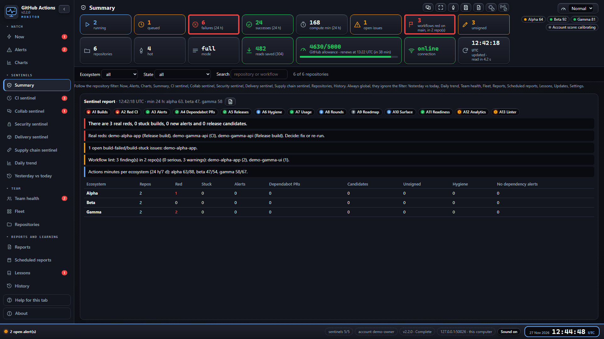</picture></p>
<p align="center"><picture><source media="(prefers-color-scheme: light)" srcset="docs/screenshots/web_sentinel_ci_light.png">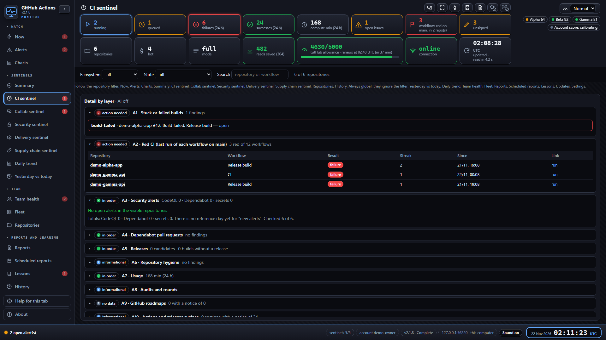</picture></p>
<p align="center"><picture><source media="(prefers-color-scheme: light)" srcset="docs/screenshots/web_sentinel_collab_light.png">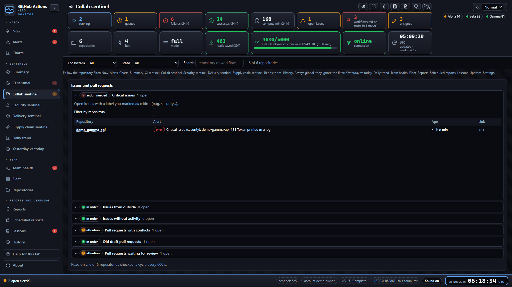</picture></p>
<p align="center"><picture><source media="(prefers-color-scheme: light)" srcset="docs/screenshots/web_sentinel_delivery_light.png">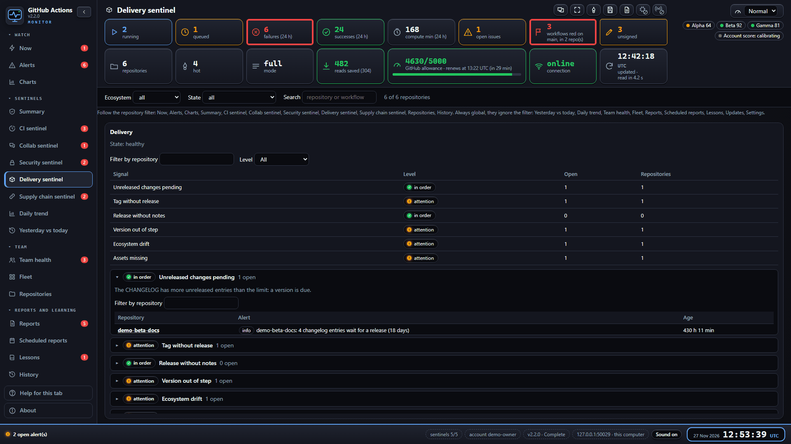</picture></p>
<p align="center"><picture><source media="(prefers-color-scheme: light)" srcset="docs/screenshots/web_sentinel_supply_light.png">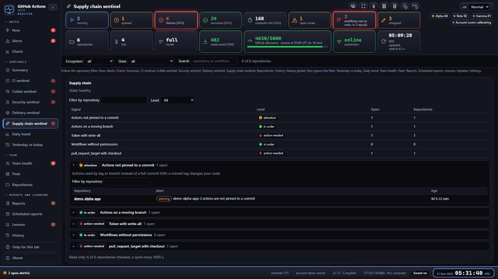</picture></p>
<p align="center"><picture><source media="(prefers-color-scheme: light)" srcset="docs/screenshots/web_sentinel_trend_light.png">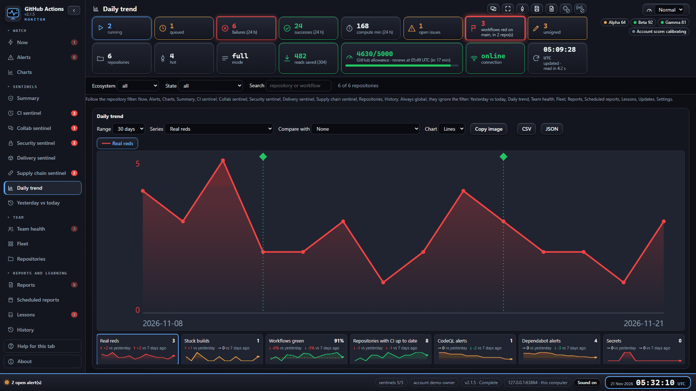</picture></p>
<p align="center"><picture><source media="(prefers-color-scheme: light)" srcset="docs/screenshots/web_fleet_light.png">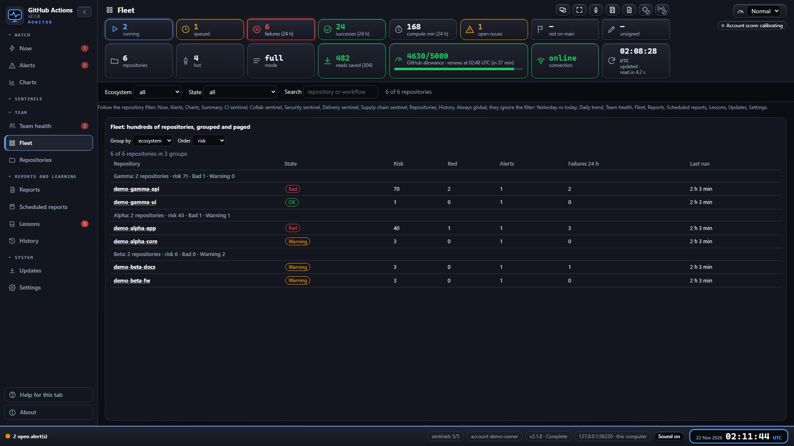</picture></p>
<p align="center"><picture><source media="(prefers-color-scheme: light)" srcset="docs/screenshots/web_reports_light.png">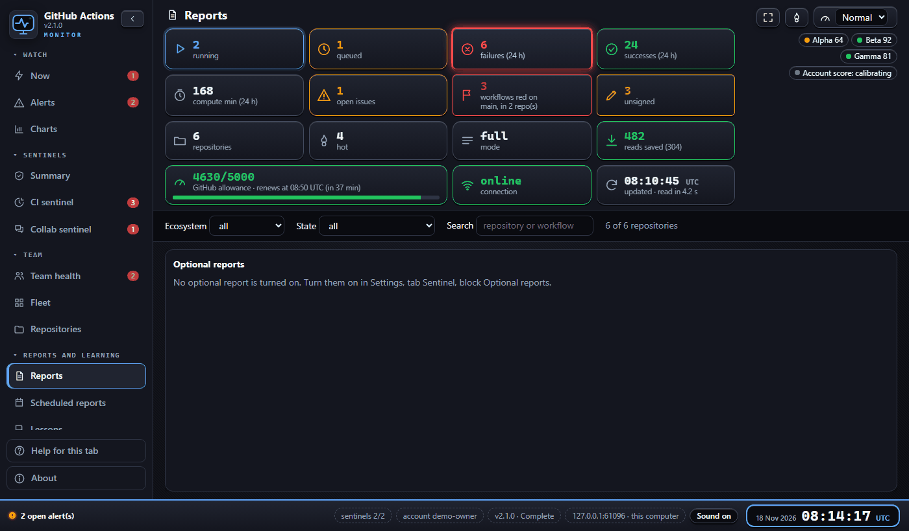</picture></p>
<p align="center">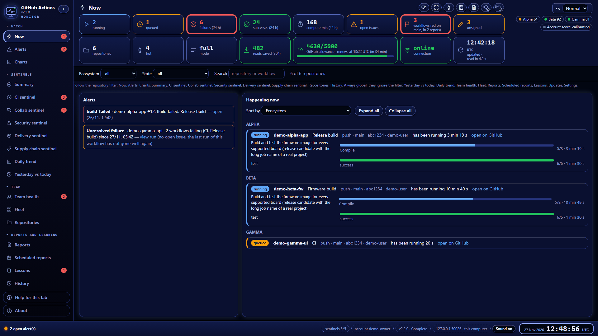</p>
<p align="center"></p>
<p align="center"></p>
<p align="center">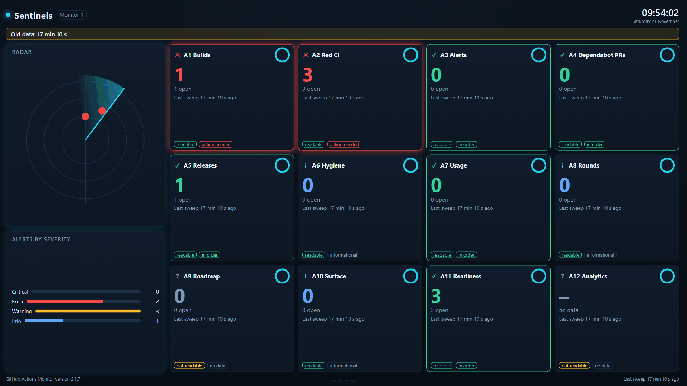</p>
<p align="center"></p>
<p align="center"></p>
<p align="center"><picture><source media="(prefers-color-scheme: light)" srcset="docs/screenshots/web_alerts_light.png"></picture></p>
<p align="center"><picture><source media="(prefers-color-scheme: light)" srcset="docs/screenshots/web_sentinel_light.png"></picture></p>
<p align="center"><picture><source media="(prefers-color-scheme: light)" srcset="docs/screenshots/web_sentinel_queue_light.png"></picture></p>
<p align="center"><picture><source media="(prefers-color-scheme: light)" srcset="docs/screenshots/web_sentinel_analytics_light.png"></picture></p>
<p align="center"><picture><source media="(prefers-color-scheme: light)" srcset="docs/screenshots/web_charts_light.png"></picture></p>
<p align="center"><picture><source media="(prefers-color-scheme: light)" srcset="docs/screenshots/web_compare_light.png">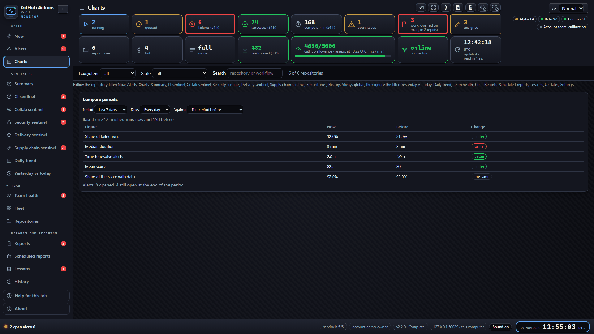</picture></p>
<p align="center"><picture><source media="(prefers-color-scheme: light)" srcset="docs/screenshots/web_repositories_light.png"></picture></p>
<p align="center"><picture><source media="(prefers-color-scheme: light)" srcset="docs/screenshots/web_team_light.png"></picture></p>
<p align="center"><picture><source media="(prefers-color-scheme: light)" srcset="docs/screenshots/web_history_light.png">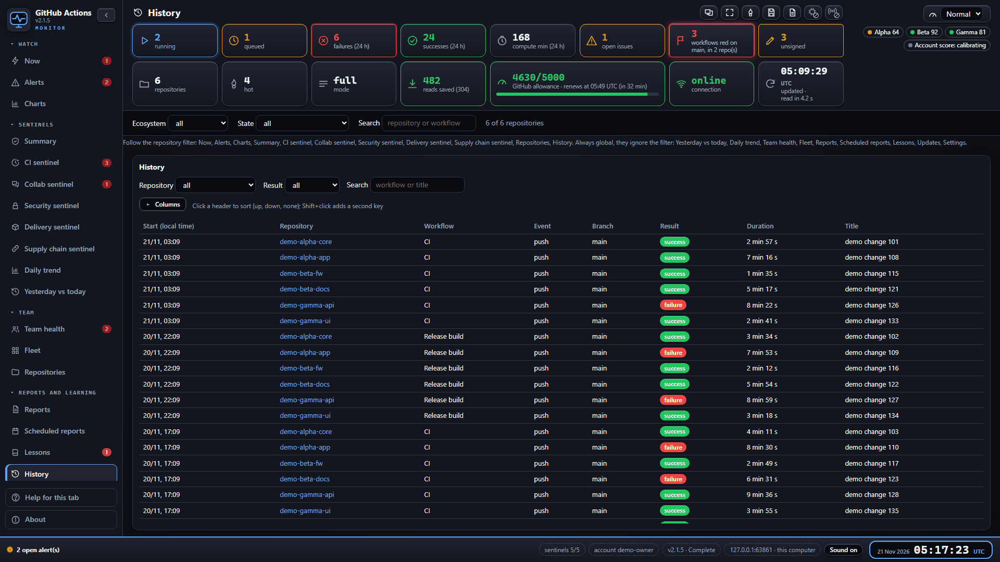</picture></p>

<p align="center"><picture><source media="(prefers-color-scheme: light)" srcset="docs/screenshots/web_about_light.png"></picture></p>
<p align="center">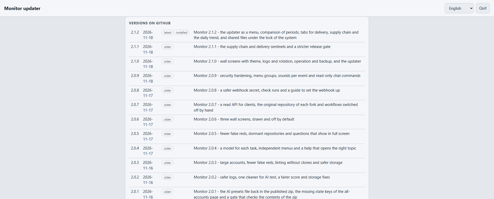</p>
<p align="center"><picture><source media="(prefers-color-scheme: light)" srcset="docs/screenshots/web_updates_light.png">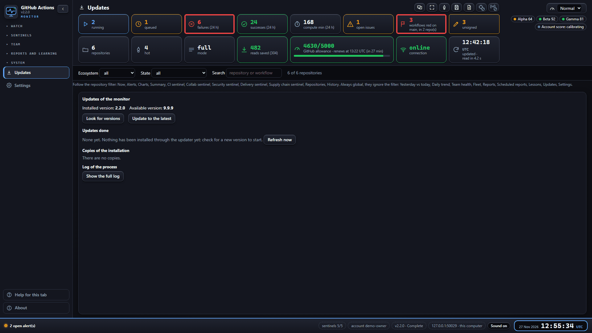</picture></p>
<p align="center"><picture><source media="(prefers-color-scheme: light)" srcset="docs/screenshots/web_help_light.png"></picture></p>
<p align="center"><picture><source media="(prefers-color-scheme: light)" srcset="docs/screenshots/web_settings_basic_light.png"></picture></p>
<p align="center"><picture><source media="(prefers-color-scheme: light)" srcset="docs/screenshots/web_network_now_light.png"></picture></p>
<p align="center"><picture><source media="(prefers-color-scheme: light)" srcset="docs/screenshots/web_network_notices_light.png"></picture></p>
<p align="center"><picture><source media="(prefers-color-scheme: light)" srcset="docs/screenshots/web_network_settings_light.png"></picture></p>
<p align="center"><picture><source media="(prefers-color-scheme: light)" srcset="docs/screenshots/web_accounts_all_light.png"></picture></p>
<p align="center"><picture><source media="(prefers-color-scheme: light)" srcset="docs/screenshots/web_accounts_one_light.png"></picture></p>
<p align="center"><picture><source media="(prefers-color-scheme: light)" srcset="docs/screenshots/web_accounts_live_light.png"></picture></p>

<details><summary><b>Settings, sub-tab by sub-tab</b></summary>

<p align="center"><picture><source media="(prefers-color-scheme: light)" srcset="docs/screenshots/web_settings_interface_light.png"></picture></p>
<p align="center"><picture><source media="(prefers-color-scheme: light)" srcset="docs/screenshots/web_settings_general_light.png"></picture></p>
<p align="center"><picture><source media="(prefers-color-scheme: light)" srcset="docs/screenshots/web_settings_polling_light.png"></picture></p>
<p align="center"><picture><source media="(prefers-color-scheme: light)" srcset="docs/screenshots/web_settings_cache_light.png">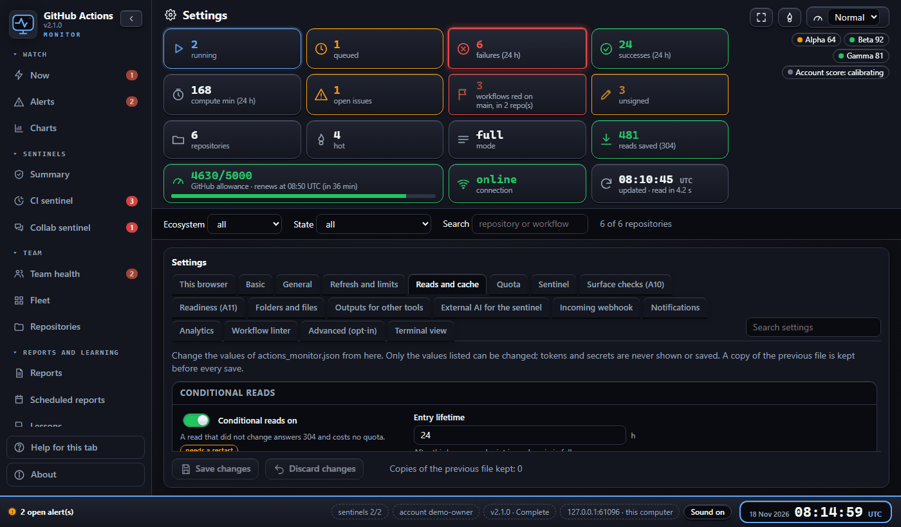</picture></p>
<p align="center"><picture><source media="(prefers-color-scheme: light)" srcset="docs/screenshots/web_settings_quota_light.png">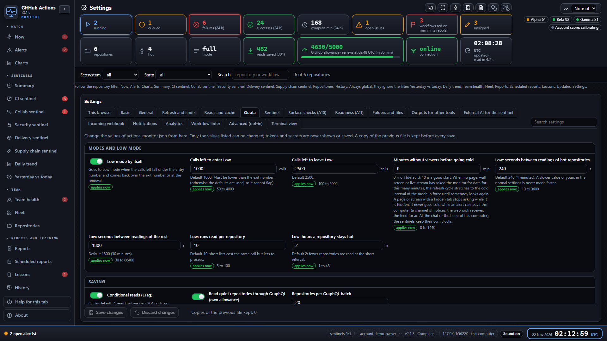</picture></p>
<p align="center"><picture><source media="(prefers-color-scheme: light)" srcset="docs/screenshots/web_settings_sentinel_light.png"></picture></p>
<p align="center"><picture><source media="(prefers-color-scheme: light)" srcset="docs/screenshots/web_settings_surface_light.png">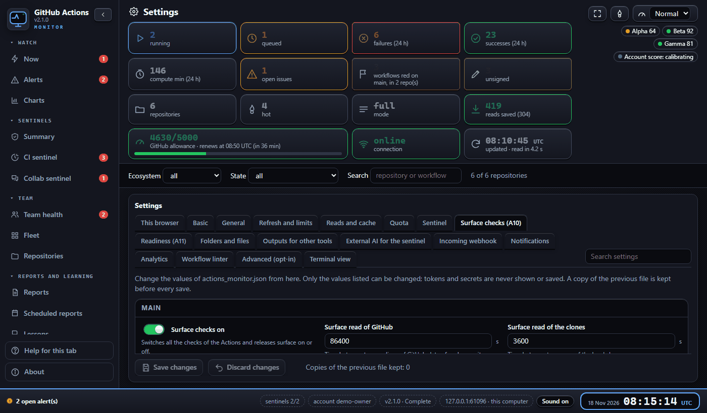</picture></p>
<p align="center"><picture><source media="(prefers-color-scheme: light)" srcset="docs/screenshots/web_settings_readiness_light.png"></picture></p>
<p align="center"><picture><source media="(prefers-color-scheme: light)" srcset="docs/screenshots/web_settings_paths_light.png"></picture></p>
<p align="center"><picture><source media="(prefers-color-scheme: light)" srcset="docs/screenshots/web_settings_outputs_light.png"></picture></p>
<p align="center"><picture><source media="(prefers-color-scheme: light)" srcset="docs/screenshots/web_settings_ai_light.png"></picture></p>
<p align="center"><picture><source media="(prefers-color-scheme: light)" srcset="docs/screenshots/web_settings_webhook_light.png"></picture></p>
<p align="center"><picture><source media="(prefers-color-scheme: light)" srcset="docs/screenshots/web_settings_notify_light.png"></picture></p>
<p align="center"><picture><source media="(prefers-color-scheme: light)" srcset="docs/screenshots/web_settings_analytics_light.png"></picture></p>
<p align="center"><picture><source media="(prefers-color-scheme: light)" srcset="docs/screenshots/web_settings_lint_light.png">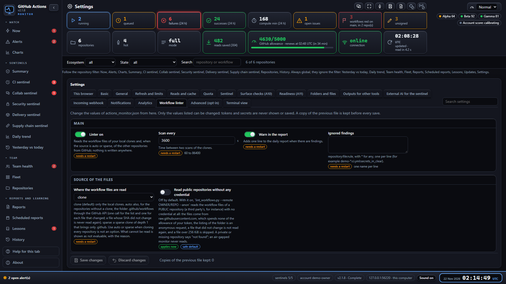</picture></p>
<p align="center"><picture><source media="(prefers-color-scheme: light)" srcset="docs/screenshots/web_settings_console_light.png"></picture></p>
<p align="center"><picture><source media="(prefers-color-scheme: light)" srcset="docs/screenshots/web_settings_advanced_light.png"></picture></p>

</details>

<details><summary><b>Console tools</b></summary>

<p align="center"><picture><source media="(prefers-color-scheme: light)" srcset="docs/screenshots/console_read_report_light.png"></picture></p>
<p align="center"><picture><source media="(prefers-color-scheme: light)" srcset="docs/screenshots/console_migrate_state_light.png"></picture></p>
<p align="center"><picture><source media="(prefers-color-scheme: light)" srcset="docs/screenshots/console_plan_light.png"></picture></p>
<p align="center"><picture><source media="(prefers-color-scheme: light)" srcset="docs/screenshots/console_lint_light.png"></picture></p>
<p align="center"><picture><source media="(prefers-color-scheme: light)" srcset="docs/screenshots/console_tui_light.png"></picture></p>

</details>

<details><summary><b>The lite edition</b></summary>

<p align="center"><picture><source media="(prefers-color-scheme: light)" srcset="docs/screenshots/web_lite_now_light.png"></picture></p>
<p align="center"><picture><source media="(prefers-color-scheme: light)" srcset="docs/screenshots/web_lite_charts_light.png"></picture></p>
<p align="center"><picture><source media="(prefers-color-scheme: light)" srcset="docs/screenshots/web_lite_history_light.png"></picture></p>
<p align="center"><picture><source media="(prefers-color-scheme: light)" srcset="docs/screenshots/web_lite_settings_light.png"></picture></p>

</details>

Each picture follows the light or dark theme of your GitHub page.

*Demo data: the repositories and names in the pictures are invented.*

## Settings

Everything lives in `actions_monitor.json` (created from `monitor/assets/examples/actions_monitor.example.json`). The **Settings** tab edits it safely; tokens and secrets are never shown or saved. Ecosystems, build targets and batch profiles are separate files you point to (`ecosystems_file`, `targets_file`, `profiles_file`); neutral `*.example.json` templates are included. Full reference: [`monitor/docs/SETTINGS.md`](monitor/docs/SETTINGS.md).

## Outputs for Grafana and dashboards

All off by default, local only (`127.0.0.1`) and with no extra token. When enabled in Settings you get `/metrics` (Prometheus format), `/api/outputs/grafana.json` and `/api/outputs/dashboard.json`, plus an importable Grafana dashboard in [`monitor/docs/grafana`](monitor/docs/grafana). Details: [`monitor/docs/OUTPUTS.md`](monitor/docs/OUTPUTS.md). The format of `ci_red.json`: [`monitor/docs/CI_RED_SCHEMA.md`](monitor/docs/CI_RED_SCHEMA.md).

## Security

- It listens on `127.0.0.1` only and refuses requests whose `Host` or `Origin` is not local. Never bind it to `0.0.0.0`: it has no login.
- It stores no token: it asks your own `gh` (unless you switch on the optional token of the monitor in Settings > Advanced).
- It writes nothing to GitHub on its own. Only `dispatch --go`, `dispatch --real` and `finalize --execute` write, and only when you run them.
- The network mode and the team mode are off by default; when they are on, the login, the roles, the lock-outs and the audit log protect the page, and every request is judged for one account only (`monitor/docs/DEPLOYMENT.md`, `monitor/docs/ACCOUNTS.md`).
- **Analytics**: p50 / p95 of the duration, of the queue time and of each step of every workflow, flaky workflows (failed, then passed on the same commit) and workflows that got slower; exported to Prometheus and Grafana.
- **Saves quota and survives a cut**: conditional reads (a 304 costs nothing) and a last-picture mode with an offline banner that resumes by itself.
- **Incoming webhook and notifications**: signed events update a repository in real time; optional messages to Telegram, Discord, Slack, Matrix, MQTT or a local address (never a write to GitHub).
- **Workflow linter and terminal view**: `bin/lint_workflows.py` checks `.github/workflows` before you push; `bin/tui.py` (optional, with `rich`) shows a live grid in the console.
- **AI assistant (off by default)**: summaries, triage and explanations with Ollama, an OpenAI-compatible service, Anthropic or `gh copilot`; commands only from a closed list, run only after you confirm each one.
- The settings page writes a fixed list of keys, validated, after saving a backup copy.

## Tests

They need no network and no extra package:

```
python -m unittest discover -s monitor/tests
```

## Repository structure

<p align="center"></p>

```
TOOLS-GITHUB-ACTIONS-MONITOR/
├── monitor/                            the program
├── docs/                               architecture, screenshots, roadmap
├── tools/                              pictures, guides and demo
├── deploy/                             image, compose, systemd
├── images/                             banner and pictures
├── .github/                            CI and issue forms
├── CHANGELOG.md                        changes per version
├── LICENSE NOTICE AUTHORS              licences and author
├── CONTRIBUTING.md SECURITY.md         how to help, report
├── SUPPORT.md CODE_OF_CONDUCT.md       support and conduct
└── monitor/
    ├── MONITOR_GITHUB_ACTIONS.*        the launchers (double click)
    ├── MONITOR_LITE_GITHUB_ACTIONS.*   the lite edition (no sentinel)
    ├── BATCH_GITHUB_ACTIONS.*          the batch tools menu
    ├── src/                            the importable package
    ├── assets/                         examples, the page, languages
    ├── bin/                            the short commands (read_report, monitor_cli ...)
    ├── tests/                          offline tests
    ├── docs/                           guides, quickstarts, schemas, Grafana
    ├── skills/                         the two skills for AIs
    └── tools/                          release and migration scripts
```

## Documentation

- [`monitor/docs/SETTINGS.md`](monitor/docs/SETTINGS.md): every setting
- [`monitor/docs/OUTPUTS.md`](monitor/docs/OUTPUTS.md): metrics, Grafana and exports
- [`monitor/docs/CI_RED_SCHEMA.md`](monitor/docs/CI_RED_SCHEMA.md): the format of ci_red.json
- [`monitor/docs/CI_RED_BRIDGE.md`](monitor/docs/CI_RED_BRIDGE.md): carrying ci_red.json to a dashboard
- [`monitor/docs/WEBHOOK.md`](monitor/docs/WEBHOOK.md): the incoming webhook
- [`monitor/docs/CHATOPS.md`](monitor/docs/CHATOPS.md): read-only chat commands for Slack and Discord
- [`monitor/docs/SOUNDS.md`](monitor/docs/SOUNDS.md): one sound for each kind of event
- [`monitor/docs/UPDATE.md`](monitor/docs/UPDATE.md): the updater: move to another version and migrate the configuration
- [`monitor/docs/OPS.md`](monitor/docs/OPS.md): Operating the installation: complete backup, restore, scheduled copy, purge on demand, the doctor and its exit codes, systemd and Docker appliance
- [`monitor/docs/LITE.md`](monitor/docs/LITE.md): The lite edition
- [`monitor/docs/COMPLETE_INDIVIDUAL.md`](monitor/docs/COMPLETE_INDIVIDUAL.md): Complete edition for one person
- [`monitor/docs/COMPLETE_SERVICE.md`](monitor/docs/COMPLETE_SERVICE.md): Complete edition as a service
- [`monitor/docs/COMPLETE_TEAM.md`](monitor/docs/COMPLETE_TEAM.md): Complete edition for a team
- [`monitor/docs/API.md`](monitor/docs/API.md): The API for clients
- [`monitor/docs/API_V1.md`](monitor/docs/API_V1.md): The read API v1, step by step
- [`monitor/docs/ASSISTANT.md`](monitor/docs/ASSISTANT.md): The assistant: fixed read-only questions to your AI
- [`monitor/docs/NOTIFICATIONS.md`](monitor/docs/NOTIFICATIONS.md): notifications and the adapter contract
- [`monitor/docs/SKILLS.md`](monitor/docs/SKILLS.md): the two skills for AIs, how they are made and how to install them
- [`monitor/docs/EXTRAS.md`](monitor/docs/EXTRAS.md): optional extras - the log of the failed step and a read-only token of the GitHub App
- [`monitor/docs/SCREENS.md`](monitor/docs/SCREENS.md): sizes, orientation and several screens
- [`monitor/docs/LESSONS.md`](monitor/docs/LESSONS.md): the book of failures, the library of lessons and the brief before a push
- [`monitor/docs/AI.md`](monitor/docs/AI.md): the AI assistant: providers, safety and actions
- [`monitor/docs/ANALYTICS.md`](monitor/docs/ANALYTICS.md): analytics, conditional reads and the lost connection
- [`monitor/docs/CONSOLE_TOOLS.md`](monitor/docs/CONSOLE_TOOLS.md): the workflow linter and the terminal view
- [`monitor/docs/DEPLOYMENT.md`](monitor/docs/DEPLOYMENT.md): running it as a service (the official image, Compose, systemd), behind a proxy, when GitHub revokes the login, permissions
- [`monitor/docs/LAYOUT.md`](monitor/docs/LAYOUT.md): the folders of the monitor, the move from 1.8.1 and the map for the AIs
- [`monitor/docs/QUICKSTART_en.txt`](monitor/docs/QUICKSTART_en.txt): first steps, in eight languages
- [`monitor/docs/FIRST_STEPS.md`](monitor/docs/FIRST_STEPS.md): your first five minutes
- [`monitor/docs/SENTINEL.md`](monitor/docs/SENTINEL.md): the sentinel and its checks A1-A13
- [`monitor/docs/COLLAB.md`](monitor/docs/COLLAB.md): the Collab sentinel, the Alerts tab and the silences
- [`monitor/docs/SENTINEL_SECURITY.md`](monitor/docs/SENTINEL_SECURITY.md): The Security sentinel: Dependabot, code scanning, secrets, branch protection, workflow permissions and CODEOWNERS, and what it could not check
- [`monitor/docs/SENTINEL_SUPPLY.md`](monitor/docs/SENTINEL_SUPPLY.md): The Supply chain sentinel: unpinned actions, moving branches, wide or missing workflow permissions and pull_request_target with a checkout, and what it could not read
- [`monitor/docs/SENTINEL_DELIVERY.md`](monitor/docs/SENTINEL_DELIVERY.md): The Delivery sentinel: unreleased entries, tags without a release, releases without notes or files, versions that disagree and pins behind a shared contract, and what it could not read
- [`monitor/docs/AUDIT_LOG.md`](monitor/docs/AUDIT_LOG.md): The log of actions: who changed what, the chain of hashes, who reads it and the settings
- [`monitor/docs/HEALTH.md`](monitor/docs/HEALTH.md): The health of a repository and of the team: what it is made of, the Team tab, the deep links and the API
- [`monitor/docs/REPORT_SCHEDULE.md`](monitor/docs/REPORT_SCHEDULE.md): Scheduled reports: the score, what changed, the repositories that need a person and the open alerts as HTML and Markdown, the schedule and the files
- [`monitor/docs/CLI.md`](monitor/docs/CLI.md): the command line as a client of the monitor
- [`monitor/docs/ACCOUNTS.md`](monitor/docs/ACCOUNTS.md): several accounts, one process each
- [`monitor/docs/QUOTAS.md`](monitor/docs/QUOTAS.md): quotas and plans of GitHub
- [`monitor/docs/MODES.md`](monitor/docs/MODES.md): working modes: normal, fast and turbo
- [`monitor/docs/AI_CONNECTION.md`](monitor/docs/AI_CONNECTION.md): Connect an AI tool: everything the monitor says, as signals, in the brief, the endpoint, the MCP tools and the hook
- [`monitor/docs/AI_SETUP_PROMPT.md`](monitor/docs/AI_SETUP_PROMPT.md): Set up the monitor with an AI: a prompt to paste into your AI assistant that installs it, asks what you want and writes the configuration
- [`monitor/docs/QUOTA.md`](monitor/docs/QUOTA.md): More quota, less spending: Low mode, the central panel, a GitHub App and how to share the allowance
- [`monitor/docs/SCORE.md`](monitor/docs/SCORE.md): The score of an account: parts, states, API, the chip in the header, the alert and the settings
- [`monitor/docs/COMPARE.md`](monitor/docs/COMPARE.md): Comparing periods: this period against the one before, the figures, the calendar filter, the states without a number, the API, the command and the settings
- [`monitor/docs/STORAGE.md`](monitor/docs/STORAGE.md): Storage and retention: files or SQLite, backup, migration and what is kept
- [`monitor/docs/ADVANCED.md`](monitor/docs/ADVANCED.md): Advanced features (all off by default)
- [`monitor/docs/AI_ALERTS.md`](monitor/docs/AI_ALERTS.md): Alerts for AIs: the feed, the brief, the hook and the stream
- [`monitor/docs/AUDIT_PACKAGE.md`](monitor/docs/AUDIT_PACKAGE.md): Package for the auditor
- [`monitor/docs/LARGE_ACCOUNTS.md`](monitor/docs/LARGE_ACCOUNTS.md): Large accounts: hundreds of repositories
- [`monitor/docs/ORGANIZATIONS.md`](monitor/docs/ORGANIZATIONS.md): Organizations and big accounts
- [`monitor/docs/PRODUCTIVITY.md`](monitor/docs/PRODUCTIVITY.md): what the monitor saves: an estimate, its assumptions and how to measure it

## Contributing

Read [CONTRIBUTING.md](CONTRIBUTING.md). Report bugs and ideas with the issue forms; report security problems as described in [SECURITY.md](SECURITY.md).

## Author

Written by **JuanenRac (Electro Hobby 3D)** · electrohobby3d@gmail.com

## License

The code is GPL-3.0-or-later; the documentation is CC BY-SA 4.0. See [LICENSE](LICENSE) and [NOTICE](NOTICE).
