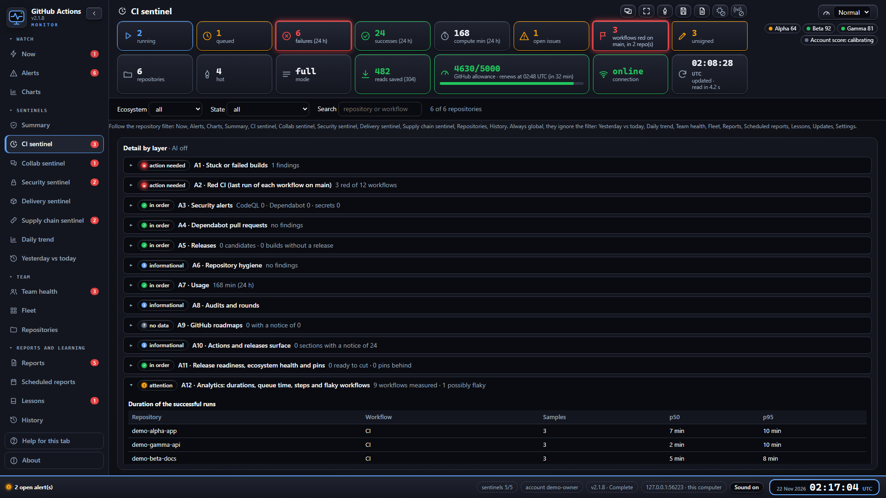
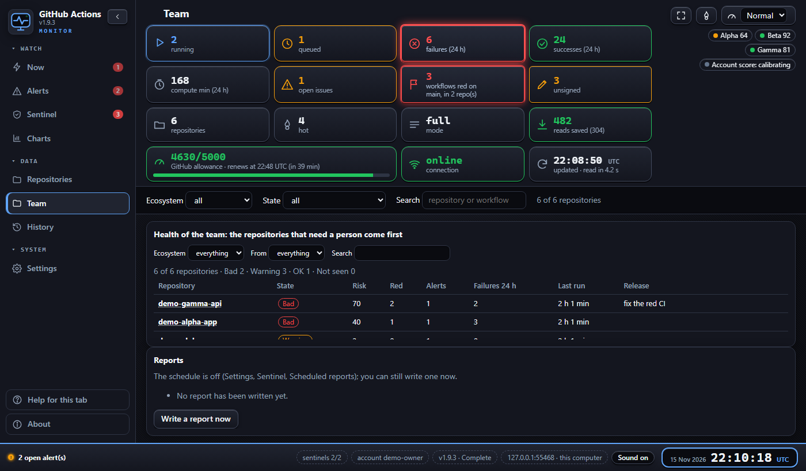
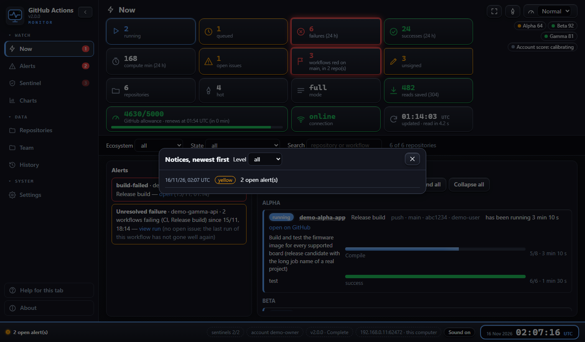
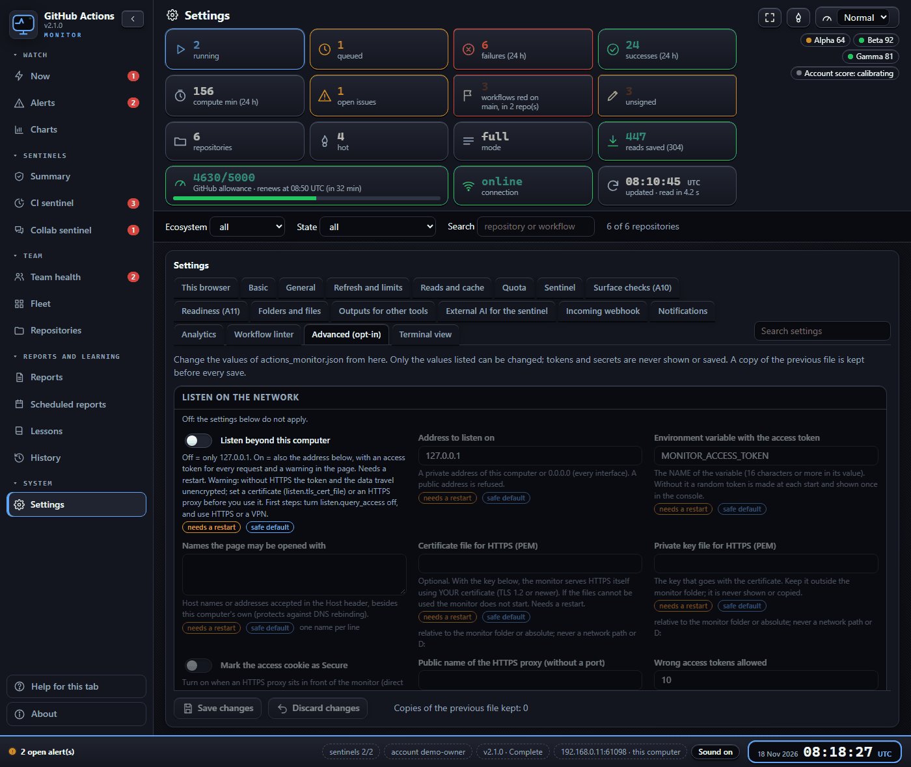
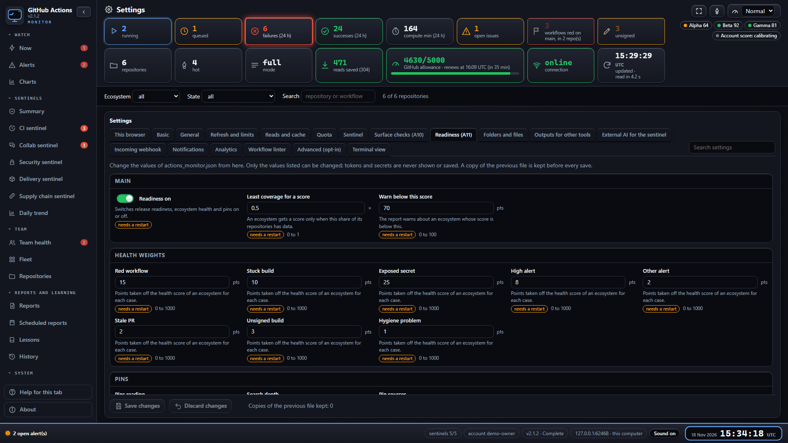
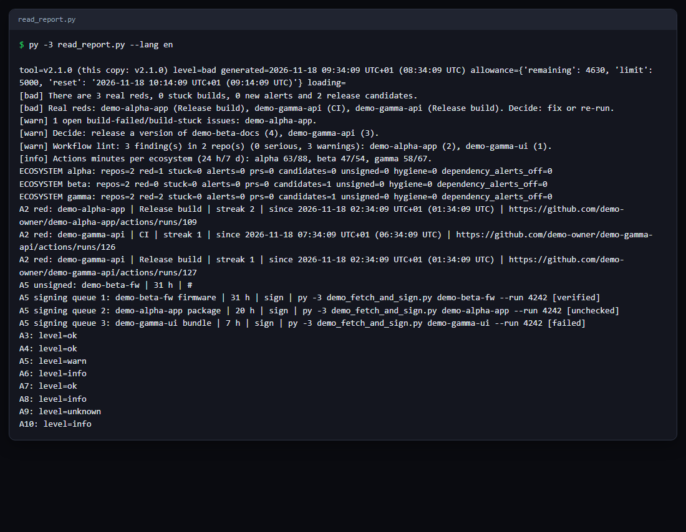

<p align="center">
  
</p>

# GitHub Actions Monitor

<p align="center">
  <a href="README.md">🇺🇸 English</a> |
  <a href="README_spa.md">🇪🇸 Español</a> |
  <b>🇫🇷 Français</b> |
  <a href="README_ita.md">🇮🇹 Italiano</a> |
  <a href="README_deu.md">🇩🇪 Deutsch</a> |
  <a href="README_zho.md">🇨🇳 简体中文</a> |
  <a href="README_jpn.md">🇯🇵 日本語</a> |
  <a href="README_por.md">🇵🇹 Português</a>
</p>

<p align="center">
  <a href="https://github.com/JuanenRac/TOOLS-GITHUB-ACTIONS-MONITOR/releases/latest"></a>
  
  
  
  
  
</p>

> Surveille les workflows de tous vos dépôts et vous dit, sur une page locale, ce qui est rouge, ce qui est bloqué et ce qui vous attend.

**GitHub Actions Monitor** est un petit programme qui tourne sur votre propre ordinateur. Il interroge GitHub, avec votre propre connexion `gh`, sur les dernières exécutions de chaque workflow de vos dépôts, décide ce qui est vraiment rouge, signale l'important (sécurité, hygiène, versions prêtes, quota) et affiche tout sur une page web que seul votre ordinateur peut ouvrir. Il ne demande que Python et `gh`, ne stocke jamais de jeton et, par défaut, il ne fait que lire.

## Ce que c'est

- **Un veilleur pour vos GitHub Actions** : avec votre propre connexion `gh`, il lit les dernières exécutions de chaque workflow de chacun de vos dépôts et décide ce qui est rouge, ce qui est bloqué et ce qui vous attend.
- **Trois sentinelles qui n'écrivent jamais sur GitHub** : CI (exécutions et workflows), Collab (issues et pull requests qui demandent une personne) et Security (Dependabot, analyse du code, analyse des secrets, protection des branches) transforment ce qu'elles lisent en alertes d'une seule liste.
- **Une page, plusieurs façons de la voir** : une page locale sur `127.0.0.1` qui s'adapte d'un téléphone à un écran mural 4K (jusqu'à trois écrans à la fois), un client en ligne de commande, une vue dans le terminal, des fichiers et un point d'accès pour vos propres tableaux de bord.
- **Deux éditions** : Lite est pour une personne et n'affiche que les exécutions ; Complete ajoute plusieurs comptes, une équipe avec des rôles, une note, la santé de chaque dépôt, des rapports et un service pour Docker.
- **Privé par conception** : rien ne quitte votre ordinateur sauf les appels à GitHub faits avec votre connexion ; la clé d'une IA facultative reste dans une variable d'environnement ; on n'écrit sur GitHub qu'avec les commandes par lots que vous lancez avec un `--go` explicite.

## Ce qu'il fait

- **Rouge ou non, avec une seule règle** : la dernière exécution terminée de chaque workflow sur la branche par défaut. Les exécutions annulées ou ignorées ne masquent jamais un échec antérieur.
- **Sentinelle** : alertes de sécurité, hygiène des dépôts, pull requests anciennes, versions prêtes à publier, builds en attente de signature et rapport en langage clair.
- **Sentinelle Collab et une seule liste d'alertes** : issues et pull requests ouvertes qui demandent une personne (oubliées, critiques, revues en attente, vieux brouillons, conflits), en lecture seule et sur une horloge propre, et un onglet Alertes avec toutes les sentinelles dans une liste, un filtre par origine et des mises en sourdine locales qui se terminent seules.
- **Une barre d'état, le plein écran et des tableaux triables** : l'avis le plus important (et une fenêtre avec tous), la connexion, le quota, la dernière lecture, le mode, l'adresse et l'horloge au pied de la page ; un bouton plein écran ; Dépôts et Historique se trient selon une ou plusieurs colonnes, avec les colonnes de votre choix.
- **La ligne de commande comme client** : `bin/monitor_cli.py` (`status`, `health`, `alerts`, `accounts`, `live`, `doctor`, `score`) lit ce que dit le moniteur en marche, avec `--json` et des codes de sortie stables ; elle n'écrit jamais sur GitHub.
- **Deux skills pour les IA** : de courts guides, en anglais, pour l'IA intégrée au moniteur (locale ou d'un fournisseur) et pour les IA qui lui parlent de l'extérieur (ligne de commande, HTTP ou fichiers seuls, MCP, flux), générés depuis le code pour que rien ne manque ; installés avec `python bin/monitor_cli.py install-skill internal|external --dest DOSSIER` ou copiés depuis l'onglet IA des Réglages (`monitor/docs/SKILLS_fra.md`).
- **Échecs et leçons** : un livre local des échecs de votre CI, des règles qui rangent chacun dans une catégorie, une bibliothèque de leçons (`monitor/docs/LESSONS_fra.md`) avec la garde qui l'aurait évité, la tendance sur 24 heures et 7 jours, `ai/LESSONS.md`, `/api/ai/lessons` et un bref avant push pour tout outil d'IA ; lecture seule, rien ne quitte l'ordinateur.
- **Toutes les tailles d'écran et plusieurs écrans** : la page s'adapte à une fenêtre du téléphone jusqu'à la 4K, droite ou tournée, et un moniteur peut servir jusqu'à trois écrans (`/screen/1` à `/screen/3`), chacun avec ses onglets et son orientation (`monitor/docs/SCREENS_fra.md`).
- **Un score par compte** : un nombre de 0 à 100, une lettre de A à E et une tendance, construits à partir de la fiabilité de la CI, de sa rapidité, du temps de rétablissement et de la vitesse à laquelle les alertes de collaboration sont closes ; il dit « calibrage » ou « données insuffisantes » plutôt qu'un nombre qu'il ne peut pas justifier, montre ce qu'il ne couvre pas encore, se trouve dans l'en-tête de la page, a une commande `score`, prévient quand il baisse et figure dans les métriques et le serveur MCP (`monitor/docs/SCORE.md`).
- **Une sentinelle de sécurité (Complete seulement, désactivée par défaut)** : elle lit, sans rien écrire dans GitHub, les alertes ouvertes de Dependabot, de l'analyse de code et de la détection de secrets, si la branche par défaut est protégée, la permission par défaut des workflows et, sur demande, les propriétaires du code ; elle lève une alerte par dépôt et par signal, compte les constats comme cinquième partie du score et dit ce qu'elle n'a pas pu lire (`monitor/docs/SENTINEL_SECURITY_fra.md`).
- **La santé de chaque dépôt et de l'équipe (Complete seulement)** : CI, alertes des trois sentinelles, préparation des versions et activité en un état (mauvais, avertissement, bon ou non vu) avec un nombre de risque ; l'onglet Équipe classe d'abord les dépôts qui demandent une personne, avec des filtres, un détail pour chacun et des liens directs pour écrans muraux ; les mêmes données sont à `/api/team/health`, `/api/repos/<owner>/<repo>/health` et dans la commande `team` (`monitor/docs/HEALTH_fra.md`).
- **Rapports, journal des actions et Apprise (Complete seulement)** : un rapport du compte (score, changements, dépôts qui demandent une personne, alertes ouvertes) écrit en HTML et Markdown selon un horaire cron ou à la demande, désactivé par défaut (`monitor/docs/REPORT_SCHEDULE_fra.md`) ; un journal de qui a changé quoi, avec une chaîne de hachages et sans valeur ni secret (`monitor/docs/AUDIT_LOG_fra.md`) ; et un canal Apprise facultatif pour les notifications, désactivé par défaut.
- **En tant que service** : l'image Docker officielle (sans root, en lecture seule), un fichier Compose avec proxy facultatif, une unité systemd, un contrôle de santé approfondi et la commande qui crée le premier administrateur (`monitor/docs/DEPLOYMENT.md`).
- **Une API figée et un guide pour chaque usage** : depuis la 2.0.0 la forme de chaque point d'accès en lecture et les codes d'erreur sont fixés dans `monitor/docs/schemas/api_contract.json`, un outil vérifie n'importe quel moniteur en marche contre ce contrat (`monitor/tools/check_api_contract.py`) et un guide court existe pour l'édition lite, pour une personne, pour un service et pour une équipe (`monitor/docs/API_fra.md`).
- **Plusieurs comptes, une équipe et un endroit pour les données** : un processus par compte, des utilisateurs avec des rôles et leurs propres comptes, les fichiers dans `config/`, `data/`, `logs/` et `ai/`, un stockage SQLite facultatif avec conservation et sauvegarde, et les ports comme réglages (`monitor/docs/ACCOUNTS.md`, `monitor/docs/STORAGE.md`, `monitor/docs/LAYOUT.md`).
- **Des listes que l'on trie et que l'on plie** : « En cours » de sept façons et l'onglet Alertes de neuf, avec un bouton pour plier ou déplier tous les dépôts ; le choix est retenu pour chaque utilisateur.
- **Notifications pour chaque utilisateur** : en mode équipe, chaque utilisateur choisit dans un panneau de la page les canaux (ntfy, Teams, e-mail), le niveau minimal et les résumés (`monitor/docs/NOTIFICATIONS_fra.md`).
- **Page de réglages** : modifiez chemins, intervalles, quotas et interrupteurs depuis le navigateur ; seulement une liste fixe de clés validées, avec sauvegarde avant chaque enregistrement.
- **Graphiques et historique** : minutes de calcul, échecs et succès avec des barres animées et un historique quotidien (respecte la réduction des animations).
- **Huit langues** (en, es, de, fr, it, ja, zh, pt) avec l'anglais comme base ; changement dans les réglages.
- **Sorties pour tableaux de bord** : `ci_red.json`, un point d'accès Prometheus et une source JSON pour Grafana, avec un tableau Grafana importable.
- **Outils par lots** : planifient et lancent plusieurs builds à la fois ; rien n'est lancé sans `--go`.
- **À propos et Aide dans la page** : le bouton **i** montre la version, l'édition, les liens, les fichiers, l'état de santé et un bouton qui copie les informations pour le support ; le bouton **?** (ou la touche `?`) ouvre toute la documentation, avec recherche et dans votre langue, sans Internet. La console offre `--about` et `--help-topics`, et une application interactive de terminal par onglets (`textual` facultatif).
- **Avis de nouvelle version** : un badge discret quand une version plus récente est publiée ; il ne lit la page publique des versions qu'une fois par jour, n'installe jamais rien et peut être désactivé (toujours désactivé sur une installation isolée).
- **Quotas pour tout compte** : offre, minutes facturables (les dépôts publics ne coûtent rien), quota de l'API lu dans les en-têtes de GitHub, concurrence et jobs proches de la limite de 6 heures ; les chiffres sont dans un fichier modifiable.

## En un coup d'œil

| | |
|---|---|
| **Version** | **2.0.9** · [toutes les versions](https://github.com/JuanenRac/TOOLS-GITHUB-ACTIONS-MONITOR/releases) |
| **Prérequis** | Python 3.11+ et la CLI GitHub (`gh auth login`) ; rien d'autre (la vue console utilise le paquet optionnel `rich`) |
| **S'ouvre** | sur une page `127.0.0.1` uniquement, en huit langues |
| **Écrit sur GitHub** | jamais seul : seulement les commandes par lots que vous lancez avec un `--go` explicite |
| **Exporte** | `ci_red.json`, des métriques Prometheus et du JSON pour Grafana (tout désactivé tant que vous ne l'activez pas) |

<!-- glance:begin -->

**Mesuré aujourd'hui** (v2.0.9)

| | |
|---|---|
| **Maturité** | functional |
| **Tests** | 3695 méthodes de test (`python -m unittest discover -s monitor/tests`) |
| **Réglages** | 607 réglages, tous avec aide |
| **Langues** | 8 (anglais, espagnol, allemand, français, italien, japonais, chinois et portugais) |
| **Testé dans le CI sur** | ubuntu, windows, Python 3.11, 3.13 |

## État du projet

Chaque ligne est une partie de ce dépôt et le voyant dit où elle en est aujourd'hui : ce que les tests et le CI peuvent montrer et ce qui a tourné pour de vrai, pas ce qui est prévu.

🟢 Fait et vérifié · 🟡 Fonctionne, avec des limites connues · 🟠 En partie fait ou pas encore vérifié · 🔴 Pas fait ou ne fonctionne pas

| Domaine | État | Ce que cela veut dire ici |
|---|---|---|
| Moniteur et page | 🟢 | Tourne chaque jour sur un vrai compte ; les tests tournent dans le CI sous Ubuntu et Windows. |
| Sentinelle (A1..A13) | 🟢 | Tourne chaque jour sur un vrai compte ; ses niveaux et lignes sont testés avec des fixtures. |
| Notifications | 🟡 | Testées contre des serveurs simulés ; tous les canaux n'ont pas été essayés avec le vrai service. |
| Connexion à un outil d'IA et MCP | 🟡 | Le flux, l'état, le flux en direct, le hook et les outils MCP sont testés avec un vrai serveur et un client simulé ; aucun utilisateur indépendant ne les a encore utilisés. |
| Édition lite | 🟡 | Testée dans le CI et partage les canaux et réglages de la complète ; peu d'usage réel jusqu'ici. |
| GitHub App, panneau central et mode économe | 🟠 | Nouveau : testé avec des serveurs et fichiers simulés ; pas encore tourné longtemps avec le vrai service. |
| Score de chaque compte | 🟡 | Testé avec des séries synthétiques, des jeux d'essai et des serveurs simulés ; il n'a pas encore été observé pendant des semaines sur de vrais comptes. |
| Image Docker et mode service | 🟡 | L'image est construite et testée dans la CI (sans root, en lecture seule, avec une connexion révoquée) ; encore peu de temps comme service de longue durée. |
| Mode équipe et plusieurs comptes | 🟡 | Testé avec de vrais processus et des utilisateurs simulés ; une vraie équipe ne l'a pas utilisé longtemps. |
| Stockage (fichiers et SQLite) | 🟡 | Testé avec les deux supports et les migrations entre eux ; une base de données de plusieurs mois n'a pas encore connu de mise à jour. |
| Linux et macOS | 🟠 | Linux n'est testé que dans le CI ; macOS n'est pas testé dans le CI pour l'instant ; l'usage quotidien est sous Windows. |

<!-- glance:end -->

## Architecture

<p align="center"></p>

## Commencez ici : quelle édition ?

| Si vous voulez... | Démarrage | Port |
|---|---|---|
| voir ce qui tourne et ce qui échoue, rien de plus (**commencez ici**) | `MONITOR_LITE_GITHUB_ACTIONS` | 8766 |
| tout le compte surveillé pour vous : alertes, releases, signature, préparation, analytique | `MONITOR_GITHUB_ACTIONS` (avec la [sentinelle](monitor/docs/SENTINEL_fra.md)) | 8765 |

La fenêtre de console indique laquelle tourne, dans son titre et sa première ligne. Encore un doute ? `python bin/actions_monitor.py --demo` ouvre la page avec des données inventées et `--doctor` vérifie votre installation. [Vos cinq premières minutes](monitor/docs/FIRST_STEPS_fra.md)

## Démarrage rapide

1. Installez Python 3.11 ou plus récent et la [CLI GitHub](https://cli.github.com/), puis lancez `gh auth login`.
2. Téléchargez ce dépôt (ou le zip de la dernière release) et ouvrez le dossier `monitor`.
3. Démarrez-le : Windows `MONITOR_GITHUB_ACTIONS.bat`, Linux `./MONITOR_GITHUB_ACTIONS.sh`, macOS double-clic sur `MONITOR_GITHUB_ACTIONS.command`, ou `python bin/actions_monitor.py` partout.
4. Ouvrez l'adresse affichée (`http://127.0.0.1:<port>`). Au premier démarrage, il crée `actions_monitor.json` à partir de l'exemple.
5. Ouvrez **Réglages** pour indiquer votre compte GitHub, les écosystèmes (groupes de dépôts par préfixe de nom) et le reste.

> Vous mettez à jour depuis une version antérieure à la 1.5.0 ? [`monitor/docs/MIGRATING_fra.md`](monitor/docs/MIGRATING_fra.md)

## L'édition lite

Un second produit, plus simple, dans le même paquet : la page de ce qui tourne et de ce qui échoue, sans la sentinelle. Pour qui veut seulement surveiller ses runs.

|  | Complète | Lite |
|---|---|---|
| Démarrage | `MONITOR_GITHUB_ACTIONS` (`.bat` / `.sh` / `.command`) | `MONITOR_LITE_GITHUB_ACTIONS` (les trois mêmes) |
| Port | 8765 | 8766 |
| Onglets | Maintenant, Sentinelle, Graphiques, Dépôts, Historique, Réglages | Maintenant, Graphiques, Dépôts, Historique, des Réglages courts |
| En-tête | toutes les tuiles, préparation, signature | en cours, en file, échecs et succès de 24 h, minutes de calcul, issues, rouges sur main, dépôts, quota, connexion |
| Sentinelle (alertes, releases, file de signature, préparation, linter) | oui | non : elle n'est même pas importée |
| Analyses, notifications, webhook, IA, sorties Prometheus / Grafana | oui, désactivés tant que vous ne les activez pas | non : ces chemins répondent 404 |
| Configuration | `actions_monitor.json` | `actions_monitor_lite.json` (créé au premier démarrage ; la sentinelle y est désactivée) |
| Fichiers d'état | `etag_cache.json`, `analytics_history.json`... | les mêmes noms avec le suffixe `_lite` |

[`monitor/docs/LITE_fra.md`](monitor/docs/LITE_fra.md)

## Captures d'écran

### La page

<p align="center"><picture><source media="(prefers-color-scheme: light)" srcset="docs/screenshots/web_now_light.png"></picture></p>
<p align="center"></p>
<p align="center"></p>
<p align="center"></p>
<p align="center"><picture><source media="(prefers-color-scheme: light)" srcset="docs/screenshots/web_alerts_light.png"></picture></p>
<p align="center"><picture><source media="(prefers-color-scheme: light)" srcset="docs/screenshots/web_sentinel_light.png"></picture></p>
<p align="center"><picture><source media="(prefers-color-scheme: light)" srcset="docs/screenshots/web_sentinel_queue_light.png"></picture></p>
<p align="center"><picture><source media="(prefers-color-scheme: light)" srcset="docs/screenshots/web_sentinel_analytics_light.png"></picture></p>
<p align="center"><picture><source media="(prefers-color-scheme: light)" srcset="docs/screenshots/web_charts_light.png"></picture></p>
<p align="center"><picture><source media="(prefers-color-scheme: light)" srcset="docs/screenshots/web_repositories_light.png"></picture></p>
<p align="center"><picture><source media="(prefers-color-scheme: light)" srcset="docs/screenshots/web_team_light.png"></picture></p>
<p align="center"><picture><source media="(prefers-color-scheme: light)" srcset="docs/screenshots/web_history_light.png"></picture></p>

<p align="center"><picture><source media="(prefers-color-scheme: light)" srcset="docs/screenshots/web_about_light.png"></picture></p>
<p align="center"><picture><source media="(prefers-color-scheme: light)" srcset="docs/screenshots/web_help_light.png"></picture></p>
<p align="center"><picture><source media="(prefers-color-scheme: light)" srcset="docs/screenshots/web_settings_basic_light.png"></picture></p>
<p align="center"><picture><source media="(prefers-color-scheme: light)" srcset="docs/screenshots/web_network_now_light.png"></picture></p>
<p align="center"><picture><source media="(prefers-color-scheme: light)" srcset="docs/screenshots/web_network_notices_light.png"></picture></p>
<p align="center"><picture><source media="(prefers-color-scheme: light)" srcset="docs/screenshots/web_network_settings_light.png"></picture></p>
<p align="center"><picture><source media="(prefers-color-scheme: light)" srcset="docs/screenshots/web_accounts_all_light.png"></picture></p>
<p align="center"><picture><source media="(prefers-color-scheme: light)" srcset="docs/screenshots/web_accounts_one_light.png"></picture></p>
<p align="center"><picture><source media="(prefers-color-scheme: light)" srcset="docs/screenshots/web_accounts_live_light.png"></picture></p>

<details><summary><b>Réglages, sous-onglet par sous-onglet</b></summary>

<p align="center"><picture><source media="(prefers-color-scheme: light)" srcset="docs/screenshots/web_settings_interface_light.png"></picture></p>
<p align="center"><picture><source media="(prefers-color-scheme: light)" srcset="docs/screenshots/web_settings_general_light.png"></picture></p>
<p align="center"><picture><source media="(prefers-color-scheme: light)" srcset="docs/screenshots/web_settings_polling_light.png"></picture></p>
<p align="center"><picture><source media="(prefers-color-scheme: light)" srcset="docs/screenshots/web_settings_cache_light.png"></picture></p>
<p align="center"><picture><source media="(prefers-color-scheme: light)" srcset="docs/screenshots/web_settings_sentinel_light.png"></picture></p>
<p align="center"><picture><source media="(prefers-color-scheme: light)" srcset="docs/screenshots/web_settings_surface_light.png"></picture></p>
<p align="center"><picture><source media="(prefers-color-scheme: light)" srcset="docs/screenshots/web_settings_readiness_light.png"></picture></p>
<p align="center"><picture><source media="(prefers-color-scheme: light)" srcset="docs/screenshots/web_settings_paths_light.png"></picture></p>
<p align="center"><picture><source media="(prefers-color-scheme: light)" srcset="docs/screenshots/web_settings_outputs_light.png"></picture></p>
<p align="center"><picture><source media="(prefers-color-scheme: light)" srcset="docs/screenshots/web_settings_ai_light.png"></picture></p>
<p align="center"><picture><source media="(prefers-color-scheme: light)" srcset="docs/screenshots/web_settings_webhook_light.png"></picture></p>
<p align="center"><picture><source media="(prefers-color-scheme: light)" srcset="docs/screenshots/web_settings_notify_light.png"></picture></p>
<p align="center"><picture><source media="(prefers-color-scheme: light)" srcset="docs/screenshots/web_settings_analytics_light.png"></picture></p>
<p align="center"><picture><source media="(prefers-color-scheme: light)" srcset="docs/screenshots/web_settings_lint_light.png"></picture></p>
<p align="center"><picture><source media="(prefers-color-scheme: light)" srcset="docs/screenshots/web_settings_console_light.png"></picture></p>
<p align="center"><picture><source media="(prefers-color-scheme: light)" srcset="docs/screenshots/web_settings_advanced_light.png"></picture></p>

</details>

<details><summary><b>Outils console</b></summary>

<p align="center"><picture><source media="(prefers-color-scheme: light)" srcset="docs/screenshots/console_read_report_light.png"></picture></p>
<p align="center"><picture><source media="(prefers-color-scheme: light)" srcset="docs/screenshots/console_migrate_state_light.png"></picture></p>
<p align="center"><picture><source media="(prefers-color-scheme: light)" srcset="docs/screenshots/console_plan_light.png"></picture></p>
<p align="center"><picture><source media="(prefers-color-scheme: light)" srcset="docs/screenshots/console_lint_light.png"></picture></p>
<p align="center"><picture><source media="(prefers-color-scheme: light)" srcset="docs/screenshots/console_tui_light.png"></picture></p>

</details>

<details><summary><b>L'édition lite</b></summary>

<p align="center"><picture><source media="(prefers-color-scheme: light)" srcset="docs/screenshots/web_lite_now_light.png"></picture></p>
<p align="center"><picture><source media="(prefers-color-scheme: light)" srcset="docs/screenshots/web_lite_charts_light.png"></picture></p>
<p align="center"><picture><source media="(prefers-color-scheme: light)" srcset="docs/screenshots/web_lite_history_light.png"></picture></p>
<p align="center"><picture><source media="(prefers-color-scheme: light)" srcset="docs/screenshots/web_lite_settings_light.png"></picture></p>

</details>

Chaque image suit le thème clair ou sombre de votre page GitHub.

*Données de démonstration : les dépôts et noms des images sont inventés.*

## Réglages

Tout vit dans `actions_monitor.json` (créé depuis `monitor/assets/examples/actions_monitor.example.json`). L'onglet **Réglages** le modifie en toute sécurité ; les jetons et secrets ne sont jamais affichés ni enregistrés. Les écosystèmes, cibles de build et profils de lot sont des fichiers séparés que vous indiquez (`ecosystems_file`, `targets_file`, `profiles_file`) ; des modèles neutres `*.example.json` sont fournis. Référence complète : [`monitor/docs/SETTINGS_fra.md`](monitor/docs/SETTINGS_fra.md).

## Sorties pour Grafana et tableaux de bord

Tout est désactivé par défaut, local uniquement (`127.0.0.1`) et sans jeton supplémentaire. Une fois activé dans les réglages : `/metrics` (format Prometheus), `/api/outputs/grafana.json` et `/api/outputs/dashboard.json`, plus un tableau Grafana importable dans [`monitor/docs/grafana`](monitor/docs/grafana). Détails : [`monitor/docs/OUTPUTS_fra.md`](monitor/docs/OUTPUTS_fra.md). Le format de `ci_red.json` : [`monitor/docs/CI_RED_SCHEMA_fra.md`](monitor/docs/CI_RED_SCHEMA_fra.md).

## Sécurité

- Il n'écoute que sur `127.0.0.1` et refuse les requêtes dont le `Host` ou l'`Origin` n'est pas local. Ne le liez jamais à `0.0.0.0` : il n'a pas de connexion.
- Il ne stocke aucun jeton : il utilise votre propre `gh` (sauf si vous activez le jeton optionnel du moniteur dans Réglages > Avancé).
- Il n'écrit rien sur GitHub de lui-même. Seuls `dispatch --go`, `dispatch --real` et `finalize --execute` écrivent, et seulement quand vous les lancez.
- Le mode réseau et le mode équipe sont désactivés par défaut ; une fois activés, la connexion, les rôles, les verrouillages et le journal d'audit protègent la page, et chaque requête est jugée pour un seul compte (`monitor/docs/DEPLOYMENT.md`, `monitor/docs/ACCOUNTS.md`).
- **Analyses** : p50 / p95 de la durée, du temps en file et de chaque étape de chaque workflow, workflows instables (échoués puis réussis sur le même commit) et workflows devenus plus lents ; export vers Prometheus et Grafana.
- **Économise le quota et survit à une coupure** : lectures conditionnelles (un 304 ne coûte rien) et un mode dernière image avec bandeau hors ligne qui reprend seul.
- **Webhook entrant et notifications** : des événements signés mettent un dépôt à jour en temps réel ; messages optionnels vers Telegram, Discord, Slack, Matrix, MQTT ou une adresse locale (jamais une écriture sur GitHub).
- **Linter de workflows et vue console** : `bin/lint_workflows.py` contrôle `.github/workflows` avant le push ; `bin/tui.py` (optionnel, avec `rich`) affiche une grille en direct dans la console.
- **Assistant IA (désactivé par défaut)** : résumés, tri et explications avec Ollama, un service compatible OpenAI, Anthropic ou `gh copilot` ; commandes uniquement d'une liste fermée, exécutées seulement après confirmation de chacune.
- La page de réglages écrit une liste fixe de clés validées, après avoir enregistré une copie de sauvegarde.

## Tests

Ils n'ont besoin ni de réseau ni de paquet supplémentaire :

```
python -m unittest discover -s monitor/tests
```

## Structure du dépôt

<p align="center"></p>

```
TOOLS-GITHUB-ACTIONS-MONITOR/
├── monitor/                            le programme
├── docs/                               architecture, captures, feuille de route
├── tools/                              images, guides et démo
├── deploy/                             image, compose, systemd
├── images/                             bannière et images
├── .github/                            CI et formulaires
├── CHANGELOG.md                        changements par version
├── LICENSE NOTICE AUTHORS              licences et auteur
├── CONTRIBUTING.md SECURITY.md         aider, signaler
├── SUPPORT.md CODE_OF_CONDUCT.md       aide et conduite
└── monitor/
    ├── MONITOR_GITHUB_ACTIONS.*        les lanceurs (double clic)
    ├── MONITOR_LITE_GITHUB_ACTIONS.*   l'édition lite
    ├── BATCH_GITHUB_ACTIONS.*          le menu des builds par lots
    ├── src/                            le paquet importable
    ├── assets/                         exemples, page, langues
    ├── bin/                            les commandes courtes (read_report, monitor_cli ...)
    ├── tests/                          tests hors ligne
    ├── docs/                           guides, démarrages rapides, schémas, Grafana
    ├── skills/                         les deux skills pour les IA
    └── tools/                          scripts de version et de migration
```

## Documentation

- [`monitor/docs/SETTINGS_fra.md`](monitor/docs/SETTINGS_fra.md): tous les réglages
- [`monitor/docs/OUTPUTS_fra.md`](monitor/docs/OUTPUTS_fra.md): métriques, Grafana et exports
- [`monitor/docs/CI_RED_SCHEMA_fra.md`](monitor/docs/CI_RED_SCHEMA_fra.md): le format de ci_red.json
- [`monitor/docs/CI_RED_BRIDGE_fra.md`](monitor/docs/CI_RED_BRIDGE_fra.md): amener ci_red.json vers un tableau de bord
- [`monitor/docs/WEBHOOK_fra.md`](monitor/docs/WEBHOOK_fra.md): le webhook entrant
- [`monitor/docs/CHATOPS_fra.md`](monitor/docs/CHATOPS_fra.md): commandes de chat en lecture seule pour Slack et Discord
- [`monitor/docs/SOUNDS_fra.md`](monitor/docs/SOUNDS_fra.md): un son pour chaque type d'événement
- [`monitor/docs/LITE_fra.md`](monitor/docs/LITE_fra.md): L'édition lite
- [`monitor/docs/COMPLETE_INDIVIDUAL_fra.md`](monitor/docs/COMPLETE_INDIVIDUAL_fra.md): Édition complète pour une personne
- [`monitor/docs/COMPLETE_SERVICE_fra.md`](monitor/docs/COMPLETE_SERVICE_fra.md): Édition complète en service
- [`monitor/docs/COMPLETE_TEAM_fra.md`](monitor/docs/COMPLETE_TEAM_fra.md): Édition complète pour une équipe
- [`monitor/docs/API_fra.md`](monitor/docs/API_fra.md): L'API pour les clients
- [`monitor/docs/NOTIFICATIONS_fra.md`](monitor/docs/NOTIFICATIONS_fra.md): notifications et contrat des adaptateurs
- [`monitor/docs/AI_fra.md`](monitor/docs/AI_fra.md): l'assistant IA : fournisseurs, sécurité et actions
- [`monitor/docs/ANALYTICS_fra.md`](monitor/docs/ANALYTICS_fra.md): analyses, lectures conditionnelles et connexion perdue
- [`monitor/docs/CONSOLE_TOOLS_fra.md`](monitor/docs/CONSOLE_TOOLS_fra.md): le linter de workflows et la vue console
- [`monitor/docs/DEPLOYMENT_fra.md`](monitor/docs/DEPLOYMENT_fra.md): l'exécuter comme service (l'image officielle, Compose, systemd), derrière un proxy, quand GitHub révoque l'accès, permissions
- [`monitor/docs/LAYOUT_fra.md`](monitor/docs/LAYOUT_fra.md): les dossiers du moniteur, le passage depuis la 1.8.1 et la carte pour les IA
- [`monitor/docs/QUICKSTART_fr.txt`](monitor/docs/QUICKSTART_fr.txt): premiers pas, en huit langues
- [`monitor/docs/FIRST_STEPS_fra.md`](monitor/docs/FIRST_STEPS_fra.md) : vos cinq premières minutes
- [`monitor/docs/SENTINEL_fra.md`](monitor/docs/SENTINEL_fra.md) : la sentinelle et ses contrôles A1-A13
- [`monitor/docs/COLLAB_fra.md`](monitor/docs/COLLAB_fra.md) : la sentinelle Collab, l'onglet Alertes et les sourdines
- [`monitor/docs/SENTINEL_SECURITY_fra.md`](monitor/docs/SENTINEL_SECURITY_fra.md): La sentinelle de sécurité : Dependabot, analyse de code, secrets, protection des branches, permissions des workflows et CODEOWNERS, et ce qu'elle n'a pas pu vérifier
- [`monitor/docs/AUDIT_LOG_fra.md`](monitor/docs/AUDIT_LOG_fra.md): Le journal des actions : qui a changé quoi, la chaîne de hachages, qui le lit et les réglages
- [`monitor/docs/HEALTH_fra.md`](monitor/docs/HEALTH_fra.md): La santé d'un dépôt et de l'équipe : de quoi elle est faite, l'onglet Équipe, les liens directs et l'API
- [`monitor/docs/REPORT_SCHEDULE_fra.md`](monitor/docs/REPORT_SCHEDULE_fra.md): Rapports planifiés : le score, ce qui a changé, les dépôts qui demandent une personne et les alertes ouvertes en HTML et Markdown, l'horaire et les fichiers
- [`monitor/docs/CLI_fra.md`](monitor/docs/CLI_fra.md) : la ligne de commande comme client du moniteur
- [`monitor/docs/ACCOUNTS_fra.md`](monitor/docs/ACCOUNTS_fra.md) : plusieurs comptes, un processus chacun
- [`monitor/docs/QUOTAS_fra.md`](monitor/docs/QUOTAS_fra.md) : quotas et offres de GitHub
- [`monitor/docs/MODES_fra.md`](monitor/docs/MODES_fra.md) : modes de travail : normal, rapide et turbo
- [`monitor/docs/AI_CONNECTION_fra.md`](monitor/docs/AI_CONNECTION_fra.md): Connecter un outil d'IA : tout ce que dit le moniteur, en signaux, dans le résumé, le point d'accès, les outils MCP et le hook
- [`monitor/docs/QUOTA_fra.md`](monitor/docs/QUOTA_fra.md): Plus de quota, moins de dépense : mode économe, le panneau central, une GitHub App et comment partager le quota
- [`monitor/docs/EXTRAS_fra.md`](monitor/docs/EXTRAS_fra.md): Extras facultatifs : le journal de l'étape en échec et un jeton en lecture seule de la GitHub App
- [`monitor/docs/SCORE_fra.md`](monitor/docs/SCORE_fra.md): Le score d'un compte : parties, états, API, la pastille de l'en-tête, l'alerte et les réglages
- [`monitor/docs/STORAGE_fra.md`](monitor/docs/STORAGE_fra.md): Stockage et conservation : fichiers ou SQLite, sauvegarde, migration et ce qui est gardé
- [`monitor/docs/ADVANCED_fra.md`](monitor/docs/ADVANCED_fra.md): Fonctions avancées (toutes désactivées par défaut)
- [`monitor/docs/AI_ALERTS_fra.md`](monitor/docs/AI_ALERTS_fra.md): Alertes pour les IA : le flux, le résumé, le hook et le stream
- [`monitor/docs/AUDIT_PACKAGE_fra.md`](monitor/docs/AUDIT_PACKAGE_fra.md): Dossier pour l'auditeur
- [`monitor/docs/LARGE_ACCOUNTS_fra.md`](monitor/docs/LARGE_ACCOUNTS_fra.md): Grands comptes : des centaines de dépôts
- [`monitor/docs/ORGANIZATIONS_fra.md`](monitor/docs/ORGANIZATIONS_fra.md): Organisations et grands comptes

## Contribuer

Lisez [CONTRIBUTING.md](CONTRIBUTING.md). Signalez bogues et idées avec les formulaires d'issues ; les problèmes de sécurité comme décrit dans [SECURITY.md](SECURITY.md).

## Auteur

Écrit par **JuanenRac (Electro Hobby 3D)** · electrohobby3d@gmail.com

## Licence

Le code est sous GPL-3.0-or-later ; la documentation sous CC BY-SA 4.0. Voir [LICENSE](LICENSE) et [NOTICE](NOTICE).
