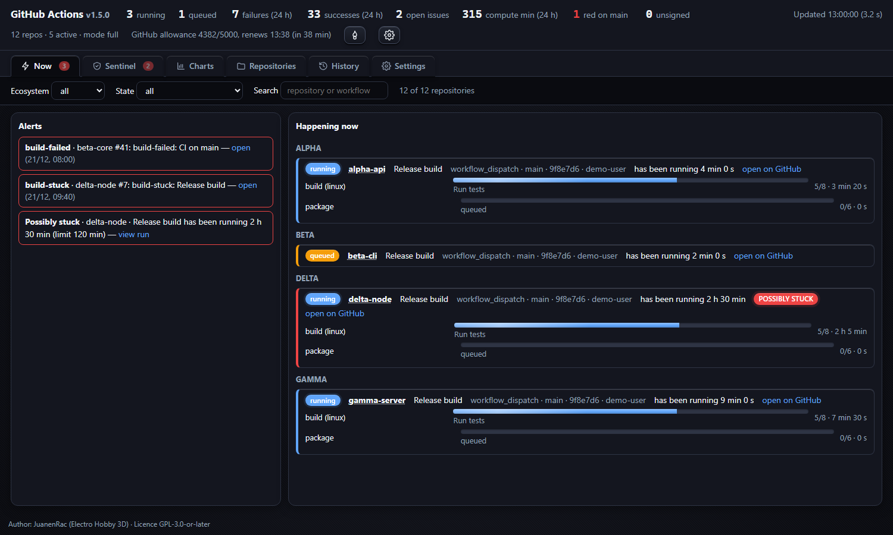
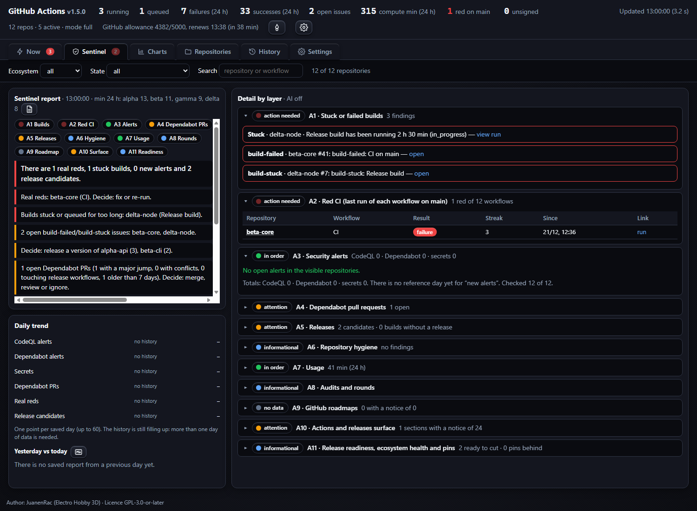
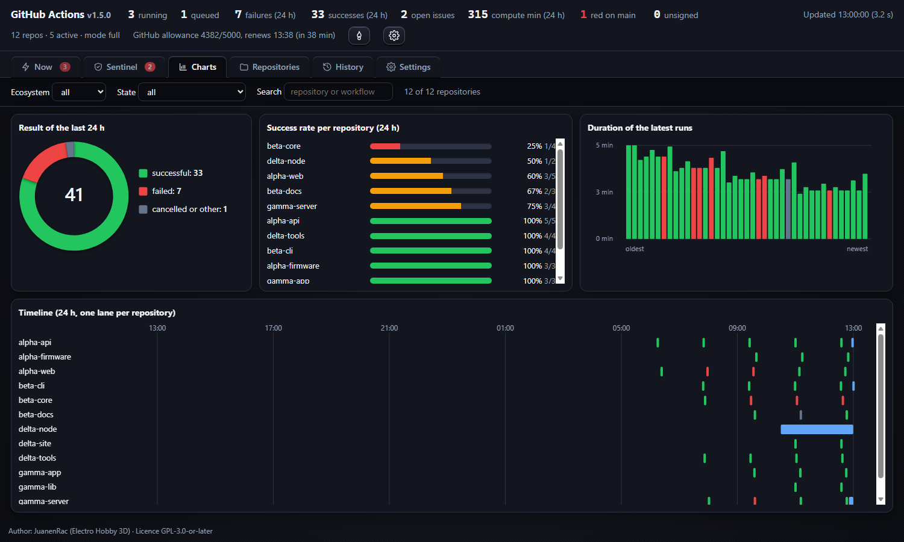
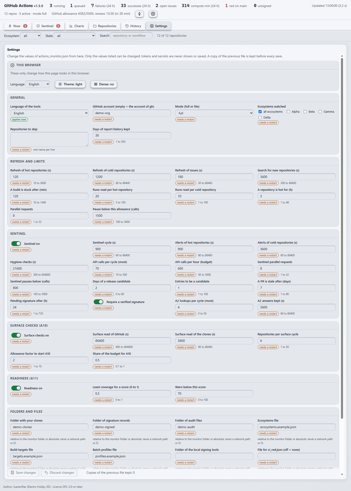

<p align="center">
  
</p>

# GitHub Actions Monitor

<p align="center">
  <a href="README.md">🇺🇸 English</a> |
  <a href="README_spa.md">🇪🇸 Español</a> |
  <b>🇫🇷 Français</b> |
  <a href="README_ita.md">🇮🇹 Italiano</a> |
  <a href="README_deu.md">🇩🇪 Deutsch</a> |
  <a href="README_zho.md">🇨🇳 简体中文</a> |
  <a href="README_jpn.md">🇯🇵 日本語</a> |
  <a href="README_por.md">🇵🇹 Português</a>
</p>

<p align="center">
  <a href="https://github.com/JuanenRac/TOOLS-GITHUB-ACTIONS-MONITOR/releases/latest"></a>
  
  
  
  
</p>

> Surveille les workflows de tous vos dépôts et vous dit, sur une page locale, ce qui est rouge, ce qui est bloqué et ce qui vous attend.

**GitHub Actions Monitor** est un petit programme qui tourne sur votre propre ordinateur. Il interroge GitHub, avec votre propre connexion `gh`, sur les dernières exécutions de chaque workflow de vos dépôts, décide ce qui est vraiment rouge, signale l'important (sécurité, hygiène, versions prêtes, quota) et affiche tout sur une page web que seul votre ordinateur peut ouvrir. Il ne demande que Python et `gh`, ne stocke jamais de jeton et, par défaut, il ne fait que lire.

## En un coup d'œil

| | |
|---|---|
| **Version** | **1.5.1** · [toutes les versions](https://github.com/JuanenRac/TOOLS-GITHUB-ACTIONS-MONITOR/releases) |
| **Prérequis** | Python 3.11+ et la CLI GitHub (`gh auth login`) ; rien d'autre |
| **S'ouvre** | sur une page `127.0.0.1` uniquement, en huit langues |
| **Écrit sur GitHub** | jamais seul : seulement les commandes par lots que vous lancez avec un `--go` explicite |
| **Exporte** | `ci_red.json`, des métriques Prometheus et du JSON pour Grafana (tout désactivé tant que vous ne l'activez pas) |

## Captures d'écran

<p align="center"></p>
<p align="center"></p>
<p align="center"></p>
<p align="center"></p>

*Données de démonstration : les dépôts et noms des images sont inventés.*

## Ce qu'il fait

- **Rouge ou non, avec une seule règle** : la dernière exécution terminée de chaque workflow sur la branche par défaut. Les exécutions annulées ou ignorées ne masquent jamais un échec antérieur.
- **Sentinelle** : alertes de sécurité, hygiène des dépôts, pull requests anciennes, versions prêtes à publier, builds en attente de signature et rapport en langage clair.
- **Page de réglages** : modifiez chemins, intervalles, quotas et interrupteurs depuis le navigateur ; seulement une liste fixe de clés validées, avec sauvegarde avant chaque enregistrement.
- **Graphiques et historique** : minutes de calcul, échecs et succès avec des barres animées et un historique quotidien (respecte la réduction des animations).
- **Huit langues** (en, es, de, fr, it, ja, zh, pt) avec l'anglais comme base ; changement dans les réglages.
- **Sorties pour tableaux de bord** : `ci_red.json`, un point d'accès Prometheus et une source JSON pour Grafana, avec un tableau Grafana importable.
- **Outils par lots** : planifient et lancent plusieurs builds à la fois ; rien n'est lancé sans `--go`.

## Architecture

<p align="center"></p>

## Démarrage rapide

1. Installez Python 3.11 ou plus récent et la [CLI GitHub](https://cli.github.com/), puis lancez `gh auth login`.
2. Téléchargez ce dépôt (ou le zip de la dernière release) et ouvrez le dossier `monitor`.
3. Démarrez-le : Windows `MONITOR_GITHUB_ACTIONS.bat`, Linux `./MONITOR_GITHUB_ACTIONS.sh`, macOS double-clic sur `MONITOR_GITHUB_ACTIONS.command`, ou `python actions_monitor.py` partout.
4. Ouvrez l'adresse affichée (`http://127.0.0.1:<port>`). Au premier démarrage, il crée `actions_monitor.json` à partir de l'exemple.
5. Ouvrez **Réglages** pour indiquer votre compte GitHub, les écosystèmes (groupes de dépôts par préfixe de nom) et le reste.

> Vous mettez à jour depuis une version antérieure à la 1.5.0 ? [`monitor/docs/MIGRATING_fra.md`](monitor/docs/MIGRATING_fra.md)

## Réglages

Tout vit dans `actions_monitor.json` (créé depuis `actions_monitor.example.json`). L'onglet **Réglages** le modifie en toute sécurité ; les jetons et secrets ne sont jamais affichés ni enregistrés. Les écosystèmes, cibles de build et profils de lot sont des fichiers séparés que vous indiquez (`ecosystems_file`, `targets_file`, `profiles_file`) ; des modèles neutres `*.example.json` sont fournis. Référence complète : [`monitor/docs/SETTINGS_fra.md`](monitor/docs/SETTINGS_fra.md).

## Sorties pour Grafana et tableaux de bord

Tout est désactivé par défaut, local uniquement (`127.0.0.1`) et sans jeton supplémentaire. Une fois activé dans les réglages : `/metrics` (format Prometheus), `/api/outputs/grafana.json` et `/api/outputs/dashboard.json`, plus un tableau Grafana importable dans [`monitor/docs/grafana`](monitor/docs/grafana). Détails : [`monitor/docs/OUTPUTS_fra.md`](monitor/docs/OUTPUTS_fra.md). Le format de `ci_red.json` : [`monitor/docs/CI_RED_SCHEMA_fra.md`](monitor/docs/CI_RED_SCHEMA_fra.md).

## Sécurité

- Il n'écoute que sur `127.0.0.1` et refuse les requêtes dont le `Host` ou l'`Origin` n'est pas local. Ne le liez jamais à `0.0.0.0` : il n'a pas de connexion.
- Il ne stocke aucun jeton : il utilise votre propre `gh`.
- Il n'écrit rien sur GitHub de lui-même. Seuls `dispatch --go`, `dispatch --real` et `finalize --execute` écrivent, et seulement quand vous les lancez.
- La page de réglages écrit une liste fixe de clés validées, après avoir enregistré une copie de sauvegarde.

## Tests

Ils n'ont besoin ni de réseau ni de paquet supplémentaire :

```
python -m unittest discover -s monitor/tests
```

## Structure du dépôt

<p align="center"></p>

```
TOOLS-GITHUB-ACTIONS-MONITOR/
├── monitor/                          le programme
├── docs/                             architecture, captures
├── tools/                            générateurs d'images
├── images/                           bannière et images
├── .github/                          CI et formulaires
├── CHANGELOG.md                      changements par version
├── LICENSE NOTICE AUTHORS            licences et auteur
├── CONTRIBUTING.md SECURITY.md       aider, signaler
├── SUPPORT.md CODE_OF_CONDUCT.md     aide et conduite
└── monitor/
    ├── actions_monitor.py            serveur local
    ├── actions_monitor.html          la page web
    ├── sentinel_local.py             alertes, rapport
    ├── surface.py readiness.py       contrôles, préparation
    ├── settings_api.py outputs.py    réglages, métriques
    ├── signstate.py sigverify.py     signature : état, contrôle
    ├── read_report.py                rapport en terminal
    ├── gha_dispatch_all.py           builds par lots
    ├── events.py report_history.py   événements, historique
    ├── ci_red.py export_status.py    fichiers pour d'autres
    ├── i18n.py locales/              huit langues
    ├── toolconfig.py workspace.py    réglages, clones
    ├── tests/                        tests hors ligne
    └── docs/                         réglages, Grafana
```

## Documentation

- [`monitor/docs/SETTINGS_fra.md`](monitor/docs/SETTINGS_fra.md): tous les réglages
- [`monitor/docs/OUTPUTS_fra.md`](monitor/docs/OUTPUTS_fra.md): métriques, Grafana et exports
- [`monitor/docs/CI_RED_SCHEMA_fra.md`](monitor/docs/CI_RED_SCHEMA_fra.md): le format de ci_red.json
- [`monitor/docs/CI_RED_BRIDGE_fra.md`](monitor/docs/CI_RED_BRIDGE_fra.md): amener ci_red.json vers un tableau de bord
- [`monitor/QUICKSTART_fr.txt`](monitor/QUICKSTART_fr.txt): premiers pas, en huit langues

## Contribuer

Lisez [CONTRIBUTING.md](CONTRIBUTING.md). Signalez bogues et idées avec les formulaires d'issues ; les problèmes de sécurité comme décrit dans [SECURITY.md](SECURITY.md).

## Auteur

Écrit par **JuanenRac (Electro Hobby 3D)** · electrohobby3d@gmail.com

## Licence

Le code est sous GPL-3.0-or-later ; la documentation sous CC BY-SA 4.0. Voir [LICENSE](LICENSE) et [NOTICE](NOTICE).
