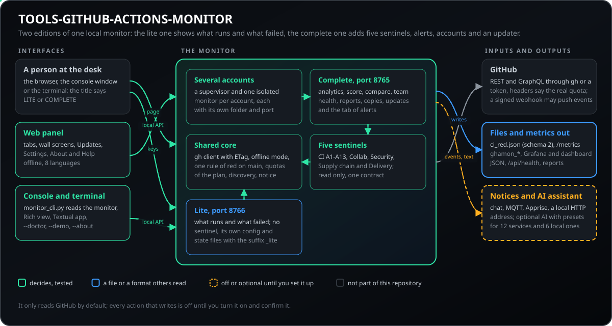
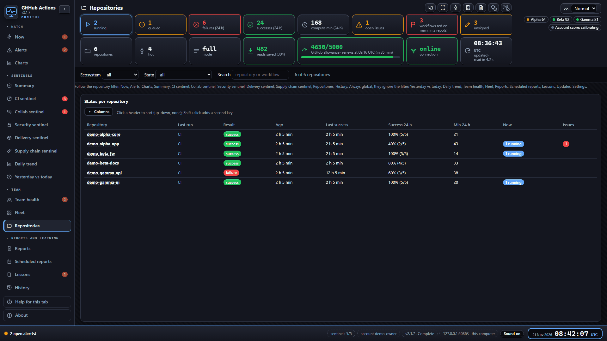
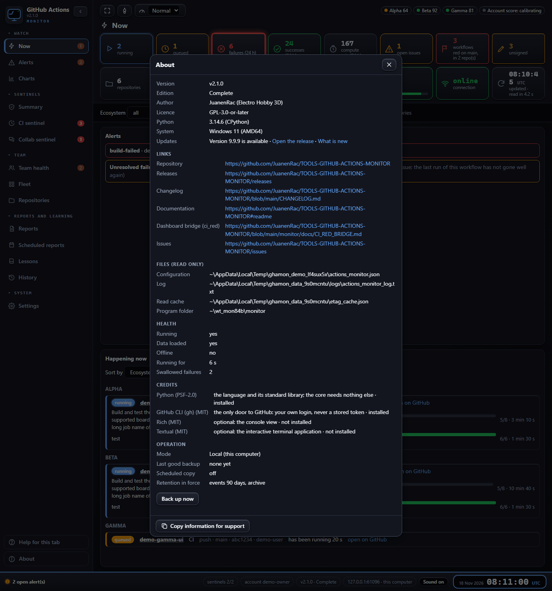
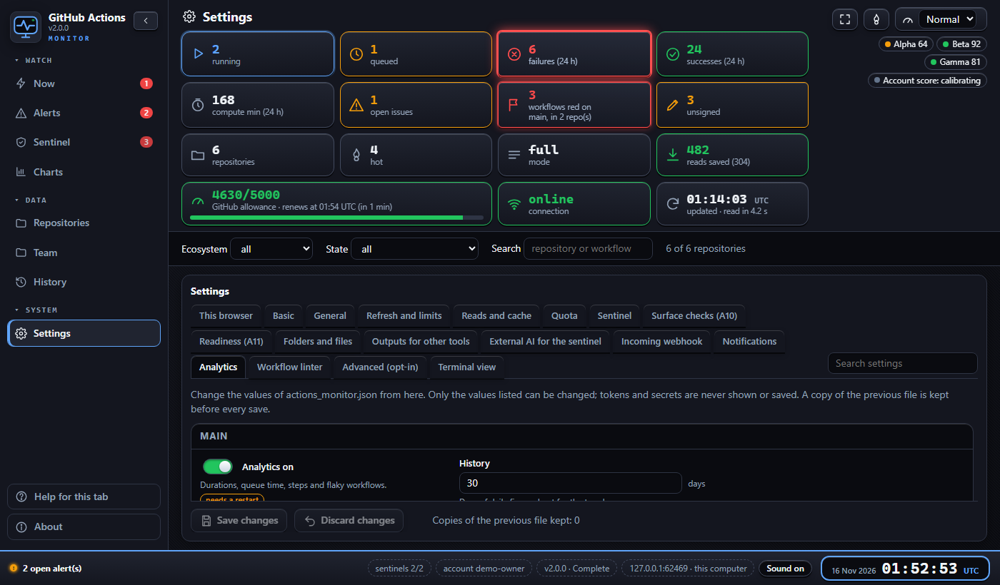
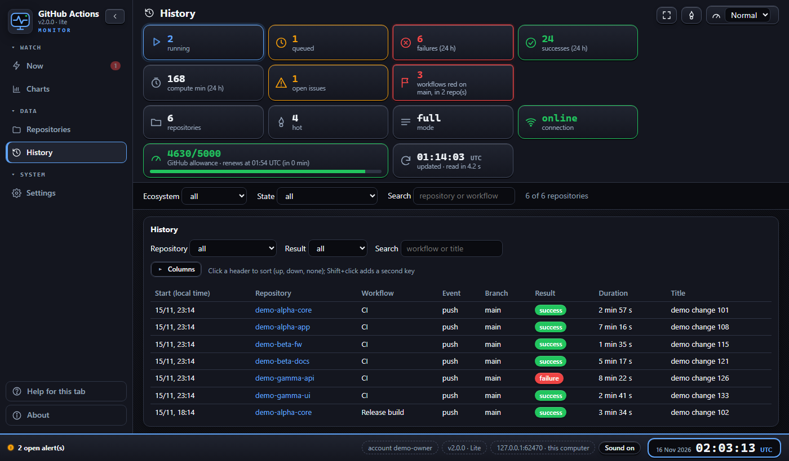

<p align="center">
  
</p>

# GitHub Actions Monitor

<p align="center">
  <a href="README.md">🇺🇸 English</a> |
  <a href="README_spa.md">🇪🇸 Español</a> |
  <a href="README_fra.md">🇫🇷 Français</a> |
  <a href="README_ita.md">🇮🇹 Italiano</a> |
  <a href="README_deu.md">🇩🇪 Deutsch</a> |
  <a href="README_zho.md">🇨🇳 简体中文</a> |
  <b>🇯🇵 日本語</b> |
  <a href="README_por.md">🇵🇹 Português</a>
</p>

<p align="center">
  <a href="https://github.com/JuanenRac/TOOLS-GITHUB-ACTIONS-MONITOR/releases/latest"></a>
  
  
  
  
  
</p>

> 所有するすべてのリポジトリのワークフローを監視し、赤いもの・止まっているもの・対応待ちのものを、ローカルの1ページで教えます。

**GitHub Actions Monitor** は、あなた自身のコンピューターで動く小さなプログラムです。自分の `gh` ログインを使って GitHub に各ワークフローの最新の実行を問い合わせ、本当に赤いものを判定し、重要なこと（セキュリティ、衛生、公開準備の整ったバージョン、クォータ）を知らせ、自分のマシンからしか開けない Web ページにすべてを表示します。必要なのは Python と `gh` だけで、トークンは保存せず、既定では読み取りしか行いません。

## 概要

- **GitHub Actionsの見張り役**: 自分の `gh` ログインで、所有するすべてのリポジトリのすべてのワークフローの最新の実行を読み取り、何が赤で、何が止まっていて、何があなたを待っているかを判断します。
- **GitHubには決して書き込まない3つのセンチネル**: CI(実行とワークフロー)、Collab(人の対応が必要なissueとプルリクエスト)、Security(Dependabot、コードスキャン、シークレットスキャン、ブランチ保護)が、読み取った内容を1つの一覧のアラートにします。
- **1つのページ、いくつもの見方**: スマートフォンから4Kの壁面ディスプレイまで合わせる `127.0.0.1` のローカルページ(最大3画面を同時に)、コマンドラインのクライアント、ターミナルの表示、ファイル、自分のダッシュボード用のエンドポイント。
- **2つのエディション**: Liteは1人用で実行の表示だけ。Completeは複数のアカウント、役割を持つチーム、スコア、各リポジトリの健全性、レポート、Docker用のサービスを加えます。
- **設計からプライベート**: ログインで行うGitHubへの呼び出し以外は、何もコンピューターから出ません。任意のAIのキーは環境変数に残り、GitHubへの書き込みは、明示的な `--go` を付けて実行するバッチコマンドだけで行われます。

## できること

- **赤かどうかは1つのルールで判定**：既定ブランチ上の各ワークフローの最後に完了した実行。キャンセルやスキップされた実行が、以前の失敗を隠すことはありません。
- **センチネル**：セキュリティアラート、リポジトリの衛生、古いプルリクエスト、公開準備の整ったバージョン、署名待ちのビルド、平易な言葉のレポート。
- **Collab 番人と 1 つのアラート一覧**：人の手が必要な未解決の Issue とプルリクエスト（放置、重大、レビュー待ち、古い下書き、コンフリクト）を、読み取り専用・独自の周期で確認。アラートタブにはすべての番人を 1 つの一覧にまとめ、由来での絞り込みと、自動で終わるローカルのミュートを備えます。
- **ステータスバー、全画面表示、並べ替えできる表**：最も重要な通知（とすべてを見るウィンドウ）、接続、割り当て、直近の読み取り、モード、アドレス、時計をページ下部に表示。全画面表示ボタン。リポジトリと履歴は 1 つまたは複数の列で並べ替えでき、列も選べます。
- **クライアントとしてのコマンドライン**：`bin/monitor_cli.py`（`status`、`health`、`alerts`、`accounts`、`live`、`doctor`、`score`）は実行中のモニターの内容を読み、`--json` と固定の終了コードに対応します。GitHub には書き込みません。
- **AI 向けの2つのスキル**：モニターに組み込まれた AI(ローカルまたはプロバイダー)と、外部からモニターと連携する AI(コマンドライン、HTTP やファイルのみ、MCP、ストリーム)向けの短い英語のガイドで、漏れがないようコードから生成されます。`python bin/monitor_cli.py install-skill internal|external --dest フォルダー` でインストールするか、設定の AI タブからコピーします（`monitor/docs/SKILLS_jpn.md`）。
- **失敗とレッスン**：CI の失敗のローカルなブック、各失敗をカテゴリに分類するルール、それを防げたガードを添えたレッスンのライブラリ（`monitor/docs/LESSONS_jpn.md`）、24時間と7日間の傾向、`ai/LESSONS.md`、`/api/ai/lessons`、そしてあらゆる AI ツール向けのプッシュ前の概要。読み取り専用で、コンピューターの外には何も出ません。
- **あらゆる画面サイズと複数の画面**：ページはスマートフォンから4Kまでのウィンドウに、縦でも横でも適応し、1台のモニターで最大3つの画面（`/screen/1` から `/screen/3`）を提供できます。各画面に独自のタブと向きを設定できます（`monitor/docs/SCREENS_jpn.md`）。
- **アカウントごとのスコア**：CI の信頼性、速度、復旧にかかる時間、コラボレーションのアラートがどれだけ早く閉じられるかから作られる 0〜100 の数値、A〜E の文字評価、傾向。裏付けのない数値の代わりに「較正中」「データ不足」と表示し、まだカバーしていないものを示し、ページのヘッダーに表示され、`score` コマンドがあり、低下すると警告し、メトリクスと MCP サーバーにも含まれます（`monitor/docs/SCORE.md`）。
- **セキュリティセンチネル（Complete のみ、初期状態はオフ）**：GitHub には何も書き込まず、Dependabot・コードスキャン・シークレットスキャンの未解決アラート、既定ブランチが保護されているか、ワークフローの既定の権限、依頼があればコードオーナーを読み取ります。リポジトリとシグナルごとに 1 件のアラートを出し、検出結果をスコアの 5 番目の要素として数え、読み取れなかったものを伝えます（`monitor/docs/SENTINEL_SECURITY_jpn.md`）。
- **各リポジトリとチームの健全性（Complete のみ）**：CI、3 つのセンチネルのアラート、リリース準備状況、アクティビティを 1 つの状態（不良・警告・OK・未確認）とリスク値にまとめます。チームタブは人の手が必要なリポジトリを先頭に並べ、フィルター、リポジトリごとの詳細、壁掛け画面用のディープリンクを備えます。同じデータは `/api/team/health`、`/api/repos/<owner>/<repo>/health`、`team` コマンドで得られます（`monitor/docs/HEALTH_jpn.md`）。
- **レポート、操作ログ、Apprise（Complete のみ）**：アカウントのレポート（スコア、変化、人の手が必要なリポジトリ、未解決のアラート）を cron スケジュールまたは依頼に応じて HTML と Markdown で作成します（初期状態はオフ、`monitor/docs/REPORT_SCHEDULE_jpn.md`）。誰が何を変更したかをハッシュの連鎖で記録し、値や秘密は含みません（`monitor/docs/AUDIT_LOG_jpn.md`）。通知用の任意の Apprise チャンネルもあり、初期状態はオフです。
- **サービスとして**：公式 Docker イメージ（非 root、読み取り専用）、任意のプロキシ付き Compose ファイル、systemd ユニット、詳細なヘルスチェック、最初の管理者を作るコマンド（`monitor/docs/DEPLOYMENT.md`）。
- **固定された API と用途ごとの案内**：2.0.0 から、すべての読み取りエンドポイントの形とエラーコードが `monitor/docs/schemas/api_contract.json` に固定され、ツールが動作中のモニターをそれに照らして検査します（`monitor/tools/check_api_contract.py`）。簡易版、個人、サービス、チームのそれぞれに短い案内もあります（`monitor/docs/API_jpn.md`）。
- **複数アカウント、チーム、データの置き場所**：アカウントごとに 1 プロセス、ロールと専用アカウントを持つユーザー、`config/`、`data/`、`logs/`、`ai/` に分けたファイル、保持期間とバックアップ付きの任意の SQLite ストレージ、設定になったポート（`monitor/docs/ACCOUNTS.md`、`monitor/docs/STORAGE.md`、`monitor/docs/LAYOUT.md`）。
- **並べ替えと折りたたみができる一覧**：「いま起きていること」は 7 通り、アラートタブは 9 通りで並べ替えられ、すべてのリポジトリを折りたたむ／開くボタンがあります。選択はユーザーごとに記憶されます。
- **ユーザーごとの通知**：チームモードでは、各ユーザーがページのパネルでチャンネル（ntfy、Teams、メール）、最低レベル、まとめ通知を選べます（`monitor/docs/NOTIFICATIONS_jpn.md`）。
- **設定ページ**：パス、間隔、クォータ、スイッチをブラウザーから変更できます。検証済みの固定キーのみで、保存前に必ずバックアップを取ります。
- **グラフと履歴**：計算時間、失敗、成功をアニメーションするバーと日次履歴で表示します（動きの軽減設定を尊重します）。
- **8言語**（en、es、de、fr、it、ja、zh、pt）。英語が基本で、設定で切り替えます。
- **ダッシュボード向け出力**：`ci_red.json`、Prometheus エンドポイント、Grafana 用 JSON ソースと、インポート可能な Grafana ダッシュボード。
- **バッチツール**：多数のビルドをまとめて計画・実行します。`--go` なしでは何も実行されません。
- **ページ内のバージョン情報とヘルプ**: **i** ボタンでバージョン、エディション、リンク、ファイル、動作状況、サポート用情報をコピーするボタンを表示し、**?** ボタン（またはキー `?`）でドキュメント全体を検索付き・お使いの言語でインターネットなしに開きます。コンソールには `--about` と `--help-topics`、タブ付きの対話型ターミナルアプリ（任意の `textual`）があります。
- **新バージョンのお知らせ**: 新しいリリースが公開されると控えめなバッジを表示します。公開リリースページを1日1回読むだけで、何もインストールせず、オフにでき（隔離環境では常にオフ）ます。
- **あらゆるアカウント向けのクォータ**: プラン、課金対象の分数（公開リポジトリは無料）、GitHub のヘッダーから読む API クォータ、並行実行、6時間の上限に近いジョブ。数値は編集可能なファイルにあります。

## 概要

| | |
|---|---|
| **バージョン** | **2.0.2** · [すべてのリリース](https://github.com/JuanenRac/TOOLS-GITHUB-ACTIONS-MONITOR/releases) |
| **必要なもの** | Python 3.11 以上と GitHub CLI（`gh auth login`）。それ以外は不要(ターミナル表示は任意のパッケージ `rich` を使います) |
| **開く先** | `127.0.0.1` 上のページのみ、8言語対応 |
| **GitHub への書き込み** | 自動では行いません。明示的な `--go` を付けて実行したバッチコマンドのみ |
| **エクスポート** | `ci_red.json`、Prometheus メトリクス、Grafana 用 JSON（有効にするまですべてオフ） |

<!-- glance:begin -->

**現時点の実測** (v2.0.2)

| | |
|---|---|
| **成熟度** | functional |
| **テスト** | テストメソッド 2371 件(`python -m unittest discover -s monitor/tests`) |
| **設定** | 設定 421 件、すべてヘルプ付き |
| **言語** | 8(英語、スペイン語、ドイツ語、フランス語、イタリア語、日本語、中国語、ポルトガル語) |
| **CI で検証したシステム** | ubuntu, windows、Python 3.11, 3.13 |

## プロジェクトの状況

各行はこのリポジトリの一部分で、信号は現時点の到達度を示します。テストと CI が示せること、実際に動いたことであり、予定ではありません。

🟢 完了・検証済み · 🟡 動作するが既知の制限あり · 🟠 一部のみ、または未検証 · 🔴 未完了または動作せず

| 領域 | 状態 | ここでの意味 |
|---|---|---|
| モニターとページ | 🟢 | 実際のアカウントで毎日動作。テストは CI の 3 つのシステムで実行。 |
| センチネル(A1..A13) | 🟢 | 実際のアカウントで毎日動作。レベルと行はフィクスチャーでテスト。 |
| 通知 | 🟡 | 模擬サーバーでテスト済み。すべてのチャネルを実サービスで試したわけではありません。 |
| AI ツール接続と MCP | 🟡 | フィード、状態、ストリーム、フック、MCP ツールは実サーバーと模擬クライアントでテスト済み。独立したユーザーはまだ使っていません。 |
| Lite 版 | 🟡 | CI でテスト済みで、完全版とチャネルと設定を共有。実使用はこれまで少なめ。 |
| GitHub App、中央パネル、節約モード | 🟠 | 新機能:模擬サーバーとファイルでテスト済み。実サービスでの長期稼働はまだありません。 |
| アカウントごとのスコア | 🟡 | 合成データ、テスト用データ、模擬サーバーで検証済み。実アカウントで数週間見守った実績はまだありません。 |
| Docker イメージとサービスモード | 🟡 | イメージは CI でビルドして検証済み（非 root、読み取り専用、失効したログイン）。長期稼働のサービスとしての実績はまだ短いです。 |
| チームモードと複数アカウント | 🟡 | 実プロセスと模擬ユーザーで検証済み。実際のチームが長く使った実績はまだありません。 |
| ストレージ（ファイルと SQLite） | 🟡 | 両方のバックエンドと、その間の移行で検証済み。数か月経ったデータベースのアップグレードはまだ経験していません。 |
| Linux と macOS | 🟠 | CI でのみテスト。日常の使用は Windows です。 |

<!-- glance:end -->

## アーキテクチャ

<p align="center"></p>

## まずここから: どの版？

| 目的 | 起動 | ポート |
|---|---|---|
| 何が動き何が失敗したかだけを見たい（**まずはこちら**） | `MONITOR_LITE_GITHUB_ACTIONS` | 8766 |
| アカウント全体を見張ってほしい: アラート、リリース、署名、準備状況、分析 | `MONITOR_GITHUB_ACTIONS`（[センチネル](monitor/docs/SENTINEL_jpn.md)付き） | 8765 |

コンソールウィンドウのタイトルと1行目でどちらが動いているかわかります。迷うときは `python bin/actions_monitor.py --demo` で架空のデータのページを開き、`--doctor` でインストールを確認できます。[最初の5分間](monitor/docs/FIRST_STEPS_jpn.md)

## クイックスタート

1. Python 3.11 以上と [GitHub CLI](https://cli.github.com/) をインストールし、`gh auth login` を実行します。
2. このリポジトリ（または最新リリースの zip）をダウンロードし、`monitor` フォルダーを開きます。
3. 起動：Windows は `MONITOR_GITHUB_ACTIONS.bat`、Linux は `./MONITOR_GITHUB_ACTIONS.sh`、macOS は `MONITOR_GITHUB_ACTIONS.command` をダブルクリック、どの環境でも `python bin/actions_monitor.py` で起動できます。
4. 表示されたアドレス（`http://127.0.0.1:<ポート>`）を開きます。初回起動時に、サンプルから `actions_monitor.json` を作成します。
5. **設定** を開き、GitHub アカウント、エコシステム（名前の接頭辞によるリポジトリのグループ）などを設定します。

> 1.5.0 より前のバージョンから更新しますか？ [`monitor/docs/MIGRATING_jpn.md`](monitor/docs/MIGRATING_jpn.md)

## lite 版

同じパッケージに入った、もう 1 つのシンプルな製品です。実行中のものと失敗したものを見せるページで、センチネルはありません。自分の実行を眺めたいだけの人向けです。

|  | 完全版 | lite 版 |
|---|---|---|
| 起動 | `MONITOR_GITHUB_ACTIONS`(`.bat` / `.sh` / `.command`) | `MONITOR_LITE_GITHUB_ACTIONS`(同じ 3 種類) |
| ポート | 8765 | 8766 |
| タブ | 今、センチネル、グラフ、リポジトリ、履歴、設定 | 今、グラフ、リポジトリ、履歴、短い設定 |
| ヘッダー | すべてのタイル、準備状況、署名 | 実行中、待機、24 時間の失敗と成功、計算分数、issue、main の赤、リポジトリ、割り当て、接続 |
| センチネル(アラート、リリース、署名キュー、準備状況、Lint) | あり | なし(インポートもされません) |
| 分析、通知、Webhook、AI、Prometheus / Grafana 出力 | あり(オンにするまでオフ) | なし(これらのパスは 404 を返します) |
| 設定 | `actions_monitor.json` | `actions_monitor_lite.json`(初回起動時に作成。センチネルはオフ) |
| 状態ファイル | `etag_cache.json`、`analytics_history.json` など | 同じ名前に接尾辞 `_lite` |

[`monitor/docs/LITE_jpn.md`](monitor/docs/LITE_jpn.md)

## スクリーンショット

### ページ

<p align="center"><picture><source media="(prefers-color-scheme: light)" srcset="docs/screenshots/web_now_light.png"></picture></p>
<p align="center"><picture><source media="(prefers-color-scheme: light)" srcset="docs/screenshots/web_alerts_light.png"></picture></p>
<p align="center"><picture><source media="(prefers-color-scheme: light)" srcset="docs/screenshots/web_sentinel_light.png"></picture></p>
<p align="center"><picture><source media="(prefers-color-scheme: light)" srcset="docs/screenshots/web_sentinel_queue_light.png"></picture></p>
<p align="center"><picture><source media="(prefers-color-scheme: light)" srcset="docs/screenshots/web_sentinel_analytics_light.png"></picture></p>
<p align="center"><picture><source media="(prefers-color-scheme: light)" srcset="docs/screenshots/web_charts_light.png"></picture></p>
<p align="center"><picture><source media="(prefers-color-scheme: light)" srcset="docs/screenshots/web_repositories_light.png"></picture></p>
<p align="center"><picture><source media="(prefers-color-scheme: light)" srcset="docs/screenshots/web_team_light.png"></picture></p>
<p align="center"><picture><source media="(prefers-color-scheme: light)" srcset="docs/screenshots/web_history_light.png"></picture></p>

<p align="center"><picture><source media="(prefers-color-scheme: light)" srcset="docs/screenshots/web_about_light.png"></picture></p>
<p align="center"><picture><source media="(prefers-color-scheme: light)" srcset="docs/screenshots/web_help_light.png"></picture></p>
<p align="center"><picture><source media="(prefers-color-scheme: light)" srcset="docs/screenshots/web_settings_basic_light.png"></picture></p>
<p align="center"><picture><source media="(prefers-color-scheme: light)" srcset="docs/screenshots/web_network_now_light.png"></picture></p>
<p align="center"><picture><source media="(prefers-color-scheme: light)" srcset="docs/screenshots/web_network_notices_light.png"></picture></p>
<p align="center"><picture><source media="(prefers-color-scheme: light)" srcset="docs/screenshots/web_network_settings_light.png"></picture></p>
<p align="center"><picture><source media="(prefers-color-scheme: light)" srcset="docs/screenshots/web_accounts_all_light.png"></picture></p>
<p align="center"><picture><source media="(prefers-color-scheme: light)" srcset="docs/screenshots/web_accounts_one_light.png"></picture></p>
<p align="center"><picture><source media="(prefers-color-scheme: light)" srcset="docs/screenshots/web_accounts_live_light.png"></picture></p>

<details><summary><b>設定(サブタブごと)</b></summary>

<p align="center"><picture><source media="(prefers-color-scheme: light)" srcset="docs/screenshots/web_settings_interface_light.png"></picture></p>
<p align="center"><picture><source media="(prefers-color-scheme: light)" srcset="docs/screenshots/web_settings_general_light.png"></picture></p>
<p align="center"><picture><source media="(prefers-color-scheme: light)" srcset="docs/screenshots/web_settings_polling_light.png"></picture></p>
<p align="center"><picture><source media="(prefers-color-scheme: light)" srcset="docs/screenshots/web_settings_cache_light.png"></picture></p>
<p align="center"><picture><source media="(prefers-color-scheme: light)" srcset="docs/screenshots/web_settings_sentinel_light.png"></picture></p>
<p align="center"><picture><source media="(prefers-color-scheme: light)" srcset="docs/screenshots/web_settings_surface_light.png"></picture></p>
<p align="center"><picture><source media="(prefers-color-scheme: light)" srcset="docs/screenshots/web_settings_readiness_light.png"></picture></p>
<p align="center"><picture><source media="(prefers-color-scheme: light)" srcset="docs/screenshots/web_settings_paths_light.png"></picture></p>
<p align="center"><picture><source media="(prefers-color-scheme: light)" srcset="docs/screenshots/web_settings_outputs_light.png"></picture></p>
<p align="center"><picture><source media="(prefers-color-scheme: light)" srcset="docs/screenshots/web_settings_ai_light.png"></picture></p>
<p align="center"><picture><source media="(prefers-color-scheme: light)" srcset="docs/screenshots/web_settings_webhook_light.png"></picture></p>
<p align="center"><picture><source media="(prefers-color-scheme: light)" srcset="docs/screenshots/web_settings_notify_light.png"></picture></p>
<p align="center"><picture><source media="(prefers-color-scheme: light)" srcset="docs/screenshots/web_settings_analytics_light.png"></picture></p>
<p align="center"><picture><source media="(prefers-color-scheme: light)" srcset="docs/screenshots/web_settings_lint_light.png"></picture></p>
<p align="center"><picture><source media="(prefers-color-scheme: light)" srcset="docs/screenshots/web_settings_console_light.png"></picture></p>
<p align="center"><picture><source media="(prefers-color-scheme: light)" srcset="docs/screenshots/web_settings_advanced_light.png"></picture></p>

</details>

<details><summary><b>コンソールツール</b></summary>

<p align="center"><picture><source media="(prefers-color-scheme: light)" srcset="docs/screenshots/console_read_report_light.png"></picture></p>
<p align="center"><picture><source media="(prefers-color-scheme: light)" srcset="docs/screenshots/console_migrate_state_light.png"></picture></p>
<p align="center"><picture><source media="(prefers-color-scheme: light)" srcset="docs/screenshots/console_plan_light.png"></picture></p>
<p align="center"><picture><source media="(prefers-color-scheme: light)" srcset="docs/screenshots/console_lint_light.png"></picture></p>
<p align="center"><picture><source media="(prefers-color-scheme: light)" srcset="docs/screenshots/console_tui_light.png"></picture></p>

</details>

<details><summary><b>lite 版</b></summary>

<p align="center"><picture><source media="(prefers-color-scheme: light)" srcset="docs/screenshots/web_lite_now_light.png"></picture></p>
<p align="center"><picture><source media="(prefers-color-scheme: light)" srcset="docs/screenshots/web_lite_charts_light.png"></picture></p>
<p align="center"><picture><source media="(prefers-color-scheme: light)" srcset="docs/screenshots/web_lite_history_light.png"></picture></p>
<p align="center"><picture><source media="(prefers-color-scheme: light)" srcset="docs/screenshots/web_lite_settings_light.png"></picture></p>

</details>

各画像は GitHub ページのライト/ダークテーマに従います。

*デモデータです。画像内のリポジトリ名や名前は架空のものです。*

## 設定

すべては `actions_monitor.json`（`monitor/assets/examples/actions_monitor.example.json` から作成）にあります。**設定** タブで安全に編集でき、トークンや秘密情報は表示も保存もされません。エコシステム、ビルド対象、バッチプロファイルは別ファイルで、`ecosystems_file`、`targets_file`、`profiles_file` で指定します。中立な `*.example.json` テンプレートが付属します。詳細は [`monitor/docs/SETTINGS_jpn.md`](monitor/docs/SETTINGS_jpn.md) を参照してください。

## Grafana とダッシュボード向け出力

すべて既定でオフ、ローカル（`127.0.0.1`）限定で、追加のトークンは不要です。設定で有効にすると `/metrics`（Prometheus 形式）、`/api/outputs/grafana.json`、`/api/outputs/dashboard.json` が使え、インポート可能な Grafana ダッシュボードが [`monitor/docs/grafana`](monitor/docs/grafana) にあります。詳細：[`monitor/docs/OUTPUTS_jpn.md`](monitor/docs/OUTPUTS_jpn.md)。`ci_red.json` の形式：[`monitor/docs/CI_RED_SCHEMA_jpn.md`](monitor/docs/CI_RED_SCHEMA_jpn.md)。

## セキュリティ

- `127.0.0.1` でのみ待ち受け、`Host` または `Origin` がローカルでないリクエストは拒否します。ログインがないため、`0.0.0.0` には決して割り当てないでください。
- トークンは保存せず、あなた自身の `gh` を使います（設定 > 詳細設定でモニターの任意トークンをオンにした場合を除く）。
- 自動では GitHub に何も書き込みません。書き込むのは `dispatch --go`、`dispatch --real`、`finalize --execute` だけで、あなたが実行したときのみです。
- ネットワークモードとチームモードは既定でオフです。オンにすると、ログイン、ロール、ロックアウト、監査ログがページを守り、各リクエストは 1 つのアカウントについてのみ判定されます（`monitor/docs/DEPLOYMENT.md`、`monitor/docs/ACCOUNTS.md`）。
- **分析**:各ワークフローの所要時間・待ち時間・各ステップの p50 / p95、不安定なワークフロー(同じコミットで失敗後に成功)、遅くなったワークフロー。Prometheus と Grafana に出力。
- **割り当てを節約し、断線に耐える**:条件付き読み取り(304 は無料)と、オフライン表示付きで自動再開する最終状態モード。
- **受信 Webhook と通知**:署名付きイベントでリポジトリをリアルタイムに更新。Telegram・Discord・Slack・Matrix・MQTT・ローカルアドレスへの任意のメッセージ(GitHub への書き込みは一切なし)。
- **ワークフロー Lint とターミナル表示**:`bin/lint_workflows.py` は push 前に `.github/workflows` を検査し、`bin/tui.py`(任意、`rich` 使用)はコンソールにライブ表を表示します。
- **AI アシスタント(既定ではオフ)**:Ollama、OpenAI 互換サービス、Anthropic、`gh copilot` による要約・仕分け・説明。コマンドは限定リストのものだけで、1 件ずつ確認した後にのみ実行されます。
- 設定ページは、バックアップを保存してから、検証済みの固定キーだけを書き込みます。

## テスト

ネットワークも追加パッケージも不要です：

```
python -m unittest discover -s monitor/tests
```

## リポジトリ構造

<p align="center"></p>

```
TOOLS-GITHUB-ACTIONS-MONITOR/
├── monitor/                            プログラム本体
├── docs/                               構成図・画面・ロードマップ
├── tools/                              図・ガイド・デモ
├── deploy/                             イメージ、Compose、systemd
├── images/                             バナーと図
├── .github/                            CI と Issue フォーム
├── CHANGELOG.md                        バージョン別の変更
├── LICENSE NOTICE AUTHORS              ライセンスと作者
├── CONTRIBUTING.md SECURITY.md         参加方法、報告
├── SUPPORT.md CODE_OF_CONDUCT.md       サポートと行動規範
└── monitor/
    ├── MONITOR_GITHUB_ACTIONS.*        起動スクリプト(ダブルクリック)
    ├── MONITOR_LITE_GITHUB_ACTIONS.*   lite 版(センチネルなし)
    ├── BATCH_GITHUB_ACTIONS.*          バッチビルドのメニュー
    ├── src/                            インポート可能なパッケージ
    ├── assets/                         例・ページ・言語
    ├── bin/                            短いコマンド(read_report、monitor_cli など)
    ├── tests/                          オフラインテスト
    ├── docs/                           ガイド、クイックスタート、スキーマ
    ├── skills/                         AI 向けの2つのスキル
    └── tools/                          リリースと移行のスクリプト
```

## ドキュメント

- [`monitor/docs/SETTINGS_jpn.md`](monitor/docs/SETTINGS_jpn.md): すべての設定
- [`monitor/docs/OUTPUTS_jpn.md`](monitor/docs/OUTPUTS_jpn.md): メトリクス、Grafana、エクスポート
- [`monitor/docs/CI_RED_SCHEMA_jpn.md`](monitor/docs/CI_RED_SCHEMA_jpn.md): ci_red.json の形式
- [`monitor/docs/CI_RED_BRIDGE_jpn.md`](monitor/docs/CI_RED_BRIDGE_jpn.md): ci_red.json をダッシュボードへ渡す
- [`monitor/docs/WEBHOOK_jpn.md`](monitor/docs/WEBHOOK_jpn.md): 受信 Webhook
- [`monitor/docs/LITE_jpn.md`](monitor/docs/LITE_jpn.md): lite 版
- [`monitor/docs/COMPLETE_INDIVIDUAL_jpn.md`](monitor/docs/COMPLETE_INDIVIDUAL_jpn.md): 一人で使う完全版
- [`monitor/docs/COMPLETE_SERVICE_jpn.md`](monitor/docs/COMPLETE_SERVICE_jpn.md): サービスとしての完全版
- [`monitor/docs/COMPLETE_TEAM_jpn.md`](monitor/docs/COMPLETE_TEAM_jpn.md): チームで使う完全版
- [`monitor/docs/API_jpn.md`](monitor/docs/API_jpn.md): クライアント向け API
- [`monitor/docs/NOTIFICATIONS_jpn.md`](monitor/docs/NOTIFICATIONS_jpn.md): 通知とアダプターの取り決め
- [`monitor/docs/AI_jpn.md`](monitor/docs/AI_jpn.md): AI アシスタント:プロバイダー、安全性、アクション
- [`monitor/docs/ANALYTICS_jpn.md`](monitor/docs/ANALYTICS_jpn.md): 分析、条件付き読み取り、接続の喪失
- [`monitor/docs/CONSOLE_TOOLS_jpn.md`](monitor/docs/CONSOLE_TOOLS_jpn.md): ワークフロー Lint とターミナル表示
- [`monitor/docs/DEPLOYMENT_jpn.md`](monitor/docs/DEPLOYMENT_jpn.md): サービスとして動かす（公式イメージ、Compose、systemd）、プロキシの背後、GitHub がログインを失効させたとき、権限
- [`monitor/docs/LAYOUT_jpn.md`](monitor/docs/LAYOUT_jpn.md): モニターのフォルダー、1.8.1 からの移行、AI 向けのマップ
- [`monitor/docs/QUICKSTART_ja.txt`](monitor/docs/QUICKSTART_ja.txt): 最初の手順（8言語）
- [`monitor/docs/FIRST_STEPS_jpn.md`](monitor/docs/FIRST_STEPS_jpn.md): 最初の5分間
- [`monitor/docs/SENTINEL_jpn.md`](monitor/docs/SENTINEL_jpn.md): センチネルとチェック A1〜A13
- [`monitor/docs/COLLAB_jpn.md`](monitor/docs/COLLAB_jpn.md): Collab 番人、アラートタブ、ミュート
- [`monitor/docs/SENTINEL_SECURITY_jpn.md`](monitor/docs/SENTINEL_SECURITY_jpn.md): セキュリティセンチネル：Dependabot、コードスキャン、シークレット、ブランチ保護、ワークフローの権限、CODEOWNERS、確認できなかったこと
- [`monitor/docs/AUDIT_LOG_jpn.md`](monitor/docs/AUDIT_LOG_jpn.md): 操作ログ：誰が何を変更したか、ハッシュの連鎖、読める人、設定
- [`monitor/docs/HEALTH_jpn.md`](monitor/docs/HEALTH_jpn.md): リポジトリとチームの健全性：構成、チームタブ、ディープリンク、API
- [`monitor/docs/REPORT_SCHEDULE_jpn.md`](monitor/docs/REPORT_SCHEDULE_jpn.md): 定期レポート：スコア、変化、人の手が必要なリポジトリ、未解決のアラートを HTML と Markdown で、スケジュールとファイル
- [`monitor/docs/CLI_jpn.md`](monitor/docs/CLI_jpn.md): モニターのクライアントとしてのコマンドライン
- [`monitor/docs/ACCOUNTS_jpn.md`](monitor/docs/ACCOUNTS_jpn.md): 複数アカウント（1 つにつき 1 プロセス）
- [`monitor/docs/QUOTAS_jpn.md`](monitor/docs/QUOTAS_jpn.md): GitHub のクォータとプラン
- [`monitor/docs/MODES_jpn.md`](monitor/docs/MODES_jpn.md): 動作モード: 通常・高速・ターボ
- [`monitor/docs/AI_CONNECTION_jpn.md`](monitor/docs/AI_CONNECTION_jpn.md): AI ツールを接続する:モニターが伝えるすべてをシグナルとして、ブリーフ、エンドポイント、MCP ツール、フックで提供
- [`monitor/docs/QUOTA_jpn.md`](monitor/docs/QUOTA_jpn.md): クォータを増やし、消費を減らす:節約モード、中央パネル、GitHub App、クォータの共有方法
- [`monitor/docs/EXTRAS_jpn.md`](monitor/docs/EXTRAS_jpn.md): 任意の追加機能：失敗したステップのログと GitHub App の読み取り専用トークン
- [`monitor/docs/SCORE_jpn.md`](monitor/docs/SCORE_jpn.md): アカウントのスコア：要素、状態、API、ヘッダーのチップ、アラート、設定
- [`monitor/docs/STORAGE_jpn.md`](monitor/docs/STORAGE_jpn.md): 保存と保持：ファイルまたは SQLite、バックアップ、移行、残すもの
- [`monitor/docs/ADVANCED_jpn.md`](monitor/docs/ADVANCED_jpn.md): 詳細機能（すべて既定でオフ）
- [`monitor/docs/AI_ALERTS_jpn.md`](monitor/docs/AI_ALERTS_jpn.md): AI 向けアラート：フィード、ブリーフ、フック、ストリーム
- [`monitor/docs/AUDIT_PACKAGE_jpn.md`](monitor/docs/AUDIT_PACKAGE_jpn.md): 監査担当者向けパッケージ

## コントリビュート

[CONTRIBUTING.md](CONTRIBUTING.md) をお読みください。バグやアイデアは Issue フォームで、セキュリティ上の問題は [SECURITY.md](SECURITY.md) に従って報告してください。

## 作者

作者：**JuanenRac (Electro Hobby 3D)** · electrohobby3d@gmail.com

## ライセンス

コードは GPL-3.0-or-later、ドキュメントは CC BY-SA 4.0 です。[LICENSE](LICENSE) と [NOTICE](NOTICE) を参照してください。
