<p align="center">
  
</p>

# GitHub Actions Monitor

<p align="center">
  <a href="README.md">🇺🇸 English</a> |
  <b>🇪🇸 Español</b> |
  <a href="README_fra.md">🇫🇷 Français</a> |
  <a href="README_ita.md">🇮🇹 Italiano</a> |
  <a href="README_deu.md">🇩🇪 Deutsch</a> |
  <a href="README_zho.md">🇨🇳 简体中文</a> |
  <a href="README_jpn.md">🇯🇵 日本語</a> |
  <a href="README_por.md">🇵🇹 Português</a>
</p>

<p align="center">
  <a href="https://github.com/JuanenRac/TOOLS-GITHUB-ACTIONS-MONITOR/releases/latest"></a>
  
  
  
  
  
</p>

> Vigila los workflows de todos tus repositorios y te dice, en una página local, qué está en rojo, qué está atascado y qué te espera.

**GitHub Actions Monitor** es un programa pequeño que se ejecuta en tu propio ordenador. Pregunta a GitHub, con tu propio acceso de `gh`, por las últimas ejecuciones de cada workflow de tus repositorios, decide qué está de verdad en rojo, avisa de lo importante (seguridad, higiene, versiones listas para publicar, cuota) y lo muestra en una página web que solo abre tu equipo. No necesita más que Python y `gh`, nunca guarda un token y, por defecto, solo lee.

## Qué es

- **Un vigilante de tus GitHub Actions**: con tu propio acceso de `gh` lee las últimas ejecuciones de cada workflow de cada repositorio tuyo y decide qué está en rojo, qué está atascado y qué te espera.
- **Tres centinelas que nunca escriben en GitHub**: CI (ejecuciones y workflows), Collab (issues y pull requests que necesitan a una persona) y Security (Dependabot, escaneo de código, escaneo de secretos, protección de ramas) convierten lo que leen en alertas de una sola lista.
- **Una página, varias formas de mirarla**: una página local en `127.0.0.1` que se adapta desde un móvil hasta una pantalla mural 4K (hasta tres pantallas a la vez), un cliente de línea de órdenes, una vista en la terminal, ficheros y un punto de acceso para tus propios paneles.
- **Dos ediciones**: Lite es para una persona y solo muestra las ejecuciones; Complete añade varias cuentas, un equipo con roles, una puntuación, la salud de cada repositorio, informes y un servicio para Docker.
- **Privado por diseño**: nada sale de tu equipo salvo las llamadas a GitHub hechas con tu acceso; la clave de una IA opcional se queda en una variable de entorno; solo se escribe en GitHub con las órdenes por lotes que lanzas con un `--go` explícito.

## Qué hace

- **Rojo o no, con una sola regla**: la última ejecución terminada de cada workflow en la rama por defecto. Las ejecuciones canceladas u omitidas nunca tapan un fallo anterior.
- **Centinela**: alertas de seguridad, higiene de repositorios, pull requests antiguas, versiones listas para publicar, compilaciones pendientes de firma y un parte en lenguaje llano.
- **Centinela Collab y una lista de alertas**: incidencias y pull requests abiertos que necesitan a una persona (olvidados, críticos, revisiones en espera, borradores viejos, conflictos), solo lectura y con un reloj propio, y una pestaña Alertas con todos los centinelas en una lista, filtro por origen y silencios locales que acaban solos.
- **Barra de estado, pantalla completa y tablas ordenables**: el aviso más importante (y una ventana con todos), la conexión, la cuota, la última lectura, el modo, la dirección y el reloj al pie de la página; un botón de pantalla completa; Repositorios e Historial se ordenan por una o varias columnas, con las columnas que elijas.
- **La línea de comandos como cliente**: `bin/monitor_cli.py` (`status`, `health`, `alerts`, `accounts`, `live`, `doctor`, `score`) lee lo que dice el monitor en marcha, con `--json` y códigos de salida estables; nunca escribe en GitHub.
- **Dos skills para IAs**: guías cortas, en inglés, para la IA integrada en el monitor (local o de un proveedor) y para las IA que hablan con él desde fuera (línea de comandos, HTTP o archivos, MCP, stream), generadas desde el código para que no falte nada; se instalan con `python bin/monitor_cli.py install-skill internal|external --dest CARPETA` o se copian desde la pestaña IA de los Ajustes (`monitor/docs/SKILLS_spa.md`).
- **Fallos y lecciones**: un libro local de los fallos de su CI, reglas que clasifican cada uno en una categoría, una biblioteca de lecciones (`monitor/docs/LESSONS_spa.md`) con la guardia que lo habría evitado, la tendencia de 24 horas y 7 días, `ai/LESSONS.md`, `/api/ai/lessons` y un resumen previo al push para cualquier herramienta de IA; solo lectura, nada sale del equipo.
- **Todos los tamaños de pantalla y varias pantallas**: la página se ajusta a una ventana desde un móvil hasta 4K, vertical o girada, y un monitor puede servir hasta tres pantallas (`/screen/1` a `/screen/3`), cada una con sus pestañas y su orientación (`monitor/docs/SCREENS_spa.md`).
- **Una puntuación por cuenta**: un número de 0 a 100, una letra de A a E y una tendencia, hechos con la fiabilidad de la CI, su velocidad, el tiempo de recuperación y lo rápido que se cierran las alertas de colaboración; dice «calibrando» o «datos insuficientes» en vez de un número que no puede respaldar, muestra lo que todavía no cubre, está en la cabecera de la página, tiene una orden `score`, avisa cuando baja y está en las métricas y en el servidor MCP (`monitor/docs/SCORE.md`).
- **Un centinela de seguridad (solo Complete, apagado por defecto)**: lee, sin escribir nada en GitHub, las alertas abiertas de Dependabot, del análisis de código y del análisis de secretos, si la rama por defecto está protegida, el permiso por defecto de los flujos y, si se pide, los propietarios del código; genera una alerta por repositorio y señal, cuenta los hallazgos como quinta parte de la puntuación y dice lo que no pudo leer (`monitor/docs/SENTINEL_SECURITY.md`).
- **Un centinela de cadena de suministro (solo Complete, apagado por defecto)**: lee, sin escribir nada en GitHub, los ficheros de flujo de cada repositorio por la API (sin clonar) y genera una alerta por repositorio y señal cuando una acción no está fijada a un commit o sigue una rama móvil, un flujo da al token `write-all` o no declara permisos, o `pull_request_target` descarga el código de una pull request; los hallazgos salen del linter de flujos, el valor de un secreto nunca se lee y un repositorio que no pudo leer se lista en vez de contarse como limpio (`monitor/docs/SENTINEL_SUPPLY_spa.md`).
- **La salud de cada repositorio y del equipo (solo Complete)**: CI, alertas de los tres centinelas, preparación de versiones y actividad en un estado (malo, aviso, bien o sin ver) con un número de riesgo; la pestaña Equipo ordena primero los repositorios que necesitan a una persona, con filtros, un detalle de cada uno y enlaces directos para pantallas de pared; los mismos datos están en `/api/team/health`, `/api/repos/<owner>/<repo>/health` y la orden `team` (`monitor/docs/HEALTH_spa.md`).
- **Informes, registro de acciones y Apprise (solo Complete)**: un informe de la cuenta (puntuación, cambios, repositorios que necesitan a una persona, alertas abiertas) escrito en HTML y Markdown según un horario cron o a petición, apagado por defecto (`monitor/docs/REPORT_SCHEDULE_spa.md`); un registro de quién cambió qué, con una cadena de hashes y sin valores ni secretos (`monitor/docs/AUDIT_LOG_spa.md`); y un canal opcional de Apprise para las notificaciones, apagado por defecto.
- **Como servicio**: la imagen oficial de Docker (sin root, de solo lectura), un fichero Compose con proxy opcional, una unidad de systemd, una comprobación de salud profunda y la orden que crea el primer administrador (`monitor/docs/DEPLOYMENT.md`).
- **Una API congelada y una guía para cada uso**: desde la 2.0.0 la forma de cada endpoint de lectura y los códigos de error están fijados en `monitor/docs/schemas/api_contract.json`, una herramienta comprueba cualquier monitor en marcha contra ese contrato (`monitor/tools/check_api_contract.py`) y hay una guía breve para la edición lite, para una persona, para un servicio y para un equipo (`monitor/docs/API_spa.md`).
- **Varias cuentas, un equipo y un sitio para los datos**: un proceso por cuenta, usuarios con roles y sus propias cuentas, los ficheros en `config/`, `data/`, `logs/` y `ai/`, un almacenamiento SQLite opcional con retención y copia de seguridad, y los puertos como ajustes (`monitor/docs/ACCOUNTS.md`, `monitor/docs/STORAGE.md`, `monitor/docs/LAYOUT.md`).
- **Listas que se ordenan y se pliegan**: «Ocurriendo ahora» de siete maneras y la pestaña de Alertas de nueve, con un botón para plegar o desplegar todos los repositorios; la elección se recuerda por usuario.
- **Notificaciones para cada usuario**: en el modo equipo cada usuario elige canales (ntfy, Teams, correo), el nivel mínimo y los resúmenes en un panel de la página (`monitor/docs/NOTIFICATIONS_spa.md`).
- **Página de ajustes**: cambia rutas, intervalos, cuotas e interruptores desde el navegador; solo una lista fija de claves, validadas, con copia de seguridad antes de cada guardado.
- **Gráficas e historial**: minutos de cómputo, fallos y éxitos con barras animadas y un historial diario (respeta el movimiento reducido).
- **Ocho idiomas** (en, es, de, fr, it, ja, zh, pt) con el inglés como base; se cambia en Ajustes.
- **Salidas para paneles**: `ci_red.json`, un punto de acceso Prometheus y una fuente JSON para Grafana, con un panel de Grafana importable.
- **Herramientas por lotes**: planifican y lanzan muchas compilaciones a la vez; nada se lanza sin `--go`.
- **Acerca de y Ayuda en la página**: el botón **i** muestra la versión, la edición, los enlaces, los archivos, el estado de salud y un botón que copia la información para soporte; el botón **?** (o la tecla `?`) abre toda la documentación, con búsqueda y en tu idioma, sin Internet. La consola tiene `--about` y `--help-topics`, y una aplicación interactiva de terminal por pestañas (`textual` opcional).
- **Aviso de versión nueva**: una insignia discreta cuando se publica una versión más nueva; solo lee la página pública de versiones una vez al día, nunca instala nada y se puede apagar (siempre apagado en una instalación aislada).
- **Cuotas para cualquier cuenta**: plan, minutos facturables (los repositorios públicos no cuestan), cuota de la API leída de las cabeceras de GitHub, concurrencia y jobs cerca del límite de 6 horas; las cifras están en un archivo editable.

## De un vistazo

| | |
|---|---|
| **Versión** | **2.1.3** · [todas las versiones](https://github.com/JuanenRac/TOOLS-GITHUB-ACTIONS-MONITOR/releases) |
| **Necesita** | Python 3.11+ y la CLI de GitHub (`gh auth login`); nada más (la vista de consola usa el paquete opcional `rich`) |
| **Se abre** | en una página de `127.0.0.1` solamente, en ocho idiomas |
| **Escribe en GitHub** | nunca por sí solo: solo las órdenes por lotes que lances con un `--go` explícito |
| **Exporta** | `ci_red.json`, métricas Prometheus y JSON para Grafana (todo apagado hasta que lo actives) |

<!-- glance:begin -->

**Medido hoy** (v2.1.3)

| | |
|---|---|
| **Madurez** | functional |
| **Tests** | 4260 métodos de test (`python -m unittest discover -s monitor/tests`) |
| **Ajustes** | 694 ajustes, todos con ayuda |
| **Idiomas** | 8 (inglés, español, alemán, francés, italiano, japonés, chino y portugués) |
| **Probado en el CI en** | ubuntu, windows, Python 3.11, 3.13 |

## Estado del proyecto

Cada línea es una parte de este repositorio y la luz dice hasta dónde llega hoy: lo que pueden mostrar los tests y el CI y lo que se ha ejecutado de verdad, no lo planeado.

🟢 Hecho y verificado · 🟡 Funciona, con límites conocidos · 🟠 Hecho en parte o sin verificar todavía · 🔴 Sin hacer o sin funcionar

| Área | Estado | Qué significa aquí |
|---|---|---|
| Monitor y página | 🟢 | Funciona cada día con una cuenta real; los tests corren en el CI en Ubuntu y Windows. |
| Centinela (A1..A13) | 🟢 | Funciona cada día con una cuenta real; sus niveles y filas se prueban con fixtures. |
| Notificaciones | 🟡 | Probadas contra servidores simulados; no todos los canales se han probado con el servicio real. |
| Conexión con una IA y MCP | 🟡 | El flujo, el estado, el flujo en directo, el hook y las herramientas MCP se prueban con un servidor real y un cliente simulado; ningún usuario independiente los ha usado todavía. |
| Edición lite | 🟡 | Probada en el CI y comparte los canales y ajustes de la completa; poco uso real hasta ahora. |
| GitHub App, panel central y modo Bajo | 🟠 | Nuevo: probado con servidores y ficheros simulados; todavía no ha funcionado mucho tiempo con el servicio real. |
| Puntuación de cada cuenta | 🟡 | Probada con series sintéticas, datos de prueba y servidores simulados; todavía no se ha vigilado durante semanas en cuentas reales. |
| Imagen de Docker y modo servicio | 🟡 | La imagen se construye y se prueba en la CI (sin root, de solo lectura, con un acceso revocado); aún poco tiempo como servicio de larga duración. |
| Modo equipo y varias cuentas | 🟡 | Probado con procesos reales y usuarios simulados; un equipo real no lo ha usado durante mucho tiempo. |
| Almacenamiento (ficheros y SQLite) | 🟡 | Probado con los dos soportes y las migraciones entre ellos; una base de datos de meses todavía no ha pasado por una actualización. |
| Linux y macOS | 🟠 | Linux se prueba solo en el CI; macOS no se prueba en el CI por ahora; el uso diario es en Windows. |

<!-- glance:end -->

## Arquitectura

<p align="center"></p>

## Empieza aquí: ¿qué edición?

| Si quieres... | Arranque | Puerto |
|---|---|---|
| ver lo que corre y lo que falla, nada más (**empieza aquí**) | `MONITOR_LITE_GITHUB_ACTIONS` | 8766 |
| toda la cuenta vigilada por ti: alertas, releases, firma, preparación, analítica | `MONITOR_GITHUB_ACTIONS` (con el [centinela](monitor/docs/SENTINEL_spa.md)) | 8765 |

La ventana de consola dice cuál corre, en su título y en su primera línea. ¿Aún dudas? `python bin/actions_monitor.py --demo` abre la página con datos inventados y `--doctor` comprueba tu instalación. [Tus primeros cinco minutos](monitor/docs/FIRST_STEPS_spa.md)

## Inicio rápido

1. Instala Python 3.11 o superior y la [CLI de GitHub](https://cli.github.com/), y ejecuta `gh auth login`.
2. Descarga este repositorio (o el zip de la última release) y abre la carpeta `monitor`.
3. Arráncalo: en Windows `MONITOR_GITHUB_ACTIONS.bat`, en Linux `./MONITOR_GITHUB_ACTIONS.sh`, en macOS doble clic en `MONITOR_GITHUB_ACTIONS.command`, o `python bin/actions_monitor.py` en cualquier sistema.
4. Abre la dirección que imprime (`http://127.0.0.1:<puerto>`). En el primer arranque crea `actions_monitor.json` a partir del ejemplo.
5. Abre **Ajustes** para indicar tu cuenta de GitHub, los ecosistemas (grupos de repositorios por prefijo de nombre) y lo demás.

> ¿Actualizas desde una versión anterior a la 1.5.0? [`monitor/docs/MIGRATING_spa.md`](monitor/docs/MIGRATING_spa.md)

## La edición lite

Un segundo producto, más sencillo, en el mismo paquete: la página de lo que corre y lo que falla, sin el centinela. Es para quien solo quiere vigilar sus runs.

|  | Completa | Lite |
|---|---|---|
| Arranque | `MONITOR_GITHUB_ACTIONS` (`.bat` / `.sh` / `.command`) | `MONITOR_LITE_GITHUB_ACTIONS` (los mismos tres) |
| Puerto | 8765 | 8766 |
| Pestañas | Ahora, Centinela, Gráficas, Repositorios, Historial, Configuración | Ahora, Gráficas, Repositorios, Historial, una Configuración corta |
| Cabecera | todos los recuadros, preparación, firma | en curso, en cola, fallos y éxitos de 24 h, minutos de cómputo, issues, rojos en main, repositorios, cuota, conexión |
| Centinela (alertas, releases, cola de firma, preparación, linter) | sí | no: ni siquiera se importa |
| Analítica, notificaciones, webhook, IA, salidas Prometheus / Grafana | sí, apagadas hasta que las actives | no: esas rutas responden 404 |
| Configuración | `actions_monitor.json` | `actions_monitor_lite.json` (se crea en el primer arranque; el centinela va apagado) |
| Archivos de estado | `etag_cache.json`, `analytics_history.json`... | los mismos nombres con el sufijo `_lite` |

[`monitor/docs/LITE_spa.md`](monitor/docs/LITE_spa.md)

## Capturas

### La página

<p align="center"><picture><source media="(prefers-color-scheme: light)" srcset="docs/screenshots/web_now_light.png"></picture></p>
<p align="center"><picture><source media="(prefers-color-scheme: light)" srcset="docs/screenshots/web_menu_groups_light.png">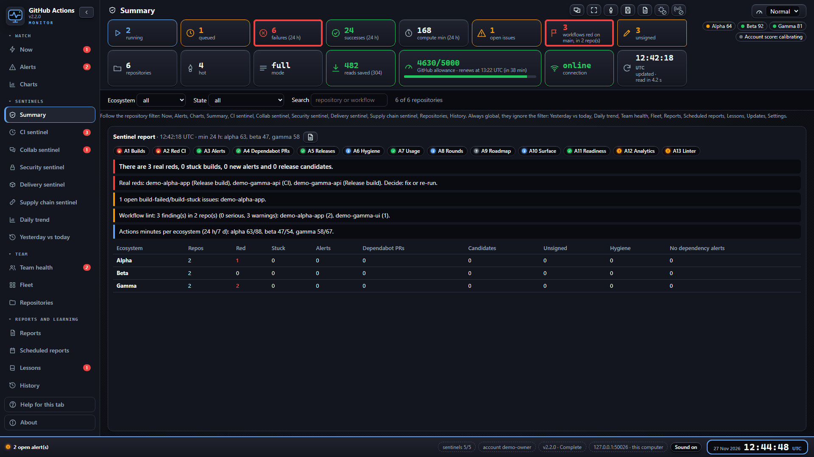</picture></p>
<p align="center"><picture><source media="(prefers-color-scheme: light)" srcset="docs/screenshots/web_sentinel_ci_light.png">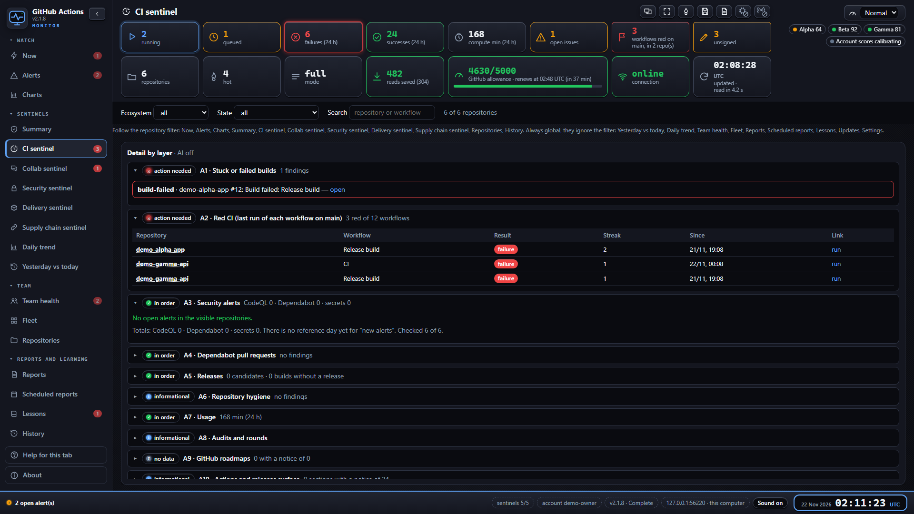</picture></p>
<p align="center"><picture><source media="(prefers-color-scheme: light)" srcset="docs/screenshots/web_sentinel_collab_light.png">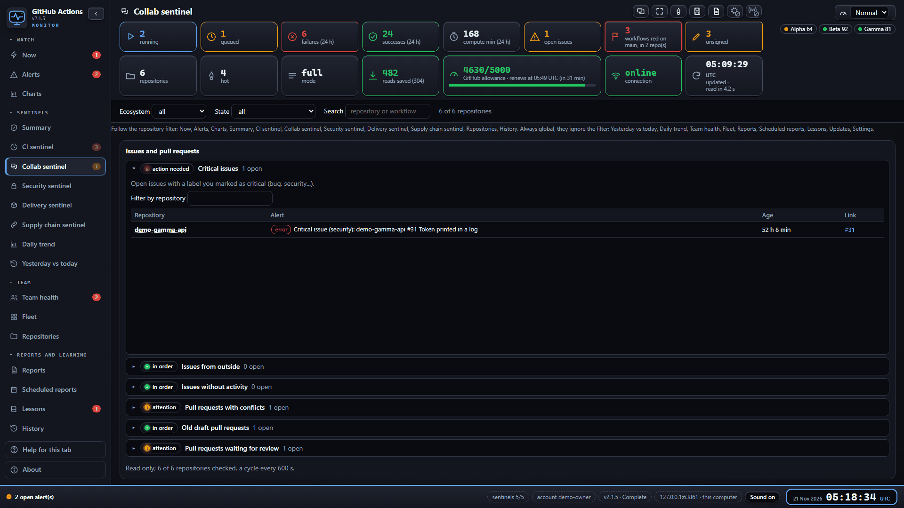</picture></p>
<p align="center"><picture><source media="(prefers-color-scheme: light)" srcset="docs/screenshots/web_sentinel_delivery_light.png">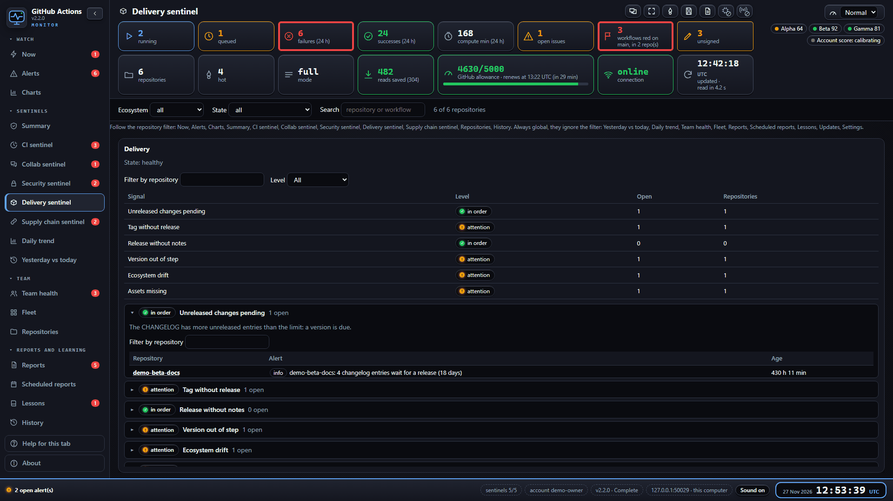</picture></p>
<p align="center"><picture><source media="(prefers-color-scheme: light)" srcset="docs/screenshots/web_sentinel_supply_light.png">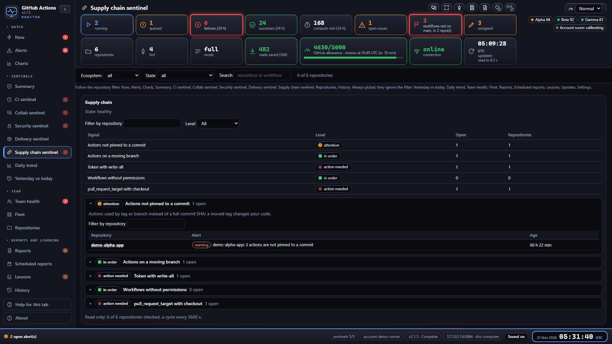</picture></p>
<p align="center"><picture><source media="(prefers-color-scheme: light)" srcset="docs/screenshots/web_sentinel_trend_light.png">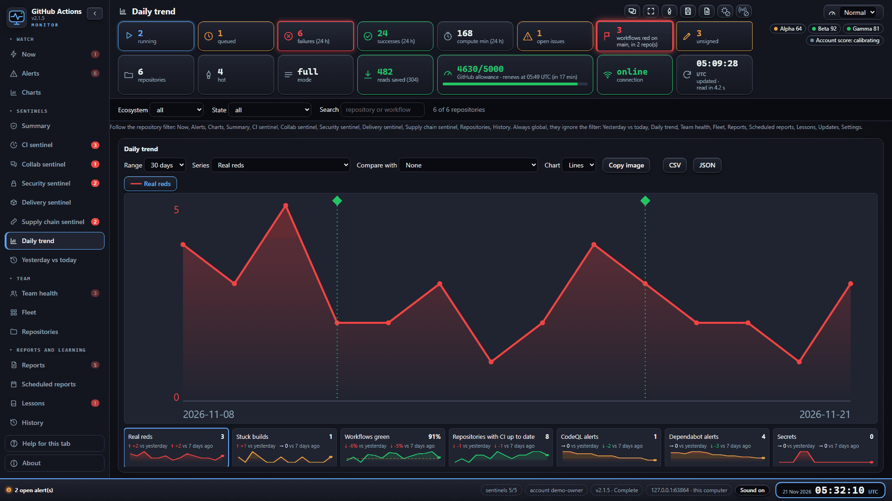</picture></p>
<p align="center"><picture><source media="(prefers-color-scheme: light)" srcset="docs/screenshots/web_fleet_light.png">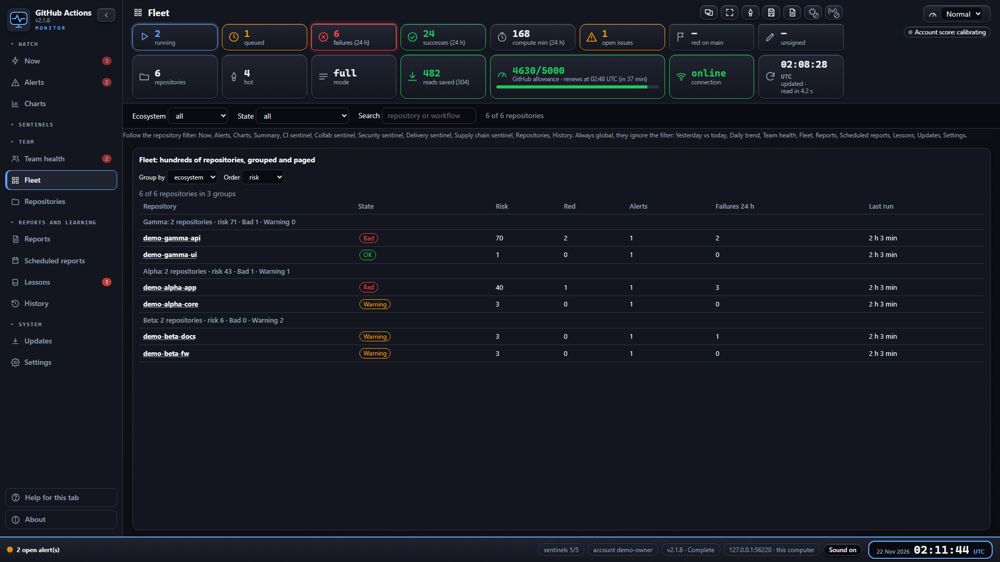</picture></p>
<p align="center"><picture><source media="(prefers-color-scheme: light)" srcset="docs/screenshots/web_reports_light.png">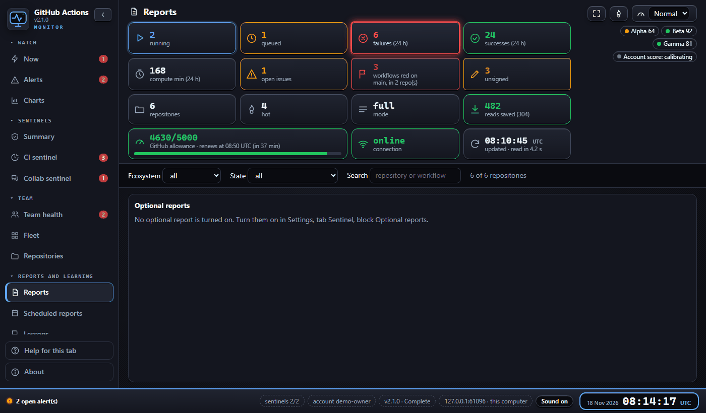</picture></p>
<p align="center">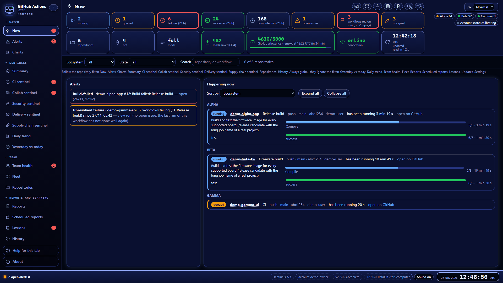</p>
<p align="center">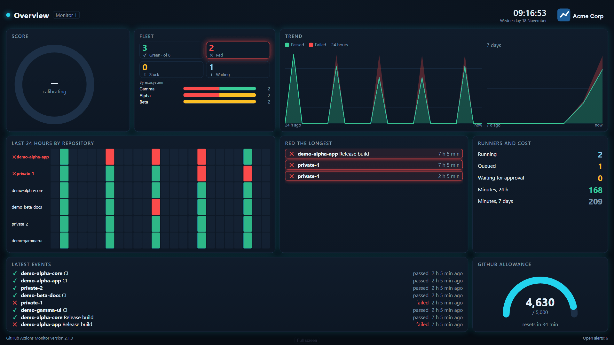</p>
<p align="center"></p>
<p align="center"></p>
<p align="center"></p>
<p align="center"></p>
<p align="center"><picture><source media="(prefers-color-scheme: light)" srcset="docs/screenshots/web_alerts_light.png"></picture></p>
<p align="center"><picture><source media="(prefers-color-scheme: light)" srcset="docs/screenshots/web_sentinel_light.png">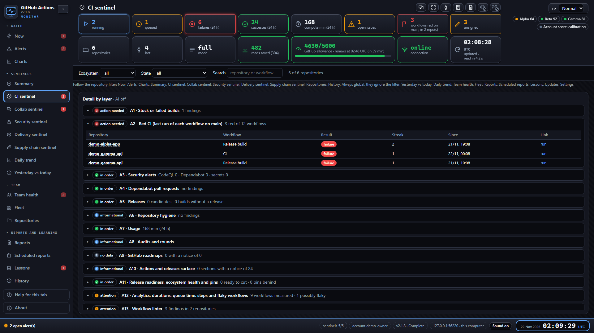</picture></p>
<p align="center"><picture><source media="(prefers-color-scheme: light)" srcset="docs/screenshots/web_sentinel_queue_light.png"></picture></p>
<p align="center"><picture><source media="(prefers-color-scheme: light)" srcset="docs/screenshots/web_sentinel_analytics_light.png"></picture></p>
<p align="center"><picture><source media="(prefers-color-scheme: light)" srcset="docs/screenshots/web_charts_light.png"></picture></p>
<p align="center"><picture><source media="(prefers-color-scheme: light)" srcset="docs/screenshots/web_compare_light.png">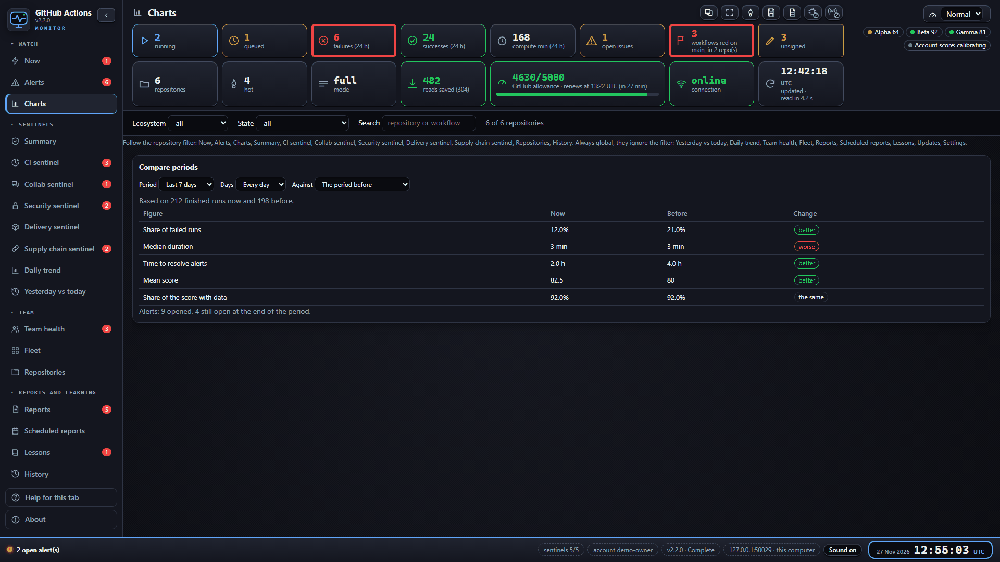</picture></p>
<p align="center"><picture><source media="(prefers-color-scheme: light)" srcset="docs/screenshots/web_repositories_light.png"></picture></p>
<p align="center"><picture><source media="(prefers-color-scheme: light)" srcset="docs/screenshots/web_team_light.png"></picture></p>
<p align="center"><picture><source media="(prefers-color-scheme: light)" srcset="docs/screenshots/web_history_light.png"></picture></p>

<p align="center"><picture><source media="(prefers-color-scheme: light)" srcset="docs/screenshots/web_about_light.png"></picture></p>
<p align="center">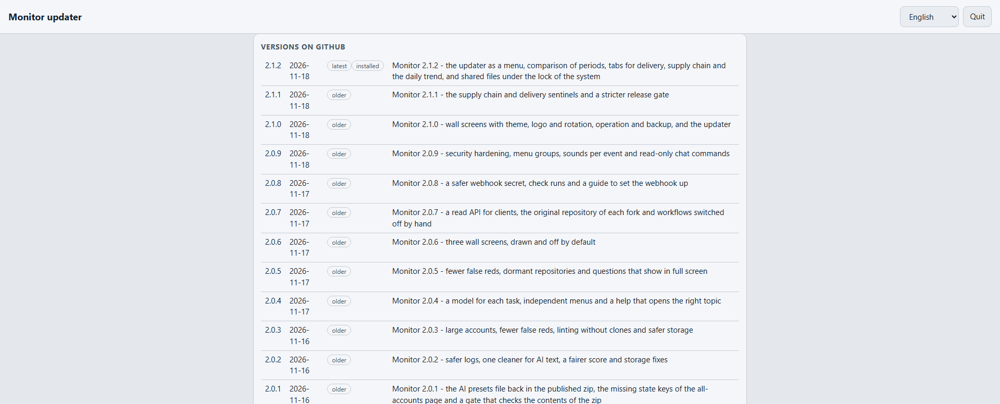</p>
<p align="center"><picture><source media="(prefers-color-scheme: light)" srcset="docs/screenshots/web_updates_light.png">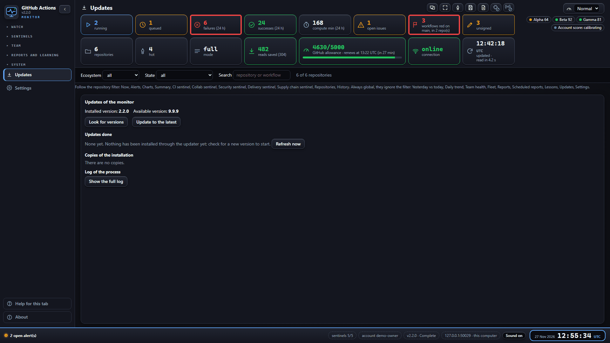</picture></p>
<p align="center"><picture><source media="(prefers-color-scheme: light)" srcset="docs/screenshots/web_help_light.png"></picture></p>
<p align="center"><picture><source media="(prefers-color-scheme: light)" srcset="docs/screenshots/web_settings_basic_light.png"></picture></p>
<p align="center"><picture><source media="(prefers-color-scheme: light)" srcset="docs/screenshots/web_network_now_light.png"></picture></p>
<p align="center"><picture><source media="(prefers-color-scheme: light)" srcset="docs/screenshots/web_network_notices_light.png"></picture></p>
<p align="center"><picture><source media="(prefers-color-scheme: light)" srcset="docs/screenshots/web_network_settings_light.png"></picture></p>
<p align="center"><picture><source media="(prefers-color-scheme: light)" srcset="docs/screenshots/web_accounts_all_light.png"></picture></p>
<p align="center"><picture><source media="(prefers-color-scheme: light)" srcset="docs/screenshots/web_accounts_one_light.png">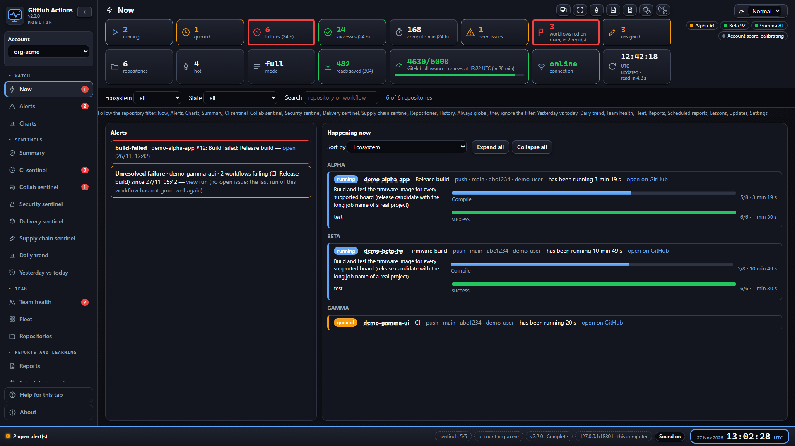</picture></p>
<p align="center"><picture><source media="(prefers-color-scheme: light)" srcset="docs/screenshots/web_accounts_live_light.png"></picture></p>

<details><summary><b>Configuración, subpestaña a subpestaña</b></summary>

<p align="center"><picture><source media="(prefers-color-scheme: light)" srcset="docs/screenshots/web_settings_interface_light.png"></picture></p>
<p align="center"><picture><source media="(prefers-color-scheme: light)" srcset="docs/screenshots/web_settings_general_light.png"></picture></p>
<p align="center"><picture><source media="(prefers-color-scheme: light)" srcset="docs/screenshots/web_settings_polling_light.png"></picture></p>
<p align="center"><picture><source media="(prefers-color-scheme: light)" srcset="docs/screenshots/web_settings_cache_light.png"></picture></p>
<p align="center"><picture><source media="(prefers-color-scheme: light)" srcset="docs/screenshots/web_settings_quota_light.png">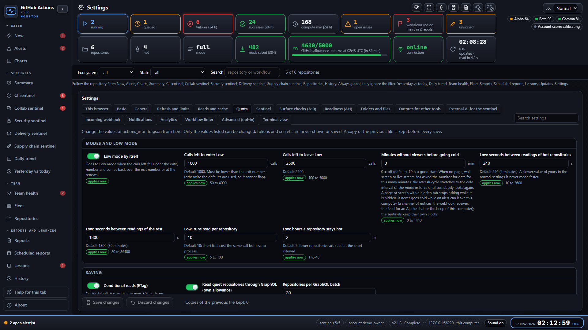</picture></p>
<p align="center"><picture><source media="(prefers-color-scheme: light)" srcset="docs/screenshots/web_settings_sentinel_light.png"></picture></p>
<p align="center"><picture><source media="(prefers-color-scheme: light)" srcset="docs/screenshots/web_settings_surface_light.png"></picture></p>
<p align="center"><picture><source media="(prefers-color-scheme: light)" srcset="docs/screenshots/web_settings_readiness_light.png"></picture></p>
<p align="center"><picture><source media="(prefers-color-scheme: light)" srcset="docs/screenshots/web_settings_paths_light.png"></picture></p>
<p align="center"><picture><source media="(prefers-color-scheme: light)" srcset="docs/screenshots/web_settings_outputs_light.png"></picture></p>
<p align="center"><picture><source media="(prefers-color-scheme: light)" srcset="docs/screenshots/web_settings_ai_light.png"></picture></p>
<p align="center"><picture><source media="(prefers-color-scheme: light)" srcset="docs/screenshots/web_settings_webhook_light.png"></picture></p>
<p align="center"><picture><source media="(prefers-color-scheme: light)" srcset="docs/screenshots/web_settings_notify_light.png"></picture></p>
<p align="center"><picture><source media="(prefers-color-scheme: light)" srcset="docs/screenshots/web_settings_analytics_light.png"></picture></p>
<p align="center"><picture><source media="(prefers-color-scheme: light)" srcset="docs/screenshots/web_settings_lint_light.png"></picture></p>
<p align="center"><picture><source media="(prefers-color-scheme: light)" srcset="docs/screenshots/web_settings_console_light.png"></picture></p>
<p align="center"><picture><source media="(prefers-color-scheme: light)" srcset="docs/screenshots/web_settings_advanced_light.png"></picture></p>

</details>

<details><summary><b>Herramientas de consola</b></summary>

<p align="center"><picture><source media="(prefers-color-scheme: light)" srcset="docs/screenshots/console_read_report_light.png"></picture></p>
<p align="center"><picture><source media="(prefers-color-scheme: light)" srcset="docs/screenshots/console_migrate_state_light.png"></picture></p>
<p align="center"><picture><source media="(prefers-color-scheme: light)" srcset="docs/screenshots/console_plan_light.png"></picture></p>
<p align="center"><picture><source media="(prefers-color-scheme: light)" srcset="docs/screenshots/console_lint_light.png">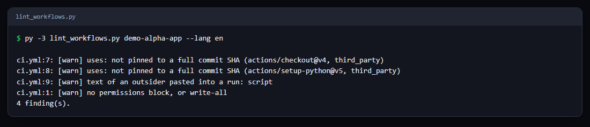</picture></p>
<p align="center"><picture><source media="(prefers-color-scheme: light)" srcset="docs/screenshots/console_tui_light.png"></picture></p>

</details>

<details><summary><b>La edición lite</b></summary>

<p align="center"><picture><source media="(prefers-color-scheme: light)" srcset="docs/screenshots/web_lite_now_light.png"></picture></p>
<p align="center"><picture><source media="(prefers-color-scheme: light)" srcset="docs/screenshots/web_lite_charts_light.png"></picture></p>
<p align="center"><picture><source media="(prefers-color-scheme: light)" srcset="docs/screenshots/web_lite_history_light.png"></picture></p>
<p align="center"><picture><source media="(prefers-color-scheme: light)" srcset="docs/screenshots/web_lite_settings_light.png"></picture></p>

</details>

Cada imagen sigue el tema claro u oscuro de tu página de GitHub.

*Datos de demostración: los repositorios y nombres de las imágenes son inventados.*

## Ajustes

Todo vive en `actions_monitor.json` (se crea desde `monitor/assets/examples/actions_monitor.example.json`). La pestaña **Ajustes** lo edita con seguridad; los tokens y secretos nunca se muestran ni se guardan. Los ecosistemas, los objetivos de compilación y los perfiles de lotes son ficheros aparte a los que apuntas (`ecosystems_file`, `targets_file`, `profiles_file`); se incluyen plantillas neutras `*.example.json`. Referencia completa: [`monitor/docs/SETTINGS_spa.md`](monitor/docs/SETTINGS_spa.md).

## Salidas para Grafana y paneles

Todo apagado por defecto, solo local (`127.0.0.1`) y sin token adicional. Al activarlo en Ajustes obtienes `/metrics` (formato Prometheus), `/api/outputs/grafana.json` y `/api/outputs/dashboard.json`, además de un panel de Grafana importable en [`monitor/docs/grafana`](monitor/docs/grafana). Detalles: [`monitor/docs/OUTPUTS_spa.md`](monitor/docs/OUTPUTS_spa.md). El formato de `ci_red.json`: [`monitor/docs/CI_RED_SCHEMA_spa.md`](monitor/docs/CI_RED_SCHEMA_spa.md).

## Seguridad

- Escucha solo en `127.0.0.1` y rechaza las peticiones cuyo `Host` u `Origin` no sean locales. No lo enlaces nunca a `0.0.0.0`: no tiene inicio de sesión.
- No guarda ningún token: usa tu propio `gh` (salvo que actives el token opcional del monitor en Ajustes > Avanzado).
- No escribe nada en GitHub por sí solo. Solo `dispatch --go`, `dispatch --real` y `finalize --execute` escriben, y únicamente cuando tú los lanzas.
- El modo de red y el modo de equipo están apagados por defecto; encendidos, el acceso, los roles, los bloqueos y el registro de auditoría protegen la página, y cada petición se juzga para una sola cuenta (`monitor/docs/DEPLOYMENT.md`, `monitor/docs/ACCOUNTS.md`).
- **Analítica**: p50 / p95 de la duración, del tiempo en cola y de cada paso de cada workflow, workflows inestables (fallan y luego pasan en el mismo commit) y workflows que se han vuelto más lentos; exportado a Prometheus y Grafana.
- **Ahorra cuota y sobrevive a un corte**: lecturas condicionales (un 304 no cuesta nada) y un modo de última imagen con aviso de sin conexión que se reanuda solo.
- **Webhook de entrada y notificaciones**: eventos firmados actualizan un repositorio en tiempo real; mensajes opcionales a Telegram, Discord, Slack, Matrix, MQTT o una dirección local (nunca una escritura en GitHub).
- **Linter de workflows y vista de consola**: `bin/lint_workflows.py` revisa `.github/workflows` antes de subir; `bin/tui.py` (opcional, con `rich`) muestra una cuadrícula en vivo en la consola.
- **Asistente de IA (apagado por defecto)**: resúmenes, triaje y explicaciones con Ollama, un servicio compatible con OpenAI, Anthropic o `gh copilot`; solo comandos de una lista cerrada, que se ejecutan únicamente tras confirmar cada uno.
- La página de ajustes escribe una lista fija de claves, validadas, tras guardar una copia de seguridad.

## Pruebas

No necesitan red ni paquetes adicionales:

```
python -m unittest discover -s monitor/tests
```

## Estructura del repositorio

<p align="center">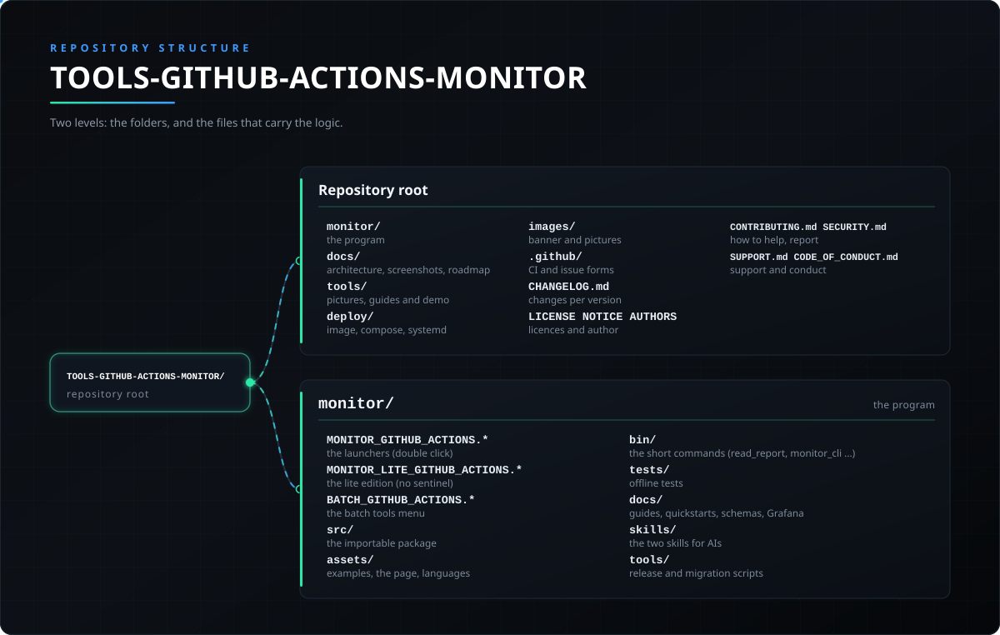</p>

```
TOOLS-GITHUB-ACTIONS-MONITOR/
├── monitor/                            el programa
├── docs/                               arquitectura, capturas, hoja de ruta
├── tools/                              dibujos, guías y demo
├── deploy/                             imagen, compose, systemd
├── images/                             banner y dibujos
├── .github/                            CI y formularios
├── CHANGELOG.md                        cambios por versión
├── LICENSE NOTICE AUTHORS              licencias y autoría
├── CONTRIBUTING.md SECURITY.md         cómo ayudar, informar
├── SUPPORT.md CODE_OF_CONDUCT.md       soporte y conducta
└── monitor/
    ├── MONITOR_GITHUB_ACTIONS.*        los lanzadores (doble clic)
    ├── MONITOR_LITE_GITHUB_ACTIONS.*   la edición lite (sin centinela)
    ├── BATCH_GITHUB_ACTIONS.*          el menú de compilaciones por lotes
    ├── src/                            el paquete importable
    ├── assets/                         ejemplos, la página, idiomas
    ├── bin/                            los comandos cortos (read_report, monitor_cli ...)
    ├── tests/                          tests sin red
    ├── docs/                           guías, inicios rápidos, esquemas, Grafana
    ├── skills/                         las dos skills para IAs
    └── tools/                          scripts de versión y migración
```

## Documentación

- [`monitor/docs/SETTINGS_spa.md`](monitor/docs/SETTINGS_spa.md): todos los ajustes
- [`monitor/docs/OUTPUTS_spa.md`](monitor/docs/OUTPUTS_spa.md): métricas, Grafana y exportaciones
- [`monitor/docs/CI_RED_SCHEMA_spa.md`](monitor/docs/CI_RED_SCHEMA_spa.md): el formato de ci_red.json
- [`monitor/docs/CI_RED_BRIDGE_spa.md`](monitor/docs/CI_RED_BRIDGE_spa.md): llevar ci_red.json a un panel
- [`monitor/docs/WEBHOOK_spa.md`](monitor/docs/WEBHOOK_spa.md): el webhook de entrada
- [`monitor/docs/CHATOPS_spa.md`](monitor/docs/CHATOPS_spa.md): comandos de chat de solo lectura para Slack y Discord
- [`monitor/docs/SOUNDS_spa.md`](monitor/docs/SOUNDS_spa.md): un sonido para cada tipo de evento
- [`monitor/docs/UPDATE_spa.md`](monitor/docs/UPDATE_spa.md): el actualizador: pasar a otra versión y migrar la configuración
- [`monitor/docs/OPS_spa.md`](monitor/docs/OPS_spa.md): Operar la instalación: copia de seguridad completa, restauración, copia programada, purga bajo demanda, el doctor y sus códigos de salida, appliance con systemd y Docker
- [`monitor/docs/LITE_spa.md`](monitor/docs/LITE_spa.md): La edición lite
- [`monitor/docs/COMPLETE_INDIVIDUAL_spa.md`](monitor/docs/COMPLETE_INDIVIDUAL_spa.md): Edición completa para una persona
- [`monitor/docs/COMPLETE_SERVICE_spa.md`](monitor/docs/COMPLETE_SERVICE_spa.md): Edición completa como servicio
- [`monitor/docs/COMPLETE_TEAM_spa.md`](monitor/docs/COMPLETE_TEAM_spa.md): Edición completa para un equipo
- [`monitor/docs/API_spa.md`](monitor/docs/API_spa.md): La API para clientes
- [`monitor/docs/NOTIFICATIONS_spa.md`](monitor/docs/NOTIFICATIONS_spa.md): notificaciones y el contrato de los adaptadores
- [`monitor/docs/AI_spa.md`](monitor/docs/AI_spa.md): el asistente de IA: proveedores, seguridad y acciones
- [`monitor/docs/ANALYTICS_spa.md`](monitor/docs/ANALYTICS_spa.md): analítica, lecturas condicionales y conexión perdida
- [`monitor/docs/CONSOLE_TOOLS_spa.md`](monitor/docs/CONSOLE_TOOLS_spa.md): el linter de workflows y la vista de consola
- [`monitor/docs/DEPLOYMENT_spa.md`](monitor/docs/DEPLOYMENT_spa.md): ejecutarlo como servicio (la imagen oficial, Compose, systemd), tras un proxy, cuando GitHub revoca el acceso, permisos
- [`monitor/docs/LAYOUT_spa.md`](monitor/docs/LAYOUT_spa.md): las carpetas del monitor, el traslado desde la 1.8.1 y el mapa para las IA
- [`monitor/docs/QUICKSTART_es.txt`](monitor/docs/QUICKSTART_es.txt): primeros pasos, en ocho idiomas
- [`monitor/docs/FIRST_STEPS_spa.md`](monitor/docs/FIRST_STEPS_spa.md): tus primeros cinco minutos
- [`monitor/docs/SENTINEL_spa.md`](monitor/docs/SENTINEL_spa.md): el centinela y sus comprobaciones A1-A13
- [`monitor/docs/COLLAB_spa.md`](monitor/docs/COLLAB_spa.md): el centinela Collab, la pestaña Alertas y los silencios
- [`monitor/docs/SENTINEL_SECURITY_spa.md`](monitor/docs/SENTINEL_SECURITY_spa.md): El centinela de seguridad: Dependabot, análisis de código, secretos, protección de ramas, permisos de los flujos y CODEOWNERS, y lo que no pudo comprobar
- [`monitor/docs/SENTINEL_SUPPLY_spa.md`](monitor/docs/SENTINEL_SUPPLY_spa.md): El centinela de cadena de suministro: acciones sin fijar, ramas móviles, permisos de flujo amplios o ausentes y pull_request_target con descarga, y lo que no pudo leer
- [`monitor/docs/SENTINEL_DELIVERY_spa.md`](monitor/docs/SENTINEL_DELIVERY_spa.md): El centinela de entrega: entradas sin publicar, etiquetas sin versión, versiones sin notas ni ficheros, versiones que no coinciden y fijaciones por detrás de un contrato compartido, y lo que no pudo leer
- [`monitor/docs/AUDIT_LOG_spa.md`](monitor/docs/AUDIT_LOG_spa.md): El registro de acciones: quién cambió qué, la cadena de hashes, quién lo lee y los ajustes
- [`monitor/docs/HEALTH_spa.md`](monitor/docs/HEALTH_spa.md): La salud de un repositorio y del equipo: de qué se compone, la pestaña Equipo, los enlaces directos y la API
- [`monitor/docs/REPORT_SCHEDULE_spa.md`](monitor/docs/REPORT_SCHEDULE_spa.md): Informes programados: la puntuación, lo que ha cambiado, los repositorios que necesitan a una persona y las alertas abiertas en HTML y Markdown, el horario y los ficheros
- [`monitor/docs/CLI_spa.md`](monitor/docs/CLI_spa.md): la línea de comandos como cliente del monitor
- [`monitor/docs/ACCOUNTS_spa.md`](monitor/docs/ACCOUNTS_spa.md): varias cuentas, un proceso para cada una
- [`monitor/docs/QUOTAS_spa.md`](monitor/docs/QUOTAS_spa.md): cuotas y planes de GitHub
- [`monitor/docs/MODES_spa.md`](monitor/docs/MODES_spa.md): modos de trabajo: normal, rápido y turbo
- [`monitor/docs/AI_CONNECTION_spa.md`](monitor/docs/AI_CONNECTION_spa.md): Conectar una herramienta de IA: todo lo que dice el monitor, como señales, en el resumen, el endpoint, las herramientas MCP y el hook
- [`monitor/docs/AI_SETUP_PROMPT_spa.md`](monitor/docs/AI_SETUP_PROMPT_spa.md): Configurar el monitor con una IA: un prompt para pegar en tu asistente de IA que lo instala, te pregunta qué quieres y escribe la configuración
- [`monitor/docs/QUOTA_spa.md`](monitor/docs/QUOTA_spa.md): Más cuota, menos gasto: modo Bajo, el panel central, una GitHub App y cómo compartir la cuota
- [`monitor/docs/EXTRAS_spa.md`](monitor/docs/EXTRAS_spa.md): Extras opcionales: el registro del paso fallido y un token de solo lectura de la GitHub App
- [`monitor/docs/SCORE_spa.md`](monitor/docs/SCORE_spa.md): La puntuación de una cuenta: partes, estados, API, la ficha de la cabecera, la alerta y los ajustes
- [`monitor/docs/COMPARE_spa.md`](monitor/docs/COMPARE_spa.md): Comparar periodos: este periodo frente al anterior, las cifras, el filtro de calendario, los estados sin número, la API, el comando y los ajustes
- [`monitor/docs/STORAGE_spa.md`](monitor/docs/STORAGE_spa.md): Almacenamiento y retención: ficheros o SQLite, copia de seguridad, migración y qué se conserva
- [`monitor/docs/ADVANCED_spa.md`](monitor/docs/ADVANCED_spa.md): Funciones avanzadas (todas apagadas por defecto)
- [`monitor/docs/AI_ALERTS_spa.md`](monitor/docs/AI_ALERTS_spa.md): Avisos para IAs: el feed, el resumen, el hook y el stream
- [`monitor/docs/AUDIT_PACKAGE_spa.md`](monitor/docs/AUDIT_PACKAGE_spa.md): Paquete para el auditor
- [`monitor/docs/LARGE_ACCOUNTS_spa.md`](monitor/docs/LARGE_ACCOUNTS_spa.md): Cuentas grandes: cientos de repositorios
- [`monitor/docs/ORGANIZATIONS_spa.md`](monitor/docs/ORGANIZATIONS_spa.md): Organizaciones y cuentas grandes

## Contribuir

Lee [CONTRIBUTING.md](CONTRIBUTING.md). Informa de fallos e ideas con los formularios de incidencias; los problemas de seguridad, como se describe en [SECURITY.md](SECURITY.md).

## Autoría

Escrito por **JuanenRac (Electro Hobby 3D)** · electrohobby3d@gmail.com

## Licencia

El código es GPL-3.0-or-later; la documentación es CC BY-SA 4.0. Consulta [LICENSE](LICENSE) y [NOTICE](NOTICE).
