<p align="center">
  
</p>

# GitHub Actions Monitor

<p align="center">
  <a href="README.md">🇺🇸 English</a> |
  <a href="README_spa.md">🇪🇸 Español</a> |
  <a href="README_fra.md">🇫🇷 Français</a> |
  <a href="README_ita.md">🇮🇹 Italiano</a> |
  <a href="README_deu.md">🇩🇪 Deutsch</a> |
  <b>🇨🇳 简体中文</b> |
  <a href="README_jpn.md">🇯🇵 日本語</a> |
  <a href="README_por.md">🇵🇹 Português</a>
</p>

<p align="center">
  <a href="https://github.com/JuanenRac/TOOLS-GITHUB-ACTIONS-MONITOR/releases/latest"></a>
  
  
  
  
  
</p>

> 监视你所有仓库的工作流，并在一个本地页面上告诉你：哪些是红的、哪些卡住了、哪些在等你处理。

**GitHub Actions Monitor** 是运行在你自己电脑上的小程序。它通过你自己的 `gh` 登录向 GitHub 查询仓库中每个工作流的最近运行，判断哪些真正是红的，提醒重要事项（安全、卫生、可发布的版本、配额），并把一切显示在只有你的机器能打开的网页上。它只需要 Python 和 `gh`，从不保存令牌，默认只读取。

## 这是什么

- **GitHub Actions 的看守**:使用您自己的 `gh` 登录,读取您所有仓库中每个工作流的最近运行,判断什么是红色、什么卡住了、什么在等您处理。
- **三个从不写入 GitHub 的哨兵**:CI(运行和工作流)、Collab(需要人处理的 issue 和拉取请求)和 Security(Dependabot、代码扫描、密钥扫描、分支保护)把读到的内容变成同一份列表中的警报。
- **一个页面,多种查看方式**:位于 `127.0.0.1` 的本地页面,从手机到 4K 墙面屏都能适配(最多同时三块屏幕),另有命令行客户端、终端视图、文件和供您自己仪表板使用的端点。
- **两个版本**:Lite 面向一个人,只显示运行;Complete 增加多账户、带角色的团队、评分、每个仓库的健康状况、报告和 Docker 服务。
- **从设计上保护隐私**:除了用您的登录对 GitHub 发出的调用,没有任何内容离开您的电脑;可选 AI 的密钥只留在环境变量中;只有您带明确的 `--go` 运行的批处理命令才会写入 GitHub。

## 功能

- **是否为红，只用一条规则**：默认分支上每个工作流最后一次已结束的运行。已取消或已跳过的运行不会掩盖之前的失败。
- **哨兵**：安全警报、仓库卫生、陈旧的拉取请求、可发布的版本、等待签名的构建，以及通俗易懂的报告。
- **Collab 哨兵与统一警报列表**：需要人来处理的未关闭 Issue 和拉取请求（被遗忘的、严重的、等待评审的、陈旧草稿、冲突），只读且按自己的周期运行；“警报”标签页把所有哨兵汇总成一个列表，可按来源筛选，并提供会自行结束的本地静音。
- **状态栏、全屏与可排序的表格**：页面底部显示最重要的提示（以及显示全部提示的窗口）、连接、配额、最近一次读取、模式、地址和时钟；全屏按钮；“仓库”和“历史”可按一列或多列排序，并可自选列。
- **作为客户端的命令行**：`bin/monitor_cli.py`（`status`、`health`、`alerts`、`accounts`、`live`、`doctor`、`score`）读取运行中监视器给出的信息，支持 `--json` 和稳定的退出码；从不向 GitHub 写入。
- **两份面向 AI 的技能包**：简短的英文指南，分别给监视器内置的 AI(本地或来自提供商)和从外部与其交互的 AI(命令行、仅 HTTP 或文件、MCP、事件流)，由代码生成以确保没有遗漏；可用 `python bin/monitor_cli.py install-skill internal|external --dest 文件夹` 安装，或在设置的 AI 标签页中复制（`monitor/docs/SKILLS_zho.md`）。
- **失败与经验**：本地的 CI 失败记录簿、把每个失败归入某个类别的规则、附带本可阻止该失败的防护的经验库（`monitor/docs/LESSONS_zho.md`）、24 小时和 7 天的趋势、`ai/LESSONS.md`、`/api/ai/lessons`，以及供任何 AI 工具使用的推送前简报；只读，不会有内容离开本机。
- **各种屏幕尺寸与多块屏幕**：页面可适应从手机到 4K 的窗口，竖放或旋转均可，一台监视器最多可提供三块屏幕（`/screen/1` 到 `/screen/3`），每块都有自己的标签页和方向（`monitor/docs/SCREENS_zho.md`）。
- **每个账户一个评分**：由 CI 的可靠性、速度、恢复时间以及协作告警被关闭的快慢得出的 0 到 100 的数值、A 到 E 的等级和趋势；无法支撑数值时显示“校准中”或“数据不足”，并说明尚未涵盖的内容，显示在页面页眉，有 `score` 命令，下降时会提醒，并出现在指标和 MCP 服务器中（`monitor/docs/SCORE.md`）。
- **安全哨兵（仅 Complete，默认关闭）**：它不向 GitHub 写入任何内容，只读取 Dependabot、代码扫描和密钥扫描的未处理警报、默认分支是否受保护、工作流的默认权限，以及（如有需要）代码所有者；每个仓库和每种信号生成一条警报，把发现计入评分的第五部分，并说明哪些内容无法读取（`monitor/docs/SENTINEL_SECURITY_zho.md`）。
- **供应链哨兵（仅 Complete，默认关闭）**：它不向 GitHub 写入任何内容，通过 API（无需克隆）读取每个仓库的工作流文件，当某个 Action 未固定到提交或跟随移动分支、某个工作流给令牌 `write-all` 或未声明权限、或 `pull_request_target` 检出拉取请求的代码时，每个仓库和每种信号生成一条警报；发现来自工作流检查器，密钥的值从不被读取，无法读取的仓库会被列出而不是算作干净（`monitor/docs/SENTINEL_SUPPLY_zho.md`）。
- **每个仓库和团队的健康状况（仅 Complete）**：把 CI、三个哨兵的警报、发布就绪情况和活跃度汇总为一个状态（差、警告、正常或未查看）和一个风险值；团队标签页把最需要人处理的仓库排在前面，提供筛选、每个仓库的详情以及用于墙面屏幕的深度链接；同样的数据也可通过 `/api/team/health`、`/api/repos/<owner>/<repo>/health` 和 `team` 命令获得（`monitor/docs/HEALTH_zho.md`）。
- **报告、操作日志和 Apprise（仅 Complete）**：按 cron 计划或按需生成账户报告（评分、变化、需要人处理的仓库、未处理的警报），格式为 HTML 和 Markdown，默认关闭（`monitor/docs/REPORT_SCHEDULE_zho.md`）；记录谁修改了什么的日志，带哈希链，不含任何值或机密（`monitor/docs/AUDIT_LOG_zho.md`）；以及可选的 Apprise 通知渠道，默认关闭。
- **作为服务运行**：官方 Docker 镜像（非 root、只读）、带可选代理的 Compose 文件、systemd 单元、深度健康检查，以及创建第一个管理员的命令（`monitor/docs/DEPLOYMENT.md`）。
- **冻结的 API 与每种用法的指南**：自 2.0.0 起，每个读取端点的形状和错误码都固定在 `monitor/docs/schemas/api_contract.json` 中，一个工具可据此检查任何正在运行的监视器（`monitor/tools/check_api_contract.py`），并为简易版、个人、服务和团队各提供一份简短指南（`monitor/docs/API_zho.md`）。
- **多账户、团队和数据的存放位置**：每个账户一个进程，带角色和各自账户的用户，文件分放在 `config/`、`data/`、`logs/` 和 `ai/`，可选的 SQLite 存储及其保留与备份，端口成为设置项（`monitor/docs/ACCOUNTS.md`、`monitor/docs/STORAGE.md`、`monitor/docs/LAYOUT.md`）。
- **可排序、可折叠的列表**：“正在发生”有七种排序方式，告警标签页有九种，并有折叠或展开所有仓库的按钮；该选择按用户记忆。
- **每位用户的通知**：在团队模式下，每位用户在页面的面板中选择渠道（ntfy、Teams、电子邮件）、最低级别和汇总（`monitor/docs/NOTIFICATIONS_zho.md`）。
- **设置页面**：在浏览器中修改路径、间隔、配额和开关；只有固定且经过验证的键，每次保存前都会备份。
- **图表与历史**：计算分钟数、失败和成功，配有动画条形图和每日历史（尊重“减少动态效果”设置）。
- **八种语言**（en、es、de、fr、it、ja、zh、pt），以英语为基础；在设置中切换。
- **面向仪表板的输出**：`ci_red.json`、Prometheus 端点和 Grafana 用 JSON 数据源，并附带可导入的 Grafana 仪表板。
- **批处理工具**：一次计划并触发多个构建；没有 `--go` 就不会触发任何东西。
- **页面内的“关于”和“帮助”**：**i** 按钮显示版本、版本类型、链接、文件、运行状况和复制支持信息的按钮；**?** 按钮（或 `?` 键）可离线打开全部文档，支持搜索并使用你的语言。控制台提供 `--about` 和 `--help-topics`，以及分标签页的交互式终端应用（可选 `textual`）。
- **新版本提示**：发布较新版本时显示低调的徽章；它每天只读取一次公开发布页，从不安装任何内容，可以关闭（隔离网络安装中始终关闭）。
- **适用于任何账户的配额**：套餐、计费分钟数（公开仓库不计费）、从 GitHub 响应头读取的 API 配额、并发数，以及接近 6 小时上限的作业；数字保存在可编辑的文件中。

## 能节省什么

使用监视器代替手动检查 Actions 可以节省时间。这是**估算,而非实测**:监视 CI 和分诊失败所花时间的约 **85-95 %**,因此对于使用大量仓库的团队,整体生产力约提高 **15-25 %**。该估算假设:没有监视器时,有人要打开每个仓库的 Actions 标签页查看哪些是红色,并逐个阅读失败日志来查找原因;每周都会出现失败;监视和分诊约占工作时间的六分之一到三分之一(只有在这一假设下两个数字才一致)。仓库很少,或者目前没有人手动检查时,节省会小得多。

| 任务 | 没有监视器 | 使用监视器 | 估算节省 |
| --- | --- | --- | --- |
| 监视每个仓库的每个工作流 | 反复打开每个仓库的 Actions 标签页 | 一个页面和一份自动更新的警报列表 | 85-95 % |
| 判断什么才是真正的红色 | 凭肉眼比较运行(已取消和已跳过的运行会掩盖失败) | 一条规则:默认分支上每个工作流最后一次完成的运行 | 85-95 % |
| 查找失败运行的原因 | 依次打开运行、作业和日志 | 警报已指明工作流和失败,并附上对应的经验教训 | 85-95 % |
| 及时得知失败 | 事后才发现,或等别人告知 | 警报、通知以及面向 AI 工具的摘要 | 85-95 % |
| 不重复已知错误、安全、卫生和可发布版本 | 依赖记忆和人工审查 | 经验教训库和哨兵 | 未量化 |

方法、假设以及如何在自己的使用中测量: [`monitor/docs/PRODUCTIVITY_zho.md`](monitor/docs/PRODUCTIVITY_zho.md).

## 概览

| | |
|---|---|
| **版本** | **2.1.3** · [所有发布](https://github.com/JuanenRac/TOOLS-GITHUB-ACTIONS-MONITOR/releases) |
| **需要** | Python 3.11+ 和 GitHub CLI（`gh auth login`）；不需要其他东西(终端视图使用可选的 `rich` 包) |
| **打开** | 仅在 `127.0.0.1` 上的页面，支持八种语言 |
| **写入 GitHub** | 绝不自行写入：只有你用明确的 `--go` 运行的批处理命令才会 |
| **导出** | `ci_red.json`、Prometheus 指标和 Grafana 用 JSON（开启前全部关闭） |

<!-- glance:begin -->

**今日实测** (v2.1.3)

| | |
|---|---|
| **成熟度** | functional |
| **测试** | 4770 个测试方法(`python -m unittest discover -s monitor/tests`) |
| **设置** | 738 个设置,均有帮助 |
| **语言** | 8 种(英语、西班牙语、德语、法语、意大利语、日语、中文和葡萄牙语) |
| **CI 测试平台** | ubuntu, windows,Python 3.11, 3.13 |

## 项目状态

每一行是本仓库的一个部分,指示灯表示它今天的进度:测试和 CI 能证明的、以及真正运行过的,而不是计划中的。

🟢 已完成并验证 · 🟡 可用,有已知限制 · 🟠 部分完成或尚未验证 · 🔴 未完成或不能用

| 范围 | 状态 | 含义 |
|---|---|---|
| 监视器与页面 | 🟢 | 每天在真实账户上运行;测试在 CI 的 Ubuntu 和 Windows 上运行。 |
| 哨兵(A1..A13) | 🟢 | 每天在真实账户上运行;其级别和行用固定数据测试。 |
| 通知 | 🟡 | 已针对模拟服务器测试;并非每个渠道都在真实服务上试过。 |
| AI 工具连接与 MCP | 🟡 | 信息流、状态、事件流、钩子和 MCP 工具已用真实服务器和模拟客户端测试;尚无独立用户使用过。 |
| Lite 版 | 🟡 | 已在 CI 中测试,与完整版共用通道和设置;迄今实际使用较少。 |
| GitHub App、中央面板和节省模式 | 🟠 | 新功能:已用模拟服务器和文件测试;尚未长时间对真实服务运行。 |
| 每个账户的评分 | 🟡 | 已用合成数据序列、测试数据和模拟服务器验证；尚未在真实账户上连续观察数周。 |
| Docker 镜像与服务模式 | 🟡 | 镜像在 CI 中构建并验证（非 root、只读、登录被撤销）；作为长期运行服务的时间还不长。 |
| 团队模式与多账户 | 🟡 | 已用真实进程和模拟用户验证；真实团队尚未长期使用。 |
| 存储（文件与 SQLite） | 🟡 | 已用两种存储及其间的迁移验证；已使用数月的数据库尚未经历过升级。 |
| Linux 和 macOS | 🟠 | Linux 仅在 CI 中测试;macOS 暂不在 CI 中测试;日常使用在 Windows 上。 |

<!-- glance:end -->

## 架构

<p align="center"></p>

## 从这里开始：选哪个版本？

| 如果你想... | 启动 | 端口 |
|---|---|---|
| 只看什么在运行、什么失败了（**从这里开始**） | `MONITOR_LITE_GITHUB_ACTIONS` | 8766 |
| 让整个账户被替你监视：警报、发布、签名、就绪度、分析 | `MONITOR_GITHUB_ACTIONS`（含[哨兵](monitor/docs/SENTINEL_zho.md)） | 8765 |

控制台窗口的标题和第一行会说明正在运行哪一个。还拿不准？`python bin/actions_monitor.py --demo` 用虚构数据打开页面，`--doctor` 检查你的安装。[你的前五分钟](monitor/docs/FIRST_STEPS_zho.md)

## 快速开始

1. 安装 Python 3.11 或更新版本和 [GitHub CLI](https://cli.github.com/)，然后运行 `gh auth login`。
2. 下载本仓库（或最新发布的 zip），打开 `monitor` 文件夹。
3. 启动：Windows 运行 `MONITOR_GITHUB_ACTIONS.bat`，Linux 运行 `./MONITOR_GITHUB_ACTIONS.sh`，macOS 双击 `MONITOR_GITHUB_ACTIONS.command`，或在任何系统运行 `python bin/actions_monitor.py`。
4. 打开它打印的地址（`http://127.0.0.1:<端口>`）。首次启动时会根据示例创建 `actions_monitor.json`。
5. 打开 **设置**，填写你的 GitHub 账号、生态系统（按名称前缀分组的仓库）和其他内容。

> 从 1.5.0 之前的版本更新？ [`monitor/docs/MIGRATING_zho.md`](monitor/docs/MIGRATING_zho.md)

## lite 版

同一软件包里的第二个、更简单的产品:显示正在运行和失败内容的页面,没有哨兵。适合只想看自己运行情况的人。

|  | 完整版 | lite 版 |
|---|---|---|
| 启动 | `MONITOR_GITHUB_ACTIONS`(`.bat` / `.sh` / `.command`) | `MONITOR_LITE_GITHUB_ACTIONS`(同样三个) |
| 端口 | 8765 | 8766 |
| 标签页 | 现在、哨兵、图表、仓库、历史、设置 | 现在、图表、仓库、历史、简短设置 |
| 页眉 | 所有磁贴、就绪、签名 | 运行中、排队、24 小时的失败与成功、计算分钟、issue、main 上的红色、仓库、配额、连接 |
| 哨兵(警报、发布、签名队列、就绪、检查器) | 有 | 无:甚至不会被导入 |
| 分析、通知、Webhook、AI、Prometheus / Grafana 输出 | 有,开启前默认关闭 | 无:这些路径返回 404 |
| 配置 | `actions_monitor.json` | `actions_monitor_lite.json`(首次启动时创建;其中哨兵为关闭) |
| 状态文件 | `etag_cache.json`、`analytics_history.json` 等 | 同名文件加后缀 `_lite` |

[`monitor/docs/LITE_zho.md`](monitor/docs/LITE_zho.md)

## 截图

### 页面

<p align="center"><picture><source media="(prefers-color-scheme: light)" srcset="docs/screenshots/web_now_light.png"></picture></p>
<p align="center"><picture><source media="(prefers-color-scheme: light)" srcset="docs/screenshots/web_menu_groups_light.png">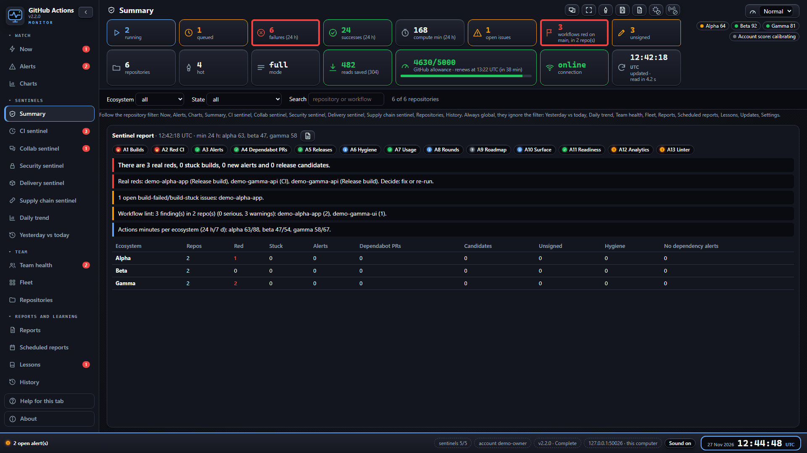</picture></p>
<p align="center"><picture><source media="(prefers-color-scheme: light)" srcset="docs/screenshots/web_sentinel_ci_light.png">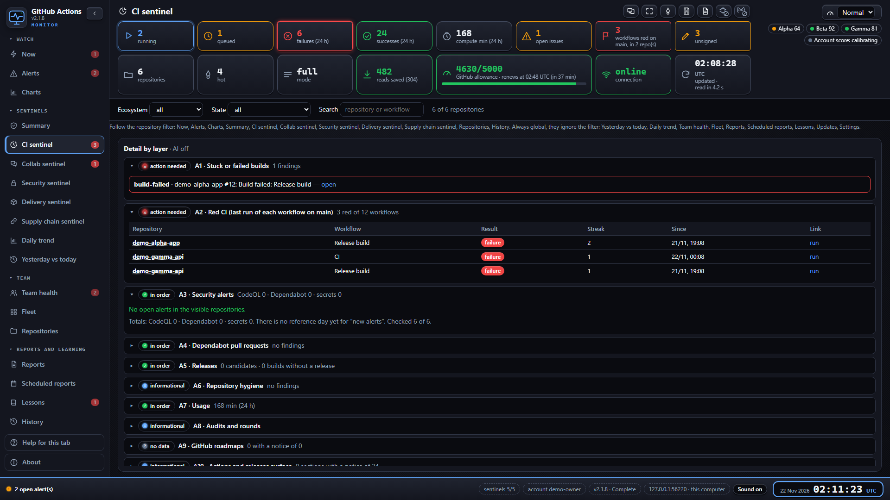</picture></p>
<p align="center"><picture><source media="(prefers-color-scheme: light)" srcset="docs/screenshots/web_sentinel_collab_light.png">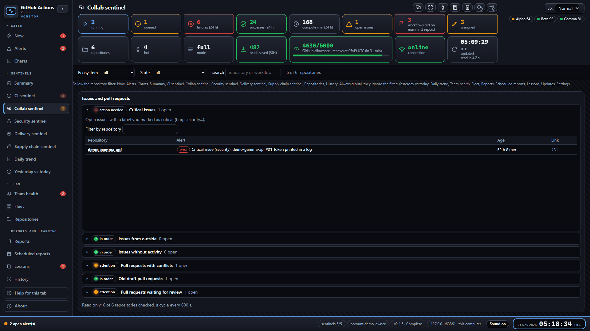</picture></p>
<p align="center"><picture><source media="(prefers-color-scheme: light)" srcset="docs/screenshots/web_sentinel_delivery_light.png">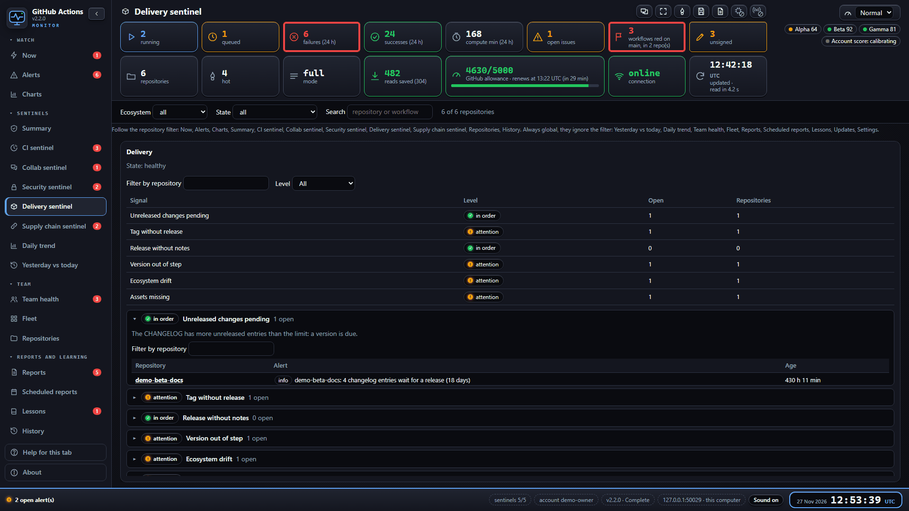</picture></p>
<p align="center"><picture><source media="(prefers-color-scheme: light)" srcset="docs/screenshots/web_sentinel_supply_light.png">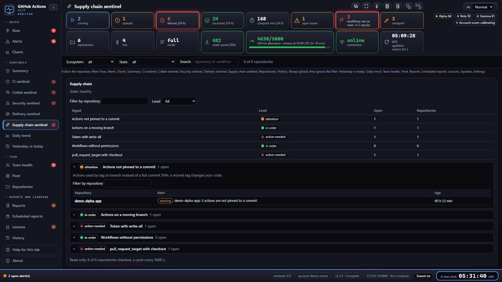</picture></p>
<p align="center"><picture><source media="(prefers-color-scheme: light)" srcset="docs/screenshots/web_sentinel_trend_light.png">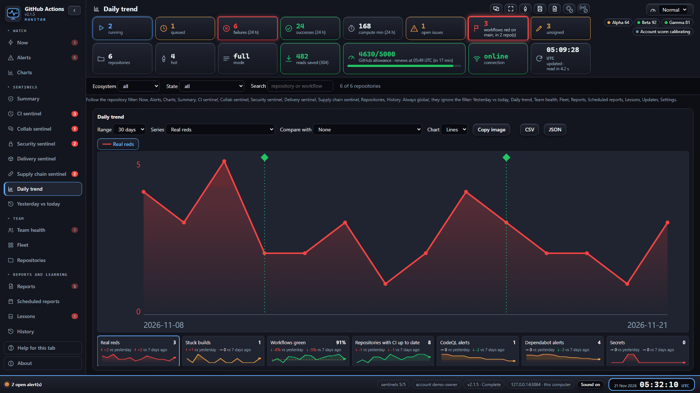</picture></p>
<p align="center"><picture><source media="(prefers-color-scheme: light)" srcset="docs/screenshots/web_fleet_light.png">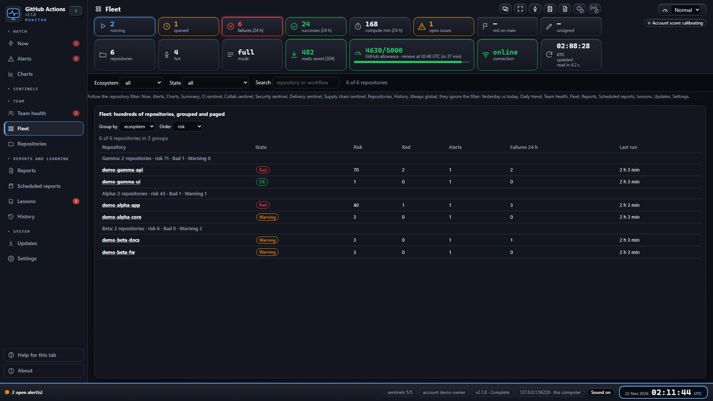</picture></p>
<p align="center"><picture><source media="(prefers-color-scheme: light)" srcset="docs/screenshots/web_reports_light.png">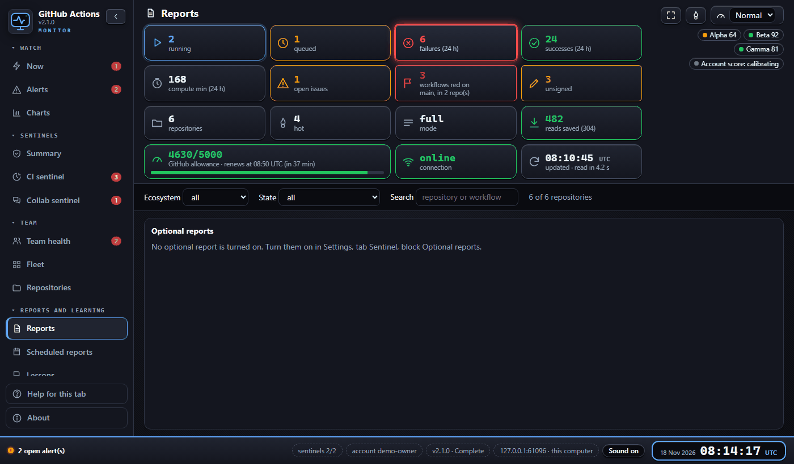</picture></p>
<p align="center">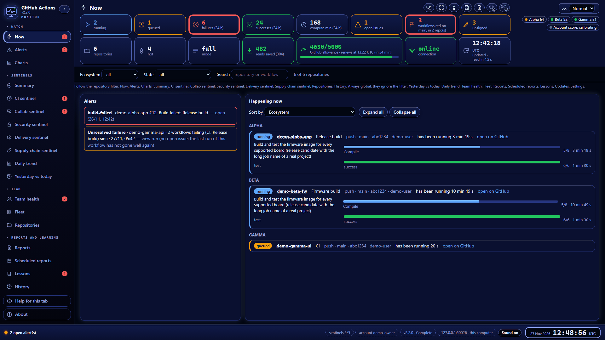</p>
<p align="center"></p>
<p align="center"></p>
<p align="center"></p>
<p align="center"></p>
<p align="center"></p>
<p align="center"><picture><source media="(prefers-color-scheme: light)" srcset="docs/screenshots/web_alerts_light.png"></picture></p>
<p align="center"><picture><source media="(prefers-color-scheme: light)" srcset="docs/screenshots/web_sentinel_light.png"></picture></p>
<p align="center"><picture><source media="(prefers-color-scheme: light)" srcset="docs/screenshots/web_sentinel_queue_light.png"></picture></p>
<p align="center"><picture><source media="(prefers-color-scheme: light)" srcset="docs/screenshots/web_sentinel_analytics_light.png"></picture></p>
<p align="center"><picture><source media="(prefers-color-scheme: light)" srcset="docs/screenshots/web_charts_light.png"></picture></p>
<p align="center"><picture><source media="(prefers-color-scheme: light)" srcset="docs/screenshots/web_compare_light.png">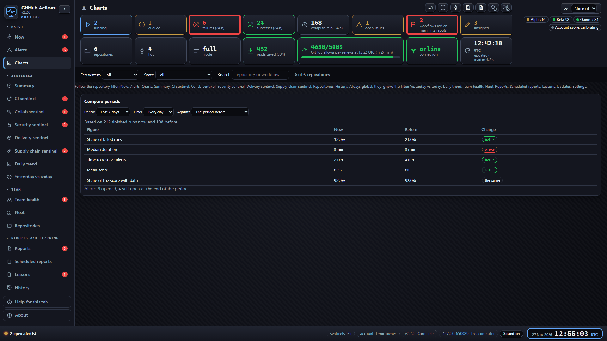</picture></p>
<p align="center"><picture><source media="(prefers-color-scheme: light)" srcset="docs/screenshots/web_repositories_light.png"></picture></p>
<p align="center"><picture><source media="(prefers-color-scheme: light)" srcset="docs/screenshots/web_team_light.png"></picture></p>
<p align="center"><picture><source media="(prefers-color-scheme: light)" srcset="docs/screenshots/web_history_light.png"></picture></p>

<p align="center"><picture><source media="(prefers-color-scheme: light)" srcset="docs/screenshots/web_about_light.png"></picture></p>
<p align="center">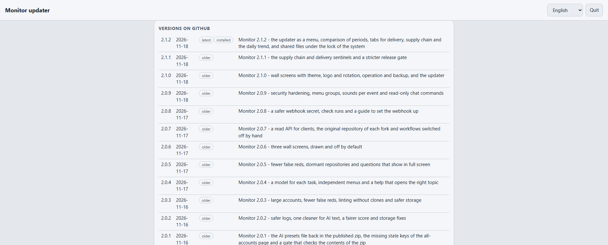</p>
<p align="center"><picture><source media="(prefers-color-scheme: light)" srcset="docs/screenshots/web_updates_light.png">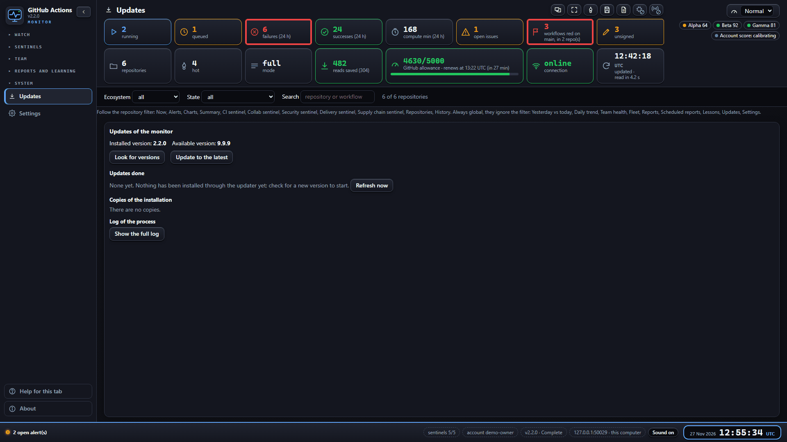</picture></p>
<p align="center"><picture><source media="(prefers-color-scheme: light)" srcset="docs/screenshots/web_help_light.png"></picture></p>
<p align="center"><picture><source media="(prefers-color-scheme: light)" srcset="docs/screenshots/web_settings_basic_light.png">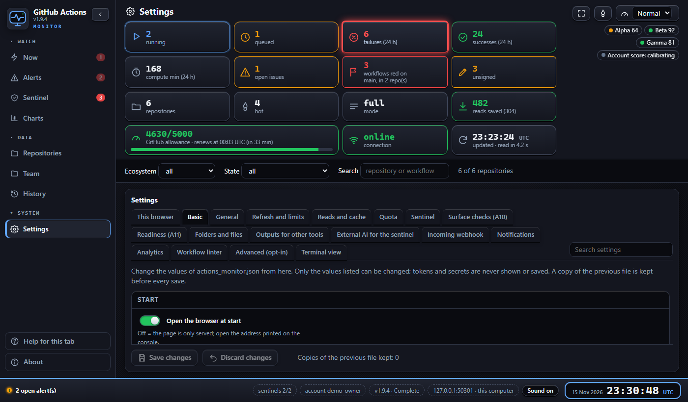</picture></p>
<p align="center"><picture><source media="(prefers-color-scheme: light)" srcset="docs/screenshots/web_network_now_light.png"></picture></p>
<p align="center"><picture><source media="(prefers-color-scheme: light)" srcset="docs/screenshots/web_network_notices_light.png"></picture></p>
<p align="center"><picture><source media="(prefers-color-scheme: light)" srcset="docs/screenshots/web_network_settings_light.png"></picture></p>
<p align="center"><picture><source media="(prefers-color-scheme: light)" srcset="docs/screenshots/web_accounts_all_light.png"></picture></p>
<p align="center"><picture><source media="(prefers-color-scheme: light)" srcset="docs/screenshots/web_accounts_one_light.png"></picture></p>
<p align="center"><picture><source media="(prefers-color-scheme: light)" srcset="docs/screenshots/web_accounts_live_light.png"></picture></p>

<details><summary><b>设置(逐个子标签页)</b></summary>

<p align="center"><picture><source media="(prefers-color-scheme: light)" srcset="docs/screenshots/web_settings_interface_light.png"></picture></p>
<p align="center"><picture><source media="(prefers-color-scheme: light)" srcset="docs/screenshots/web_settings_general_light.png"></picture></p>
<p align="center"><picture><source media="(prefers-color-scheme: light)" srcset="docs/screenshots/web_settings_polling_light.png">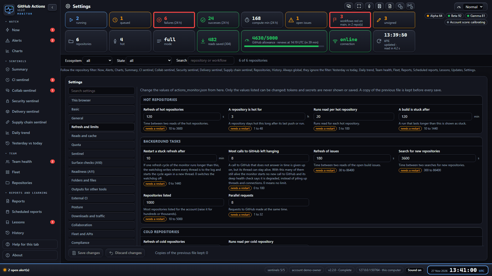</picture></p>
<p align="center"><picture><source media="(prefers-color-scheme: light)" srcset="docs/screenshots/web_settings_cache_light.png"></picture></p>
<p align="center"><picture><source media="(prefers-color-scheme: light)" srcset="docs/screenshots/web_settings_quota_light.png">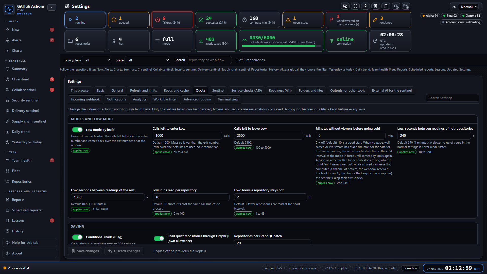</picture></p>
<p align="center"><picture><source media="(prefers-color-scheme: light)" srcset="docs/screenshots/web_settings_sentinel_light.png"></picture></p>
<p align="center"><picture><source media="(prefers-color-scheme: light)" srcset="docs/screenshots/web_settings_surface_light.png"></picture></p>
<p align="center"><picture><source media="(prefers-color-scheme: light)" srcset="docs/screenshots/web_settings_readiness_light.png"></picture></p>
<p align="center"><picture><source media="(prefers-color-scheme: light)" srcset="docs/screenshots/web_settings_paths_light.png">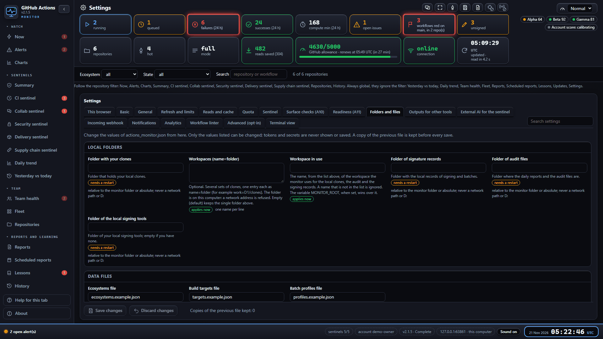</picture></p>
<p align="center"><picture><source media="(prefers-color-scheme: light)" srcset="docs/screenshots/web_settings_outputs_light.png"></picture></p>
<p align="center"><picture><source media="(prefers-color-scheme: light)" srcset="docs/screenshots/web_settings_ai_light.png"></picture></p>
<p align="center"><picture><source media="(prefers-color-scheme: light)" srcset="docs/screenshots/web_settings_webhook_light.png"></picture></p>
<p align="center"><picture><source media="(prefers-color-scheme: light)" srcset="docs/screenshots/web_settings_notify_light.png"></picture></p>
<p align="center"><picture><source media="(prefers-color-scheme: light)" srcset="docs/screenshots/web_settings_analytics_light.png"></picture></p>
<p align="center"><picture><source media="(prefers-color-scheme: light)" srcset="docs/screenshots/web_settings_lint_light.png"></picture></p>
<p align="center"><picture><source media="(prefers-color-scheme: light)" srcset="docs/screenshots/web_settings_console_light.png"></picture></p>
<p align="center"><picture><source media="(prefers-color-scheme: light)" srcset="docs/screenshots/web_settings_advanced_light.png"></picture></p>

</details>

<details><summary><b>控制台工具</b></summary>

<p align="center"><picture><source media="(prefers-color-scheme: light)" srcset="docs/screenshots/console_read_report_light.png"></picture></p>
<p align="center"><picture><source media="(prefers-color-scheme: light)" srcset="docs/screenshots/console_migrate_state_light.png">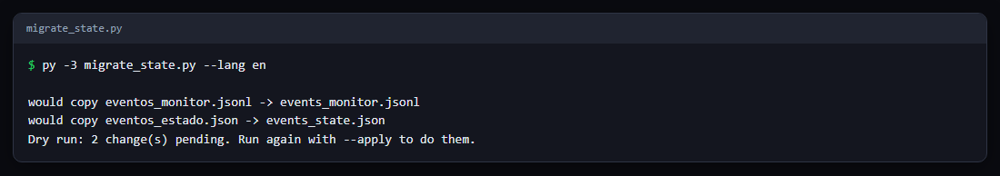</picture></p>
<p align="center"><picture><source media="(prefers-color-scheme: light)" srcset="docs/screenshots/console_plan_light.png">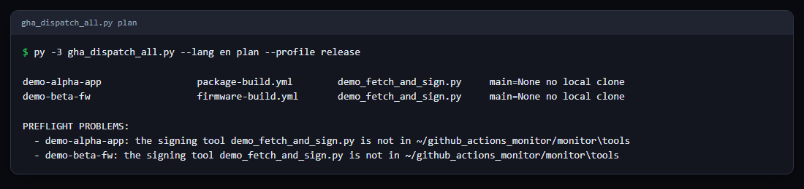</picture></p>
<p align="center"><picture><source media="(prefers-color-scheme: light)" srcset="docs/screenshots/console_lint_light.png"></picture></p>
<p align="center"><picture><source media="(prefers-color-scheme: light)" srcset="docs/screenshots/console_tui_light.png">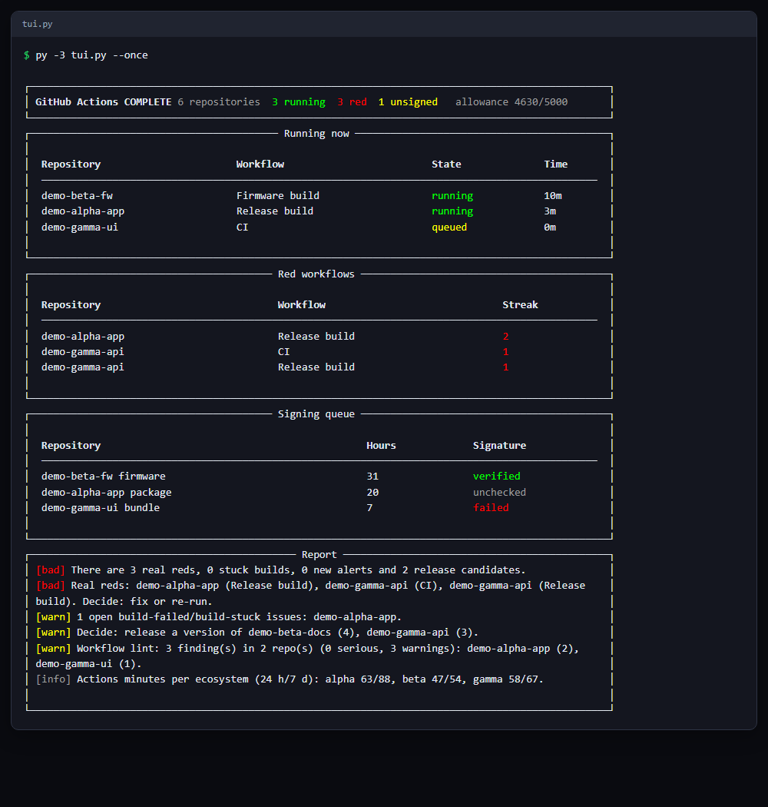</picture></p>

</details>

<details><summary><b>lite 版</b></summary>

<p align="center"><picture><source media="(prefers-color-scheme: light)" srcset="docs/screenshots/web_lite_now_light.png"></picture></p>
<p align="center"><picture><source media="(prefers-color-scheme: light)" srcset="docs/screenshots/web_lite_charts_light.png"></picture></p>
<p align="center"><picture><source media="(prefers-color-scheme: light)" srcset="docs/screenshots/web_lite_history_light.png"></picture></p>
<p align="center"><picture><source media="(prefers-color-scheme: light)" srcset="docs/screenshots/web_lite_settings_light.png"></picture></p>

</details>

每张图片都会跟随你 GitHub 页面的浅色或深色主题。

*演示数据：图片中的仓库和名称均为虚构。*

## 设置

一切都在 `actions_monitor.json` 中（由 `monitor/assets/examples/actions_monitor.example.json` 创建）。**设置** 标签页可安全地编辑它；令牌和机密绝不会显示或保存。生态系统、构建目标和批处理配置是你指定的独立文件（`ecosystems_file`、`targets_file`、`profiles_file`）；附带中性的 `*.example.json` 模板。完整参考：[`monitor/docs/SETTINGS_zho.md`](monitor/docs/SETTINGS_zho.md)。

## 面向 Grafana 和仪表板的输出

默认全部关闭，仅限本地（`127.0.0.1`），无需额外令牌。在设置中启用后可使用 `/metrics`（Prometheus 格式）、`/api/outputs/grafana.json` 和 `/api/outputs/dashboard.json`，并在 [`monitor/docs/grafana`](monitor/docs/grafana) 提供可导入的 Grafana 仪表板。详情：[`monitor/docs/OUTPUTS_zho.md`](monitor/docs/OUTPUTS_zho.md)。`ci_red.json` 的格式：[`monitor/docs/CI_RED_SCHEMA_zho.md`](monitor/docs/CI_RED_SCHEMA_zho.md)。

## 安全

- 它只监听 `127.0.0.1`，并拒绝 `Host` 或 `Origin` 不是本地的请求。切勿绑定到 `0.0.0.0`：它没有登录。
- 它不保存任何令牌：使用你自己的 `gh`（除非你在“设置 > 高级”中开启监视器的可选令牌）。
- 它不会自行向 GitHub 写入任何内容。只有 `dispatch --go`、`dispatch --real` 和 `finalize --execute` 会写入，且仅在你运行它们时。
- 网络模式和团队模式默认关闭；开启后，登录、角色、锁定和审计日志保护页面，每个请求只针对一个账户进行判断（`monitor/docs/DEPLOYMENT.md`、`monitor/docs/ACCOUNTS.md`）。
- **分析**:每个工作流的时长、排队时间和每个步骤的 p50 / p95,不稳定的工作流(在同一提交上先失败后通过)以及变慢的工作流;导出到 Prometheus 和 Grafana。
- **节省配额并能应对断网**:条件读取(304 不消耗任何配额)以及带离线横幅、可自动恢复的“最后画面”模式。
- **入站 Webhook 与通知**:已签名的事件实时更新仓库;可选地向 Telegram、Discord、Slack、Matrix、MQTT 或本地地址发送消息(绝不写入 GitHub)。
- **工作流检查器与终端视图**:`bin/lint_workflows.py` 在推送前检查 `.github/workflows`;`bin/tui.py`(可选,使用 `rich`)在控制台中显示实时表格。
- **AI 助手(默认关闭)**:用 Ollama、OpenAI 兼容服务、Anthropic 或 `gh copilot` 做总结、分类和解释;命令只来自封闭列表,且每一条都要经你确认后才会执行。
- 设置页面在保存备份副本之后，才会写入固定且经过验证的键。

## 测试

不需要网络，也不需要额外的包：

```
python -m unittest discover -s monitor/tests
```

## 仓库结构

<p align="center"></p>

```
TOOLS-GITHUB-ACTIONS-MONITOR/
├── monitor/                            程序本体
├── docs/                               架构、截图、路线图
├── tools/                              图片、指南与演示
├── deploy/                             镜像、Compose、systemd
├── images/                             横幅图和图片
├── .github/                            CI 和议题表单
├── CHANGELOG.md                        各版本变更
├── LICENSE NOTICE AUTHORS              许可证和作者
├── CONTRIBUTING.md SECURITY.md         参与方式、报告
├── SUPPORT.md CODE_OF_CONDUCT.md       支持和行为准则
└── monitor/
    ├── MONITOR_GITHUB_ACTIONS.*        启动脚本(双击)
    ├── MONITOR_LITE_GITHUB_ACTIONS.*   lite 版(无哨兵)
    ├── BATCH_GITHUB_ACTIONS.*          批量构建菜单
    ├── src/                            可导入的包
    ├── assets/                         示例、网页、语言
    ├── bin/                            简短命令(read_report、monitor_cli 等)
    ├── tests/                          离线测试
    ├── docs/                           指南、快速入门、模式、Grafana
    ├── skills/                         面向 AI 的两份技能包
    └── tools/                          发布与迁移脚本
```

## 文档

- [`monitor/docs/SETTINGS_zho.md`](monitor/docs/SETTINGS_zho.md): 所有设置
- [`monitor/docs/OUTPUTS_zho.md`](monitor/docs/OUTPUTS_zho.md): 指标、Grafana 和导出
- [`monitor/docs/CI_RED_SCHEMA_zho.md`](monitor/docs/CI_RED_SCHEMA_zho.md): ci_red.json 的格式
- [`monitor/docs/CI_RED_BRIDGE_zho.md`](monitor/docs/CI_RED_BRIDGE_zho.md): 把 ci_red.json 带到仪表板
- [`monitor/docs/WEBHOOK_zho.md`](monitor/docs/WEBHOOK_zho.md): 入站 Webhook
- [`monitor/docs/CHATOPS_zho.md`](monitor/docs/CHATOPS_zho.md): Slack 和 Discord 的只读聊天命令
- [`monitor/docs/SOUNDS_zho.md`](monitor/docs/SOUNDS_zho.md): 每种事件一种声音
- [`monitor/docs/UPDATE_zho.md`](monitor/docs/UPDATE_zho.md): 更新器：切换到其他版本并迁移配置
- [`monitor/docs/OPS_zho.md`](monitor/docs/OPS_zho.md): 运维安装：完整备份、恢复、计划备份、按需清理、doctor 及其退出码、systemd 与 Docker 设备化部署
- [`monitor/docs/LITE_zho.md`](monitor/docs/LITE_zho.md): lite 版
- [`monitor/docs/COMPLETE_INDIVIDUAL_zho.md`](monitor/docs/COMPLETE_INDIVIDUAL_zho.md): 面向个人的完整版
- [`monitor/docs/COMPLETE_SERVICE_zho.md`](monitor/docs/COMPLETE_SERVICE_zho.md): 作为服务运行的完整版
- [`monitor/docs/COMPLETE_TEAM_zho.md`](monitor/docs/COMPLETE_TEAM_zho.md): 面向团队的完整版
- [`monitor/docs/API_zho.md`](monitor/docs/API_zho.md): 面向客户端的 API
- [`monitor/docs/API_V1_zho.md`](monitor/docs/API_V1_zho.md): 只读 API v1 分步指南
- [`monitor/docs/ASSISTANT_zho.md`](monitor/docs/ASSISTANT_zho.md): 助手：向您的 AI 提出的只读固定问题
- [`monitor/docs/NOTIFICATIONS_zho.md`](monitor/docs/NOTIFICATIONS_zho.md): 通知与适配器约定
- [`monitor/docs/AI_zho.md`](monitor/docs/AI_zho.md): AI 助手:提供方、安全与操作
- [`monitor/docs/ANALYTICS_zho.md`](monitor/docs/ANALYTICS_zho.md): 分析、条件读取与连接丢失
- [`monitor/docs/CONSOLE_TOOLS_zho.md`](monitor/docs/CONSOLE_TOOLS_zho.md): 工作流检查器与终端视图
- [`monitor/docs/DEPLOYMENT_zho.md`](monitor/docs/DEPLOYMENT_zho.md): 作为服务运行（官方镜像、Compose、systemd）、反向代理之后、GitHub 撤销登录时、权限
- [`monitor/docs/LAYOUT_zho.md`](monitor/docs/LAYOUT_zho.md): 监视器的文件夹、从 1.8.1 的迁移以及给 AI 的地图
- [`monitor/docs/QUICKSTART_zh.txt`](monitor/docs/QUICKSTART_zh.txt): 入门步骤（八种语言）
- [`monitor/docs/FIRST_STEPS_zho.md`](monitor/docs/FIRST_STEPS_zho.md)：你的前五分钟
- [`monitor/docs/SENTINEL_zho.md`](monitor/docs/SENTINEL_zho.md)：哨兵及其检查 A1-A13
- [`monitor/docs/COLLAB_zho.md`](monitor/docs/COLLAB_zho.md)：Collab 哨兵、警报标签页与静音
- [`monitor/docs/SENTINEL_SECURITY_zho.md`](monitor/docs/SENTINEL_SECURITY_zho.md): 安全哨兵：Dependabot、代码扫描、密钥、分支保护、工作流权限和 CODEOWNERS，以及它无法检查的内容
- [`monitor/docs/SENTINEL_SUPPLY_zho.md`](monitor/docs/SENTINEL_SUPPLY_zho.md): 供应链哨兵：未固定的 Action、移动分支、过宽或缺失的工作流权限、带检出的 pull_request_target，以及它无法读取的内容
- [`monitor/docs/SENTINEL_DELIVERY_zho.md`](monitor/docs/SENTINEL_DELIVERY_zho.md): 交付哨兵：未发布的条目、没有发布的标签、没有说明或文件的发布、不一致的版本、落后于共享契约的固定，以及无法读取的内容
- [`monitor/docs/AUDIT_LOG_zho.md`](monitor/docs/AUDIT_LOG_zho.md): 操作日志：谁修改了什么、哈希链、谁能读取以及设置
- [`monitor/docs/HEALTH_zho.md`](monitor/docs/HEALTH_zho.md): 仓库与团队的健康状况：组成、团队标签页、深度链接和 API
- [`monitor/docs/REPORT_SCHEDULE_zho.md`](monitor/docs/REPORT_SCHEDULE_zho.md): 定时报告：评分、变化、需要人处理的仓库和未处理的警报，以 HTML 和 Markdown 呈现，以及计划和文件
- [`monitor/docs/CLI_zho.md`](monitor/docs/CLI_zho.md)：作为监视器客户端的命令行
- [`monitor/docs/ACCOUNTS_zho.md`](monitor/docs/ACCOUNTS_zho.md)：多个账户，每个账户一个进程
- [`monitor/docs/QUOTAS_zho.md`](monitor/docs/QUOTAS_zho.md)：GitHub 的配额与套餐
- [`monitor/docs/MODES_zho.md`](monitor/docs/MODES_zho.md)：工作模式：普通、快速和极速
- [`monitor/docs/AI_CONNECTION_zho.md`](monitor/docs/AI_CONNECTION_zho.md): 连接 AI 工具:监视器说的一切,以信号形式出现在简报、端点、MCP 工具和钩子中
- [`monitor/docs/AI_SETUP_PROMPT_zho.md`](monitor/docs/AI_SETUP_PROMPT_zho.md): 用 AI 设置监视器:粘贴到你的 AI 助手中,它会安装监视器、询问你的需求并写好配置的提示词
- [`monitor/docs/QUOTA_zho.md`](monitor/docs/QUOTA_zho.md): 更多配额,更少消耗:节省模式、中央面板、GitHub App 以及如何共享配额
- [`monitor/docs/EXTRAS_zho.md`](monitor/docs/EXTRAS_zho.md): 可选附加功能：失败步骤的日志和 GitHub App 的只读令牌
- [`monitor/docs/SCORE_zho.md`](monitor/docs/SCORE_zho.md): 账户评分：各部分、状态、API、页眉中的标签、告警和设置
- [`monitor/docs/COMPARE_zho.md`](monitor/docs/COMPARE_zho.md): 对比时段：当前时段与上一时段、数值、日历过滤器、无数值的状态、API、命令和设置
- [`monitor/docs/STORAGE_zho.md`](monitor/docs/STORAGE_zho.md): 存储与保留：文件或 SQLite、备份、迁移以及保留的内容
- [`monitor/docs/ADVANCED_zho.md`](monitor/docs/ADVANCED_zho.md): 高级功能（默认全部关闭）
- [`monitor/docs/AI_ALERTS_zho.md`](monitor/docs/AI_ALERTS_zho.md): 给 AI 的警报：事件流、简报、钩子和数据流
- [`monitor/docs/AUDIT_PACKAGE_zho.md`](monitor/docs/AUDIT_PACKAGE_zho.md): 审计员资料包
- [`monitor/docs/LARGE_ACCOUNTS_zho.md`](monitor/docs/LARGE_ACCOUNTS_zho.md): 大型账户：数百个仓库
- [`monitor/docs/ORGANIZATIONS_zho.md`](monitor/docs/ORGANIZATIONS_zho.md): 组织与大型账号
- [`monitor/docs/PRODUCTIVITY_zho.md`](monitor/docs/PRODUCTIVITY_zho.md): 监视器能节省什么:一项估算、它的假设以及如何测量

## 参与贡献

请阅读 [CONTRIBUTING.md](CONTRIBUTING.md)。用议题表单报告缺陷和想法；安全问题请按 [SECURITY.md](SECURITY.md) 中的说明报告。

## 作者

作者：**JuanenRac (Electro Hobby 3D)** · electrohobby3d@gmail.com

## 许可证

代码采用 GPL-3.0-or-later；文档采用 CC BY-SA 4.0。参见 [LICENSE](LICENSE) 和 [NOTICE](NOTICE)。
