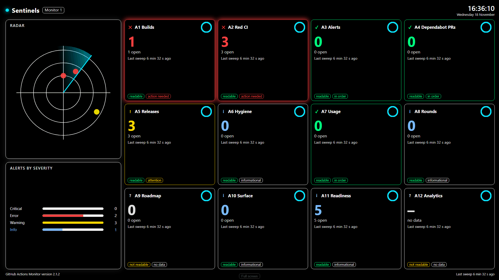

<!--
  Copyright (C) 2026 JuanenRac (Electro Hobby 3D) <electrohobby3d@gmail.com>
  GPL-3.0-or-later - see LICENSE
-->

[🇺🇸 English](SCREENS.md) | [🇪🇸 Español](SCREENS_spa.md) | [🇫🇷 Français](SCREENS_fra.md) | [🇮🇹 Italiano](SCREENS_ita.md) | **🇩🇪 Deutsch** | [🇨🇳 简体中文](SCREENS_zho.md) | [🇯🇵 日本語](SCREENS_jpn.md) | [🇵🇹 Português](SCREENS_por.md)

# Bildschirme, Größen und Ausrichtung

Die Seite passt sich der Größe ihres Fensters an, vom Telefon bis 4K, hochkant oder quer, und ein Monitor kann mehrere Bildschirme bedienen, jeder mit den Tabs Ihrer Wahl. Nichts wird doppelt abgefragt: alle Bildschirme lesen denselben Zustand.

Für einen Fernseher oder eine Wand mit größerer Schrift, hohem Kontrast oder einem Wechsel durch einige Tabs siehe [KIOSK_deu.md](KIOSK_deu.md).
## Adressen

- `/` - die ganze Seite.
- `/screen/1`, `/screen/2`, `/screen/3` - die für diesen Bildschirm festgelegten Tabs (`ui.screen1_tabs` ...). Jede in einem Fenster des eigenen Monitors oder Fernsehers öffnen.
- `?orient=portrait` oder `?orient=landscape` erzwingt das Layout eines Fensters; `?tabs=now,charts` und `?rotate=30` legen Tabs und Sekunden dazwischen für ein Fenster fest.

## Einstellungen

| Einstellung | Wirkung |
|---|---|
| `ui.orientation` | auto folgt dem Fenster; portrait stapelt die Panels in einer Spalte; landscape behält das Nebeneinander. |
| `ui.rotate_seconds` | 0 = aus. Sekunden zwischen den Tabs eines Bildschirms mit mehr als einem. |
| `ui.screen1_tabs` | Tabs von /screen/1, durch Kommas getrennt: now, al, charts, sent, sci, scol, ssec, team, fleet, repos, rep, trep, les, hist, cfg. Leer = alle. |
| `ui.screen1_orientation` | auto, portrait oder landscape nur für /screen/1. |
| `ui.screen2_tabs` | Tabs von /screen/2. |
| `ui.screen2_orientation` | Ausrichtung von /screen/2. |
| `ui.screen3_tabs` | Tabs von /screen/3. |
| `ui.screen3_orientation` | Ausrichtung von /screen/3. |
| `ui.now_sort` | Reihenfolge von Läuft gerade für alle, die keine gewählt haben: ecosystem, severity, age, newest, repo, event oder state. |
| `ui.alerts_sort` | Reihenfolge des Tabs Meldungen für alle, die keine gewählt haben: server, severity, streak, class, age, newest, repo, origin oder state. |
| `ui.remember_folds` | Eingeklapptes merken: an (Standard), von Hand ein- oder ausgeklappte Bereiche bleiben nach einer Aktualisierung und beim erneuten Öffnen der Seite so; aus, nur solange die Seite geöffnet bleibt. |

## Reihenfolge der Listen

Der Abschnitt **Läuft gerade** auf dem ersten Tab ist nach Ökosystem sortiert, mit einer Überschrift je Ökosystem. Die Liste über dem Abschnitt ändert das: Ökosystem, Schweregrad (zuerst hängende, dann Runs mit fehlgeschlagenem Job, dann laufende, dann wartende), Alter (längste Laufzeit zuerst), neueste zuerst, Repository, Auslöser (push, pull_request, schedule...) und Status (laufend vor wartend). Die Auswahl wird für jede Person gemerkt: im Teammodus speichert sie der Server beim Benutzer (`GET` und `POST /api/auth/me/view`, sie folgt dem Benutzer also in einen anderen Browser), sonst dieser Browser. Bis jemand wählt, gilt `ui.now_sort` der Konfigurationsdatei (Ökosystem, wenn der Wert fehlt oder falsch ist). Die Schaltflächen **Alle aufklappen** und **Alle zuklappen** neben der Liste klappen alle Repositories des Abschnitts auf einmal auf oder zu, in jeder Reihenfolge; die Wahl wird pro Person am selben Ort gemerkt und übersteht eine Aktualisierung (ein danach von Hand geöffnetes oder geschlossenes Repository behält Ihre Wahl).

Die Liste des Tabs **Meldungen** behält die Reihenfolge des Monitors, bis jemand mit der Liste darüber eine andere wählt: Schweregrad (kritisch, Fehler, Warnung, Info), die längste Serie aufeinanderfolgender Fehler zuerst, Klasse (eine Fehler- oder kritische Meldung ist echt und steht vor den zu beobachtenden), die älteste zuerst, die neueste zuerst, Repository, Herkunft (der Wächter, der sie ausgelöst hat) und Status (offen vor stummgeschaltet). Sie wird auf dieselbe Weise gemerkt; bis jemand wählt, gilt `ui.alerts_sort` der Konfigurationsdatei (`server`, wenn der Wert fehlt oder falsch ist).

**Ein- und ausgeklappte Bereiche** bleiben so, wie die Person sie verlassen hat. Die Bereiche des CI-Sentinels, die Karten der anderen Sentinels, die Listen der Hinweise im ersten Reiter und die Versionen des Updaters werden bei jeder Aktualisierung neu gezeichnet; eine Aktualisierung öffnet nie wieder, was eingeklappt war, und klappt nichts zu, was offen war: Jeder Block hat einen stabilen Namen, und die Seite behält die Wahl jedes einzelnen, im Speicher und, mit `ui.remember_folds` an (Standard), auch im Browser. Nur ein Klick der Person hält eine Wahl fest; was die Seite von selbst öffnet (die erste Karte mit Meldungen eines noch unberührten Sentinels), zählt nicht als Wahl.

## Getestete Größen

Ein Browser-Test öffnet die Seite in jeder dieser Größen, geht alle Tabs durch und schlägt bei seitlichem Scrollen oder Text außerhalb seines Kastens fehl. Fenster ab 2400 px erhalten eine größere Schrift (ab 3200 px eine noch größere) statt eines gestreckten Layouts; ein höheres als breites Fenster stapelt die Panels.

| Größe | Art |
|---|---|
| 1920x1080 | Full HD |
| 2560x1080 | 21:9 |
| 3440x1440 | 21:9 |
| 5120x1440 | 32:9 |
| 3840x2160 | 4K |
| 1080x1920 | Full HD |
| 2160x3840 | 4K |
| 768x1024 | tablet |
| 390x844 | phone |

## Rezept für einen Arbeitsplatz mit zwei oder drei Bildschirmen

1. Auf dem Rechner, auf dem der Monitor läuft, `ui.screen1_tabs` auf `now,al`, `ui.screen2_tabs` auf `charts,repos` und für einen gedrehten Monitor `ui.screen2_orientation` auf `portrait` setzen.
2. `http://dieser-rechner:8765/screen/1` im Fenster des ersten Monitors und `/screen/2` im zweiten öffnen; F11 für Vollbild. Von einem anderen Rechner den Netzmodus mit Zugriffstoken nutzen.
3. Für einen Wandbildschirm, den niemand bedient, mehrere Tabs vergeben und `ui.rotate_seconds` auf 20-30 setzen.

## Wandanzeigen: Übersicht, Gerade jetzt und Wächter

Drei Seiten für einen Monitor oder Fernseher, den niemand bedient. Sie haben kein Seitenmenü und keine Navigation, zeigen alles in einer Ansicht mit großer Schrift, animieren, was lebt, und lassen Fehler sanft blinken. Sie lesen nur: Keine Schaltfläche ändert etwas, und sie rufen GitHub nie auf (sie zeigen, was der Monitor schon hat).

| Adresse | Was sie zeigt |
|---|---|
| `/screen/overview` | Ring und Buchstabe der Bewertung; die Flotte (grün, rot, hängend, wartend); die letzten 24 Stunden und 7 Tage als Flächendiagramme; eine Heatmap der Repositories nach Stunde; was am längsten rot ist; Runner und Minuten; die letzten Ereignisse; das GitHub-Kontingent als Anzeige. Die Flottenkarte zeigt außerdem die Karte nach Gruppen: ein Balken je Gruppe der Flottenansicht (dieselbe Gruppierung, `fleet.group_by`) mit ihren Repositorys, die rot sind, Aufmerksamkeit brauchen, in Ordnung sind oder keine Daten haben; nur der Gruppenname und Zahlen. |
| `/screen/fleet` | Jedes Repository der Flotte nach Gruppen (Gruppierung und Reihenfolge des Reiters Flotte, die riskanteste Gruppe zuerst): ein kleines Quadrat für jedes gesunde Repository und ein Chip mit dem Namen für jedes, das Aufmerksamkeit braucht, oben die Summen der Flotte. Was nicht passt, wird gezählt („+3 weitere“). |
| `/screen/now` | Was in dieser Minute geschieht: laufende Läufe mit Fortschritt und Dauer, die Warteschlange, Läufe, die auf Freigabe warten, aktuelle Fehlschläge, Merges und Releases, fällige Releases und eine Live-Linie der letzten zwei Stunden. |
| `/screen/sentinels` | Eine Karte je Wächter (A1 bis A12) mit Stufe, offenen Befunden, ob seine Quellen lesbar sind, dem letzten Durchlauf und einem Ring, der dem Durchlauf folgt; ein animiertes Radar, das markiert, was nicht stimmt, und die Warnungen nach Schweregrad. |

### Parameter der Adresse

Eine Adresse je Monitor. Ein Parameter kann ein Fenster ruhiger oder kleiner machen, als die Einstellungen erlauben, nie lauter.

| Parameter | Wirkung |
|---|---|
| `?monitor=1` bis `9` | Die Nummer, die neben dem Titel steht. |
| `?theme=light` (oder `dark`, `auto`, `contrast` oder der Name eines der sechzehn Designs) | Farben des ganzen Fensters, vor dem, was die Einstellungen sagen. `contrast` ist weiß auf schwarz, für einen Bildschirm, den man von weitem sieht. |
| `?density=compact`, `normal` oder `large` | Schriftgröße. `?scale=1.5` vergrößert alles (0,5 bis 3). |
| `?refresh=10` | Sekunden zwischen den Aktualisierungen (5 bis 120). |
| `?lang=de` | Sprache (en, es, de, fr, it, ja, zh, pt). |
| `?rotate=30` | Das Fenster wechselt alle 30 Sekunden von selbst zwischen Übersicht, Gerade jetzt und Wächtern (mindestens 5; 0 = bleibt auf einer Anzeige). Mit `screens.mode` = rotate wechselt es ohnehin; dies ändert das Tempo eines Fensters. |
| `?jump=off` | Nur mit `screens.mode` = rotate: Das Fenster wechselt, springt aber nie zu einem neuen Rot. |
| `?blink=off` | Fehler behalten einen festen Schein statt zu blinken. Es kann nicht einschalten, was `screens.blink` ausgeschaltet lässt. |
| `?repo=WORD,WORD` | Nur die Repositories, deren Name eines der Wörter enthält (Buchstaben, Ziffern und `. _ - /`, bis zu acht Wörter). `/screen/overview` und `/screen/now` behalten nur Repositories, deren Name der Bildschirm zeigt (ein verborgener Name passt nie), die Zahlen folgen den behaltenen Zeilen, und die Bewertung und die Gruppenkarte, die zur ganzen Flotte gehören, werden nicht gezeigt; `/screen/sentinels` wird nicht gefiltert. |
| `?sound=on` | Ein kurzer Signalton bei einem neuen Fehler, nur wenn `screens.sound` es erlaubt. Standardmäßig aus. |
| `?safe=4` | Hält den Inhalt um diesen Prozentsatz (0 bis 10) vom Rand des Fensters entfernt, für einen Fernseher, der den Rand abschneidet (Overscan). Ersetzt `screens.safe_margin_percent` für dieses Fenster. |

### Sprache der Anzeigen

Die Sprache einer Anzeige wird in dieser Reihenfolge bestimmt: `?lang=xx` in der Adresse; dann die auf der Hauptseite desselben Browsers gewählte Sprache (sie wird dort gespeichert, und eine in diesem Browser geöffnete Anzeige liest sie, sodass die Anzeige der Seite ohne Parameter folgt); dann die Sprache des Monitors (`MONITOR_LANG` oder die konfigurierte). Unterscheidet sich die gespeicherte Sprache einer Anzeige von der, in der sie ausgeliefert wurde, lädt sie einmal vor dem Zeichnen neu, mit angehängtem `?lang=` und erhaltenen übrigen Parametern (darunter `?rotate=`). Die acht Sprachen (en, es, de, fr, it, ja, zh, pt) sind dieselben wie auf der Seite: Titel, Beschriftungen, Zustände, Schweregrade, Einheiten und relative Zeiten („vor 5 Min.“) stammen aus dem Katalog, und Uhrzeit, Datum und Zahlen werden mit dem Gebietsschema der Sprache geschrieben (en-GB, es-ES, de-DE, fr-FR, it-IT, ja-JP, zh-CN, pt-PT). Der Link „Anzeige öffnen“ in den Einstellungen trägt bereits `?lang=` mit der Sprache der Seite. Ein Rechner, der keine Sprache wählt, bleibt bei Englisch: Die Sprache des Browsers entscheidet nicht.

### Einstellungen der Wandanzeigen

| Einstellung | Was sie bewirkt |
|---|---|
| `screens.enabled` | Schaltet die drei Seiten ein. Aus: `/screen/overview`, `/screen/now`, `/screen/sentinels` und `/api/screens/data` antworten mit 404 (`/screen/1` bis `/screen/3` sind die Seite selbst und hängen nicht davon ab). Die Lite-Edition liefert die Wandbildschirme ebenfalls, mit leerem Wächter-Bildschirm. Standardmäßig aus. |
| `screens.default_theme` | inherit (Standard: das für das ganze Produkt gewählte Design, siehe unten), auto, light, dark, eines der sechzehn Designs oder contrast. |
| `screens.default_density` | compact, normal (Standard) oder large. |
| `screens.refresh_seconds` | Sekunden zwischen den Aktualisierungen eines Fensters (standardmäßig 10). Die Seiten lesen vom Monitor, nie von GitHub, eine kurze Zeit kostet also kein Kontingent. |
| `screens.rotate_seconds` | Nur mit `screens.mode` = three. 0 (Standard) = keine Rotation; ab 5 wechselt ein Fenster durch die drei Seiten. |
| `screens.blink` | Fehler blinken sanft (standardmäßig an). |
| `screens.blink_calm_minutes` | Minuten, nach denen ein Fehler, um den sich niemand gekümmert hat, einen festen Schein behält statt zu blinken (standardmäßig 30; 0 = blinkt bis zur Lösung). |
| `screens.sound` | Ein Signalton bei einem neuen Fehler (standardmäßig aus). |
| `screens.burn_in_protection` | Verschiebt alles jede Minute um einige Pixel (standardmäßig an). |
| `screens.safe_margin_percent` | Hält den Inhalt um diesen Prozentsatz vom Rand des Fensters entfernt, für einen Fernseher, der den Rand abschneidet (Overscan): alles wird etwas kleiner gezeichnet. 0 (Standard) nutzt das ganze Fenster; 0 bis 10. |
| `screens.night_dim` | Dunkelt die Anzeigen zwischen `screens.night_dim_from_hour` (22) und `screens.night_dim_to_hour` (7) ab; standardmäßig aus. |
| `screens.show_repo_names` | all, public (Standard: private Repositories erscheinen als private-1, private-2...) oder none (jeder Name wird ausgeblendet). Für einen Bildschirm, den andere sehen können, public oder none verwenden. Bei einer von Hand geschriebenen Liste in `repos` wird die Sichtbarkeit alle `discover_refresh_seconds` mit einer Auflistung des Kontos gelesen; ein Repository, dessen Sichtbarkeit nicht gelesen werden konnte, gilt als privat. Die Nummern (private-1...) erhalten nur die verborgenen Repositorys, in der Reihenfolge eines HMAC des Namens mit einem Schlüssel der Installation, der in einer privaten Datei im Datenordner liegt; sie sagen also nichts darüber, wo ein Repository unter den anderen liegt. |
| `screens.theme_overview`, `screens.theme_fleet`, `screens.theme_now`, `screens.theme_sentinels` | Das Design einer Anzeige: inherit (Standard: das von `screens.default_theme`) oder eines der obigen Designs. |
| `screens.mode` | three (Standard: die drei Seiten getrennt, eine pro Fenster) oder rotate (eine einzige Seite, die durch die drei wechselt und zu einem neuen Rot springt). |
| `screens.rotate_every_seconds` | Im Modus rotate die Sekunden pro Anzeige (Standard 20; 5 bis 300). |
| `screens.alert_hold_seconds` | Im Modus rotate die Sekunden, die ein neues Rot das Fenster auf seiner Anzeige hält (Standard 30; 5 bis 600), oder bis das Rot verschwindet. |
| `screens.logo_overview`, `screens.logo_fleet`, `screens.logo_now`, `screens.logo_sentinels` | Auf welchen Anzeigen das Logo erscheint (standardmäßig nur auf der Übersicht). |
| `screens.logo_corner` | top-right (Standard), top-left, bottom-right oder bottom-left. |
| `screens.logo_max_width`, `screens.logo_max_height` | Größte Größe des Logos in Pixeln bei 1920 x 1080 (Standard 160 x 64; es wächst mit dem Bildschirm). |
| `screens.group_map` | Standardmäßig an. Zeigt auf dem Übersichtsbildschirm die Karte der Flotte nach Gruppen (die Gruppierung der Flottenansicht). Aus: nur die vier Kacheln. |
| `screens.life` | Standardmäßig an. Eine Zahl, die sich ändert, blitzt dort auf, wo sie sich geändert hat, ein neuer Fehler schickt eine Welle über sein Feld und ein Zustandswechsel hinterlässt eine kurze Spur. Mit der Systemeinstellung für weniger Bewegung bewegt sich nichts. |
| `screens.glance_seconds` | Sekunden, die die Kopfzeile in bis zu drei Chips zeigt, was sich bei der letzten Aktualisierung geändert hat („Rot +1“); Standard 3, 0 = aus (0 bis 30). |
| `screens.transition` | Wie eine rotierende Anzeige von einer Anzeige zur nächsten wechselt: fade (Standard), slide oder none. |
| `screens.hide_healthy` | Standardmäßig aus. Die Flottenanzeige lässt die Quadrate der gesunden Repositories weg; die Übersicht lässt Gruppen ohne Rot oder Gelb und die Zeilen der Wärmekarte ohne Fehler weg. Die Summen bleiben. |
| `screens.idle_dim_minutes` | 0 = aus (Standard). Hat sich so viele Minuten nichts geändert und ist nichts rot, wird die Anzeige gedimmt, um das Panel zu schonen; die nächste Änderung weckt sie (1 bis 1440). |
| `screens.min_font_px` | Die kleinste Schrift der Anzeigen in Pixeln, egal wie groß das Fenster ist (Standard 12; 8 bis 32). |
| `screens.version_check_seconds` | Wie oft eine Wandanzeige `/api/version` abfragt, um zu wissen, ob der Monitor aktualisiert oder neu gestartet wurde (Standard 300; 0 = nie; mindestens 30). |
| `screens.menu` | Standardmäßig an. Die Schaltfläche Bildschirme in der oberen Leiste. Aus: Die Schaltfläche verschwindet; die Bildschirme laufen weiter unter ihren eigenen Adressen. |
| `screens.menu_target` | new (Standard): Ein Bildschirm öffnet sich in einem neuen Fenster oder Tab; same: im aktuellen Tab. |
| `screens.menu_max_windows` | Höchstzahl Fenster, die ein Mehrbildschirm-Satz auf einmal öffnet (Standard 4; 1 bis 9). |
| `screens.menu_rotate_seconds` | Sekunden je Bildschirm in den rotierenden Voreinstellungen des Menüs (Standard 20; 5 bis 300). |
| `screens.menu_tv_scale` | Das `?scale=` der Fernseher-Voreinstellung (Standard 1,5; 0,5 bis 3). |

### Design der Anzeigen

Alles, was der Monitor zeigt, trägt das in den Einstellungen gewählte Design (`ui.theme`: auto, light, dark oder eines der sechzehn Designs): die Seite, die Wandanzeigen und die Anmeldeseite. Wer im Reiter Dieser Browser ein Design wählt, speichert es zugleich als `ui.theme`; ein Browser, der nie gewählt hat, übernimmt das des Monitors. Die auf die Festplatte geschriebenen HTML-Berichte folgen der hellen oder dunklen Einstellung des Computers, der sie öffnet.

Die Wandanzeigen erben es: `screens.default_theme` ist standardmäßig `inherit`. Setze es auf ein anderes Design, um allen Anzeigen dasselbe zu geben, und `screens.theme_overview`, `screens.theme_now` oder `screens.theme_sentinels`, um einer Anzeige ein eigenes zu geben. Die Adresse kann ein Fenster weiterhin mit `?theme=` festlegen. Keine Anzeige schreibt eine eigene Farbe: alle nutzen die Paletten des Designs, daher erscheint ein der Seite hinzugefügtes Design auch auf den Anzeigen.

### Modus der Anzeigen: drei oder rotierend

`screens.mode` = three (Standard) hält die drei Seiten getrennt, eine pro Fenster. `screens.mode` = rotate macht jedes Fenster zu einer einzigen Anzeige, die alle `screens.rotate_every_seconds` Sekunden (Standard 20; 5 bis 300) durch Übersicht, Gerade jetzt und Wächter wechselt.

Ein rotes Problem lässt das Fenster zu der Anzeige springen, die es zeigt: **Gerade jetzt** für einen fehlgeschlagenen Workflow, **Wächter** für ein Wächterfeld, das rot wird. Das Fenster bleibt dort `screens.alert_hold_seconds` Sekunden (Standard 30; 5 bis 600) oder bis dieses Rot verschwunden ist, was zuerst eintritt, und wechselt dann weiter. Ein bereits gezeigtes Rot lässt das Fenster nicht erneut springen, bis es sich ändert oder wiederkehrt. Was beim Öffnen des Fensters rot ist, ist nur der Ausgangspunkt und lässt es nicht springen. Kommt ein zweites Rot, während das Fenster das erste hält, wartet es, bis es dran ist. Um das zu wissen, liest ein Fenster die beiden anderen Anzeigen im Hintergrund mit demselben schreibgeschützten Aufruf (nie GitHub). `?rotate=0` lässt ein Fenster auf seiner Anzeige und `?jump=off` behält das Wechseln ohne die Sprünge. Jede Anzeige legt beim Erscheinen ihr eigenes Design und ihr eigenes Logo an.

### Logo der Organisation

Der Reiter Dieser Browser der Einstellungen hat einen Block zum Hochladen des Logos deiner Organisation: PNG, JPEG, WebP oder SVG, höchstens 1 MB. Der Monitor prüft den echten Typ an den ersten Bytes der Datei (Name und mitgeschicktes Etikett zählen nicht), lehnt ein SVG mit Skripten, Ereignis-Handlern, Verweisen auf andere Dateien oder Adressen oder einem Dokumenttyp ab und speichert das Bild im Ordner `data/` dieses Computers als `org_logo` mit seiner Endung, nie in der Konfiguration. Es gibt nur ein Logo: ein neues ersetzt das alte. Das Aktionsprotokoll vermerkt das Hochladen und das Entfernen, nie die Datei.

`screens.logo_overview`, `screens.logo_now` und `screens.logo_sentinels` wählen, auf welchen Wandanzeigen es erscheint (standardmäßig nur auf der Übersicht), `screens.logo_corner` die Ecke (standardmäßig oben rechts) und `screens.logo_max_width` und `screens.logo_max_height` die größte Größe in Pixeln bei 1920 x 1080 (Standard 160 x 64; das Logo wächst mit dem Bildschirm). Das Bild wird in diese Größe eingepasst, ohne seine Form zu ändern, und hat einen eigenen Platz in der Kopf- oder Fußzeile, sodass es den Inhalt nie verdeckt. Der Hintergrund bleibt transparent: Ein Logo mit transparentem Hintergrund sieht in hellen wie in dunklen Designs richtig aus.

Das Fenster „Über“ zeigt immer das Logo des Monitors. Ist `ui.about_org_logo` eingeschaltet (standardmäßig aus), zeigt es daneben auch dieses Logo Ihrer Organisation, mit einem Alternativtext in der Sprache der Seite und einer Größe, die der Breite des Fensters folgt, ohne das Bild zu verzerren. Wurde kein Logo hochgeladen oder lässt sich die Datei nicht lesen, sagt das Fenster es, und sonst ändert sich nichts.

### Was sie zeigen und was sie verbergen

Die Daten kommen von `/api/screens/data?screen=overview` (oder `now`, `sentinels`): eine geschlossene Liste von Feldern, gebildet aus dem letzten Zyklus, dem Schnappschuss der Wächter, den Warnungen und der Bewertung. Sie enthält nie einen Link, einen Commit-Titel, einen Job-Namen, einen Benutzernamen oder einen Pfad dieses Rechners, und die Workflow-Namen ausgeblendeter Repositories werden ebenfalls ausgeblendet. Im Netzwerkmodus brauchen die Seiten dasselbe Zugriffstoken wie der Rest des Monitors, und die Antwort ist schreibgeschützt.

### Was hineinpasst und was geschieht, wenn es nicht passt

Die drei Seiten werden in Einheiten gezeichnet, die der kurzen Seite des Fensters folgen; dasselbe Layout füllt also die unten genannten Größen, nichts wird gedehnt und nichts scrollt. Ein Werkzeug misst sie mit dem DOM in den acht Sprachen und mit Daten, die eine Anzeige hart fordern (Repository-Namen mit 90 Zeichen, deutsche Zusammensetzungen und japanische Namen ohne Leerzeichen, die größte Zeilenzahl, die der Monitor senden kann, siebenstellige Zahlen, gar keine Daten, ein einziger Wert, eine alte Messung): `python tools/check_screens.py` (`--list` zeigt jeden Befund, `--report DATEI` schreibt sie als JSON, `--size` und `--lang` wählen, was gemessen wird, `--surface kiosk` misst den Kiosk). Es schlägt fehl bei einer Seite, die scrollt, einem Text oder Kasten jenseits des Rands, einem Kasten, dessen Inhalt nicht passt, einer Überschrift, die mit Auslassungspunkten endet, zwei Texten, die sich überdecken, einer Schrift unter einem Hundertstel der kurzen Fensterseite (12 px bei einem Fenster von 1080 px) und Zeilen, die ohne Hinweis verborgen sind. Dasselbe Werkzeug misst den Kontrast im Browser: jeden Text gegen die Farbe dahinter (die Stufen eines Verlaufs zählen; 4,5:1, bei großer Schrift 3:1) in jedem Thema mit `--theme NAME ...` (zum Beispiel `python tools/check_screens.py --theme Ice light contrast`); ein Text darunter ist ein Befund der Art `contrast`. Auf einem Telefon lautet die Prüfung `python tools/check_mobile.py` (ein Fenster von 375 px, die kompakte Ansicht, jeder Tab): Kein Bedienelement, das ein Finger drücken muss, ist kleiner als 44 x 44 px, die Seite scrollt nie seitwärts, das Menü ist eine Zeile, die von selbst scrollt, und die Dialoge folgen der Höhe, die die Bildschirmtastatur freilässt.

| Größe | Art |
|---|---|
| 1920x1080 | Full HD |
| 2560x1440 | QHD |
| 3840x2160 | 4K |
| 3440x1440 | Ultrabreit 21:9 |
| 5120x1440 | Super-Ultrabreit 32:9 |
| 1080x1920 | Full HD hochkant |
| 2160x3840 | 4K hochkant |

- Ein Name eines Repositorys oder Workflows, der nicht passt, endet mit Auslassungspunkten und trägt seinen vollen Text im `title`; eine Überschrift, eine Beschriftung oder eine Zahl endet nie mit Auslassungspunkten: die Überschrift bekommt eine zweite Zeile, und eine Zahl, die breiter ist als ihr Kasten, bekommt eine kleinere Schrift bis zu einer Untergrenze.
- Hat eine Liste mehr Zeilen, als in ihren Kasten passen, stehen die wichtigsten zuerst (Rot vor Grün, das Neueste zuerst), und die letzte Zeile sagt, wie viele weggelassen wurden ("+3 weitere"); ohne diese Zeile wird nichts verborgen.
- Sicherer Rand (Overscan): Viele Fernseher schneiden einige Prozent jedes Rands ab, sofern ihr Bildmodus nicht "Just Scan" oder "Pixel für Pixel" ist. `screens.safe_margin_percent` (standardmäßig 0, 0 bis 10; `?safe=4` für ein Fenster) hält den Inhalt so weit von jedem Rand entfernt, indem alles kleiner gezeichnet wird, und `kiosk.safe_margin_percent` tut dasselbe für den Kiosk. 3 bis 5 versuchen, wenn die ersten Buchstaben der Uhr oder der Rand der Karten abgeschnitten werden.
- Die kleinste Schrift ist `screens.min_font_px` (standardmäßig 12 Pixel): In einem so kleinen Fenster, dass das Layout eine kleinere Schrift bräuchte, behalten die Anzeigen die Schrift und zeigen weniger Zeilen, wobei sie sagen, wie viele sie weggelassen haben, statt den Text zu verkleinern.
- Eine Anzeige, die tagelang läuft, folgt dem Monitor: Alle `screens.version_check_seconds` Sekunden (standardmäßig 300) fragt sie `/api/version` ab und lädt sich selbst neu, wenn Version oder Startzeit nicht die sind, mit denen sie geladen wurde; so behält ein Fernseher nach einem Update oder Neustart nie eine alte Seite. Sie lädt nur nach einer gültigen, abweichenden Antwort neu: Ein Monitor, der nicht antwortet, löst nie ein Neuladen aus, und mit 0 fragt sie nie.

### Wie sie sich verhalten

- Fehler blinken weniger als zweimal pro Sekunde (nie als Stroboskop); ein neuer Fehler löst einen einzigen Blitz aus; ein Fehler, um den sich `screens.blink_calm_minutes` Minuten niemand gekümmert hat, behält einen festen Schein. Mit der Systemeinstellung für weniger Bewegung oder mit `?blink=off` blinkt und bewegt sich nichts. Ein Fehler wird nie nur durch Farbe gezeigt: Er trägt ein Symbol und ein Wort.
- Antwortet der Monitor nicht, sagt die Seite es, wird abgedunkelt und versucht es nach 5, 10, 20... Sekunden erneut (bis 60).
- Ein dauerhaft eingeschalteter Bildschirm ist gegen Einbrennen geschützt: Alles verschiebt sich jede Minute um einige Pixel, und die Seite kann nachts abdunkeln.
- Was sich zwischen zwei Aktualisierungen ändert, sieht man: Die Zahl blitzt dort auf, wo sie sich geändert hat (`screens.life`), ein neuer Fehler schickt eine Welle über sein Feld, und `screens.glance_seconds` Sekunden lang sagen einige Chips in der Kopfzeile, was sich geändert hat („Rot +1“, „Laufend +2“). Der erste Blick einer Anzeige merkt sich nur; mit der Systemeinstellung für weniger Bewegung bewegt sich nichts, die Chips erscheinen aber.
- Eine rotierende Anzeige wechselt mit Überblendung, Schieben oder Schnitt (`screens.transition`). Eine Anzeige ohne Neuigkeiten seit `screens.idle_dim_minutes` Minuten ruht (gedimmt), solange nichts rot ist.

### Mehrere Monitore einrichten

1. Wählen Sie für jeden Monitor eine Adresse, zum Beispiel `/screen/overview?monitor=1`, `/screen/now?monitor=2` und `/screen/sentinels?monitor=3`; oder öffnen Sie ein einziges Fenster mit `?rotate=20`.
2. Öffnen Sie jede in Chrome oder Edge im Kioskmodus: `msedge --kiosk "http://dieser-rechner:8765/screen/now?monitor=2" --edge-kiosk-type=fullscreen` oder `chrome --kiosk "http://dieser-rechner:8765/screen/now?monitor=2"`; mit `--app=ADRESSE` statt `--kiosk` hat das Fenster keine Leisten. Ohne Kioskmodus bittet die unauffällige Schaltfläche am Seitenende um Vollbild.
3. Von einem anderen Rechner aus verwenden Sie den Netzwerkmodus: Das Zugriffstoken eines Betrachters genügt, weil diese Seiten nie schreiben.

## Welcher Tab auf welcher Wandanzeige liegt

Jeder Tab der Seite hat eine Entscheidung, die im Code steht (`TAB_DECISIONS` in `screens.py`) und von einem Test geprüft wird: Er wird auf einer der Wandanzeigen gezeigt oder nennt den Grund, warum nicht. Ein gezeigter Tab hat seine Daten in der Antwort von `/api/screens/data` (die Übersicht trägt Alarme, Diagramme und Flotte; Gerade jetzt trägt Jetzt; Wächter trägt die Karten der Wächter-Tabs). Ein nicht gezeigter Tab nennt seinen Grund:

- `people`: er nennt Personen, und eine Wandanzeige zeigt nie einen Benutzernamen.
- `controls`: er besteht aus Schaltflächen und Feldern, die etwas ändern, und eine Wandanzeige hat keine.
- `reading`: er ist zum Lesen, Vergleichen oder Speichern gemacht, nicht zum Ansehen aus der Ferne.
- `text`: er besteht aus Titeln, Ursachen und Meldungen, die eine Wandanzeige nie zeigt.

| Tab | Name | Wandanzeige | Grund |
|---|---|---|---|
| `now` | Jetzt | `/screen/now` | - |
| `al` | Alarme | `/screen/overview` | - |
| `charts` | Diagramme | `/screen/overview` | - |
| `sent` | Übersicht | `/screen/sentinels` | - |
| `sci` | CI-Wächter | `/screen/sentinels` | - |
| `scol` | Kollaborations-Wächter | `/screen/sentinels` | - |
| `ssec` | Sicherheits-Wächter | `/screen/sentinels` | - |
| `sdel` | Delivery-Sentinel | `/screen/sentinels` | - |
| `ssup` | Lieferketten-Sentinel | `/screen/sentinels` | - |
| `strend` | Tagestrend | - | `reading` |
| `syvt` | Gestern vs. heute | - | `reading` |
| `team` | Teamzustand | - | `people` |
| `fleet` | Flotte | `/screen/fleet` | - |
| `repos` | Repositories | - | `controls` |
| `rep` | Berichte | - | `reading` |
| `trep` | Geplante Berichte | - | `reading` |
| `les` | Lektionen | - | `text` |
| `hist` | Verlauf | - | `text` |
| `upd` | Updates | - | `controls` |
| `cfg` | Einstellungen | - | `controls` |

## Menü Bildschirme

Die Schaltfläche **Bildschirme** in der oberen Leiste (das Symbol mit zwei Monitoren) öffnet ein Menü mit jeder Art von Bildschirm, die der Monitor hat, damit sich niemand die Adressen merken muss. Es navigiert nur: Es öffnet Adressen, schreibt nichts und liest nichts von GitHub. Es ist standardmäßig an und `screens.menu` schaltet es aus.

| Bildschirm | Adresse | Was es ist |
|---|---|---|
| Dashboard | `/` | Die ganze Seite, für eine Person am Schreibtisch. `?repo=` filtert die Repositories. |
| Kiosk | `/?chrome=0&view=now` | Eine Ansicht ohne Kopfzeile, Tabs und Filter, für einen Monitor, den niemand anfasst. Die Ansicht ist ein Parameter. |
| Teamansicht | `/?chrome=0&view=team` | Die Teamansicht als Kiosk (vollständige Ausgabe). |
| Tab-Bildschirme 1 bis 3 | `/screen/1`, `/screen/2`, `/screen/3` | Die für jeden Monitor eines Schreibtischs festgelegten Tabs; `?tabs=`, `?orient=` und `?rotate=` ändern sie für ein Fenster. |
| Wandbildschirme | `/screen/overview`, `/screen/now`, `/screen/sentinels` | Die drei oben beschriebenen Wandbildschirme. |
| Rotierende Wand | `/screen/overview?rotate=20` | Ein Fenster, das durch die drei rotiert und zu einem neuen Rot springt. |
| Fernseher | `/screen/overview?theme=contrast&density=large&scale=1.5&rotate=20` | Die rotierende Wand für einen Bildschirm, der aus der Ferne gesehen wird. |
| Mehrere Monitore | eine Adresse je Fenster | Ein Satz Fenster, eines je Monitor (siehe unten). |

Jede Karte zeigt die Parameter, die diese Adresse annimmt (Thema, Dichte, Aktualisierung, Maßstab, Sprache, Rotation, Repository-Filter ...), jeden mit eigenem Hilfetext, und die entstehende Adresse. **Öffnen** öffnet sie in einem neuen Fenster oder Tab oder im aktuellen Tab, wie `screens.menu_target` sagt; **Adresse kopieren** legt die vollständige Adresse in die Zwischenablage, um sie auf einem anderen Rechner zu öffnen (nie mit Token: Im Netzwerkmodus meldet sich jener Rechner wie üblich an). Die Wandbildschirme antworten mit 404, solange `screens.enabled` aus ist; ihre Karte sagt das, statt eine leere Seite zu öffnen; die Teamansicht gibt es in der Lite-Ausgabe nicht.

### Mehrere Monitore

Wählen Sie die Zahl der Fenster (höchstens `screens.menu_max_windows`), die Anordnung (in einer Reihe, einer Spalte oder einem Raster) und was jedes Fenster zeigt (die drei Wandbildschirme der Reihe nach, von selbst rotierende Wände oder die Tab-Bildschirme). **Alle Fenster öffnen** öffnet ein Fenster je Monitor. In einem Browser mit der Window-Management-API (Chrome und Edge fragen nach der Berechtigung *Fensterverwaltung*) wird jedes Fenster auf seinen eigenen Monitor gesetzt, in der Reihenfolge der Anordnung; bei mehr Fenstern als Monitoren teilen sie sich einen Monitor als Kacheln. Ohne sie öffnen sich die Fenster dort, wo der Browser sie hinsetzt, und die Karte listet je Fenster einen Kiosk-Befehl (`msedge --kiosk ADRESSE --window-position=X,Y`) zum manuellen Start. Der Browser muss Pop-ups für die Adresse des Monitors erlauben.

Denselben Katalog lesen Werkzeuge: `GET /api/screens/menu`, `monitor_cli.py screens [list|urls]` und das MCP-Werkzeug `screens_menu`. Alle drei sind nur lesend.

## Bilder

Der Reiter Jetzt in vier Größen, mit erfundenen Daten (4K, ein 21:9-Monitor, ein gedrehter Monitor, ein Smartphone):

Die drei Wandanzeigen in 4K und auf einem gedrehten Monitor, mit erfundenen Daten:

Die Wandanzeigen in anderen Themen, mit dem Logo einer Organisation und das Fenster, das sich von selbst dreht, mit erfundenen Daten:

