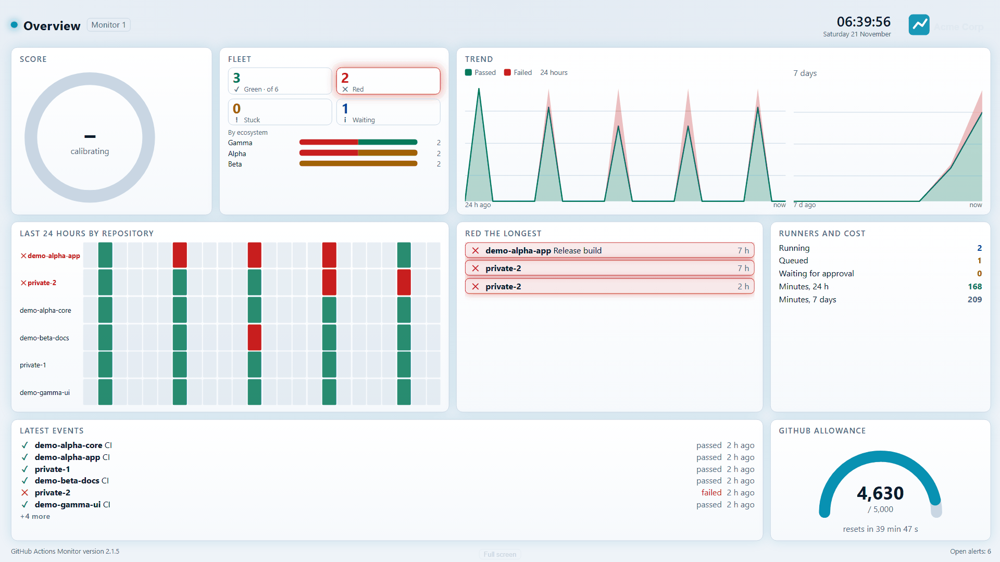

<!--
  Copyright (C) 2026 JuanenRac (Electro Hobby 3D) <electrohobby3d@gmail.com>
  GPL-3.0-or-later - see LICENSE
-->

[🇺🇸 English](SCREENS.md) | [🇪🇸 Español](SCREENS_spa.md) | **🇫🇷 Français** | [🇮🇹 Italiano](SCREENS_ita.md) | [🇩🇪 Deutsch](SCREENS_deu.md) | [🇨🇳 简体中文](SCREENS_zho.md) | [🇯🇵 日本語](SCREENS_jpn.md) | [🇵🇹 Português](SCREENS_por.md)

# Écrans, tailles et orientation

La page s'adapte à la taille de sa fenêtre, du téléphone à la 4K, à la verticale ou à l'horizontale, et un même moniteur peut servir plusieurs écrans, chacun avec les onglets que vous choisissez. Rien n'est interrogé deux fois : tous les écrans lisent le même état.

## Adresses

- `/` - la page entière.
- `/screen/1`, `/screen/2`, `/screen/3` - les onglets définis pour cet écran (`ui.screen1_tabs` ...). Ouvrez chacune dans une fenêtre de son propre écran ou téléviseur.
- `?orient=portrait` ou `?orient=landscape` force la disposition d'une fenêtre ; `?tabs=now,charts` et `?rotate=30` fixent les onglets et les secondes entre eux pour une fenêtre.

## Réglages

| Réglage | Effet |
|---|---|
| `ui.orientation` | auto suit la fenêtre ; portrait empile les panneaux en une colonne ; landscape garde la disposition côte à côte. |
| `ui.rotate_seconds` | 0 = désactivé. Secondes entre les onglets d'un écran qui en a plusieurs. |
| `ui.screen1_tabs` | Onglets de /screen/1, séparés par des virgules : now, al, charts, sent, sci, scol, ssec, team, fleet, repos, rep, trep, les, hist, cfg. Vide = tous. |
| `ui.screen1_orientation` | auto, portrait ou landscape pour /screen/1 seulement. |
| `ui.screen2_tabs` | Onglets de /screen/2. |
| `ui.screen2_orientation` | Orientation de /screen/2. |
| `ui.screen3_tabs` | Onglets de /screen/3. |
| `ui.screen3_orientation` | Orientation de /screen/3. |
| `ui.now_sort` | Ordre de En cours pour qui n'a pas choisi : ecosystem, severity, age, newest, repo, event ou state. |
| `ui.alerts_sort` | Ordre de l'onglet Alertes pour qui n'a pas choisi : server, severity, streak, class, age, newest, repo, origin ou state. |

## Ordre des listes

La section **En cours** du premier onglet est triée par écosystème, avec un titre pour chacun. La liste au-dessus de la section le change : écosystème, gravité (d'abord les exécutions bloquées, puis celles avec un job en échec, puis en cours, puis en file), ancienneté (la plus longue d'abord), plus récent d'abord, dépôt, déclencheur (push, pull_request, schedule...) et état (en cours avant en file). Le choix est mémorisé pour chaque personne : en mode équipe le serveur le garde avec l'utilisateur (`GET` et `POST /api/auth/me/view`, il le suit donc dans un autre navigateur), sinon ce navigateur. Tant que personne ne choisit, l'ordre est `ui.now_sort` du fichier de configuration (écosystème s'il manque ou s'il est faux). Les boutons **Tout déplier** et **Tout replier** à côté de la liste déplient ou replient d'un coup tous les dépôts de la section, dans n'importe quel ordre ; le choix est mémorisé pour chaque personne au même endroit et survit à une actualisation (un dépôt que vous ouvrez ou fermez ensuite à la main garde votre choix).

La liste de l'onglet **Alertes** garde l'ordre envoyé par le moniteur tant que quelqu'un n'en choisit pas un autre avec la liste au-dessus : gravité (critique, erreur, avertissement, info), la plus longue série d'échecs consécutifs d'abord, classe (une alerte d'erreur ou critique est réelle et passe avant celles à surveiller), les plus anciennes d'abord, les plus récentes d'abord, dépôt, origine (la sentinelle qui l'a levée) et état (ouvertes avant mises en sourdine). Elle est mémorisée de la même façon ; tant que personne ne choisit, `ui.alerts_sort` du fichier de configuration s'applique (`server` s'il manque ou s'il est faux).

## Tailles testées

Un test de navigateur ouvre la page dans chacune de ces tailles, parcourt tous les onglets et échoue en cas de défilement latéral ou de texte qui sort de sa boîte. Les fenêtres de 2400 px ou plus reçoivent un texte plus grand (3200 px, plus grand encore) au lieu d'une disposition étirée ; une fenêtre plus haute que large empile les panneaux.

| Taille | Type |
|---|---|
| 1920x1080 | Full HD |
| 2560x1080 | 21:9 |
| 3440x1440 | 21:9 |
| 5120x1440 | 32:9 |
| 3840x2160 | 4K |
| 1080x1920 | Full HD |
| 2160x3840 | 4K |
| 768x1024 | tablet |
| 390x844 | phone |

## Recette pour un poste de deux ou trois écrans

1. Sur l'ordinateur qui exécute le moniteur, mettez `ui.screen1_tabs` à `now,al`, `ui.screen2_tabs` à `charts,repos` et, pour un écran tourné, `ui.screen2_orientation` à `portrait`.
2. Ouvrez `http://cet-ordinateur:8765/screen/1` dans une fenêtre du premier écran et `/screen/2` sur le second ; F11 pour le plein écran. Depuis un autre ordinateur, utilisez le mode réseau avec son jeton d'accès.
3. Pour un écran mural que personne ne touche, donnez-lui plusieurs onglets et mettez `ui.rotate_seconds` à 20-30.

## Écrans muraux : vue d'ensemble, en ce moment et sentinelles

Trois pages pour un moniteur ou un téléviseur que personne ne touche. Elles n'ont ni menu latéral ni navigation, montrent tout en une seule vue avec de grands caractères, animent ce qui est vivant et font clignoter doucement les échecs. Elles ne font que lire : aucun bouton ne modifie quoi que ce soit, et elles n'appellent jamais GitHub (elles montrent ce que le moniteur détient déjà).

| Adresse | Ce qu'elle montre |
|---|---|
| `/screen/overview` | Anneau et lettre du score ; le parc (verts, rouges, bloqués, en attente) ; les dernières 24 heures et 7 jours en graphiques en aires ; une carte thermique des dépôts par heure ; ce qui est rouge depuis le plus longtemps ; runners et minutes ; les derniers événements ; le quota GitHub sous forme de jauge. La carte de la flotte affiche aussi la carte par groupes : une barre par groupe de la vue de flotte (le même regroupement, `fleet.group_by`) avec ses dépôts rouges, à surveiller, en ordre ou sans données ; seulement le nom du groupe et des chiffres. |
| `/screen/now` | Ce qui se passe cette minute : exécutions en cours avec progression et durée, la file, les exécutions en attente d'approbation, les échecs récents, les fusions et versions publiées, les versions à venir et une ligne en direct des deux dernières heures. |
| `/screen/sentinels` | Une carte par sentinelle (A1 à A12) avec son niveau, les constats ouverts, si ses sources sont lisibles, le dernier balayage et un anneau qui suit le balayage ; un radar animé qui marque ce qui ne va pas et les alertes par gravité. |

### Paramètres de l'adresse

Une adresse par moniteur. Un paramètre peut rendre une fenêtre plus calme ou plus petite que ne le permettent les réglages, jamais plus bruyante.

| Paramètre | Effet |
|---|---|
| `?monitor=1` à `9` | Le numéro affiché à côté du titre. |
| `?theme=light` (ou `dark`, `auto`, `contrast`, ou le nom de l'un des seize thèmes) | Couleurs de toute la fenêtre, au-dessus de ce que disent les réglages. `contrast` est blanc sur noir, pour un écran vu de loin. |
| `?density=compact`, `normal` ou `large` | Taille du texte. `?scale=1.5` agrandit tout (de 0,5 à 3). |
| `?refresh=10` | Secondes entre les mises à jour (de 5 à 120). |
| `?lang=de` | Langue (en, es, de, fr, it, ja, zh, pt). |
| `?rotate=30` | La fenêtre passe toute seule par vue d'ensemble, en ce moment et sentinelles toutes les 30 secondes (au moins 5 ; 0 = elle reste sur un écran). Avec `screens.mode` = rotate elle tourne déjà ; ceci change le rythme d'une fenêtre. |
| `?jump=off` | Seulement avec `screens.mode` = rotate : la fenêtre tourne mais ne saute jamais vers un nouveau rouge. |
| `?blink=off` | Les échecs gardent un halo fixe au lieu de clignoter. Il ne peut pas activer ce que `screens.blink` laisse désactivé. |
| `?sound=on` | Un bip court pour un nouvel échec, seulement si `screens.sound` l'autorise. Désactivé par défaut. |

### Langue des écrans

La langue d'un écran se décide dans cet ordre : `?lang=xx` dans l'adresse ; puis la langue choisie sur la page principale du même navigateur (elle y est enregistrée, et un écran ouvert dans ce navigateur la lit, si bien que l'écran suit la page sans aucun paramètre) ; puis la langue du moniteur (`MONITOR_LANG`, ou celle configurée). Un écran dont la langue enregistrée diffère de celle dans laquelle il a été servi se recharge une fois, avant de dessiner, avec `?lang=` ajouté et les autres paramètres (dont `?rotate=`) conservés. Les huit langues (en, es, de, fr, it, ja, zh, pt) sont celles de la page : titres, libellés, états, gravités, unités et temps relatifs (« il y a 5 min ») viennent du catalogue, et l'heure, la date et les nombres s'écrivent avec les paramètres régionaux de la langue (en-GB, es-ES, de-DE, fr-FR, it-IT, ja-JP, zh-CN, pt-PT). Le lien « Ouvrir l'écran » des Réglages porte déjà `?lang=` avec la langue de la page. Un ordinateur qui ne choisit pas de langue reste en anglais : la langue du navigateur ne décide pas.

### Réglages des écrans muraux

| Réglage | Ce qu'il fait |
|---|---|
| `screens.enabled` | Active les trois pages. Désactivé : `/screen/overview`, `/screen/now`, `/screen/sentinels` et `/api/screens/data` répondent 404 (`/screen/1` à `/screen/3` sont la page elle-même et n'en dépendent pas). L'édition lite sert aussi les écrans muraux, avec l'écran des sentinelles vide. Désactivé par défaut. |
| `screens.default_theme` | inherit (par défaut : le thème choisi pour tout le produit, voir plus bas), auto, light, dark, l'un des seize thèmes ou contrast. |
| `screens.default_density` | compact, normal (par défaut) ou large. |
| `screens.refresh_seconds` | Secondes entre les mises à jour d'une fenêtre (10 par défaut). Les pages lisent le moniteur, jamais GitHub : un délai court ne consomme pas de quota. |
| `screens.rotate_seconds` | Seulement avec `screens.mode` = three. 0 (par défaut) = pas de rotation ; à partir de 5, une fenêtre passe par les trois pages. |
| `screens.blink` | Les échecs clignotent doucement (activé par défaut). |
| `screens.blink_calm_minutes` | Minutes après lesquelles un échec dont personne ne s'est occupé garde un halo fixe au lieu de clignoter (30 par défaut ; 0 = il clignote jusqu'à sa résolution). |
| `screens.sound` | Un bip pour un nouvel échec (désactivé par défaut). |
| `screens.burn_in_protection` | Déplace tout de quelques pixels chaque minute (activé par défaut). |
| `screens.night_dim` | Atténue les écrans entre `screens.night_dim_from_hour` (22) et `screens.night_dim_to_hour` (7) ; désactivé par défaut. |
| `screens.show_repo_names` | all, public (par défaut : les dépôts privés apparaissent comme private-1, private-2...) ou none (tous les noms sont masqués). Utilisez public ou none pour un écran que d'autres personnes peuvent voir. Avec une liste de dépôts écrite à la main dans `repos`, la visibilité est lue par une liste du compte toutes les `discover_refresh_seconds` ; un dépôt dont la visibilité n'a pas pu être lue compte comme privé. Les numéros (private-1...) ne vont qu'aux dépôts masqués, dans l'ordre d'un HMAC du nom avec une clé de l'installation gardée dans un fichier privé du dossier de données : ils ne disent rien de la place d'un dépôt parmi les autres. |
| `screens.theme_overview`, `screens.theme_now`, `screens.theme_sentinels` | Le thème d'un écran : inherit (par défaut : celui de `screens.default_theme`) ou l'un des thèmes ci-dessus. |
| `screens.mode` | three (par défaut : les trois pages séparées, une par fenêtre) ou rotate (une seule page qui passe par les trois et saute vers un nouveau rouge). |
| `screens.rotate_every_seconds` | En mode rotate, secondes sur chaque écran (20 par défaut ; de 5 à 300). |
| `screens.alert_hold_seconds` | En mode rotate, secondes pendant lesquelles un nouveau rouge garde la fenêtre sur son écran (30 par défaut ; de 5 à 600), ou jusqu'à ce que le rouge disparaisse. |
| `screens.logo_overview`, `screens.logo_now`, `screens.logo_sentinels` | Sur quels écrans le logo apparaît (seulement la vue d'ensemble par défaut). |
| `screens.logo_corner` | top-right (par défaut), top-left, bottom-right ou bottom-left. |
| `screens.logo_max_width`, `screens.logo_max_height` | Taille maximale du logo en pixels à 1920 x 1080 (160 x 64 par défaut ; il grandit avec l'écran). |
| `screens.group_map` | Activé par défaut. Affiche la carte de la flotte par groupes sur l’écran général (le regroupement de la vue de flotte). Désactivé : seulement les quatre tuiles. |
| `screens.menu` | Activé par défaut. Le bouton Écrans de la barre du haut. Désactivé : le bouton disparaît ; les écrans continuent de fonctionner à leurs propres adresses. |
| `screens.menu_target` | new (par défaut) : un écran s'ouvre dans une nouvelle fenêtre ou un nouvel onglet ; same : dans l'onglet actuel. |
| `screens.menu_max_windows` | Nombre maximal de fenêtres qu'un ensemble multi-écrans ouvre d'un coup (4 par défaut ; de 1 à 9). |
| `screens.menu_rotate_seconds` | Secondes par écran dans les préréglages tournants du menu (20 par défaut ; de 5 à 300). |
| `screens.menu_tv_scale` | Le `?scale=` du préréglage télé (1,5 par défaut ; de 0,5 à 3). |

### Thème des écrans

Tout ce que montre le moniteur porte le thème choisi dans les Réglages (`ui.theme` : auto, light, dark ou l'un des seize thèmes) : la page, les écrans muraux et la page de connexion. Choisir un thème dans le sélecteur de l'onglet Ce navigateur l'enregistre aussi comme `ui.theme`, si bien qu'un navigateur qui n'a jamais choisi prend celui du moniteur. Les rapports HTML écrits sur disque suivent le réglage clair ou sombre de l'ordinateur qui les ouvre.

Les écrans muraux en héritent : `screens.default_theme` vaut `inherit` par défaut. Mettez-le sur un autre thème pour fixer le même sur tous les écrans, et `screens.theme_overview`, `screens.theme_now` ou `screens.theme_sentinels` pour donner son propre thème à un écran. L'adresse peut toujours fixer une fenêtre avec `?theme=`. Aucun écran n'écrit de couleur à lui : tous utilisent les palettes du thème, donc un thème ajouté à la page apparaît aussi sur les écrans.

### Mode des écrans : trois ou rotation

`screens.mode` = three (par défaut) garde les trois pages séparées, une par fenêtre. `screens.mode` = rotate fait de chaque fenêtre un seul écran qui passe par vue d'ensemble, en ce moment et sentinelles toutes les `screens.rotate_every_seconds` secondes (20 par défaut ; de 5 à 300).

Un échec en rouge fait sauter la fenêtre vers l'écran qui le montre : **En ce moment** pour un workflow en échec, **Sentinelles** pour un panneau de sentinelle qui passe au rouge. La fenêtre y reste `screens.alert_hold_seconds` secondes (30 par défaut ; de 5 à 600) ou jusqu'à ce que ce rouge disparaisse, selon ce qui arrive en premier, puis continue de tourner. Un rouge déjà montré ne refait pas sauter la fenêtre tant qu'il ne change pas ou ne revient pas. Ce qui est rouge à l'ouverture de la fenêtre n'est que le point de départ et ne la fait pas sauter. Si un second rouge arrive pendant que la fenêtre tient le premier, il attend son tour. Pour le savoir, une fenêtre lit les deux autres écrans en arrière-plan avec le même appel en lecture seule (jamais GitHub). `?rotate=0` garde une fenêtre sur son écran et `?jump=off` garde la rotation sans les sauts. Chaque écran met son propre thème et son propre logo en arrivant.

### Logo de l'organisation

L'onglet Ce navigateur des Réglages a un bloc pour envoyer le logo de votre organisation : PNG, JPEG, WebP ou SVG, 1 Mo au maximum. Le moniteur vérifie le vrai type d'après les premiers octets du fichier (le nom et l'étiquette qui l'accompagne ne comptent pas), refuse un SVG avec des scripts, des gestionnaires d'événements, des liens vers d'autres fichiers ou adresses ou un type de document, et garde l'image dans le dossier `data/` de cet ordinateur sous le nom `org_logo` avec son extension, jamais dans la configuration. Un seul logo existe : en envoyer un autre le remplace. Le journal des actions note l'envoi et le retrait, jamais le fichier.

`screens.logo_overview`, `screens.logo_now` et `screens.logo_sentinels` choisissent sur quels écrans muraux il apparaît (seulement la vue d'ensemble par défaut), `screens.logo_corner` le coin (en haut à droite par défaut) et `screens.logo_max_width` et `screens.logo_max_height` la taille maximale en pixels à 1920 x 1080 (160 x 64 par défaut ; le logo grandit avec l'écran). L'image est ajustée dans cette taille sans être déformée et a sa place dans l'en-tête ou le pied de page, si bien qu'elle ne cache jamais le contenu. Son fond reste transparent : un logo à fond transparent rend bien dans les thèmes clairs comme dans les sombres.

### Ce qu'elles montrent et ce qu'elles cachent

Les données viennent de `/api/screens/data?screen=overview` (ou `now`, `sentinels`) : une liste fermée de champs construite à partir du dernier cycle, de l'instantané des sentinelles, des alertes et du score. Elle ne contient jamais de lien, de titre de commit, de nom de job, de nom d'utilisateur ni de chemin de cet ordinateur, et les noms de workflow des dépôts masqués sont masqués aussi. En mode réseau, les pages exigent le même jeton d'accès que le reste du moniteur et la réponse est en lecture seule.

### Leur comportement

- Les échecs clignotent moins de deux fois par seconde (jamais de stroboscope) ; un nouvel échec provoque un seul éclair ; un échec dont personne ne s'est occupé pendant `screens.blink_calm_minutes` minutes garde un halo fixe. Avec le réglage du système pour réduire les animations, ou avec `?blink=off`, rien ne clignote ni ne bouge. Un échec n'est jamais signalé par la seule couleur : il porte un symbole et un mot.
- Quand le moniteur ne répond pas, la page le dit, s'atténue et réessaie après 5, 10, 20... secondes (jusqu'à 60).
- Un écran toujours allumé est protégé contre la rémanence : tout se déplace de quelques pixels chaque minute et la page peut s'atténuer la nuit.

### Installer plusieurs moniteurs

1. Choisissez une adresse par moniteur, par exemple `/screen/overview?monitor=1`, `/screen/now?monitor=2` et `/screen/sentinels?monitor=3` ; ou ouvrez une seule fenêtre avec `?rotate=20`.
2. Ouvrez chacune dans Chrome ou Edge en mode kiosque : `msedge --kiosk "http://cet-ordinateur:8765/screen/now?monitor=2" --edge-kiosk-type=fullscreen` ou `chrome --kiosk "http://cet-ordinateur:8765/screen/now?monitor=2"` ; avec `--app=ADRESSE` au lieu de `--kiosk`, la fenêtre n'a pas de barres. Sans mode kiosque, le bouton discret en bas de page demande le plein écran.
3. Depuis un autre ordinateur, utilisez le mode réseau : le jeton d'accès d'un lecteur suffit, car ces pages n'écrivent jamais.

## Menu Écrans

Le bouton **Écrans** de la barre du haut (l'icône de deux moniteurs) ouvre un menu avec chaque type d'écran du moniteur, pour que personne n'ait à retenir les adresses. Il ne fait que naviguer : il ouvre des adresses, n'écrit rien et ne lit rien sur GitHub. Il est activé par défaut et `screens.menu` le désactive.

| Écran | Adresse | De quoi s'agit-il |
|---|---|---|
| Tableau de bord | `/` | La page entière, pour une personne à son bureau. `?repo=` filtre les dépôts. |
| Borne | `/?chrome=0&view=now` | Une vue sans en-tête, onglets ni filtres, pour un moniteur que personne ne touche. La vue est un paramètre. |
| Vue d'équipe | `/?chrome=0&view=team` | La vue d'équipe en borne (édition complète). |
| Écrans d'onglets 1 à 3 | `/screen/1`, `/screen/2`, `/screen/3` | Les onglets définis pour chaque moniteur d'un bureau ; `?tabs=`, `?orient=` et `?rotate=` les changent pour une fenêtre. |
| Écrans muraux | `/screen/overview`, `/screen/now`, `/screen/sentinels` | Les trois écrans muraux ci-dessus. |
| Mur tournant | `/screen/overview?rotate=20` | Une fenêtre qui tourne entre les trois et saute sur un nouveau rouge. |
| Télé | `/screen/overview?theme=contrast&density=large&scale=1.5&rotate=20` | Le mur tournant pour un écran vu de loin. |
| Plusieurs moniteurs | une adresse par fenêtre | Un ensemble de fenêtres, une par moniteur (voir ci-dessous). |

Chaque carte montre les paramètres que cette adresse accepte (thème, densité, actualisation, échelle, langue, rotation, filtre de dépôts...), chacun avec son propre texte d'aide, et l'adresse obtenue. **Ouvrir** l'ouvre dans une nouvelle fenêtre ou un nouvel onglet, ou dans l'onglet actuel, selon `screens.menu_target` ; **Copier l'adresse** place l'adresse complète dans le presse-papiers pour l'ouvrir sur un autre ordinateur (jamais de jeton : en mode réseau, cet ordinateur se connecte comme d'habitude). Les écrans muraux répondent 404 tant que `screens.enabled` est désactivé ; leur carte le dit au lieu d'ouvrir une page vide ; la vue d'équipe n'est pas dans l'édition lite.

### Plusieurs moniteurs

Choisissez le nombre de fenêtres (au plus `screens.menu_max_windows`), la disposition (en ligne, en colonne ou en grille) et ce que montre chaque fenêtre (les trois écrans muraux à tour de rôle, des murs qui tournent seuls ou les écrans d'onglets). **Ouvrir toutes les fenêtres** ouvre une fenêtre par moniteur. Dans un navigateur doté de l'API de gestion des fenêtres (Chrome et Edge demandent l'autorisation *gestion des fenêtres*), chaque fenêtre est placée sur son propre moniteur, ordonnés comme l'indique la disposition ; avec plus de fenêtres que de moniteurs, elles se partagent un moniteur en mosaïque. Sans elle, les fenêtres s'ouvrent là où le navigateur les met et la carte liste une commande de borne par fenêtre (`msedge --kiosk ADRESSE --window-position=X,Y`) pour les lancer à la main. Le navigateur doit autoriser les fenêtres contextuelles pour l'adresse du moniteur.

Le même catalogue est lu par les outils : `GET /api/screens/menu`, `monitor_cli.py screens [list|urls]` et l'outil MCP `screens_menu`. Les trois sont en lecture seule.

## Images

L'onglet Maintenant en quatre tailles, avec des données inventées (4K, un moniteur 21:9, un moniteur tourné, un téléphone) :

Les trois écrans muraux en 4K et sur un moniteur tourné, avec des données inventées :

Les écrans muraux dans d'autres thèmes, avec le logo d'une organisation et la fenêtre qui tourne toute seule, avec des données inventées :

