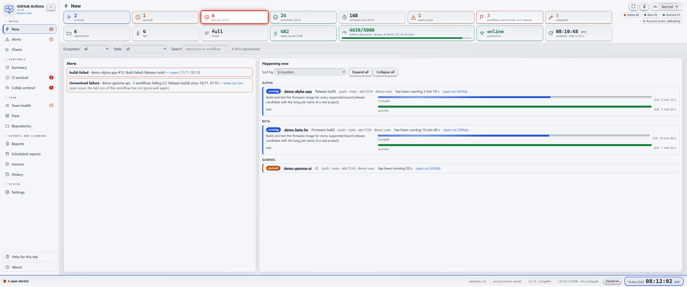
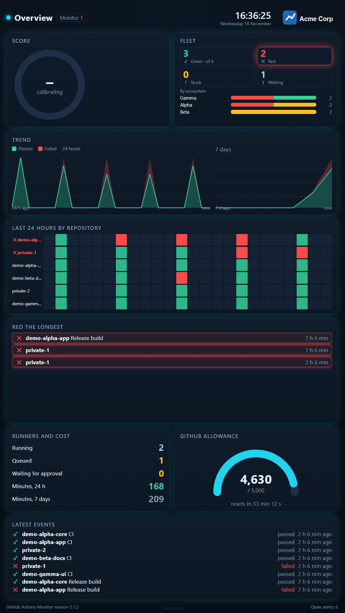

<!--
  Copyright (C) 2026 JuanenRac (Electro Hobby 3D) <electrohobby3d@gmail.com>
  GPL-3.0-or-later - see LICENSE
-->

[🇺🇸 English](SCREENS.md) | [🇪🇸 Español](SCREENS_spa.md) | [🇫🇷 Français](SCREENS_fra.md) | **🇮🇹 Italiano** | [🇩🇪 Deutsch](SCREENS_deu.md) | [🇨🇳 简体中文](SCREENS_zho.md) | [🇯🇵 日本語](SCREENS_jpn.md) | [🇵🇹 Português](SCREENS_por.md)

# Schermi, dimensioni e orientamento

La pagina si adatta alla dimensione della finestra, dal telefono al 4K, in verticale o in orizzontale, e un solo monitor può servire più schermi, ciascuno con le schede che scegli. Niente viene interrogato due volte: tutti gli schermi leggono lo stesso stato.

## Indirizzi

- `/` - l'intera pagina.
- `/screen/1`, `/screen/2`, `/screen/3` - le schede impostate per quello schermo (`ui.screen1_tabs` ...). Apri ciascuna in una finestra del proprio monitor o TV.
- `?orient=portrait` o `?orient=landscape` forza la disposizione di una finestra; `?tabs=now,charts` e `?rotate=30` impostano le schede e i secondi tra loro per una finestra.

## Impostazioni

| Impostazione | Cosa fa |
|---|---|
| `ui.orientation` | auto segue la finestra; portrait impila i pannelli in una colonna; landscape mantiene l'affiancamento. |
| `ui.rotate_seconds` | 0 = spento. Secondi tra le schede di uno schermo che ne ha più di una. |
| `ui.screen1_tabs` | Schede di /screen/1, separate da virgole: now, al, rep, les, sent, charts, repos, hist, cfg. Vuoto = tutte. |
| `ui.screen1_orientation` | auto, portrait o landscape solo per /screen/1. |
| `ui.screen2_tabs` | Schede di /screen/2. |
| `ui.screen2_orientation` | Orientamento di /screen/2. |
| `ui.screen3_tabs` | Schede di /screen/3. |
| `ui.screen3_orientation` | Orientamento di /screen/3. |
| `ui.now_sort` | Ordine di In corso adesso per chi non ha scelto: ecosystem, severity, age, newest, repo, event o state. |
| `ui.alerts_sort` | Ordine della scheda Avvisi per chi non ha scelto: server, severity, streak, class, age, newest, repo, origin o state. |

## Ordine degli elenchi

La sezione **In corso adesso** della prima scheda è ordinata per ecosistema, con un titolo per ciascuno. L'elenco sopra la sezione lo cambia: ecosistema, gravità (prima le esecuzioni bloccate, poi quelle con un job fallito, poi in corso, poi in coda), anzianità (la più lunga per prima), più recente per prima, repository, innesco (push, pull_request, schedule...) e stato (in corso prima di in coda). La scelta viene ricordata per ogni persona: in modalità team la conserva il server con l'utente (`GET` e `POST /api/auth/me/view`, quindi lo segue in un altro browser), altrimenti questo browser. Finché nessuno sceglie, l'ordine è `ui.now_sort` del file di configurazione (ecosistema se manca o è errato). I pulsanti **Espandi tutto** e **Comprimi tutto** accanto all'elenco espandono o comprimono in un colpo tutti i repository della sezione, con qualsiasi ordine; la scelta viene ricordata per ogni persona nello stesso posto e sopravvive a un aggiornamento (un repository aperto o chiuso a mano dopo conserva la tua scelta).

L'elenco della scheda **Avvisi** mantiene l'ordine inviato dal monitor finché qualcuno non ne sceglie un altro con l'elenco sopra: gravità (critico, errore, avviso, info), prima la serie di errori consecutivi più lunga, classe (un avviso di errore o critico è reale e va prima di quelli da tenere d'occhio), prima i più vecchi, prima i più recenti, repository, origine (la sentinella che lo ha sollevato) e stato (aperti prima di silenziati). Viene ricordato allo stesso modo; finché nessuno sceglie, vale `ui.alerts_sort` del file di configurazione (`server` se manca o è errato).

## Dimensioni provate

Un test del browser apre la pagina in ciascuna di queste dimensioni, percorre tutte le schede e fallisce se c'è uno scorrimento laterale o un testo che esce dal suo riquadro. Le finestre da 2400 px in su ricevono un carattere più grande (da 3200 px, ancora più grande) invece di una disposizione allungata; una finestra più alta che larga impila i pannelli.

| Dimensione | Tipo |
|---|---|
| 1920x1080 | Full HD |
| 2560x1080 | 21:9 |
| 3440x1440 | 21:9 |
| 5120x1440 | 32:9 |
| 3840x2160 | 4K |
| 1080x1920 | Full HD |
| 2160x3840 | 4K |
| 768x1024 | tablet |
| 390x844 | phone |

## Ricetta per una postazione con due o tre schermi

1. Sul computer che esegue il monitor, imposta `ui.screen1_tabs` su `now,al`, `ui.screen2_tabs` su `charts,repos` e, per un monitor ruotato, `ui.screen2_orientation` su `portrait`.
2. Apri `http://questo-computer:8765/screen/1` in una finestra del primo monitor e `/screen/2` sul secondo; F11 per lo schermo intero. Da un altro computer usa la modalità rete con il suo token di accesso.
3. Per uno schermo a parete che nessuno tocca, dagli più schede e imposta `ui.rotate_seconds` su 20-30.

## Schermi da parete: panoramica, in questo momento e sentinelle

Tre pagine per un monitor o una TV che nessuno tocca. Non hanno menu laterale né navigazione, mostrano tutto in una sola vista con testo grande, animano ciò che è vivo e fanno lampeggiare dolcemente i guasti. Fanno solo lettura: nessun pulsante cambia nulla e non chiamano mai GitHub (mostrano ciò che il monitor ha già).

| Indirizzo | Cosa mostra |
|---|---|
| `/screen/overview` | Anello e lettera del punteggio; la flotta (verdi, rossi, bloccati, in attesa); le ultime 24 ore e 7 giorni in grafici ad area; una mappa di calore dei repository per ora; ciò che è rosso da più tempo; runner e minuti; gli ultimi eventi; la quota di GitHub come indicatore. |
| `/screen/now` | Ciò che accade in questo minuto: esecuzioni in corso con avanzamento e durata, la coda, esecuzioni in attesa di approvazione, errori recenti, merge e release, release in arrivo e una linea in diretta delle ultime due ore. |
| `/screen/sentinels` | Una scheda per ogni sentinella (da A1 ad A12) con il suo livello, i rilievi aperti, se le sue fonti sono leggibili, l'ultima scansione e un anello che segue la scansione; un radar animato che segna ciò che non va e gli avvisi per gravità. |

### Parametri dell'indirizzo

Un indirizzo per ogni monitor. Un parametro può rendere una finestra più tranquilla o più piccola di quanto consentano le impostazioni, mai più rumorosa.

| Parametro | Effetto |
|---|---|
| `?monitor=1` a `9` | Il numero mostrato accanto al titolo. |
| `?theme=dark`, `light` o `contrast` | Colori; contrast è bianco su nero, per uno schermo visto da lontano. |
| `?density=compact`, `normal` o `large` | Dimensione del testo. `?scale=1.5` ingrandisce tutto (da 0,5 a 3). |
| `?refresh=10` | Secondi tra gli aggiornamenti (da 5 a 120). |
| `?lang=de` | Lingua (en, es, de, fr, it, ja, zh, pt). |
| `?rotate=30` | La finestra passa da sola per panoramica, in questo momento e sentinelle ogni 30 secondi (minimo 5; 0 = nessuna rotazione). |
| `?blink=off` | I guasti mantengono un alone fisso invece di lampeggiare. Non può attivare ciò che `screens.blink` tiene spento. |
| `?sound=on` | Un breve segnale acustico per un nuovo guasto, solo se `screens.sound` lo consente. Disattivato per impostazione predefinita. |

### Impostazioni degli schermi da parete

| Impostazione | Cosa fa |
|---|---|
| `screens.enabled` | Attiva le tre pagine. Disattivato: `/screen/overview`, `/screen/now`, `/screen/sentinels` e `/api/screens/data` rispondono 404 (da `/screen/1` a `/screen/3` sono la pagina stessa e non ne dipendono). Anche l'edizione lite serve gli schermi a parete, con lo schermo delle sentinelle vuoto. Disattivato per impostazione predefinita. |
| `screens.default_theme` | dark (predefinito), light o contrast. |
| `screens.default_density` | compact, normal (predefinito) o large. |
| `screens.refresh_seconds` | Secondi tra gli aggiornamenti di una finestra (10 per impostazione predefinita). Le pagine leggono dal monitor, mai da GitHub, quindi un tempo breve non consuma quota. |
| `screens.rotate_seconds` | 0 (predefinito) = nessuna rotazione; da 5 in su, una finestra passa per le tre pagine. |
| `screens.blink` | I guasti lampeggiano dolcemente (attivo per impostazione predefinita). |
| `screens.blink_calm_minutes` | Minuti dopo i quali un guasto di cui nessuno si occupa mantiene un alone fisso invece di lampeggiare (30 per impostazione predefinita; 0 = lampeggia finché non è risolto). |
| `screens.sound` | Un segnale acustico per un nuovo guasto (disattivato per impostazione predefinita). |
| `screens.burn_in_protection` | Sposta tutto di qualche pixel ogni minuto (attivo per impostazione predefinita). |
| `screens.night_dim` | Attenua gli schermi tra `screens.night_dim_from_hour` (22) e `screens.night_dim_to_hour` (7); disattivato per impostazione predefinita. |
| `screens.show_repo_names` | all, public (predefinito: i repository privati compaiono come private-1, private-2...) o none (ogni nome è nascosto). Usare public o none per uno schermo che altre persone possono vedere. |

### Cosa mostrano e cosa nascondono

I dati arrivano da `/api/screens/data?screen=overview` (oppure `now`, `sentinels`): un elenco chiuso di campi costruito con l'ultimo ciclo, l'istantanea delle sentinelle, gli avvisi e il punteggio. Non contiene mai un collegamento, un titolo di commit, il nome di un job, il nome di una persona né un percorso di questo computer, e anche i nomi dei workflow dei repository nascosti sono nascosti. In modalità di rete le pagine richiedono lo stesso token di accesso del resto del monitor e la risposta è di sola lettura.

### Come si comportano

- I guasti lampeggiano meno di due volte al secondo (mai in modo stroboscopico); un nuovo guasto produce un solo lampo; un guasto di cui nessuno si occupa per `screens.blink_calm_minutes` minuti mantiene un alone fisso. Con l'impostazione del sistema per ridurre il movimento, oppure con `?blink=off`, nulla lampeggia né si muove. Un guasto non è mai indicato solo dal colore: porta un simbolo e una parola.
- Quando il monitor non risponde, la pagina lo dice, si attenua e riprova dopo 5, 10, 20... secondi (fino a 60).
- Uno schermo sempre acceso è protetto dal burn-in: tutto si sposta di qualche pixel ogni minuto e la pagina può attenuarsi di notte.

### Montare più monitor

1. Scegliere un indirizzo per ogni monitor, per esempio `/screen/overview?monitor=1`, `/screen/now?monitor=2` e `/screen/sentinels?monitor=3`; oppure aprire una sola finestra con `?rotate=20`.
2. Aprire ciascuna in Chrome o Edge in modalità chiosco: `msedge --kiosk "http://questo-computer:8765/screen/now?monitor=2" --edge-kiosk-type=fullscreen` oppure `chrome --kiosk "http://questo-computer:8765/screen/now?monitor=2"`; con `--app=INDIRIZZO` al posto di `--kiosk` la finestra non ha barre. Senza modalità chiosco, il pulsante discreto a piè di pagina chiede lo schermo intero.
3. Da un altro computer usare la modalità di rete: basta il token di accesso di un visualizzatore, perché queste pagine non scrivono mai.

## Immagini

La scheda Adesso in quattro dimensioni, con dati inventati (4K, un monitor 21:9, un monitor ruotato, un telefono):

I tre schermi da parete in 4K e su un monitor ruotato, con dati inventati:

