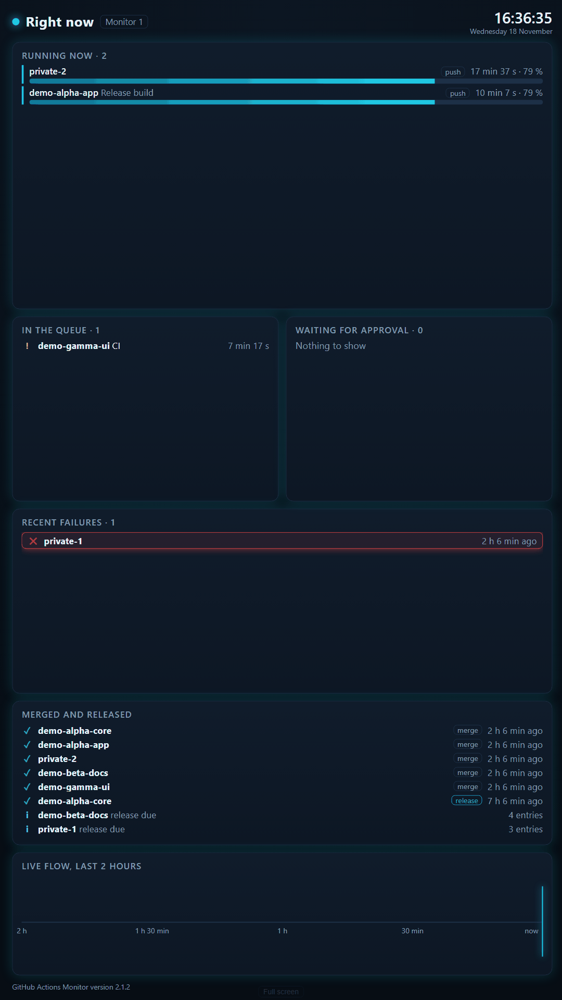

<!--
  Copyright (C) 2026 JuanenRac (Electro Hobby 3D) <electrohobby3d@gmail.com>
  GPL-3.0-or-later - see LICENSE
-->

[🇺🇸 English](SCREENS.md) | [🇪🇸 Español](SCREENS_spa.md) | [🇫🇷 Français](SCREENS_fra.md) | [🇮🇹 Italiano](SCREENS_ita.md) | [🇩🇪 Deutsch](SCREENS_deu.md) | [🇨🇳 简体中文](SCREENS_zho.md) | [🇯🇵 日本語](SCREENS_jpn.md) | **🇵🇹 Português**

# Ecrãs, tamanhos e orientação

A página adapta-se ao tamanho da janela, do telemóvel ao 4K, na vertical ou na horizontal, e um mesmo monitor pode servir vários ecrãs, cada um com os separadores que escolher. Nada é consultado duas vezes: todos os ecrãs leem o mesmo estado.

Para uma TV ou uma parede com texto maior, um contraste alto ou uma rotação por alguns separadores, veja [KIOSK_por.md](KIOSK_por.md).
## Endereços

- `/` - a página inteira.
- `/screen/1`, `/screen/2`, `/screen/3` - os separadores definidos para esse ecrã (`ui.screen1_tabs` ...). Abra cada um numa janela do seu próprio monitor ou televisão.
- `?orient=portrait` ou `?orient=landscape` força a disposição de uma janela; `?tabs=now,charts` e `?rotate=30` definem os separadores e os segundos entre eles numa janela.

## Definições

| Definição | O que faz |
|---|---|
| `ui.orientation` | auto segue a janela; portrait empilha os painéis numa coluna; landscape mantém a disposição lado a lado. |
| `ui.rotate_seconds` | 0 = desligado. Segundos entre os separadores de um ecrã que tem mais de um. |
| `ui.screen1_tabs` | Separadores de /screen/1, separados por vírgulas: now, al, charts, sent, sci, scol, ssec, team, fleet, repos, rep, trep, les, hist, cfg. Vazio = todos. |
| `ui.screen1_orientation` | auto, portrait ou landscape só para /screen/1. |
| `ui.screen2_tabs` | Separadores de /screen/2. |
| `ui.screen2_orientation` | Orientação de /screen/2. |
| `ui.screen3_tabs` | Separadores de /screen/3. |
| `ui.screen3_orientation` | Orientação de /screen/3. |
| `ui.now_sort` | Ordem de A acontecer agora para quem não escolheu: ecosystem, severity, age, newest, repo, event ou state. |
| `ui.alerts_sort` | Ordem do separador Alertas para quem não escolheu: server, severity, streak, class, age, newest, repo, origin ou state. |

## Ordem das listas

A secção **A acontecer agora** do primeiro separador está ordenada por ecossistema, com um título para cada um. A lista por cima da secção altera-a: ecossistema, gravidade (primeiro as bloqueadas, depois as que têm uma tarefa com falha, depois as em curso e por fim as em fila), antiguidade (a que leva mais tempo, primeiro), mais recente primeiro, repositório, disparador (push, pull_request, schedule...) e estado (em curso antes de em fila). A escolha fica guardada para cada pessoa: no modo de equipa é o servidor que a guarda com o utilizador (`GET` e `POST /api/auth/me/view`, por isso acompanha-o noutro navegador); caso contrário, é este navegador. Enquanto ninguém escolhe, a ordem é `ui.now_sort` do ficheiro de configuração (ecossistema se faltar ou estiver errado). Os botões **Expandir tudo** e **Recolher tudo** junto à lista expandem ou recolhem de uma vez todos os repositórios da secção, com qualquer ordem; a escolha é lembrada por pessoa no mesmo sítio e sobrevive a uma atualização (um repositório que abra ou feche à mão depois mantém a sua escolha).

A lista do separador **Alertas** mantém a ordem que o monitor envia até alguém escolher outra com a lista por cima: gravidade (crítico, erro, aviso, info), a maior sequência de falhas seguidas primeiro, classe (um alerta de erro ou crítico é real e vai antes dos que há que vigiar), os mais antigos primeiro, os mais recentes primeiro, repositório, origem (a sentinela que o levantou) e estado (abertos antes de silenciados). Fica guardada do mesmo modo e, enquanto ninguém escolhe, vale `ui.alerts_sort` do ficheiro de configuração (`server` se faltar ou estiver errado).

## Tamanhos testados

Um teste de navegador abre a página em cada um destes tamanhos, percorre todos os separadores e falha se houver deslocação lateral ou texto que saia da sua caixa. As janelas de 2400 px ou mais recebem um tipo de letra maior (as de 3200 px, ainda maior) em vez de uma disposição esticada; uma janela mais alta do que larga empilha os painéis.

| Tamanho | Tipo |
|---|---|
| 1920x1080 | Full HD |
| 2560x1080 | 21:9 |
| 3440x1440 | 21:9 |
| 5120x1440 | 32:9 |
| 3840x2160 | 4K |
| 1080x1920 | Full HD |
| 2160x3840 | 4K |
| 768x1024 | tablet |
| 390x844 | phone |

## Receita para um posto com dois ou três ecrãs

1. No computador que executa o monitor, ponha `ui.screen1_tabs` em `now,al`, `ui.screen2_tabs` em `charts,repos` e, para um monitor rodado, `ui.screen2_orientation` em `portrait`.
2. Abra `http://este-computador:8765/screen/1` numa janela do primeiro monitor e `/screen/2` no segundo; F11 para ecrã inteiro. A partir de outro computador, use o modo de rede com o seu token de acesso.
3. Para um ecrã de parede em que ninguém toca, dê-lhe vários separadores e ponha `ui.rotate_seconds` em 20-30.

## Ecrãs de parede: visão geral, neste momento e sentinelas

Três páginas para um monitor ou uma televisão em que ninguém toca. Não têm menu lateral nem navegação, mostram tudo numa única vista com letra grande, animam o que está vivo e fazem piscar as falhas com suavidade. Só leem: nenhum botão altera nada e nunca chamam o GitHub (mostram o que o monitor já tem).

| Endereço | O que mostra |
|---|---|
| `/screen/overview` | Anel e letra da pontuação; a frota (verdes, vermelhos, bloqueados, em espera); as últimas 24 horas e 7 dias em gráficos de área; um mapa de calor dos repositórios por hora; o que está a vermelho há mais tempo; runners e minutos; os últimos eventos; a quota do GitHub como indicador. |
| `/screen/now` | O que acontece neste minuto: execuções em curso com progresso e duração, a fila, execuções à espera de aprovação, falhas recentes, fusões e versões publicadas, versões por publicar e uma linha em direto das últimas duas horas. |
| `/screen/sentinels` | Um cartão por cada sentinela (A1 a A12) com o seu nível, os achados em aberto, se as suas fontes são legíveis, a última varredura e um anel que acompanha a varredura; um radar animado que assinala o que está mal e os alertas por gravidade. |

### Parâmetros do endereço

Um endereço para cada monitor. Um parâmetro pode tornar uma janela mais calma ou mais pequena do que as definições permitem, nunca mais ruidosa.

| Parâmetro | Efeito |
|---|---|
| `?monitor=1` a `9` | O número que aparece junto ao título. |
| `?theme=dark`, `light` ou `contrast` | Cores; contrast é branco sobre preto, para um ecrã visto ao longe. |
| `?density=compact`, `normal` ou `large` | Tamanho da letra. `?scale=1.5` aumenta tudo (de 0,5 a 3). |
| `?refresh=10` | Segundos entre atualizações (de 5 a 120). |
| `?lang=de` | Idioma (en, es, de, fr, it, ja, zh, pt). |
| `?rotate=30` | A janela passa sozinha por visão geral, neste momento e sentinelas a cada 30 segundos (mínimo 5; 0 = sem rotação). |
| `?blink=off` | As falhas mantêm um halo fixo em vez de piscar. Não pode ativar o que `screens.blink` mantém desligado. |
| `?sound=on` | Um sinal sonoro curto a cada falha nova, só se `screens.sound` o permitir. Desativado por defeito. |

### Idioma dos ecrãs

O idioma de um ecrã decide-se por esta ordem: `?lang=xx` no endereço; depois o idioma escolhido na página principal do mesmo navegador (fica lá guardado, e um ecrã aberto nesse navegador lê-o, pelo que o ecrã acompanha a página sem qualquer parâmetro); depois o idioma do monitor (`MONITOR_LANG`, ou o configurado). Um ecrã cujo idioma guardado difere daquele em que foi servido volta a carregar uma vez, antes de desenhar, com `?lang=` acrescentado e os restantes parâmetros (entre eles `?rotate=`) mantidos. Os oito idiomas (en, es, de, fr, it, ja, zh, pt) são os mesmos da página: títulos, etiquetas, estados, gravidades, unidades e tempos relativos («há 5 min») vêm do catálogo, e a hora, a data e os números escrevem-se com a configuração regional do idioma (en-GB, es-ES, de-DE, fr-FR, it-IT, ja-JP, zh-CN, pt-PT). A ligação «Abrir ecrã» das Definições já leva `?lang=` com o idioma da página. Um computador que não escolhe idioma por si fica em inglês: o idioma do navegador não decide.

### Definições dos ecrãs de parede

| Definição | O que faz |
|---|---|
| `screens.enabled` | Ativa as três páginas. Desativado: `/screen/overview`, `/screen/now`, `/screen/sentinels` e `/api/screens/data` respondem 404 (`/screen/1` a `/screen/3` são a própria página e não dependem disto). A edição lite também serve os ecrãs de parede, com o ecrã dos sentinelas vazio. Desativado por defeito. |
| `screens.default_theme` | dark (por defeito), light ou contrast. |
| `screens.default_density` | compact, normal (por defeito) ou large. |
| `screens.refresh_seconds` | Segundos entre atualizações de uma janela (10 por defeito). As páginas leem do monitor, nunca do GitHub, por isso um tempo curto não gasta quota. |
| `screens.rotate_seconds` | 0 (por defeito) = sem rotação; a partir de 5, uma janela passa pelas três páginas. |
| `screens.blink` | As falhas piscam suavemente (ativado por defeito). |
| `screens.blink_calm_minutes` | Minutos após os quais uma falha a que ninguém atende mantém um halo fixo em vez de piscar (30 por defeito; 0 = pisca até ser resolvida). |
| `screens.sound` | Um sinal sonoro a cada falha nova (desativado por defeito). |
| `screens.burn_in_protection` | Desloca tudo alguns píxeis a cada minuto (ativado por defeito). |
| `screens.night_dim` | Escurece os ecrãs entre `screens.night_dim_from_hour` (22) e `screens.night_dim_to_hour` (7); desativado por defeito. |
| `screens.show_repo_names` | all, public (por defeito: os repositórios privados aparecem como private-1, private-2...) ou none (todos os nomes ficam ocultos). Use public ou none num ecrã que outras pessoas possam ver. Com uma lista de repositórios escrita à mão em `repos`, a visibilidade é lida com uma listagem da conta a cada `discover_refresh_seconds`; um repositório cuja visibilidade não pôde ser lida conta como privado. Os números (private-1...) só se dão aos repositórios ocultos, pela ordem de um HMAC do nome com uma chave da instalação guardada num ficheiro privado da pasta de dados, pelo que nada dizem sobre onde um repositório cai entre os outros. |

### O que mostram e o que ocultam

Os dados vêm de `/api/screens/data?screen=overview` (ou `now`, `sentinels`): uma lista fechada de campos construída com o último ciclo, o instantâneo das sentinelas, os alertas e a pontuação. Nunca contém uma ligação, um título de commit, o nome de um job, o nome de uma pessoa nem um caminho deste computador, e os nomes dos workflows dos repositórios ocultos também ficam ocultos. No modo de rede as páginas precisam do mesmo token de acesso que o resto do monitor e a resposta é só de leitura.

### Como se comportam

- As falhas piscam menos de duas vezes por segundo (nunca de forma estroboscópica); uma falha nova faz um único clarão; uma falha a que ninguém atende durante `screens.blink_calm_minutes` minutos mantém um halo fixo. Com a definição do sistema para reduzir o movimento, ou com `?blink=off`, nada pisca nem se move. Uma falha nunca é mostrada apenas pela cor: leva um símbolo e uma palavra.
- Quando o monitor não responde, a página di-lo, escurece e tenta de novo após 5, 10, 20... segundos (até 60).
- Um ecrã sempre ligado é protegido contra a retenção de imagem: tudo se desloca alguns píxeis a cada minuto e a página pode escurecer à noite.

### Montar vários monitores

1. Escolha um endereço para cada monitor, por exemplo `/screen/overview?monitor=1`, `/screen/now?monitor=2` e `/screen/sentinels?monitor=3`; ou abra uma única janela com `?rotate=20`.
2. Abra cada um no Chrome ou no Edge em modo quiosque: `msedge --kiosk "http://este-computador:8765/screen/now?monitor=2" --edge-kiosk-type=fullscreen` ou `chrome --kiosk "http://este-computador:8765/screen/now?monitor=2"`; com `--app=ENDEREÇO` em vez de `--kiosk` a janela não tem barras. Sem modo quiosque, o botão discreto no fim da página pede o ecrã inteiro.
3. A partir de outro computador use o modo de rede: basta o token de acesso de um visualizador, porque estas páginas nunca escrevem.

## Imagens

O separador Agora em quatro tamanhos, com dados inventados (4K, um monitor 21:9, um monitor rodado, um telemóvel):

Os três ecrãs de parede em 4K e num monitor na vertical, com dados inventados:

