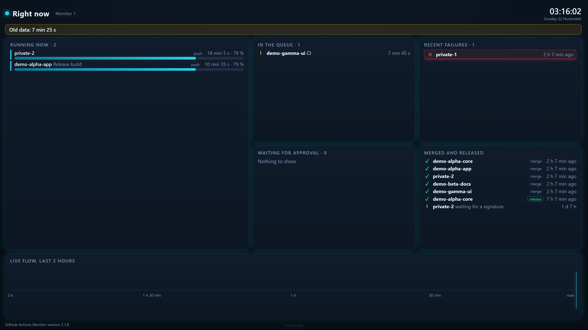
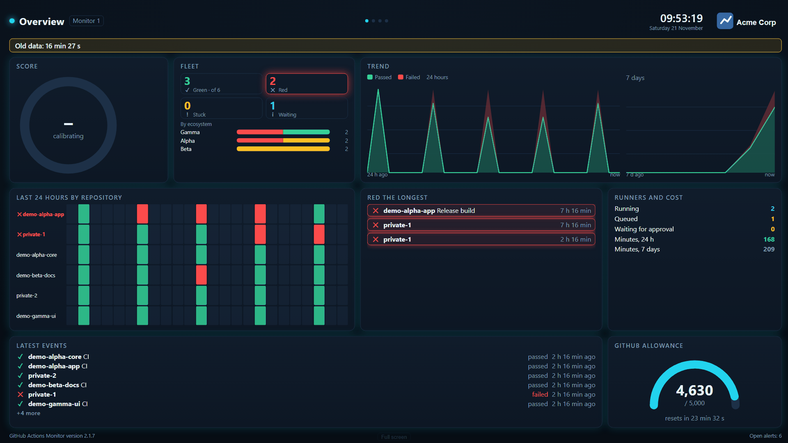

<!--
  Copyright (C) 2026 JuanenRac (Electro Hobby 3D) <electrohobby3d@gmail.com>
  GPL-3.0-or-later - see LICENSE
-->

[🇺🇸 English](SCREENS.md) | **🇪🇸 Español** | [🇫🇷 Français](SCREENS_fra.md) | [🇮🇹 Italiano](SCREENS_ita.md) | [🇩🇪 Deutsch](SCREENS_deu.md) | [🇨🇳 简体中文](SCREENS_zho.md) | [🇯🇵 日本語](SCREENS_jpn.md) | [🇵🇹 Português](SCREENS_por.md)

# Pantallas, tamaños y orientación

La página se adapta al tamaño de su ventana, de un móvil a 4K, en vertical o en horizontal, y un mismo monitor puede servir varias pantallas, cada una con las pestañas que elijas. Nada se consulta dos veces: todas las pantallas leen el mismo estado.

Para una TV o una pared con letra más grande, un contraste alto o una rotación por unas pocas pestañas, véase [KIOSK_spa.md](KIOSK_spa.md).
## Direcciones

- `/` - la página entera.
- `/screen/1`, `/screen/2`, `/screen/3` - las pestañas fijadas para esa pantalla (`ui.screen1_tabs` ...). Abre cada una en una ventana de su propio monitor o tele.
- `?orient=portrait` o `?orient=landscape` fuerza la disposición de una ventana; `?tabs=now,charts` y `?rotate=30` fijan las pestañas y los segundos entre ellas en una ventana.

## Ajustes

| Ajuste | Qué hace |
|---|---|
| `ui.orientation` | auto sigue a la ventana; portrait apila los paneles en una columna; landscape mantiene la disposición lado a lado. |
| `ui.rotate_seconds` | 0 = apagado. Segundos entre las pestañas de una pantalla que tiene más de una. |
| `ui.screen1_tabs` | Pestañas de /screen/1, separadas por comas: now, al, charts, sent, sci, scol, ssec, team, fleet, repos, rep, trep, les, hist, cfg. Vacío = todas. |
| `ui.screen1_orientation` | auto, portrait o landscape solo para /screen/1. |
| `ui.screen2_tabs` | Pestañas de /screen/2. |
| `ui.screen2_orientation` | Orientación de /screen/2. |
| `ui.screen3_tabs` | Pestañas de /screen/3. |
| `ui.screen3_orientation` | Orientación de /screen/3. |
| `ui.now_sort` | Orden de Ocurriendo ahora para quien no ha elegido: ecosystem, severity, age, newest, repo, event o state. |
| `ui.alerts_sort` | Orden de la pestaña Alertas para quien no ha elegido: server, severity, streak, class, age, newest, repo, origin o state. |
| `ui.remember_folds` | Recordar lo plegado: activado (por defecto), las secciones plegadas o desplegadas a mano se quedan así tras un refresco y al volver a abrir la página; desactivado, solo mientras la página sigue abierta. |

## Orden de las listas

La sección **Ocurriendo ahora** de la primera pestaña se ordena por ecosistema, con un encabezado por cada uno. La lista que hay sobre la sección lo cambia: ecosistema, gravedad (primero las atascadas, luego las que tienen un trabajo fallido, luego las en curso y al final las en cola), antigüedad (la que lleva más tiempo, primero), más reciente primero, repositorio, disparador (push, pull_request, schedule...) y estado (en curso antes que en cola). La elección se recuerda para cada persona: en el modo de equipo la guarda el servidor con el usuario (`GET` y `POST /api/auth/me/view`, así le acompaña a otro navegador); si no, la guarda este navegador. Mientras nadie elige, el orden es `ui.now_sort` del fichero de configuración (ecosistema si falta o es erróneo). Los botones **Desplegar todo** y **Plegar todo** junto a la lista despliegan o pliegan de golpe todos los repositorios de la sección, con cualquier orden; la elección se recuerda por persona en el mismo sitio y sobrevive a un refresco (un repositorio que abras o cierres a mano después conserva tu elección).

La lista de la pestaña **Alertas** conserva el orden que envía el monitor salvo que alguien elija otro con la lista que hay sobre ella: gravedad (crítica, error, aviso, info), la racha de fallos seguidos más larga primero, clase (una alerta de error o crítica es real y va antes de las que hay que vigilar), las más antiguas primero, las más recientes primero, repositorio, origen (el centinela que la levantó) y estado (abiertas antes que silenciadas). Se recuerda del mismo modo y, mientras nadie elige, vale `ui.alerts_sort` del fichero de configuración (`server` si falta o es erróneo).

Las **secciones plegadas y desplegadas** se quedan como las dejó la persona. Las secciones del Centinela de CI, las tarjetas de los otros centinelas, las listas de avisos de la primera pestaña y las versiones del actualizador se dibujan de nuevo en cada refresco, y un refresco nunca vuelve a abrir lo que estaba plegado ni pliega lo que estaba desplegado: cada bloque tiene un nombre estable y la página guarda la elección de cada uno, en memoria y, con `ui.remember_folds` activado (por defecto), también en el navegador. Solo un clic de la persona registra una elección; lo que la página abre por sí sola (la primera tarjeta con alertas de un centinela que nadie ha tocado aún) no cuenta como tal.

## Tamaños probados

Una prueba de navegador abre la página en cada uno de estos tamaños, recorre todas las pestañas y falla si hay scroll lateral o un texto que sale de su caja. Las ventanas de 2400 px o más reciben una letra más grande (y las de 3200 px, aún mayor) en vez de una disposición estirada; una ventana más alta que ancha apila los paneles.

| Tamaño | Tipo |
|---|---|
| 1920x1080 | Full HD |
| 2560x1080 | 21:9 |
| 3440x1440 | 21:9 |
| 5120x1440 | 32:9 |
| 3840x2160 | 4K |
| 1080x1920 | Full HD |
| 2160x3840 | 4K |
| 768x1024 | tablet |
| 390x844 | phone |

## Receta para un puesto con dos o tres pantallas

1. En el equipo que ejecuta el monitor, pon `ui.screen1_tabs` en `now,al`, `ui.screen2_tabs` en `charts,repos` y, para un monitor girado, `ui.screen2_orientation` en `portrait`.
2. Abre `http://este-equipo:8765/screen/1` en una ventana del primer monitor y `/screen/2` en el segundo; pulsa F11 para pantalla completa. Desde otro equipo, usa el modo red con su token de acceso.
3. Para una pantalla de pared que nadie toca, dale varias pestañas y pon `ui.rotate_seconds` en 20-30.

## Pantallas de pared: general, ahora y centinelas

Tres páginas para un monitor o una tele que nadie toca. No tienen menú lateral ni navegación, lo muestran todo en una sola vista con letra grande, animan lo que está vivo y hacen parpadear los fallos con suavidad. Solo leen: ningún botón cambia nada y nunca llaman a GitHub (muestran lo que el monitor ya tiene).

| Dirección | Qué muestra |
|---|---|
| `/screen/overview` | Anillo y letra de la puntuación; la flota (verdes, rojos, atascados, esperando); las últimas 24 horas y 7 días en gráficos de área; un mapa de calor de repositorios por hora; lo que lleva más tiempo en rojo; runners y minutos; los últimos eventos; la cuota de GitHub como medidor. La tarjeta de la flota muestra además el mapa por grupos: una barra por cada grupo de la vista de flota (la misma agrupación, `fleet.group_by`) con sus repositorios en rojo, que requieren atención, en orden o sin datos; solo el nombre del grupo y cifras. |
| `/screen/now` | Lo que ocurre este minuto: ejecuciones en curso con progreso y duración, la cola, ejecuciones esperando aprobación, fallos recientes, fusiones y versiones publicadas, versiones pendientes y una línea en directo de las últimas dos horas. |
| `/screen/sentinels` | Una tarjeta por cada centinela (A1 a A12) con su nivel, los hallazgos abiertos, si sus fuentes se pueden leer, el último barrido y un anillo que sigue el barrido; un radar animado que marca lo que va mal y las alertas por gravedad. |

### Parámetros de la dirección

Una dirección para cada monitor. Un parámetro puede hacer una ventana más tranquila o más pequeña de lo que permiten los ajustes, nunca más ruidosa.

| Parámetro | Efecto |
|---|---|
| `?monitor=1` a `9` | El número que se muestra junto al título. |
| `?theme=light` (o `dark`, `auto`, `contrast`, o el nombre de uno de los dieciséis temas) | Colores de toda la ventana, por encima de lo que digan los ajustes. `contrast` es blanco sobre negro, para una pantalla vista de lejos. |
| `?density=compact`, `normal` o `large` | Tamaño de la letra. `?scale=1.5` agranda todo (de 0,5 a 3). |
| `?refresh=10` | Segundos entre actualizaciones (de 5 a 120). |
| `?lang=de` | Idioma (en, es, de, fr, it, ja, zh, pt). |
| `?rotate=30` | La ventana pasa sola por general, ahora y centinelas cada 30 segundos (mínimo 5; 0 = se queda en una pantalla). Con `screens.mode` = rotate ya rota; esto cambia el ritmo de una ventana. |
| `?jump=off` | Solo con `screens.mode` = rotate: la ventana rota pero nunca salta a un rojo nuevo. |
| `?blink=off` | Los fallos conservan un halo fijo en lugar de parpadear. No puede activar lo que `screens.blink` mantiene apagado. |
| `?repo=WORD,WORD` | Solo los repositorios cuyo nombre contiene una de las palabras (letras, cifras y `. _ - /`, hasta ocho palabras). `/screen/overview` y `/screen/now` conservan solo los repositorios cuyo nombre muestra la pantalla (un nombre oculto nunca coincide), las cifras siguen las filas conservadas y la puntuación y el mapa de grupos, que son de toda la flota, no se muestran; `/screen/sentinels` no se filtra. |
| `?sound=on` | Un pitido corto con cada fallo nuevo, solo si `screens.sound` lo permite. Desactivado por defecto. |
| `?safe=4` | Mantiene el contenido a este porcentaje (0 a 10) de distancia de cada borde de la ventana, para un televisor que recorta el borde (overscan). Sustituye a `screens.safe_margin_percent` en esta ventana. |

### Idioma de las pantallas

El idioma de una pantalla se decide en este orden: `?lang=xx` en la dirección; después el idioma elegido en la página principal del mismo navegador (allí se guarda, y una pantalla abierta en ese navegador lo lee, de modo que la pantalla sigue a la página sin ningún parámetro); después el idioma del monitor (`MONITOR_LANG`, o el configurado). Una pantalla cuyo idioma guardado difiere del que se le sirvió se recarga una vez, antes de dibujar, con `?lang=` añadido y el resto de parámetros (entre ellos `?rotate=`) conservados. Los ocho idiomas (en, es, de, fr, it, ja, zh, pt) son los mismos de la página: títulos, etiquetas, estados, severidades, unidades y tiempos relativos («hace 5 min») salen del catálogo, y la hora, la fecha y los números se escriben con la configuración regional del idioma (en-GB, es-ES, de-DE, fr-FR, it-IT, ja-JP, zh-CN, pt-PT). El enlace «Abrir pantalla» de Ajustes ya lleva `?lang=` con el idioma de la página. Un equipo que no elige idioma por sí mismo se queda en inglés: el idioma del navegador no decide.

### Ajustes de las pantallas de pared

| Ajuste | Qué hace |
|---|---|
| `screens.enabled` | Activa las tres páginas. Desactivado: `/screen/overview`, `/screen/now`, `/screen/sentinels` y `/api/screens/data` responden 404 (`/screen/1` a `/screen/3` son la propia página y no dependen de esto). La edición lite también sirve las pantallas de pared, con la pantalla de centinelas vacía. Desactivado por defecto. |
| `screens.default_theme` | inherit (por defecto: el tema elegido para todo el producto, ver abajo), auto, light, dark, uno de los dieciséis temas o contrast. |
| `screens.default_density` | compact, normal (por defecto) o large. |
| `screens.refresh_seconds` | Segundos entre actualizaciones de una ventana (10 por defecto). Las páginas leen del monitor, nunca de GitHub, así que un tiempo corto no gasta cuota. |
| `screens.rotate_seconds` | Solo con `screens.mode` = three. 0 (por defecto) = sin rotación; a partir de 5, una ventana pasa por las tres páginas. |
| `screens.blink` | Los fallos parpadean con suavidad (activado por defecto). |
| `screens.blink_calm_minutes` | Minutos tras los cuales un fallo que nadie atiende conserva un halo fijo en lugar de parpadear (30 por defecto; 0 = parpadea hasta que se resuelve). |
| `screens.sound` | Un pitido con cada fallo nuevo (desactivado por defecto). |
| `screens.burn_in_protection` | Desplaza todo unos píxeles cada minuto (activado por defecto). |
| `screens.safe_margin_percent` | Mantiene el contenido a este porcentaje de distancia de cada borde de la ventana, para un televisor que recorta el borde (overscan): todo se dibuja algo más pequeño. 0 (por defecto) usa toda la ventana; de 0 a 10. |
| `screens.night_dim` | Atenúa las pantallas entre `screens.night_dim_from_hour` (22) y `screens.night_dim_to_hour` (7); desactivado por defecto. |
| `screens.show_repo_names` | all, public (por defecto: los repositorios privados aparecen como private-1, private-2...) o none (se ocultan todos los nombres). Usa public o none en una pantalla que otras personas puedan ver. Con una lista de repositorios escrita a mano en `repos`, la visibilidad se lee con un listado de la cuenta cada `discover_refresh_seconds`; un repositorio cuya visibilidad no se pudo leer cuenta como privado. Los números (private-1...) se dan solo a los repositorios ocultos, en el orden de un HMAC del nombre con una clave de la instalación guardada en un fichero privado de la carpeta de datos, así que no dicen nada de dónde cae un repositorio entre los demás. |
| `screens.theme_overview`, `screens.theme_now`, `screens.theme_sentinels` | El tema de una pantalla: inherit (por defecto: el de `screens.default_theme`) o cualquiera de los temas anteriores. |
| `screens.mode` | three (por defecto: las tres páginas por separado, una para cada ventana) o rotate (una sola página que pasa por las tres y salta a un rojo nuevo). |
| `screens.rotate_every_seconds` | En modo rotate, segundos en cada pantalla (20 por defecto; de 5 a 300). |
| `screens.alert_hold_seconds` | En modo rotate, segundos que un rojo nuevo mantiene la ventana en su pantalla (30 por defecto; de 5 a 600), o hasta que el rojo desaparezca. |
| `screens.logo_overview`, `screens.logo_now`, `screens.logo_sentinels` | En qué pantallas aparece el logo (por defecto solo en general). |
| `screens.logo_corner` | top-right (por defecto), top-left, bottom-right o bottom-left. |
| `screens.logo_max_width`, `screens.logo_max_height` | Tamaño máximo del logo en píxeles a 1920 x 1080 (160 x 64 por defecto; crece con la pantalla). |
| `screens.group_map` | Activado por defecto. Muestra el mapa de la flota por grupos en la pantalla general (la agrupación de la vista de flota). Desactivado: solo las cuatro casillas. |
| `screens.menu` | Activado por defecto. El botón Pantallas de la barra superior. Desactivado: el botón desaparece; las pantallas siguen funcionando en sus propias direcciones. |
| `screens.menu_target` | new (por defecto): una pantalla se abre en una ventana o pestaña nueva; same: en la pestaña en la que estás. |
| `screens.menu_max_windows` | Máximo de ventanas que un conjunto multipantalla abre de una vez (4 por defecto; de 1 a 9). |
| `screens.menu_rotate_seconds` | Segundos por pantalla en los preajustes que rotan del menú (20 por defecto; de 5 a 300). |
| `screens.menu_tv_scale` | El `?scale=` del preajuste de TV (1,5 por defecto; de 0,5 a 3). |

### Tema de las pantallas

Todo lo que muestra el monitor lleva el tema elegido en Ajustes (`ui.theme`: auto, light, dark o uno de los dieciséis temas): la página, las pantallas de pared y la página de acceso. Al elegir un tema en el selector de la pestaña Este navegador también se guarda como `ui.theme`, así que un navegador que nunca eligió toma el del monitor. Los informes HTML escritos en disco siguen el modo claro u oscuro del equipo que los abre.

Las pantallas de pared lo heredan: `screens.default_theme` es `inherit` por defecto. Ponlo en otro tema para fijar el mismo en todas las pantallas, y `screens.theme_overview`, `screens.theme_now` o `screens.theme_sentinels` para dar su propio tema a una pantalla. La dirección aún puede fijar una ventana con `?theme=`. Ninguna pantalla escribe un color propio: todas usan las paletas del tema, así que un tema añadido a la página aparece también en las pantallas.

### Modo de las pantallas: tres o rotar

`screens.mode` = three (por defecto) mantiene las tres páginas por separado, una para cada ventana. `screens.mode` = rotate hace de cada ventana una sola pantalla que pasa por general, ahora y centinelas cada `screens.rotate_every_seconds` segundos (20 por defecto; de 5 a 300).

Un fallo en rojo hace que la ventana salte a la pantalla que lo muestra: **Ahora** para un workflow que falló, **Centinelas** para un panel de centinela que se pone en rojo. La ventana se queda allí `screens.alert_hold_seconds` segundos (30 por defecto; de 5 a 600) o hasta que ese rojo desaparezca, lo que ocurra antes, y después sigue rotando. Un rojo ya mostrado no vuelve a hacer saltar la ventana hasta que cambie o reaparezca. Lo que está en rojo cuando se abre la ventana es solo el punto de partida y no la hace saltar. Si llega un segundo rojo mientras la ventana sostiene el primero, espera su turno. Para saberlo, la ventana lee las otras dos pantallas en segundo plano con la misma llamada de solo lectura (nunca GitHub). `?rotate=0` deja una ventana en su pantalla y `?jump=off` mantiene la rotación sin los saltos. Cada pantalla se pone su propio tema y su propio logo al aparecer.

### Logo de la organización

La pestaña Este navegador de los Ajustes tiene un bloque para subir el logo de tu organización: PNG, JPEG, WebP o SVG, de 1 MB como máximo. El monitor comprueba el tipo real por los primeros bytes del archivo (no cuentan el nombre ni la etiqueta que lo acompañe), rechaza un SVG con scripts, manejadores de eventos, enlaces a otros archivos o direcciones o un tipo de documento, y guarda la imagen en la carpeta `data/` de este equipo como `org_logo` con su extensión, nunca en la configuración. Solo existe un logo: subir otro lo sustituye. El registro de acciones anota la subida y la retirada, nunca el archivo.

`screens.logo_overview`, `screens.logo_now` y `screens.logo_sentinels` eligen en qué pantallas de pared aparece (por defecto solo en general), `screens.logo_corner` la esquina (arriba a la derecha por defecto) y `screens.logo_max_width` y `screens.logo_max_height` el tamaño máximo en píxeles a 1920 x 1080 (160 x 64 por defecto; el logo crece con la pantalla). La imagen se ajusta dentro de ese tamaño sin deformarse y tiene un sitio propio en la cabecera o el pie, así que nunca tapa el contenido. Su fondo sigue transparente: un logo con fondo transparente se ve bien en los temas claros y en los oscuros.

### Qué muestran y qué ocultan

Los datos salen de `/api/screens/data?screen=overview` (o `now`, `sentinels`): una lista cerrada de campos construida con el último ciclo, la instantánea de los centinelas, las alertas y la puntuación. Nunca contiene un enlace, un título de commit, el nombre de un job, el nombre de una persona ni una ruta de este equipo, y los nombres de workflow de los repositorios ocultos también se ocultan. En el modo red las páginas necesitan el mismo token de acceso que el resto del monitor y la respuesta es de solo lectura.

### Qué cabe y qué pasa cuando no cabe

Las tres páginas se dibujan con unidades que siguen el lado corto de la ventana, así que el mismo diseño llena los tamaños de abajo; nada se estira y nada tiene scroll. Una herramienta las mide con el DOM en los ocho idiomas y con datos que ponen a prueba una pantalla (nombres de repositorios de 90 caracteres, palabras compuestas alemanas y nombres japoneses sin espacios, el máximo de filas que el monitor puede enviar, cifras de siete dígitos, ningún dato, un solo dato, una lectura vieja): `python tools/check_screens.py` (`--list` muestra cada hallazgo, `--report FICHERO` los escribe en JSON, `--size` y `--lang` eligen qué medir, `--surface kiosk` mide el kiosco). Falla ante una página con scroll, un texto o una caja más allá del borde, una caja cuyo contenido no cabe, un título que acaba en puntos suspensivos, dos textos que se tapan, una letra menor que la centésima parte del lado corto de la ventana (12 px en una ventana de 1080 px) y filas ocultas sin aviso.

| Tamaño | Tipo |
|---|---|
| 1920x1080 | Full HD |
| 2560x1440 | QHD |
| 3840x2160 | 4K |
| 3440x1440 | ultraancho 21:9 |
| 5120x1440 | superultraancho 32:9 |
| 1080x1920 | Full HD girado |
| 2160x3840 | 4K girado |

- El nombre de un repositorio o de un flujo que no cabe acaba en puntos suspensivos y lleva su texto completo en el `title`; un título, una etiqueta o una cifra nunca acaba en puntos suspensivos: el título pasa a una segunda línea y una cifra más ancha que su caja usa una letra menor, hasta un mínimo.
- Cuando una lista tiene más filas de las que caben en su caja, van primero las más importantes (rojo antes que verde, lo más reciente primero) y la última línea dice cuántas se quedaron fuera ("+3 más"); nada se oculta sin esa línea.
- Margen de seguridad (overscan): muchos televisores recortan unos puntos porcentuales de cada borde salvo que su modo de imagen sea "just scan" o "pixel a pixel". `screens.safe_margin_percent` (0 por defecto, de 0 a 10; `?safe=4` para una ventana) mantiene el contenido a esa distancia de cada borde dibujando todo más pequeño, y `kiosk.safe_margin_percent` hace lo mismo con el kiosco. Prueba de 3 a 5 si se cortan las primeras letras del reloj o el borde de las tarjetas.

### Cómo se comportan

- Los fallos parpadean menos de dos veces por segundo (nunca de forma estroboscópica); un fallo nuevo hace un solo destello; un fallo que nadie atiende durante `screens.blink_calm_minutes` conserva un halo fijo. Con el ajuste del sistema para reducir el movimiento, o con `?blink=off`, nada parpadea ni se mueve. Un fallo nunca se muestra solo con color: lleva un símbolo y una palabra.
- Si el monitor no responde, la página lo dice, se atenúa y reintenta a los 5, 10, 20... segundos (hasta 60).
- Una pantalla siempre encendida se protege contra el quemado: todo se desplaza unos píxeles cada minuto y la página puede atenuarse de noche.

### Montar varios monitores

1. Elige una dirección para cada monitor, por ejemplo `/screen/overview?monitor=1`, `/screen/now?monitor=2` y `/screen/sentinels?monitor=3`; o abre una sola ventana con `?rotate=20`.
2. Abre cada una en Chrome o Edge en modo quiosco: `msedge --kiosk "http://este-equipo:8765/screen/now?monitor=2" --edge-kiosk-type=fullscreen` o `chrome --kiosk "http://este-equipo:8765/screen/now?monitor=2"`; con `--app=DIRECCIÓN` en lugar de `--kiosk` la ventana no tiene barras. Sin modo quiosco, el botón discreto del pie de la página pide la pantalla completa.
3. Desde otro equipo usa el modo red: basta el token de acceso de un visor, porque estas páginas nunca escriben.

## Qué pestaña está en qué pantalla de pared

Cada pestaña de la página tiene una decisión, escrita en el código (`TAB_DECISIONS` de `screens.py`) y comprobada por un test: se muestra en una de las pantallas de pared o dice por qué no. Una pestaña que se muestra tiene sus datos en la respuesta de `/api/screens/data` (la general lleva Alertas, Gráficas y Flota; Ahora mismo lleva Ahora; Centinelas lleva las tarjetas de las pestañas de centinelas). Una pestaña que no se muestra da su motivo:

- `people`: nombra personas, y una pantalla de pared nunca muestra un nombre de usuario.
- `controls`: se compone de botones y campos que cambian algo, y una pantalla de pared no tiene ninguno.
- `reading`: está hecha para leerse, compararse o guardarse, no para verse de lejos.
- `text`: se compone de títulos, causas y mensajes, que una pantalla de pared nunca muestra.

| Pestaña | Nombre | Pantalla de pared | Motivo |
|---|---|---|---|
| `now` | Ahora | `/screen/now` | - |
| `al` | Alertas | `/screen/overview` | - |
| `charts` | Gráficas | `/screen/overview` | - |
| `sent` | Resumen | `/screen/sentinels` | - |
| `sci` | Centinela de CI | `/screen/sentinels` | - |
| `scol` | Centinela de colaboración | `/screen/sentinels` | - |
| `ssec` | Centinela de seguridad | `/screen/sentinels` | - |
| `sdel` | Centinela de entrega | `/screen/sentinels` | - |
| `ssup` | Centinela de cadena de suministro | `/screen/sentinels` | - |
| `strend` | Tendencia diaria | - | `reading` |
| `syvt` | Ayer vs hoy | - | `reading` |
| `team` | Salud del equipo | - | `people` |
| `fleet` | Flota | `/screen/overview` | - |
| `repos` | Repositorios | - | `controls` |
| `rep` | Informes | - | `reading` |
| `trep` | Informes programados | - | `reading` |
| `les` | Lecciones | - | `text` |
| `hist` | Historial | - | `text` |
| `upd` | Actualizaciones | - | `controls` |
| `cfg` | Configuración | - | `controls` |

## Menú Pantallas

El botón **Pantallas** de la barra superior (el icono de dos monitores) abre un menú con todos los tipos de pantalla que tiene el monitor, para que nadie tenga que recordar las direcciones. Solo navega: abre direcciones, no escribe nada y no lee nada de GitHub. Está activado por defecto y `screens.menu` lo desactiva.

| Pantalla | Dirección | Qué es |
|---|---|---|
| Panel | `/` | La página completa, para una persona en su mesa. `?repo=` filtra los repositorios. |
| Quiosco | `/?chrome=0&view=now` | Una vista sin cabecera, pestañas ni filtros, para un monitor que nadie toca. La vista es un parámetro. |
| Vista de equipo | `/?chrome=0&view=team` | La vista de equipo como quiosco (edición completa). |
| Pantallas de pestañas 1 a 3 | `/screen/1`, `/screen/2`, `/screen/3` | Las pestañas fijadas para cada monitor de una mesa; `?tabs=`, `?orient=` y `?rotate=` las cambian para una ventana. |
| Pantallas de pared | `/screen/overview`, `/screen/now`, `/screen/sentinels` | Las tres pantallas de pared de arriba. |
| Pared que rota | `/screen/overview?rotate=20` | Una ventana que rota por las tres y salta a un rojo nuevo. |
| TV | `/screen/overview?theme=contrast&density=large&scale=1.5&rotate=20` | La pared que rota para una pantalla vista de lejos. |
| Varios monitores | una dirección por ventana | Un conjunto de ventanas, una por monitor (ver abajo). |

Cada tarjeta muestra los parámetros que admite esa dirección (tema, densidad, actualización, escala, idioma, rotación, filtro de repositorios...), cada uno con su propio texto de ayuda, y la dirección resultante. **Abrir** la abre en una ventana o pestaña nueva, o en la pestaña en la que estás, según `screens.menu_target`; **Copiar dirección** pone la dirección completa en el portapapeles para abrirla en otro ordenador (nunca incluye ningún token: en el modo de red ese ordenador inicia sesión como siempre). Las pantallas de pared responden 404 mientras `screens.enabled` está desactivado, así que su tarjeta lo dice en lugar de abrir una página vacía; la vista de equipo no está en la edición lite.

### Varios monitores

Elige cuántas ventanas (como máximo `screens.menu_max_windows`), la distribución (en fila, en columna o en cuadrícula) y qué muestra cada ventana (las tres pantallas de pared por turno, paredes que rotan solas o las pantallas de pestañas). **Abrir todas las ventanas** abre una ventana por monitor. En un navegador con la API de gestión de ventanas (Chrome y Edge piden el permiso *gestión de ventanas*) cada ventana se coloca en su propio monitor, ordenados como indica la distribución; con más ventanas que monitores comparten monitor en mosaico. Sin ella, las ventanas se abren donde las pone el navegador y la tarjeta lista un comando de quiosco por ventana (`msedge --kiosk DIRECCIÓN --window-position=X,Y`) para iniciarlas a mano. El navegador debe permitir las ventanas emergentes para la dirección del monitor.

El mismo catálogo lo leen las herramientas: `GET /api/screens/menu`, `monitor_cli.py screens [list|urls]` y la herramienta MCP `screens_menu`. Las tres son de solo lectura.

## Imágenes

La pestaña Ahora en cuatro tamaños, con datos inventados (4K, un monitor 21:9, un monitor girado, un móvil):

Las tres pantallas de pared en 4K y en un monitor girado, con datos inventados:

Las pantallas de pared con otros temas, con el logo de una organización y la ventana que gira sola, con datos inventados:

