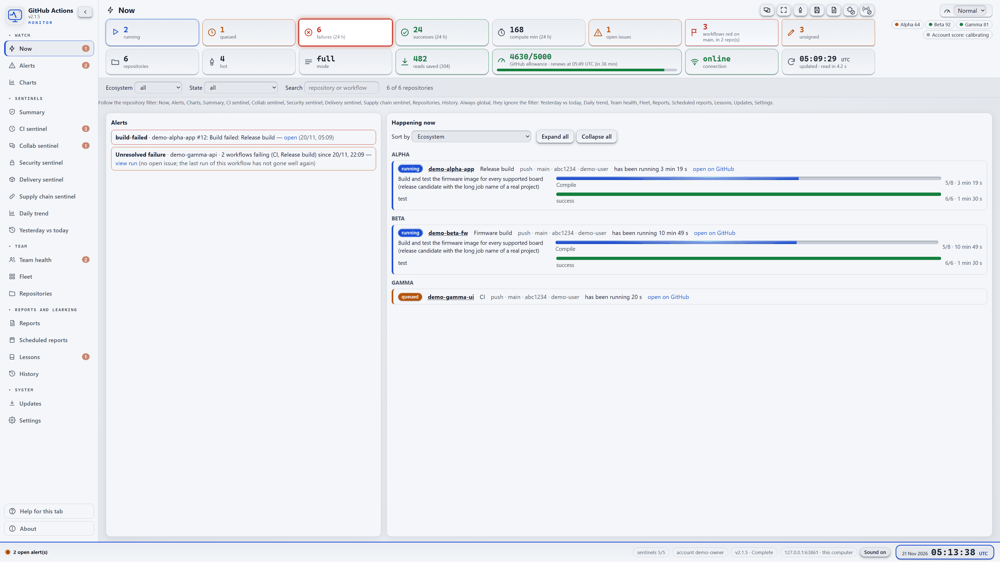
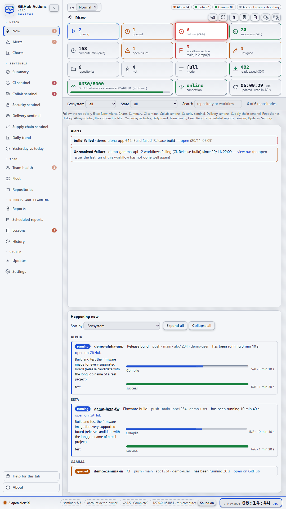

<!--
  Copyright (C) 2026 JuanenRac (Electro Hobby 3D) <electrohobby3d@gmail.com>
  GPL-3.0-or-later - see LICENSE
-->

[🇺🇸 English](SCREENS.md) | **🇪🇸 Español** | [🇫🇷 Français](SCREENS_fra.md) | [🇮🇹 Italiano](SCREENS_ita.md) | [🇩🇪 Deutsch](SCREENS_deu.md) | [🇨🇳 简体中文](SCREENS_zho.md) | [🇯🇵 日本語](SCREENS_jpn.md) | [🇵🇹 Português](SCREENS_por.md)

# Pantallas, tamaños y orientación

La página se adapta al tamaño de su ventana, de un móvil a 4K, en vertical o en horizontal, y un mismo monitor puede servir varias pantallas, cada una con las pestañas que elijas. Nada se consulta dos veces: todas las pantallas leen el mismo estado.

## Direcciones

- `/` - la página entera.
- `/screen/1`, `/screen/2`, `/screen/3` - las pestañas fijadas para esa pantalla (`ui.screen1_tabs` ...). Abre cada una en una ventana de su propio monitor o tele.
- `?orient=portrait` o `?orient=landscape` fuerza la disposición de una ventana; `?tabs=now,charts` y `?rotate=30` fijan las pestañas y los segundos entre ellas en una ventana.

## Ajustes

| Ajuste | Qué hace |
|---|---|
| `ui.orientation` | auto sigue a la ventana; portrait apila los paneles en una columna; landscape mantiene la disposición lado a lado. |
| `ui.rotate_seconds` | 0 = apagado. Segundos entre las pestañas de una pantalla que tiene más de una. |
| `ui.screen1_tabs` | Pestañas de /screen/1, separadas por comas: now, al, sent, charts, repos, hist, cfg. Vacío = todas. |
| `ui.screen1_orientation` | auto, portrait o landscape solo para /screen/1. |
| `ui.screen2_tabs` | Pestañas de /screen/2. |
| `ui.screen2_orientation` | Orientación de /screen/2. |
| `ui.screen3_tabs` | Pestañas de /screen/3. |
| `ui.screen3_orientation` | Orientación de /screen/3. |
| `ui.now_sort` | Orden de Ocurriendo ahora para quien no ha elegido: ecosystem, severity, age, newest, repo, event o state. |

## Orden de las listas

La sección **Ocurriendo ahora** de la primera pestaña se ordena por ecosistema, con un encabezado por cada uno. La lista que hay sobre la sección lo cambia: ecosistema, gravedad (primero las atascadas, luego las que tienen un trabajo fallido, luego las en curso y al final las en cola), antigüedad (la que lleva más tiempo, primero), más reciente primero, repositorio, disparador (push, pull_request, schedule...) y estado (en curso antes que en cola). La elección se recuerda para cada persona: en el modo de equipo la guarda el servidor con el usuario (`GET` y `POST /api/auth/me/view`, así le acompaña a otro navegador); si no, la guarda este navegador. Mientras nadie elige, el orden es `ui.now_sort` del fichero de configuración (ecosistema si falta o es erróneo).

## Tamaños probados

Una prueba de navegador abre la página en cada uno de estos tamaños, recorre todas las pestañas y falla si hay scroll lateral o un texto que sale de su caja. Las ventanas de 2400 px o más reciben una letra más grande (y las de 3200 px, aún mayor) en vez de una disposición estirada; una ventana más alta que ancha apila los paneles.

| Tamaño | Tipo |
|---|---|
| 1920x1080 | Full HD |
| 2560x1080 | 21:9 |
| 3440x1440 | 21:9 |
| 5120x1440 | 32:9 |
| 3840x2160 | 4K |
| 1080x1920 | Full HD |
| 2160x3840 | 4K |
| 768x1024 | tablet |
| 390x844 | phone |

## Receta para un puesto con dos o tres pantallas

1. En el equipo que ejecuta el monitor, pon `ui.screen1_tabs` en `now,al`, `ui.screen2_tabs` en `charts,repos` y, para un monitor girado, `ui.screen2_orientation` en `portrait`.
2. Abre `http://este-equipo:8765/screen/1` en una ventana del primer monitor y `/screen/2` en el segundo; pulsa F11 para pantalla completa. Desde otro equipo, usa el modo red con su token de acceso.
3. Para una pantalla de pared que nadie toca, dale varias pestañas y pon `ui.rotate_seconds` en 20-30.

## Imágenes

La pestaña Ahora en cuatro tamaños, con datos inventados (4K, un monitor 21:9, un monitor girado, un móvil):

