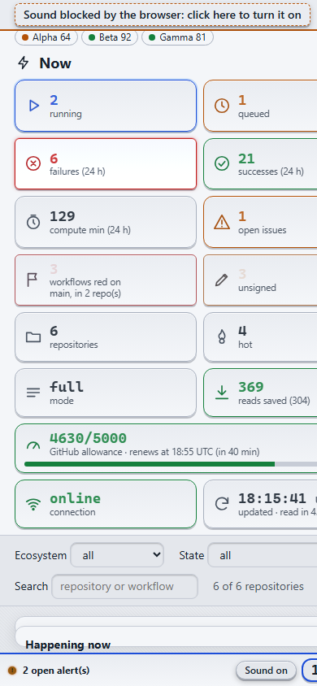
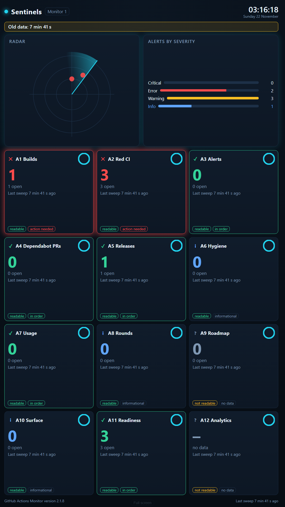

<!--
  Copyright (C) 2026 JuanenRac (Electro Hobby 3D) <electrohobby3d@gmail.com>
  GPL-3.0-or-later - see LICENSE
-->

[🇺🇸 English](SCREENS.md) | [🇪🇸 Español](SCREENS_spa.md) | [🇫🇷 Français](SCREENS_fra.md) | [🇮🇹 Italiano](SCREENS_ita.md) | [🇩🇪 Deutsch](SCREENS_deu.md) | **🇨🇳 简体中文** | [🇯🇵 日本語](SCREENS_jpn.md) | [🇵🇹 Português](SCREENS_por.md)

# 屏幕、尺寸与方向

页面会适应窗口大小，从手机到4K，竖屏或横屏；同一个监控器可以服务多个屏幕，每个屏幕显示您选择的标签页。不会重复轮询：所有屏幕读取同一状态。

## 地址

- `/` - 完整页面。
- `/screen/1`、`/screen/2`、`/screen/3` - 为该屏幕设置的标签页（`ui.screen1_tabs` 等）。在各自显示器或电视的窗口中打开。
- `?orient=portrait` 或 `?orient=landscape` 强制单个窗口的布局；`?tabs=now,charts` 和 `?rotate=30` 为单个窗口设置标签页和切换秒数。

## 设置

| 设置 | 作用 |
|---|---|
| `ui.orientation` | auto 跟随窗口；portrait 把面板堆成一列；landscape 保持并排布局。 |
| `ui.rotate_seconds` | 0 = 关闭。有多个标签页的屏幕在标签页之间切换的秒数。 |
| `ui.screen1_tabs` | /screen/1 的标签页，逗号分隔：now, al, charts, sent, sci, scol, ssec, team, fleet, repos, rep, trep, les, hist, cfg。留空 = 全部。 |
| `ui.screen1_orientation` | 仅 /screen/1 的 auto、portrait 或 landscape。 |
| `ui.screen2_tabs` | /screen/2 的标签页。 |
| `ui.screen2_orientation` | /screen/2 的方向。 |
| `ui.screen3_tabs` | /screen/3 的标签页。 |
| `ui.screen3_orientation` | /screen/3 的方向。 |
| `ui.now_sort` | 对未自行选择的人,“正在发生”的排序:ecosystem、severity、age、newest、repo、event 或 state。 |
| `ui.alerts_sort` | 对未自行选择的人,警报标签页的排序:server、severity、streak、class、age、newest、repo、origin 或 state。 |

## 列表的排序

第一个标签页的 **正在发生** 部分默认按生态系统排序,每个生态系统带一个标题。该部分上方的列表可以更改:生态系统、严重程度(先卡住的,再有失败作业的,再运行中的,最后排队中的)、运行时长(最久的在前)、最新的在前、仓库、触发方式(push、pull_request、schedule 等)和状态(运行中在排队中之前)。所选方式会按人记住:团队模式下由服务器与用户一起保存(`GET` 和 `POST /api/auth/me/view`,换浏览器也会跟随),否则由当前浏览器保存。在有人选择之前,排序取配置文件中的 `ui.now_sort`(缺失或错误时为生态系统)。 列表旁的按钮 **全部展开** 和 **全部折叠** 可在任何排序下一次展开或折叠该部分的所有仓库;该选择与排序一样按每个人记住,刷新后依然保留(之后手动打开或关闭的仓库保持您的选择)。

**警报**标签页的列表保持监视器发送的顺序,直到有人用上方的列表选择别的方式:严重程度(严重、错误、警告、信息)、连续失败最长的在前、类别(错误或严重的警报是真实的,排在需关注的之前)、最旧的在前、最新的在前、仓库、来源(发出它的哨兵)和状态(未处理的在已静音的之前)。记忆方式相同;在有人选择之前,取配置文件中的 `ui.alerts_sort`(缺失或错误时为 `server`)。

## 已测试的尺寸

浏览器测试会在下列每种尺寸下打开页面，遍历所有标签页，出现横向滚动或文字超出方框即失败。宽度达到2400 px的窗口使用更大的字体（3200 px则更大），而不是拉伸布局；高度大于宽度的窗口会堆叠面板。

| 尺寸 | 类型 |
|---|---|
| 1920x1080 | Full HD |
| 2560x1080 | 21:9 |
| 3440x1440 | 21:9 |
| 5120x1440 | 32:9 |
| 3840x2160 | 4K |
| 1080x1920 | Full HD |
| 2160x3840 | 4K |
| 768x1024 | tablet |
| 390x844 | phone |

## 两到三块屏幕的工位配方

1. 在运行监控器的电脑上，把 `ui.screen1_tabs` 设为 `now,al`，`ui.screen2_tabs` 设为 `charts,repos`，旋转的显示器把 `ui.screen2_orientation` 设为 `portrait`。
2. 在第一块显示器的窗口打开 `http://本机:8765/screen/1`，第二块打开 `/screen/2`，按 F11 全屏。从其他电脑访问请使用网络模式和访问令牌。
3. 对无人触碰的墙面屏幕，给它多个标签页并把 `ui.rotate_seconds` 设为 20-30。

## 墙面屏幕：总览、此刻与哨兵

三个供无人操作的显示器或电视使用的页面。没有侧边菜单和导航，用大号文字在一个视图中显示全部内容，让有生命的部分动起来，并让失败柔和地闪烁。它们只读：没有任何按钮会更改内容，也从不调用 GitHub（只显示监视器已有的数据）。

| 地址 | 显示内容 |
|---|---|
| `/screen/overview` | 评分圆环和字母；仓库总览（正常、失败、卡住、等待）；最近 24 小时和 7 天的面积图；按小时划分的仓库热力图；失败持续最久的项目；运行器与分钟数；最新事件；以仪表显示的 GitHub 配额。 |
| `/screen/now` | 这一分钟正在发生的事：带进度和时长的运行中任务、队列、等待批准的运行、最近的失败、合并与发布、即将发布的版本，以及最近两小时的实时时间线。 |
| `/screen/sentinels` | 每个哨兵（A1 到 A12）一张卡片，显示级别、未处理的发现数、其来源是否可读、上次扫描，以及跟随扫描进度的圆环；一个标出问题的动画雷达，以及按严重程度分类的告警。 |

### 地址参数

每台显示器一个地址。参数可以让窗口比设置允许的更安静或更小，但不能更吵。

| 参数 | 作用 |
|---|---|
| `?monitor=1` 到 `9` | 显示在标题旁的编号。 |
| `?theme=dark`、`light` 或 `contrast` | 配色；contrast 为黑底白字，适合远距离观看。 |
| `?density=compact`、`normal` 或 `large` | 文字大小。`?scale=1.5` 放大全部内容（0.5 到 3）。 |
| `?refresh=10` | 更新间隔秒数（5 到 120）。 |
| `?lang=de` | 语言（en、es、de、fr、it、ja、zh、pt）。 |
| `?rotate=30` | 窗口每 30 秒自动在总览、此刻和哨兵之间切换（最少 5；0 = 不轮换）。 |
| `?blink=off` | 失败保持固定光晕而不闪烁。它不能开启 `screens.blink` 关闭的功能。 |
| `?sound=on` | 出现新失败时发出短促提示音，仅在 `screens.sound` 允许时有效。默认关闭。 |

### 屏幕语言

屏幕的语言按以下顺序决定：地址中的 `?lang=xx`；然后是同一浏览器中主页面所选的语言（它保存在那里，在该浏览器中打开的屏幕会读取它，因此屏幕无需任何参数就跟随页面）；然后是监视器的语言（`MONITOR_LANG` 或已配置的语言）。保存的语言与屏幕被提供时的语言不同时，屏幕会在绘制之前重新加载一次，并附加 `?lang=`，其他参数（包括 `?rotate=`）保持不变。八种语言（en、es、de、fr、it、ja、zh、pt）与页面相同：标题、标签、状态、严重程度、单位和相对时间（“5 分钟前”）来自目录，时间、日期和数字则按该语言的区域设置书写（en-GB、es-ES、de-DE、fr-FR、it-IT、ja-JP、zh-CN、pt-PT）。设置中的“打开屏幕”链接已带有页面语言的 `?lang=`。不自行选择语言的电脑保持英语：浏览器的语言不起决定作用。

### 墙面屏幕的设置

| 设置 | 作用 |
|---|---|
| `screens.enabled` | 启用三个页面。关闭后 `/screen/overview`、`/screen/now`、`/screen/sentinels` 和 `/api/screens/data` 返回 404（`/screen/1` 到 `/screen/3` 就是页面本身，不依赖此设置）。精简版同样提供墙屏页面，其中哨兵屏为空。 默认关闭。 |
| `screens.default_theme` | dark（默认）、light 或 contrast。 |
| `screens.default_density` | compact、normal（默认）或 large。 |
| `screens.refresh_seconds` | 窗口的更新间隔秒数（默认 10）。页面读取的是监视器而不是 GitHub，所以间隔再短也不消耗配额。 |
| `screens.rotate_seconds` | 0（默认）= 不轮换；5 及以上时窗口在三个页面之间轮换。 |
| `screens.blink` | 失败柔和闪烁（默认开启）。 |
| `screens.blink_calm_minutes` | 无人处理的失败在多少分钟后停止闪烁并保持固定光晕（默认 30；0 = 一直闪烁到解决）。 |
| `screens.sound` | 出现新失败时发出提示音（默认关闭）。 |
| `screens.burn_in_protection` | 每分钟将所有内容移动几个像素（默认开启）。 |
| `screens.night_dim` | 在 `screens.night_dim_from_hour`（22）和 `screens.night_dim_to_hour`（7）之间调暗屏幕；默认关闭。 |
| `screens.show_repo_names` | all、public（默认：私有仓库显示为 private-1、private-2...）或 none（隐藏所有名称）。供其他人查看的屏幕请使用 public 或 none。在 `repos` 中使用手写列表时,可见性每隔 `discover_refresh_seconds` 通过一次账户列表读取;无法读取可见性的仓库按私有处理。 编号(private-1 等)只分配给被隐藏的仓库,按名称的 HMAC 顺序排列,所用密钥属于本次安装,保存在数据文件夹的私有文件中,因此无法看出某个仓库在全部仓库中的位置。 |

### 显示什么，隐藏什么

数据来自 `/api/screens/data?screen=overview`（或 `now`、`sentinels`）：由最近一次周期、哨兵快照、告警和评分构成的、字段固定的列表。它从不包含链接、提交标题、作业名称、用户名或本机路径，被隐藏仓库的工作流名称也会被隐藏。在网络模式下，这些页面需要与监视器其他部分相同的访问令牌，且响应为只读。

### 行为

- 失败每秒闪烁不到两次（绝不会频闪）；新的失败只闪一下；无人处理超过 `screens.blink_calm_minutes` 分钟的失败保持固定光晕。在系统设置为减少动画时，或使用 `?blink=off`，什么都不会闪烁或移动。失败从不只靠颜色表示：它带有符号和文字。
- 监视器没有响应时，页面会提示、调暗，并在 5、10、20...秒后重试（最多 60 秒）。
- 常亮的屏幕受到防烧屏保护：所有内容每分钟移动几个像素，页面还可以在夜间调暗。

### 设置多台显示器

1. 为每台显示器选一个地址，例如 `/screen/overview?monitor=1`、`/screen/now?monitor=2` 和 `/screen/sentinels?monitor=3`；或者打开一个带 `?rotate=20` 的窗口。
2. 在 Chrome 或 Edge 的展示模式下分别打开：`msedge --kiosk "http://这台电脑:8765/screen/now?monitor=2" --edge-kiosk-type=fullscreen` 或 `chrome --kiosk "http://这台电脑:8765/screen/now?monitor=2"`；用 `--app=地址` 代替 `--kiosk` 则窗口没有工具栏。不使用展示模式时，页面底部不显眼的按钮可请求全屏。
3. 从另一台电脑访问时使用网络模式：查看者的访问令牌就够了，因为这些页面从不写入。

## 图片

“现在”标签页在四种尺寸下的样子，使用虚构数据(4K、21:9 显示器、旋转的显示器、手机)：

三个墙面屏幕（4K 和竖屏显示器，使用虚构数据）：

