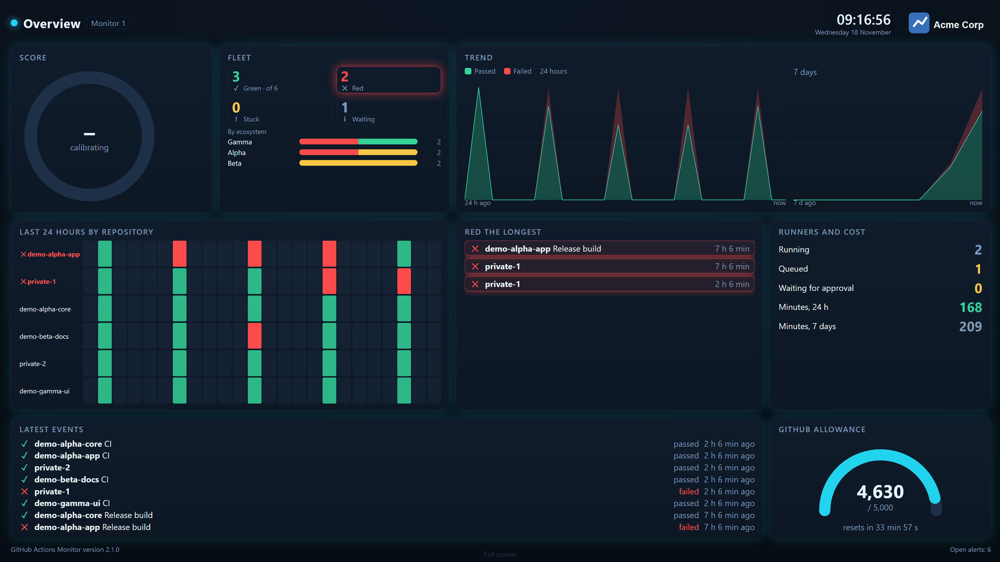

<!--
  Copyright (C) 2026 JuanenRac (Electro Hobby 3D) <electrohobby3d@gmail.com>
  GPL-3.0-or-later - see LICENSE
-->

[🇺🇸 English](SCREENS.md) | [🇪🇸 Español](SCREENS_spa.md) | [🇫🇷 Français](SCREENS_fra.md) | [🇮🇹 Italiano](SCREENS_ita.md) | [🇩🇪 Deutsch](SCREENS_deu.md) | **🇨🇳 简体中文** | [🇯🇵 日本語](SCREENS_jpn.md) | [🇵🇹 Português](SCREENS_por.md)

# 屏幕、尺寸与方向

页面会适应窗口大小，从手机到4K，竖屏或横屏；同一个监控器可以服务多个屏幕，每个屏幕显示您选择的标签页。不会重复轮询：所有屏幕读取同一状态。

如需在电视或墙面上使用更大的字号、高对比度或在几个标签页之间轮播，请参见 [KIOSK_zho.md](KIOSK_zho.md)。
## 地址

- `/` - 完整页面。
- `/screen/1`、`/screen/2`、`/screen/3` - 为该屏幕设置的标签页（`ui.screen1_tabs` 等）。在各自显示器或电视的窗口中打开。
- `?orient=portrait` 或 `?orient=landscape` 强制单个窗口的布局；`?tabs=now,charts` 和 `?rotate=30` 为单个窗口设置标签页和切换秒数。

## 设置

| 设置 | 作用 |
|---|---|
| `ui.orientation` | auto 跟随窗口；portrait 把面板堆成一列；landscape 保持并排布局。 |
| `ui.rotate_seconds` | 0 = 关闭。有多个标签页的屏幕在标签页之间切换的秒数。 |
| `ui.screen1_tabs` | /screen/1 的标签页，逗号分隔：now, al, charts, sent, sci, scol, ssec, team, fleet, repos, rep, trep, les, hist, cfg。留空 = 全部。 |
| `ui.screen1_orientation` | 仅 /screen/1 的 auto、portrait 或 landscape。 |
| `ui.screen2_tabs` | /screen/2 的标签页。 |
| `ui.screen2_orientation` | /screen/2 的方向。 |
| `ui.screen3_tabs` | /screen/3 的标签页。 |
| `ui.screen3_orientation` | /screen/3 的方向。 |
| `ui.now_sort` | 对未自行选择的人,“正在发生”的排序:ecosystem、severity、age、newest、repo、event 或 state。 |
| `ui.alerts_sort` | 对未自行选择的人,警报标签页的排序:server、severity、streak、class、age、newest、repo、origin 或 state。 |
| `ui.remember_folds` | 记住折叠状态：开启（默认）时，手动折叠或展开的栏目在刷新后和重新打开页面时保持原样；关闭时仅在页面保持打开期间保持原样。 |

## 列表的排序

第一个标签页的 **正在发生** 部分默认按生态系统排序,每个生态系统带一个标题。该部分上方的列表可以更改:生态系统、严重程度(先卡住的,再有失败作业的,再运行中的,最后排队中的)、运行时长(最久的在前)、最新的在前、仓库、触发方式(push、pull_request、schedule 等)和状态(运行中在排队中之前)。所选方式会按人记住:团队模式下由服务器与用户一起保存(`GET` 和 `POST /api/auth/me/view`,换浏览器也会跟随),否则由当前浏览器保存。在有人选择之前,排序取配置文件中的 `ui.now_sort`(缺失或错误时为生态系统)。 列表旁的按钮 **全部展开** 和 **全部折叠** 可在任何排序下一次展开或折叠该部分的所有仓库;该选择与排序一样按每个人记住,刷新后依然保留(之后手动打开或关闭的仓库保持您的选择)。

**警报**标签页的列表保持监视器发送的顺序,直到有人用上方的列表选择别的方式:严重程度(严重、错误、警告、信息)、连续失败最长的在前、类别(错误或严重的警报是真实的,排在需关注的之前)、最旧的在前、最新的在前、仓库、来源(发出它的哨兵)和状态(未处理的在已静音的之前)。记忆方式相同;在有人选择之前,取配置文件中的 `ui.alerts_sort`(缺失或错误时为 `server`)。

**已折叠和已展开的栏目**会保持用户离开时的状态。CI 哨兵的各栏目、其他哨兵的卡片、第一个标签中的通知列表以及更新器的版本列表在每次刷新时都会重新绘制，但刷新绝不会重新展开已折叠的内容，也不会折叠已展开的内容：每个区块都有稳定的名称，页面会在内存中保存每个区块的选择，在 `ui.remember_folds` 开启（默认）时还会保存在浏览器中。只有用户的点击才会记录选择；页面自行展开的内容（尚无人操作过的哨兵中第一个带警报的卡片）不算作选择。

## 已测试的尺寸

浏览器测试会在下列每种尺寸下打开页面，遍历所有标签页，出现横向滚动或文字超出方框即失败。宽度达到2400 px的窗口使用更大的字体（3200 px则更大），而不是拉伸布局；高度大于宽度的窗口会堆叠面板。

| 尺寸 | 类型 |
|---|---|
| 1920x1080 | Full HD |
| 2560x1080 | 21:9 |
| 3440x1440 | 21:9 |
| 5120x1440 | 32:9 |
| 3840x2160 | 4K |
| 1080x1920 | Full HD |
| 2160x3840 | 4K |
| 768x1024 | tablet |
| 390x844 | phone |

## 两到三块屏幕的工位配方

1. 在运行监控器的电脑上，把 `ui.screen1_tabs` 设为 `now,al`，`ui.screen2_tabs` 设为 `charts,repos`，旋转的显示器把 `ui.screen2_orientation` 设为 `portrait`。
2. 在第一块显示器的窗口打开 `http://本机:8765/screen/1`，第二块打开 `/screen/2`，按 F11 全屏。从其他电脑访问请使用网络模式和访问令牌。
3. 对无人触碰的墙面屏幕，给它多个标签页并把 `ui.rotate_seconds` 设为 20-30。

## 墙面屏幕：总览、仓库总览、此刻与哨兵

四个供无人操作的显示器或电视使用的页面。没有侧边菜单和导航，用大号文字在一个视图中显示全部内容，让有生命的部分动起来，并让失败柔和地闪烁。它们只读：没有任何按钮会更改内容，也从不调用 GitHub（只显示监视器已有的数据）。

| 地址 | 显示内容 |
|---|---|
| `/screen/overview` | 评分圆环和字母；仓库总览（正常、失败、卡住、等待）；最近 24 小时和 7 天的面积图；按小时划分的仓库热力图；失败持续最久的项目；运行器与分钟数；最新事件；以仪表显示的 GitHub 配额。 车队卡片还显示分组地图:车队视图的每个分组(相同的分组方式,`fleet.group_by`)一条横条,显示其中红色、需要关注、正常和无数据的仓库数量;只显示组名和数字。 |
| `/screen/fleet` | 按分组显示车队中的每个仓库（分组方式和顺序与“仓库总览”标签相同，风险最高的分组在前）：健康的仓库用小方块，需要关注的用带名称的标签，顶部是车队的合计。放不下的会被计数（“另外 3 项”）。 |
| `/screen/now` | 这一分钟正在发生的事：带进度和时长的运行中任务、队列、等待批准的运行、最近的失败、合并与发布、即将发布的版本，以及最近两小时的实时时间线。 |
| `/screen/sentinels` | 每个哨兵（A1 到 A12）一张卡片，显示级别、未处理的发现数、其来源是否可读、上次扫描，以及跟随扫描进度的圆环；一个标出问题的动画雷达，以及按严重程度分类的告警。 |

### 地址参数

每台显示器一个地址。参数可以让窗口比设置允许的更安静或更小，但不能更吵。

| 参数 | 作用 |
|---|---|
| `?monitor=1` 到 `9` | 显示在标题旁的编号。 |
| `?theme=light`（或 `dark`、`auto`、`contrast`，或十六种主题之一的名称） | 整个窗口的配色，优先于设置。contrast 为黑底白字，适合远距离观看。 |
| `?density=compact`、`normal` 或 `large` | 文字大小。`?scale=1.5` 放大全部内容（0.5 到 3）。 |
| `?refresh=10` | 更新间隔秒数（5 到 120）。 |
| `?lang=de` | 语言（en、es、de、fr、it、ja、zh、pt）。 |
| `?rotate=30` | 窗口每 30 秒自动在总览、此刻和哨兵之间切换（最少 5；0 = 停留在一个屏幕）。在 `screens.mode` = rotate 时本来就会轮换；这用于改变单个窗口的节奏。 |
| `?jump=off` | 仅在 `screens.mode` = rotate 时：窗口会轮换，但不会跳转到新的红色。 |
| `?blink=off` | 失败保持固定光晕而不闪烁。它不能开启 `screens.blink` 关闭的功能。 |
| `?repo=WORD,WORD` | 仅显示名称包含其中一个词的仓库（字母、数字和 `. _ - /`，最多八个词）。`/screen/overview` 和 `/screen/now` 只保留屏幕显示其名称的仓库（被隐藏的名称永远不会匹配），数字随保留的行变化，属于整个舰队的评分和分组图不显示；`/screen/sentinels` 不做筛选。 |
| `?sound=on` | 出现新失败时发出短促提示音，仅在 `screens.sound` 允许时有效。默认关闭。 |
| `?safe=4` | 让内容与窗口每条边保持这一百分比（0 到 10）的距离，适用于会裁掉边缘的电视（过扫描）。在此窗口中取代 `screens.safe_margin_percent`。 |

### 屏幕语言

屏幕的语言按以下顺序决定：地址中的 `?lang=xx`；然后是同一浏览器中主页面所选的语言（它保存在那里，在该浏览器中打开的屏幕会读取它，因此屏幕无需任何参数就跟随页面）；然后是监视器的语言（`MONITOR_LANG` 或已配置的语言）。保存的语言与屏幕被提供时的语言不同时，屏幕会在绘制之前重新加载一次，并附加 `?lang=`，其他参数（包括 `?rotate=`）保持不变。八种语言（en、es、de、fr、it、ja、zh、pt）与页面相同：标题、标签、状态、严重程度、单位和相对时间（“5 分钟前”）来自目录，时间、日期和数字则按该语言的区域设置书写（en-GB、es-ES、de-DE、fr-FR、it-IT、ja-JP、zh-CN、pt-PT）。设置中的“打开屏幕”链接已带有页面语言的 `?lang=`。不自行选择语言的电脑保持英语：浏览器的语言不起决定作用。

### 墙面屏幕的设置

| 设置 | 作用 |
|---|---|
| `screens.enabled` | 启用四个页面。关闭后 `/screen/overview`、`/screen/fleet`、`/screen/now`、`/screen/sentinels` 和 `/api/screens/data` 返回 404（`/screen/1` 到 `/screen/3` 就是页面本身，不依赖此设置）。精简版同样提供墙屏页面，其中哨兵屏为空。 默认关闭。 |
| `screens.default_theme` | inherit（默认：整个产品选定的主题，见下文）、auto、light、dark、十六种主题之一或 contrast。 |
| `screens.default_density` | compact、normal（默认）或 large。 |
| `screens.refresh_seconds` | 窗口的更新间隔秒数（默认 10）。页面读取的是监视器而不是 GitHub，所以间隔再短也不消耗配额。 |
| `screens.rotate_seconds` | 仅在 `screens.mode` = three 时。0（默认）= 不轮换；5 及以上时窗口在四个页面之间轮换。 |
| `screens.blink` | 失败柔和闪烁（默认开启）。 |
| `screens.blink_calm_minutes` | 无人处理的失败在多少分钟后停止闪烁并保持固定光晕（默认 30；0 = 一直闪烁到解决）。 |
| `screens.sound` | 出现新失败时发出提示音（默认关闭）。 |
| `screens.burn_in_protection` | 每分钟将所有内容移动几个像素（默认开启）。 |
| `screens.safe_margin_percent` | 让内容与窗口每条边保持这一百分比的距离，适用于会裁掉边缘的电视（过扫描）：所有内容画得略小。0（默认）使用整个窗口；0 到 10。 |
| `screens.night_dim` | 在 `screens.night_dim_from_hour`（22）和 `screens.night_dim_to_hour`（7）之间调暗屏幕；默认关闭。 |
| `screens.show_repo_names` | all、public（默认：私有仓库显示为 private-1、private-2...）或 none（隐藏所有名称）。供其他人查看的屏幕请使用 public 或 none。在 `repos` 中使用手写列表时,可见性每隔 `discover_refresh_seconds` 通过一次账户列表读取;无法读取可见性的仓库按私有处理。 编号(private-1 等)只分配给被隐藏的仓库,按名称的 HMAC 顺序排列,所用密钥属于本次安装,保存在数据文件夹的私有文件中,因此无法看出某个仓库在全部仓库中的位置。 |
| `screens.theme_overview`、`screens.theme_fleet`、`screens.theme_now`、`screens.theme_sentinels` | 单个屏幕的主题：inherit（默认：与 `screens.default_theme` 相同）或上述任一主题。 |
| `screens.mode` | three（默认：四个页面分开，每个窗口一个）或 rotate（单个页面在四者之间轮换，并跳转到新的红色）。 |
| `screens.rotate_every_seconds` | 在 rotate 模式下每个屏幕停留的秒数（默认 20；5 到 300）。 |
| `screens.alert_hold_seconds` | 在 rotate 模式下，新的红色让窗口停留在其屏幕的秒数（默认 30；5 到 600），或直到红色消失。 |
| `screens.logo_overview`、`screens.logo_fleet`、`screens.logo_now`、`screens.logo_sentinels` | 标志显示在哪些屏幕上（默认仅总览）。 |
| `screens.logo_corner` | top-right（默认）、top-left、bottom-right 或 bottom-left。 |
| `screens.logo_max_width`、`screens.logo_max_height` | 标志在 1920 x 1080 下的最大尺寸，单位为像素（默认 160 x 64；随屏幕放大）。 |
| `screens.group_map` | 默认开启。在总览屏幕上按分组显示车队地图(与车队视图相同的分组方式)。关闭后只显示四个方块。 |
| `screens.life` | 默认开启。变化的数字会在变化处闪动，新的失败会在其框上发出一圈波纹，状态变化会留下短暂的拖尾。系统设置为减少动态效果时什么都不会动。 |
| `screens.glance_seconds` | 页头用最多三个标签（“红色 +1”）显示上次更新中发生变化的内容所持续的秒数；默认 3，0 = 关闭（0 到 30）。 |
| `screens.transition` | 轮换窗口从一个屏幕切到下一个屏幕的方式：fade（默认）、slide 或 none。 |
| `screens.hide_healthy` | 默认关闭。仓库总览屏幕省略健康仓库的小方块；概览省略没有红色或黄色的分组以及没有失败的热力图行。总数保持不变。 |
| `screens.idle_dim_minutes` | 0 = 关闭（默认）。当这么多分钟内没有任何变化且没有红色项时，屏幕会变暗以保护面板；下一次变化会唤醒它（1 到 1440）。 |
| `screens.min_font_px` | 无论窗口多大，屏幕上最小的字号（像素）（默认 12；8 到 32）。 |
| `screens.version_check_seconds` | 墙面屏幕多久查询一次 `/api/version`,以得知监视器是否已更新或重启(默认 300;0 = 从不;最小 30)。 |
| `screens.menu` | 默认开启。顶部栏的“屏幕”按钮。关闭:按钮消失;各屏幕仍可在自己的地址上使用。 |
| `screens.menu_target` | new(默认):屏幕在新窗口或新标签页中打开;same:在当前标签页中打开。 |
| `screens.menu_max_windows` | 多显示器组合一次最多打开的窗口数(默认 4;1 到 9)。 |
| `screens.menu_rotate_seconds` | 菜单轮播预设中每个屏幕的秒数(默认 20;5 到 300)。 |
| `screens.menu_tv_scale` | 电视预设的 `?scale=`(默认 1.5;0.5 到 3)。 |

### 屏幕主题

监视器显示的一切都使用在设置中选定的主题（`ui.theme`：auto、light、dark 或十六种主题之一）：页面、墙面屏幕和登录页面。在「此浏览器」标签页的选择器中选择主题时，也会将其保存为 `ui.theme`，因此从未自选过的浏览器会采用监视器的主题。写入磁盘的 HTML 报告遵循打开它的电脑的浅色或深色设置。

墙面屏幕继承它：`screens.default_theme` 默认为 `inherit`。将其设为其他主题可为所有屏幕固定同一个主题；设置 `screens.theme_overview`、`screens.theme_fleet`、`screens.theme_now` 或 `screens.theme_sentinels` 可为单个屏幕指定专属主题。地址仍可用 `?theme=` 固定单个窗口。任何屏幕都不会写入自己的颜色：它们都使用主题的调色板，因此添加到页面的主题也会出现在屏幕上。

### 屏幕模式：三屏或轮换

`screens.mode` = three（默认）使四个页面保持分开，每个窗口一个。`screens.mode` = rotate 使每个窗口成为单个屏幕，每隔 `screens.rotate_every_seconds` 秒（默认 20；5 到 300）在总览、仓库总览、此刻和哨兵之间轮换。

红色故障会让窗口跳转到显示它的屏幕：失败的工作流跳到 **此刻**，变红的哨兵面板跳到 **哨兵**。窗口会在那里停留 `screens.alert_hold_seconds` 秒（默认 30；5 到 600），或直到该红色消失，以先到者为准，然后继续轮换。已经显示过的红色在发生变化或再次出现之前不会再让窗口跳转。窗口打开时已经是红色的内容只是起点，不会触发跳转。如果窗口正在停留于第一个红色时又来了第二个，它会等待轮到自己。为了得知这些，窗口用同样的只读调用在后台读取另外两个屏幕（绝不访问 GitHub）。`?rotate=0` 让单个窗口停留在其屏幕，`?jump=off` 保持轮换但不跳转。每个屏幕在出现时会应用自己的主题和自己的标志。

### 组织标志

设置的「此浏览器」标签页有一个用于上传组织标志的块：PNG、JPEG、WebP 或 SVG，最大 1 MB。监视器根据文件的前几个字节检查真实类型（名称和随附的标签不算数），拒绝含有脚本、事件处理程序、指向其他文件或地址的链接或文档类型的 SVG，并把图片以 `org_logo` 加扩展名保存在这台电脑的 `data/` 文件夹中，绝不写入配置。只存在一个标志：上传新的会替换旧的。操作日志会记录上传和移除，但绝不记录文件本身。

`screens.logo_overview`、`screens.logo_fleet`、`screens.logo_now` 和 `screens.logo_sentinels` 选择它显示在哪些墙面屏幕上（默认仅总览），`screens.logo_corner` 选择角落（默认右上角），`screens.logo_max_width` 和 `screens.logo_max_height` 选择在 1920 x 1080 下的最大尺寸，单位为像素（默认 160 x 64；标志随屏幕放大）。图片会按比例缩放到该尺寸内，并在页眉或页脚中有专属位置，因此绝不会遮挡内容。背景保持透明：背景透明的标志在浅色和深色主题中都显示得当。

“关于”面板始终显示监视器的标志。开启 `ui.about_org_logo`(默认关闭)后,还会在旁边显示您组织的这个标志,替代文字使用页面语言,大小随面板宽度变化且图片不会变形。如果没有上传标志,或文件无法读取,面板会提示,其他内容不变。

### 显示什么，隐藏什么

数据来自 `/api/screens/data?screen=overview`（或 `now`、`sentinels`）：由最近一次周期、哨兵快照、告警和评分构成的、字段固定的列表。它从不包含链接、提交标题、作业名称、用户名或本机路径，被隐藏仓库的工作流名称也会被隐藏。在网络模式下，这些页面需要与监视器其他部分相同的访问令牌，且响应为只读。

### 能放下什么，放不下时会怎样

四个页面使用跟随窗口短边的单位绘制，因此同一布局可以铺满下表中的各种尺寸，不拉伸也不滚动。一个工具会用 DOM 在八种语言下、用能给屏幕施压的数据（90 个字符的仓库名、德语复合词和没有空格的日语名称、监视器能发送的最多行数、七位数字、完全没有数据、只有一条数据、过期的读数）进行测量：`python tools/check_screens.py`（`--list` 显示每个发现，`--report FILE` 写成 JSON，`--size` 和 `--lang` 选择测量对象，`--surface kiosk` 测量展台）。出现以下情况会失败：页面滚动、文字或方框超出边缘、内容放不下的方框、以省略号结尾的标题、相互遮盖的两段文字、小于窗口短边百分之一的字号（1080 px 的窗口中为 12 px）以及未加提示就被隐藏的行。 同一工具还会在浏览器中测量对比度：把每段文字与其背后的颜色（渐变的各个色标都计入）比较，要求达到 4.5:1（大号字体为 3:1），可用 `--theme 名称 ...` 逐个主题检查（例如 `python tools/check_screens.py --theme Ice light contrast`）；低于该值的文字会成为 `contrast` 类型的发现。 在手机上的审计是 `python tools/check_mobile.py`（375 px 宽的窗口、紧凑视图、每个标签页）：手指需要点按的控件都不小于 44 x 44 px，页面从不横向滚动，菜单是自行滚动的一行，对话框会跟随屏幕键盘留出的高度。

| 尺寸 | 类型 |
|---|---|
| 1920x1080 | 全高清 |
| 2560x1440 | QHD |
| 3840x2160 | 4K |
| 3440x1440 | 超宽 21:9 |
| 5120x1440 | 超超宽 32:9 |
| 1080x1920 | 全高清竖屏 |
| 2160x3840 | 4K 竖屏 |

- 放不下的仓库名或工作流名称以省略号结尾，并在 `title` 中带有完整文字；标题、标签和数字绝不以省略号结尾：标题会换到第二行，比方框更宽的数字会使用更小的字号，直到下限。
- 当列表的行数多于方框能容纳的数量时，最重要的排在前面（红色先于绿色，最新的在前），最后一行会说明被省略了多少（“另有 3 项”）；没有这一行就不会隐藏任何内容。
- 安全边距（过扫描）：除非画面模式为“Just Scan”或“点对点”，许多电视会裁掉每条边的百分之几。`screens.safe_margin_percent`（默认 0，范围 0 到 10；单个窗口用 `?safe=4`）通过把所有内容画得更小，使内容与每条边保持该距离，`kiosk.safe_margin_percent` 对展台做同样的事。如果时钟的前几个字符或卡片的边框被裁掉，请试试 3 到 5。
- 最小字号是 `screens.min_font_px`（默认 12 像素）：在小到布局需要更小字号的窗口中，屏幕会保持字号并显示更少的行，同时说明省略了多少，而不是缩小文字。
- 连续开着好几天的屏幕会跟随监视器:每隔 `screens.version_check_seconds` 秒(默认 300)查询一次 `/api/version`,当版本或启动时间与其加载时不同,就会自动重新加载,因此更新或重启之后电视不会一直显示旧页面。只有收到有效且不同的回答才会重新加载:监视器没有响应时绝不会重新加载,设为 0 则从不查询。

### 行为

- 失败每秒闪烁不到两次（绝不会频闪）；新的失败只闪一下；无人处理超过 `screens.blink_calm_minutes` 分钟的失败保持固定光晕。在系统设置为减少动画时，或使用 `?blink=off`，什么都不会闪烁或移动。失败从不只靠颜色表示：它带有符号和文字。
- 监视器没有响应时，页面会提示、调暗，并在 5、10、20...秒后重试（最多 60 秒）。
- 常亮的屏幕受到防烧屏保护：所有内容每分钟移动几个像素，页面还可以在夜间调暗。
- 两次更新之间的变化看得见：数字在变化处闪动（`screens.life`），新的失败会在其框上发出一圈波纹，并且在 `screens.glance_seconds` 秒内，页头的几个标签会说明发生了什么变化（“红色 +1”“运行中 +2”）。屏幕的第一次读取只做记录；系统设置为减少动态效果时什么都不会动，但标签仍会出现。
- 轮换的窗口通过淡入淡出、滑动或直接切换来更换屏幕（`screens.transition`）。在 `screens.idle_dim_minutes` 分钟内没有新变化的屏幕，只要没有红色项就会休息（变暗）。

### 设置多台显示器

1. 为每台显示器选一个地址，例如 `/screen/overview?monitor=1`、`/screen/now?monitor=2` 和 `/screen/sentinels?monitor=3`；或者打开一个带 `?rotate=20` 的窗口。
2. 在 Chrome 或 Edge 的展示模式下分别打开：`msedge --kiosk "http://这台电脑:8765/screen/now?monitor=2" --edge-kiosk-type=fullscreen` 或 `chrome --kiosk "http://这台电脑:8765/screen/now?monitor=2"`；用 `--app=地址` 代替 `--kiosk` 则窗口没有工具栏。不使用展示模式时，页面底部不显眼的按钮可请求全屏。
3. 从另一台电脑访问时使用网络模式：查看者的访问令牌就够了，因为这些页面从不写入。

## 哪个标签页在哪块墙面屏幕上

页面的每个标签页都有一个决定，写在代码中（`screens.py` 的 `TAB_DECISIONS`）并由测试检查：它显示在某块墙面屏幕上，或者说明为何不显示。显示的标签页，其数据在 `/api/screens/data` 的响应里（总览承载“告警”“图表”“车队”；此刻承载“现在”；哨兵承载各哨兵标签页的卡片）。不显示的标签页会给出理由：

- `people`: 它点名具体的人，而墙面屏幕从不显示用户名。
- `controls`: 它由会改变某些内容的按钮和字段组成，而墙面屏幕没有这些。
- `reading`: 它是用来阅读、比较或保存的，不是用来远距离观看的。
- `text`: 它由标题、原因和消息组成，墙面屏幕从不显示这些。

| 标签页 | 名称 | 墙面屏幕 | 理由 |
|---|---|---|---|
| `now` | 当前 | `/screen/now` | - |
| `al` | 警报 | `/screen/overview` | - |
| `charts` | 图表 | `/screen/overview` | - |
| `sent` | 概览 | `/screen/sentinels` | - |
| `sci` | CI 哨兵 | `/screen/sentinels` | - |
| `scol` | 协作哨兵 | `/screen/sentinels` | - |
| `ssec` | 安全哨兵 | `/screen/sentinels` | - |
| `sdel` | 交付哨兵 | `/screen/sentinels` | - |
| `ssup` | 供应链哨兵 | `/screen/sentinels` | - |
| `strend` | 每日趋势 | - | `reading` |
| `syvt` | 昨天与今天 | - | `reading` |
| `team` | 团队健康 | - | `people` |
| `fleet` | 舰队 | `/screen/fleet` | - |
| `repos` | 仓库 | - | `controls` |
| `rep` | 报告 | - | `reading` |
| `trep` | 定时报告 | - | `reading` |
| `les` | 经验教训 | - | `text` |
| `hist` | 历史 | - | `text` |
| `upd` | 更新 | - | `controls` |
| `cfg` | 设置 | - | `controls` |

## 屏幕菜单

顶部栏的**屏幕**按钮(两台显示器的图标)会打开一个菜单,列出监视器拥有的每一种屏幕,无需记住地址。它只做导航:只打开地址,不写入任何内容,也不从 GitHub 读取任何内容。默认开启,可用 `screens.menu` 关闭。

| 屏幕 | 地址 | 说明 |
|---|---|---|
| 仪表板 | `/` | 供坐在桌前的人使用的完整页面。`?repo=` 用于筛选仓库。 |
| 展台 | `/?chrome=0&view=now` | 没有页眉、标签页和筛选器的单个视图,适合无人操作的显示器。视图是一个参数。 |
| 团队视图 | `/?chrome=0&view=team` | 展台模式的团队视图(完整版)。 |
| 标签页屏幕 1 到 3 | `/screen/1`、`/screen/2`、`/screen/3` | 为桌面上每台显示器设置的标签页;`?tabs=`、`?orient=` 和 `?rotate=` 可为单个窗口更改。 |
| 墙屏 | `/screen/overview`、`/screen/fleet`、`/screen/now`、`/screen/sentinels` | 上文所述的四个墙屏。 |
| 轮播墙屏 | `/screen/overview?rotate=20` | 一个窗口轮播这四个屏幕,并跳转到新出现的红色。 |
| 电视 | `/screen/overview?theme=contrast&density=large&scale=1.5&rotate=20` | 为远距离观看的屏幕准备的轮播墙屏。 |
| 多显示器 | 每个窗口一个地址 | 一组窗口,每台显示器一个(见下)。 |

每张卡片显示该地址接受的参数(主题、密度、刷新、缩放、语言、轮播、仓库筛选等),每个参数都有自己的帮助文字,以及最终得到的地址。**打开**按 `screens.menu_target` 在新窗口/新标签页或当前标签页中打开;**复制地址**把完整地址放入剪贴板,以便在另一台电脑上打开(从不包含令牌:在网络模式下,那台电脑照常登录)。`screens.enabled` 关闭时,墙屏返回 404,所以它们的卡片会如实说明,而不是打开空白页;精简版中没有团队视图。

### 多显示器

选择窗口数(最多 `screens.menu_max_windows`)、布局(按行、按列或网格)以及每个窗口显示的内容(依次显示四个墙屏、自动轮播的墙屏,或标签页屏幕)。**打开所有窗口**会为每台显示器打开一个窗口。在支持 Window Management API 的浏览器中(Chrome 和 Edge 会请求*窗口管理*权限),每个窗口会放到各自的显示器上,顺序按布局确定;窗口多于显示器时,它们在同一台显示器上平铺。没有该 API 时,窗口会在浏览器放置的位置打开,卡片会为每个窗口列出一条展台命令(`msedge --kiosk 地址 --window-position=X,Y`),供手动启动。浏览器必须允许监视器地址的弹出窗口。

工具也读取同一份目录:`GET /api/screens/menu`、`monitor_cli.py screens [list|urls]` 和 MCP 工具 `screens_menu`。三者都是只读的。

## 图片

“现在”标签页在四种尺寸下的样子，使用虚构数据(4K、21:9 显示器、旋转的显示器、手机)：

四个墙面屏幕（4K 和竖屏显示器，使用虚构数据）：

使用其他主题、组织标志以及自动轮换窗口的墙面屏幕（虚构数据）：

